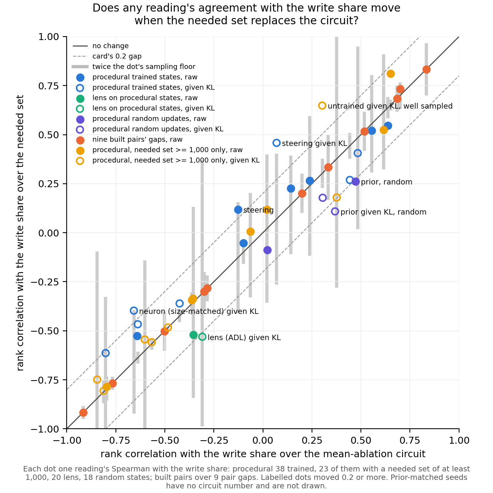

# Do claim 2's comparisons change when the write share is taken over the needed set instead of the circuit?

*P2.62 (E275), compare-lead, 2026-11-23. Descriptive: no pass bar, and no verdict on reuse under either wording of the
definition. Card `experiments/claim2_needed/card.md`; numbers `experiments/claim2_needed/results/summary.json` from
`compare.py`; figure `experiments/claim2_needed/figures/kstar_vs_k.png` from `plot.py`.*

We took every comparison behind the paper's second claim, that cheap readings track the definition's write share, and
recomputed it with the write share taken over the variables the fine-tune needs instead of over the circuit found by
mean ablation. On the nine built pairs and the twenty prior-matched seeds nothing in the picture changes, and on the
procedural tasks most readings move no more than a smaller sample of input pairs moves them. Steering after output
change is held fixed rises from 0.07 to 0.46 on all procedural states, and effective rank weakens, but both moves come
from the sixteen states whose needed set holds under 1,000 variables. On the well-sampled states neither moves, so these
are not an effect of the needed set we can stand behind, and claim 2 keeps its numbers.

## The answer

On the built pairs, every cheap reading agrees with the write share on the same number of pairs and with the same rank
correlation whichever set the share is taken over, and no pair's gap changes sign. On the prior-matched pair, the write
share over the needed set puts every copy seed above every cipher seed, as the cheap readings do. On the procedural
tasks, the larger moves in steering and effective rank vanish once states with small needed sets are left out. One
reading does move on the well-sampled states: the untrained decomposition's partial correlation rises well beyond its
floor.

## What we were trying to test

**The reading.** The write share $E_b$ looks at the variables of the VPD featurization whose write the fine-tune
changed. It splits each change into the part along the base model's own write at one positive gain and the rest, and
divides the summed first part by the summed change. It reads 1 when every changed variable keeps the base model's mechanism up to a
gain and about 0.01 for a random update of the same size. Claim 2 compared cheap readings against $E_b$ taken over the
mean-ablation circuit $K^*$. The frozen definition instead asks about the needed set $K$: the variables whose swap
between two inputs changes the fine-tune's top token, built from 256 sampled input pairs per state.

**What was recomputed.** Each comparison was rerun through the code that first computed it, with only the set under
$E_b$ changed. The first reading is the re-gating share, the part of the gain carried by changed causal-importance values.
The others are steering, the update's effective rank, the neuron share at top 64 and at matched size, the crosscoder,
the lens difference reading ADL, and output KL from the base model. Three tables:

- **Procedural states.** 38 trained fine-tunes of three procedural tasks and the repeat task, plus 18 random updates.
  Each reading's rank correlation with $E_b$, raw and partial given KL. One collapsed state with an empty needed set is
  left out, as before.
- **Built pairs.** Nine pairs of fine-tunes, each pairing a task built to reuse a skill with one built to need a new
  one, 76 states. Each reading's pair gaps against $E_b$'s gaps: on how many pairs they share a sign, and their rank
  correlation over the nine.
- **Prior-matched pair.** Ten seeds of key copy and ten of a cipher whose answers the base model finds about as likely.
  Whether $E_b$ splits copy from cipher, and each reading's rank correlation with $E_b$ over the twenty seeds.

**The sampling floor.** $K$ is a sample: it is still growing at 256 pairs on most states. The card filed a floor per
reading before any pod ran, and a move from $K^*$ to $K$ under twice that floor reads "within sampling". On the
procedural states the floor is how far the reading moves when $K$ is built from 128 of the 256 pairs. On the built
pairs and prior-matched seeds it is how far it moves between $K$ from two independent halves of the pairs.

## What we expected, and why

The card named two rivals and no pass bar. Under the first, $K$ and $K^*$ rank these states' write shares alike, so
every correlation moves by less than 0.2 and every pair gap keeps its sign. Under the second, $K$ and $K^*$ disagree here
as they did on the repeat-task RL states, where the needed set was far smaller than the circuit. That predicts some
reading moving by 0.2 or more, or some pair gap changing sign.

## What we observed

### On the built pairs, does any reading's agreement with the write share change?

**Reading it.** No. The orange-red dots all sit on the no-change line. Every reading shares the write share's sign on
exactly the same pairs, from one of nine for the crosscoder to eight of nine for the lens. Every rank correlation over
the nine pairs is the same to the last digit. The one exception is the lens after KL is regressed out, which
moves from 0.70 to 0.73. No pair gap changes sign. The same three pairs sit outside the random-update floor before KL is
removed and the same four after, and the floor itself moves from 0.0109 to 0.0110. Every one of the 76 states has a
needed set of at least 6,286 variables, so none is flagged as under-sampled. Between two independent halves of the pairs
the rank correlations move by at most 0.08, so these numbers are stable as well as unchanged.

### On the prior-matched pair, does the write share over the needed set split copy from cipher?

**Reading it.** Yes, on every seed. All ten copy seeds read a higher write share over the needed set than all ten
cipher seeds, the most extreme split twenty seeds allow, with an exact p of 1.1e-5. The cheap readings' rank
correlations with it over the twenty seeds run from 0.66 to 0.83; steering per key correlates at -0.81, as strongly but
with the opposite sign. Between independent halves of the pairs these correlations move by at most 0.28, so each is
well clear of zero. There is no number over the circuit to compare on all twenty seeds. On the three seeds that have
one, copy sits above cipher over both sets, and each seed's share moves by less than 0.001.

### On the procedural states, which correlations move, and is the move larger than sampling?

**Reading it.** Most move, but mostly by about as much as a smaller sample of pairs moves them. The blue dots scatter
around the no-change line inside their grey bars. The re-gating share's partial correlation given KL goes from 0.48 to
0.41, inside its doubled floor of 0.46. The neuron share's goes from -0.80 to -0.61, also inside. Steering moves most:
its partial correlation given KL rises from 0.07 to 0.46. That move of 0.39 is above the card's 0.2 gap and above twice
its own floor, 0.33, though under twice the table's largest floor, 0.47. Effective rank's partial correlation weakens
from -0.64 to -0.47: smaller than the gap, but well outside its own very narrow floor. The lens reading strengthens from
-0.31 to -0.53 given KL, inside its wide floor. The write share's own correlation with KL barely moves, 0.71 to 0.72.

The caveat is the floor itself. On these states it compares 128 pairs against 256 that include them, so it likely
understates the gap between two independent samples. The re-gating share's partial correlation at 128 pairs reads only
0.17, well below its 0.41 at 256, which says the needed set here is not yet saturated. Sixteen of the 39 states have a
needed set under 1,000 variables, which the next section checks.

### Do the procedural moves survive on the states whose needed set is well sampled?

The red-team check asked for the procedural table recomputed without the sixteen states whose needed set holds under
1,000 variables. That leaves 23 trained states, twelve of them read by steering and the share, and 14 when the repeat
task is also left out. The yellow dots in the figure are this table.

| partial correlation given KL | all states, circuit → needed set | needed set ≥ 1,000, circuit → needed set | floor, well-sampled |
|---|---|---|---|
| steering | 0.07 → 0.46 | -0.484 → -0.483 | 0.004 |
| effective rank | -0.64 → -0.47 | -0.81 → -0.81 | 0.03 |
| re-gating share | 0.48 → 0.41 | 0.38 → 0.18 | 0.33 |
| neuron share | -0.80 → -0.61 | -0.84 → -0.75 | 0.37 |
| untrained decomposition | 0.44 → 0.27 | 0.30 → 0.65 | 0.04 |
| without the repeat task: steering | 0.09 → 0.50 | -0.48 → -0.50 | 0.009 |
| without the repeat task: effective rank | -0.58 → -0.18 | -0.69 → -0.57 | 0.10 |

**Reading it.** The steering and effective-rank moves do not survive. On the well-sampled states steering's partial
correlation is the same over both sets, and effective rank's is the same to two digits. Without the repeat task,
effective rank moves by 0.13, within twice its floor. So both full-table moves came from the under-sampled states, and
they are not an effect of the needed set that we can stand behind. Steering's value on this subset is itself
different: about -0.48 over both sets, against 0.07 on all states. The re-gating share moves by 0.20, inside its wide
floor.

One reading does move on the well-sampled states. The untrained decomposition's partial correlation rises from 0.30 to
0.65 given KL, far beyond its floor of 0.04 and beyond the card's gap; its raw correlation rises from 0.65 to 0.81. It
is the one procedural number here that changes on well-sampled needed sets.

## Numbers in the results picture that change and that do not

| number in the picture | over the circuit | over the needed set | reads |
|---|---|---|---|
| built pairs: each reading's same-sign count and rank correlation with the write share's gaps | e.g. lens 8 of 9, 0.83; crosscoder 1 of 9, -0.92 | identical | unchanged |
| built pairs: lens after KL, rank correlation | 0.70 | 0.73 | unchanged within sampling |
| built pairs: pairs outside the random floor, raw / after KL | 3 / 4 | 3 / 4 | unchanged; no gap changes sign |
| prior-matched: write share splits copy from cipher | not computed on 20 seeds | all 20 seeds, U = 100 | new number, agrees with the cheap readings |
| procedural: re-gating share given KL | 0.48 | 0.41 | within sampling, also on well-sampled states |
| procedural: steering given KL | 0.07 | 0.46 | moves on all states only; unchanged on well-sampled states |
| procedural: steering raw | -0.13 | 0.12 | within its doubled floor |
| procedural: neuron share given KL | -0.80 | -0.61 | within sampling |
| procedural: neuron share at matched size given KL | -0.66 | -0.40 | just within its doubled floor |
| procedural: effective rank given KL | -0.64 | -0.47 | moves on all states only; unchanged on well-sampled states |
| procedural: untrained decomposition given KL, well-sampled states | 0.30 | 0.65 | **changes**: beyond the gap and its floor |
| procedural: lens given KL | -0.31 | -0.53 | within its wide floor |
| procedural: write share against KL | 0.71 | 0.72 | unchanged |
| procedural random updates: prior raw | 0.47 | 0.26 | changes, beyond a near-zero floor; not a claim 2 reading |

## What we learned

The built-pair and prior-matched halves of claim 2 do not depend on which set the write share is taken over. The cheap
readings agree with it on the same pairs, to the same rank correlations. The write share over the needed set splits the
prior-matched pair as cleanly as they do. On the procedural tasks, the apparent changes in steering and effective rank
come from needed sets too small to trust; on well-sampled states those readings do not move. So the paper can quote
claim 2's numbers over the needed set unchanged. The exception is the untrained decomposition's procedural correlation,
which strengthens.

## How compelling is the evidence

The built-pair and prior-matched readings are as solid as the earlier ones: large needed sets on every state, and a
floor between independent halves that is small beside the correlations. The procedural table is weaker. Its floor is a
nested one, 128 pairs against 256 that include them, because the earlier scan saved only each variable's first
flipping swap; an independent-halves floor there would likely be larger. Leaving out the small needed sets cuts the
re-gating share, steering, neuron and untrained readings to twelve states each, so those correlations rest on few
states. On one
built-pair state, the two independent halves gave needed sets of 20,239 and 9,330 variables. The write share over them
moved only from 0.0324 to 0.0322. So the set is not saturated at four derangements of the inputs, but the share over it
is stable.

## Surprises

None reversed. On all procedural states, steering's partial correlation given KL moves by 0.39, which meets the
second rival's wording; on the well-sampled states it does not move. The untrained decomposition's strengthening on the
well-sampled states was not anticipated by either rival's reasoning, though it meets the second rival's wording.

## What next

- An independent-halves floor on the procedural states, by rescanning with the membership saved per derangement. If
  the untrained decomposition's move sits outside it, its line in the paper changes.
- More pairs per procedural state where the needed set is under 1,000 variables, to bring the sixteen states back in.

## Redteam verdict

Holds with caveats. Redteam-lead found the built-pair and prior-matched results solid, and judged the procedural steering
and effective-rank moves provisional because they rest on a nested floor and on the sixteen states with needed sets
under 1,000 variables. The check it asked for, the procedural tables without those states, was run and is reported
above: the steering and effective-rank moves disappear there.

## Scorecard

No predictions were filed; the card's two rivals, read as written:

| rival | in words | read | holds? |
|---|---|---|---|
| a | every correlation and KL partial moves by less than 0.2; no pair gap changes sign; the write share over the needed set splits copy from cipher | pairs and prior-matched: yes; procedural, well sampled: all but the untrained decomposition given KL, which moves 0.35 | on built pairs and prior-matched; on procedural except one reading |
| b | some reading moves by 0.2 or more, or some pair gap changes sign | all procedural states: steering given KL 0.39; well sampled: untrained decomposition given KL | on the procedural table, by one reading once small needed sets are out |

## Departures from the literature

None new. The needed set and the write share follow the frozen definition and the earlier scan's settings unchanged.
The procedural floor departs from the plan check's independent halves, for the reason given above.

## Not run

- An independent-halves floor on the procedural states; their scan did not save per-derangement membership.
- The prior-matched rank correlations over the circuit on all twenty seeds; only three seeds have the circuit.
- More than 256 pairs on any state, though the needed set is still growing on most.

Provenance: $0 for this page, CPU only, from saved files. The scan of the 114 new items ran on pods earlier, $9.56 in
all including a lost first attempt.
