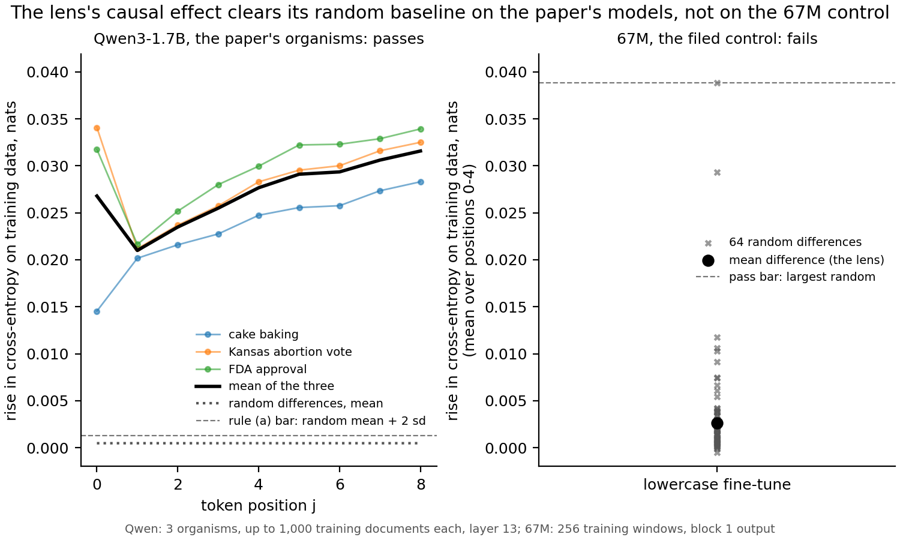

# Does the activation difference lens, run as published, give a reading on our fine-tunes?

*2026-11-23, compare-lead. Cell P2.67, experiment E284. Method spec `reports/plans/2026-11-23_plan_p2-67-adl-spec.md`
(the paper quoted step by step, and the departures of our earlier version), run plan
`reports/plans/2026-11-23_plan_p2-67-run.md`, filed rules `experiments/adl_published/results/predictions.json`. Results
`experiments/adl_published/results/control.json`, `parity.json`, `stage0.json`; figure
`experiments/adl_published/figures/controls.png` from `experiments/adl_published/plot.py`.*

We re-ran the activation difference lens of Minder et al. with the authors' own code, on the paper's fine-tunes and on
our small model's filed control. It works on the paper's fine-tunes, but on our control its direction does no better
than a random one, so by the filed rule it was not read on any of our fine-tunes. For `GOALS.md` it gives no reading on
our states, and even where it works it names what a fine-tune was trained on, not whether it reused existing mechanisms.

## The answer

The lens, run as published, works on the paper's own fine-tunes: its causal effect on their training text is dozens of
times its random baseline, on all three, at every position. On the 67M its filed positive control fails: about
a third of random directions raise the loss more than the lens's own direction does. So it was not run on our fine-tunes, and
that is the result. The score our earlier version reported is not in the paper, and the paper makes no call on whether
a fine-tune reused existing mechanisms. For the paper's methods table: **"ADL (as published) detects the training
domain, makes no reuse call."**

## Three plain answers from the paper

These come from the spec, which quotes version 3 of the paper and the toolkit at commit 617d9266.

- **Is our earlier score in the paper? No.** E264-267 scored each fine-tune by the largest share, over the first five
  positions, of a task's answer log-odds gain that the swap below removes. The paper reads the same swap as a rise in
  cross-entropy on the fine-tuning documents, in nats, per position. The toolkit also writes that rise as a share of the
  base-to-fine-tuned loss gap, but no figure in the paper uses it, and nothing in either reads a task's answer.
- **Is the paper's output a per-fine-tune score? Yes, but of a different thing.** The headline is an LLM grader's grade
  from 1 to 5 of whether an LLM agent, given the lens's outputs, named what the fine-tune was trained on. The other two
  scores are the share of the lens's top 20 tokens that a grader calls relevant to the training domain, and how close
  text from the steered model is to the training data. All three measure how readable the training domain is.
- **Does it say anything about reuse against new? No.** The paper reads the trace as overfitting to narrow data, a
  constant bias that the mean difference picks up, and makes no claim about whether the fine-tune used existing
  mechanisms. Any reading of the lens as a reuse score would be ours, not the paper's.

## What we were trying to test

The lens takes a base model and its fine-tune, runs both on the first few tokens of ten thousand ordinary web
documents, and averages the difference of their activations at the middle layer, separately for each token position.
Call that average $\bar\delta_j$ for position $j$. The paper's causal check then runs the fine-tuned model on its own
training documents, sets the component of its middle-layer activation along $\bar\delta_j$ to the base model's value at
every token, and reads how much the cross-entropy rises. A rise of 0 means the direction carries nothing the fine-tune
learned; a larger rise means it carries part of it.

That rise is compared with the same swap along 64 random directions, each the difference of the base model's
activations at two random tokens. If the lens's rise sits among the random ones, its direction is no more special than
any other.

Two positive controls were filed before any run, one per model.

- **Qwen3-1.7B, the paper's own fine-tunes.** Three fine-tunes on synthetic documents about one false fact each: cake
  baking, a Kansas abortion vote and an FDA approval. Each also has a version trained with pretraining text mixed in one
  to two, which the paper says roughly halves the effect. This control asks whether the pinned toolkit reproduces the
  paper's figure. It rules out that our setup, not the 67M, is what breaks.
- **The 67M, our model.** The fine-tune that continues Pile text in lowercase, whose change is close to the same shift
  on every input: the case where a mean difference should be easiest to find. It rules out that the lens fails on our
  model for a reason unrelated to the fine-tunes we want to read.

The do-nothing comes first on the 67M: the unchanged model, where every difference and every rise must be exactly 0.
A parity check also compared our re-implementation of the causal effect with the toolkit's on the cake-baking fine-tune,
since the 67M cannot run through the toolkit and must use our port.

## What we expected

On the Qwen fine-tunes we expected what the paper's text states. The rise on training documents is clearly above the
random directions'. On web text it is below 0, since removing the fine-tune's bias helps there. The mixed-in versions
show about half the effect. On the 67M we expected the lowercase control to pass, with medium confidence: a constant
shift is what the method is built to see.

## What we observed



### Does the toolkit reproduce the paper on the paper's fine-tunes?

**Reading it.** Yes. In the left panel every organism's curve sits far above the dotted random baseline at all nine
positions. Averaged over positions and organisms, the rise on training text is 0.027 nats. The random directions' mean
is 0.00047, and the filed bar at that mean plus two standard deviations is 0.0013. On web text the mean rise is below
0 at eight of nine positions, as the paper says; position 0 alone is slightly positive. The fine-tunes trained with
pretraining text mixed in show 0.53 of the effect, inside the filed band around one half. Each organism agrees with the
mean on its own: the mixed versions keep 0.58, 0.54 and 0.47 of the effect.

| organism | rise on training text, mean over positions 0-8 | positions below 0 on web text | mixed-in over plain |
|---|---|---|---|
| cake baking | 0.023 | 8 of 9 | 0.58 |
| Kansas abortion vote | 0.029 | 8 of 9 | 0.54 |
| FDA approval | 0.030 | 8 of 9 | 0.47 |
| mean of the three | 0.027 | 8 of 9 | 0.53 |
| random differences, mean | 0.00047 | | |

On web text the mixed-in versions read 0.0080, slightly above 0, as the paper's appendix says they should. This was
descriptive, not a filed rule.

### Does the lens's direction stand out on the 67M control?

**Reading it.** No. The right panel shows, on the 67M lowercase fine-tune's training text, the rise averaged over
positions 0-4, which is the filed rule's quantity. The lens's direction reads 0.0026. The 64 random differences reach
0.039 at most. Their mean is 0.0036, above the lens, and 22 of the 64 raise the loss more than the lens's own direction. The largest random value is one outlier, the next is 0.029, but the lens sits below the random mean, so the
miss does not hang on that outlier. By the filed stop rule, confirmed by whip-lead, none of the 176 planned 67M states
was read.

The do-nothing passed exactly: on the unchanged model every mean difference and every rise read 0.

A side number, ours and not the lens: the same swap read as the loss of each training row's answer token, our
adaptation, gives 0.039 against a random maximum of 0.022 on the lowercase control. That adaptation has no positive
control for reuse, a constant shift is not reuse, and it is not the method. It is reported so it is not lost, and is
not to be cited as the activation difference lens.

### Does our port agree with the toolkit?

**Reading it.** On the cross-entropies, yes; on the mean difference, there is an unexplained gap. Fed the toolkit's
own directions on the same token inputs, checked by checksum, the port's four cross-entropy readings all fell within
the gap between two toolkit runs at different batch sizes, at most 0.0013 nats. The port's own mean difference
disagrees with the toolkit's by 0.118 of the toolkit's largest entry. The two toolkit runs agreed on it exactly, so
there is no noise floor to judge it against, and no pass is claimed.

A candidate cause, unverified: the toolkit subtracts and averages the activations in bfloat16, the dtype its config
sets, while the port subtracts and sums in float64. The port also reads a Hugging Face forward hook where the toolkit
reads through nnterp. Neither has been tested. Until it is run down, no mean difference computed by our port is quoted
as the method's. The 67M reading above comes from our port, so this gap is a caveat on it too, though it cannot turn a
reading below the random mean into a pass on its own.

## What E264-267 reported, and why it is superseded

Our earlier version, built 2026-11-22, ported the lens's arithmetic but changed what it read. Its main departures, each
ours, from the spec's table:

- It scored the largest share of a task's answer log-odds gain removed by the swap, a score the paper does not have.
- It took the mean difference on mid-document Pile rows, not on document starts.
- Its random-update baseline divided by the paired fine-tune's gain, not each update's own.
- It had no grader, Patchscope, steering or agent, which are most of the paper's method.

Its first control, a copy fine-tune, failed. Its second, the same lowercase fine-tune, passed at the edge of its bar.
On that pass it reported that its gaps on the nine built pairs had the same sign as the definition's on eight. That agreement did not carry to prior-matched or procedural states. Since the score was ours, those
results describe our adaptation, not the activation difference lens. The as-published lens, run here, fails the same
control. E264-267 are superseded: they are not to be cited as the lens, as published, ordering our pairs.

## What we learned

The activation difference lens does what its paper says on fine-tunes like the paper's: a narrow, constant bias leaves
a direction that carries the fine-tune's effect on its training data. On the 67M, even the most constant fine-tune we
have leaves no such direction above random, so the method gives no reading on our states. For `GOALS.md` this closes the
lens as a baseline in either form: as published it measures how readable the training domain is, not reuse against
new, and on our model it does not pass its own control. The draft should say both, and should not rest "existing tools
cannot see reuse" on this method.

## How compelling is the evidence

The Qwen control is the paper's own setup through the authors' unchanged code at a pinned commit, three organisms with
each curve shown, so its pass is solid. It checks the causal effect only: the grader, agent and steering steps were
switched off, so their scores were not reproduced. The 67M failure is one control fine-tune read by our port, with 256
training windows rather than up to 1,000 documents, and with the port's mean difference not yet reconciled with the
toolkit's. A different 67M control, or the mismatch's cause, could move the number; neither was tried. The failure is
not marginal, though: the lens reads below the random mean.

## Surprises

The 67M control failing was a reversal of a filed expectation of medium confidence: a constant shift was expected to be
the easiest case. The cause is not known. The port's mean difference not matching the toolkit's was also unexpected.

## What next

- Run down the mean-difference mismatch. If it turns out to be a port bug, re-read the 67M control with the fix; a pass
  would reopen the 67M items under the same filed rules.
- Nothing else is proposed. The lens, as published, does not bear on reuse against new, so a 67M pass would add a
  domain reading, not a reuse reading.

## BibTeX

The existing `refs.bib` entry `minder2025narrow` has the right authors and arXiv number. Its booktitle, ICLR 2026, is
not shown by any source read here: the spec read arXiv version 3 of 4 Mar 2026. Writeup-lead should check the venue or
use:

```bibtex
@misc{minder2025narrow,
  author        = {Minder, Julian and Dumas, Cl{\'e}ment and Slocum, Stewart and Casademunt, Helena and Holmes, Cameron and West, Robert and Nanda, Neel},
  title         = {Narrow Finetuning Leaves Clearly Readable Traces in Activation Differences},
  year          = {2025},
  eprint        = {2510.13900},
  archivePrefix = {arXiv},
  primaryClass  = {cs.CL},
  note          = {arXiv:2510.13900, version 3, 4 Mar 2026}
}
```

Authors and title checked against the paper's title page in the spec's local copy and the toolkit's `CITATION.cff`.

## Scorecard

| id | claim in words | rule | read | verdict |
|---|---|---|---|---|
| Qwen (a) | the lens's rise on training text clears random | mean above random mean at 5 or more of 9 positions, and position mean above random mean + 2 sd | 9 of 9; 0.027 against 0.0013 | pass |
| Qwen (b) | the rise on web text is negative | mean below 0 at 5 or more of 9 positions | 8 of 9 | pass |
| Qwen (c) | mixing in pretraining text halves it | mixed over plain in 0.25 to 0.75 | 0.53 | pass |
| Qwen (d) | mixed-in rise on web text slightly positive | descriptive | 0.0080 | as the paper says |
| W0 | the do-nothing reads exactly 0 | every difference and rise exactly 0 | all 0 | pass |
| 67M control | lowercase fine-tune: the lens clears random | position mean over 0-4 above the largest of 64 random differences | 0.0026 against 0.039 | **fail: stop, no items** |
| parity, cross-entropy | port matches toolkit | within the two-run floor | all four kinds within | pass |
| parity, mean difference | port matches toolkit | within the two-run floor | 0.118 relative, floor exactly 0 | no bar; unexplained |

## Departures from the literature

- The 67M reading uses our port of the toolkit's causal effect, not the toolkit: the 67M is not a Hugging Face model
  nnterp wraps. The port matches on cross-entropy but not yet on the mean difference.
- The 67M text is Pile document starts, not FineWeb, and the random differences come from Pile rows, not chat data: the
  67M was trained on Pile and has no chat template.
- The 67M reads 256 training windows per state, not up to 1,000 documents, to fit the cluster's 30-minute jobs.
- The 67M pass rule compares with the largest of the 64 random directions, stricter than the paper's comparison with
  their mean; the lens also failed the mean.
- On both models only the causal effect was run. The grader, Patchscope, steering and agent steps need an LLM key, and
  steering and the agent need a chat model the 67M is not.
- The parity floor run changed the batch sizes, because two identical toolkit runs agree bit for bit.

## Not run

- Run down the mean-difference mismatch between the port and the toolkit.
- The 176 planned 67M states: built pairs, prior-matched pairs and procedural states. Stopped by the filed rule.
- Any other 67M positive control.
- The grader, token-relevance, Patchscope, steering and agent steps, on either model.
- A check of our Qwen curves against the paper's figure values; the rules used only the signs and ratios the text states.
- The random-direction and Gaussian-vector cross-entropies in the parity check: the toolkit does not save its random
  vectors.

## Provenance

- Qwen control: three H100 RunPod pods, one per organism, six toolkit runs, toolkit at 617d9266; tarballs in
  `experiments/adl_published/results/control_dl/`, not committed; checked by `control_check.py`. Commit 05445bce.
- Parity: on the cake-baking pod after its two runs, `experiments/adl_published/parity.py`. Commit 05445bce.
- 67M stage 0: cluster debug L40, `experiments/adl_published/run.py stage0`; log `results/run_stage0_0-1.log`; item files
  `results/items/`. Commit bf7430a3.
- Pod cost: not recorded in this clone's spend history.
