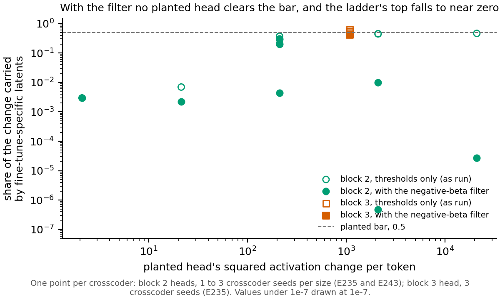

# Does the crosscoder reading change when latents with a negative base coefficient are excluded, as Minder et al. do?

*2026-11-23, compare-lead. Cell P2.70, CPU only, $0. Prompted by redteam-lead's fidelity audit of the crosscoder
baseline. Script `experiments/crosscoder/rescore_negbeta.py`, results `experiments/crosscoder/results/negbeta_rescore.json`,
figure `experiments/crosscoder/figures/negbeta_ladder.png`. The classifier fix is in `src/commute/crosscoder.py`,
function `specific`.*

We rescored every saved crosscoder reading with the authors' exclusion of latents whose base-model coefficient is
negative, a step our latent test lacked. Every planted control now misses its bar, while readings of trained fine-tunes
and random updates barely move. For `GOALS.md` the crosscoder stays unusable at fine-tune size, but the exclusion mostly
removes the planted change's own latents, so the rule needs a decision before the paper adopts these numbers.

## The answer

With the exclusion, no planted change passes the crosscoder's control anywhere. The block-3 head that passed now reads
0.42 to 0.44, and the real-text plant that passed reads 0. The ladder's top two sizes fall to at most 0.010. Readings of
fine-tunes and random updates move by at most 0.022. The surprise is which latents go: mostly ones whose base coefficient
is a hair below zero, the mark of a truly fine-tune-only latent.

## What we were trying to test

**The crosscoder.** A crosscoder is one dictionary of sparse latents that rebuilds two models' activations at once, here
the original 67M model and a changed one at one block's input. Minder et al. 2025, arXiv 2504.02922 v4, call a latent
fine-tune-specific when it is among the top latents by relative decoder norm and passes *latent scaling*. Latent scaling
fits, for each latent $j$, a coefficient $\beta_j$ that best rescales its fine-tune decoder direction to explain a
target. The targets are the base model's and the fine-tune's reconstruction error, with the latent's own part added
back, and their reconstructions. The ratios are $\nu^\varepsilon = \beta^{\varepsilon}_{base} / \beta^{\varepsilon}_{ft}$
and $\nu^r = \beta^{r}_{base} / \beta^{r}_{ft}$. A latent passes when $\nu^r < 0.5$ and $\nu^\varepsilon < 0.2$: the
base model has little use for it.

**The missing step.** Their appendix E.2, page 26, adds: "For all of our analyses, we filter out latents with negative
β base values", and counts none in BatchTopK crosscoders. Our port applied the two thresholds only, so a negative ratio
passed. Our check against the authors' released Gemma crosscoder applied the filter to both sides, in
`experiments/crosscoder_replicate/run.py`. So that check never tested this step of our 67M code. The fix puts the same rule, both base coefficients at least 0, inside `specific`; a latent that never fired
has no coefficient and fails as before.

**What was rescored.** All 96 saved crosscoder readings of the five experiments that trained one. They cover the nine
built pairs, the real-text controls, the planted heads at blocks 2 and 3, the block-2 size ladder, and the five key
tasks, each with its controls and random updates. Each record holds the relative norms, the alive
mask, each latent's carried share of the activation change, and the fitted coefficients of the 5,000 top latents. The
groups were rebuilt from the saved groups, so the old reading reproduces each run's reported parts to within 3e-8 and
its counts exactly. Only the "wide" second candidate count is rebuilt from float16 norms; it is not quoted anywhere.

**The reading.** The specific part is the share of the activation change carried by fine-tune-specific latents. Zero
means none of the change is in such latents. A planted change the method should see is meant to reach the bar of 0.5.
The pair reading $d$ is the shared part minus the specific part.

## What we expected

Redteam-lead's recompute predicted nine numbers for the planted heads, and the audit's second reviewer gave the same.
The filter can only shrink the specific set, so every specific part can only fall, and $d$ can only rise.

## What we observed

### Does any planted control still pass?

**Reading it.** No. Open marks are the readings as run, filled marks the same crosscoders with the exclusion. At block 3
all three seeds fall under the bar, to 0.42 to 0.44. At block 2 the ladder's top two sizes fall
to near zero, and the middle size's third seed falls from 0.37 to 0.004. The ladder no longer flattens just under the
bar; it rises to about 0.30 at the middle size, then collapses.

On real text the planted direction passed with one latent carrying 0.77 of the change. That latent's base
reconstruction coefficient is minus 0.0035 of its fine-tune coefficient, so the exclusion drops it and the plant reads 0.

### Do the readings of fine-tunes and random updates move?

Barely. On the nine built pairs only one side has a dropped latent that carries over a ten-thousandth of the change: copy at 96 keys, whose $d$
moves from 0.056 to 0.078. All four tallies of pairs whose side built to reuse reads higher stay as they were, five,
four, six and six of nine. On the five key tasks the copy spread falls from 0.43 to 0.41, and 13 of the 15 fine-tunes
still read below their task's random updates. At block 3 the Gaussian and both pair sides stay under one hundredth of
the change.

### Which latents does the exclusion drop?

Mostly the planted change itself. At the ladder's top size the dropped latents carried 0.462 of the change. Of that,
0.456 sits in latents whose two base-to-fine-tune ratios are both above minus 0.02. The two largest carry over a quarter
and a sixth of the change, with fine-tune coefficients near 1. Those are what latent scaling calls perfectly
fine-tune-only; the sign of a coefficient that is zero up to noise decides their fate. The same holds for the middle
size's third seed and the real-text plant. At block 3 it is different: there the dropped share is 0.10 to 0.20, and
under a third of it is near zero, so most dropped latents there have clearly negative base coefficients.

The appendix describes the latents it dropped as having "low maximum activations" and a "small improvement in MSE", and
reports none in BatchTopK crosscoders. Ours carry up to 0.77 of the change. The authors' own released Gemma table also
holds negative base coefficients in the top 3,176 latents, though the paper says none: our replication found 2,832 kept
of 3,176.

### Every crosscoder number the paper and log quote, old and new

Paper lines are in writeup-lead's clone, `paper/paper/`, at commit c347a94. Not edited.

| where | what it says | old | new | still true? |
|---|---|---|---|---|
| main.tex 963; appD 88 | block-2 head, specific part, three seeds | 0.21 to 0.37; at most 0.37 | 0.004 to 0.30; at most 0.30 | under the bar either way |
| main.tex 966; appD 89 | ladder near fine-tune size | 0.0030 | 0.0030 | yes |
| main.tex 966-967; appD 89-90 | ladder's top two sizes "levelled off" | 0.45 and 0.46 | 0.010 and 5e-7; 3e-5 | no: they fall to near zero |
| main.tex 968; appD 91 | block-3 control "passed", head at 11.30 nats | 0.56, 0.63, 0.52 | 0.44, 0.43, 0.42 | no: it fails |
| appD 92-93 | block 3: random change reads like both sides, all under one hundredth | random 0.0035 to 0.0070 | random 7e-6 to 0.0008 | under one hundredth yes; no passing control |
| sec5_results 163 | real text: "where its planted control passed" | 0.77 | 0 | no: it fails |
| sec5_results 163-165 | real-text Gaussian, stop bar, trained built-pair sides | 0.73; 0.45; 0.39 to 0.46 | unchanged | yes |
| sec5_results 162; sec5_3 85; appF 130 | key tasks below random | 13 of 15 | 13 of 15 | yes |
| appF 128-129 | key-task seed spread; copy seed 0 | 0.43; 0.06 | 0.41; 0.08 | number changes |
| appF 162 | crosscoder signs on the nine pairs | four | four | yes |
| main.tex 958 | earlier planted direction: its latent's error ratio against 0.2 | 0.244 | 0.244, still fails | yes |
| sec5_results 161; sec5_3 84; sec7 34; main.tex 681 | misses its control up to about a hundred times a fine-tune | | | yes, further from the bar |
| main.tex 975; sec5_results 182 | figure `crosscoder_size_ladder` | as run | redraw needed | no |
| main.tex 947-948; appG 52-55 | the latent test named as the paper's two thresholds | | | add the exclusion or list it as a departure |
| log card E235 | block-2 head; block-3 head | 0.30, 0.21, 0.37; 0.56, 0.63, 0.52 passed | 0.30, 0.20, 0.004; 0.44, 0.43, 0.42 failed | no |
| log card E235 | block 3: random, elicit, cipher | 0.0035 to 0.0070; 0.0056 to 0.0092; 0.0014 to 0.0106 | 7e-6 to 0.0008; 0.0032 to 0.0059; 0.0004 to 0.0089 | ranges change |
| log card E235 | k 32 and k 200 at block 2 | 0.39; 0.19 | -0.0003; 0.003 | number changes |
| log card E235 | specific latent counts at block 3 | 7 to 50 | 1 to 37 | number changes |
| log card E244 | spread, copy seeds | 0.43; 0.056, 0.488, 0.489 | 0.41; 0.078, 0.488, 0.489 | number changes |
| report E203 | sides built to reuse higher: as built, size-matched, both counting artefacts | 5, 4, 6, 6 of 9 | 5, 4, 6, 6 of 9 | yes |

E243 rung 4 has two crosscoder seeds, so its new values are 0.010 and 5e-7. The real-text Gaussian has no dropped
latent, and on the other built-pair sides no dropped latent carries over a ten-thousandth of the change.

## What we learned

The crosscoder's row in the paper does not change in kind: at fine-tune size it reads nothing, under either rule. What
changes is the one place it looked alive. The block-3 pass and the real-text pass both disappear, so there is no site and
no text where this crosscoder has passed a planted control. Whether that is the authors' method or an artefact of
applying their filter to latents with a coefficient of zero up to noise is a reading choice, set out below.

## How compelling is the evidence

The arithmetic is exact: the old readings reproduce every reported part to within 3e-8 and every count exactly, and
redteam-lead's nine planted-head numbers reproduce to all printed digits. The open question is the rule, not the
numbers. The coefficients were fitted on 100,000 tokens, against the paper's 50M, so a coefficient near zero has a
noisier sign here than in the paper; no noise floor for the base coefficient was measured. One crosscoder per side on
the built pairs and key tasks, one to three per planted size.

## Surprises

The exclusion is not removing artefacts here; it removes the planted change. Redteam-lead read the collapse of the
ladder's top as "an artefact of the missing filter". The latents behind that collapse have base coefficients within
2% of zero, below it, and fine-tune coefficients near 1. Under the literal rule they are excluded; under the rule's
stated purpose, dropping latents with low activations that are interaction artefacts, they would be kept. The paper
saw no such latents in BatchTopK crosscoders, so it never had to choose.

## What next

- A decision for the lead, then the user if it touches how the paper names the method: keep the literal rule, now in
  the code, or exclude only base coefficients clearly below zero, with a floor measured from the coefficient's spread
  across crosscoder seeds. The first makes every planted control fail; the second would likely restore the ladder's
  top and the real-text pass but not the block-3 pass, where most dropped latents are clearly negative.
- Either way, redraw `crosscoder_size_ladder` and correct the block-3 and real-text sentences listed above.
- A $0 check that would settle it: the spread of the base coefficient for the plant's own latent across the existing
  crosscoder seeds at block 2.

## Departures from the literature

- The exclusion now follows App. E.2 as written, base coefficients at least 0 on both targets. The paper states no
  tolerance; none is used.
- Latent scaling is fitted on 100,000 tokens rather than 50M, unchanged from the runs; this is why a near-zero sign is
  noisy here.

## Not run

- No crosscoder was retrained and no coefficient refitted; everything reads saved records.
- The wide candidate count's groups are rebuilt from float16 norms, up to 0.008 off the reported parts; nothing quotes it.
- No noise floor for the base coefficient's sign.
- The paper, its figure and the research log are not edited; the log line is the lead's.
- E203's rehearsal and the E212 rehearsal crosscoders were not rescored.
