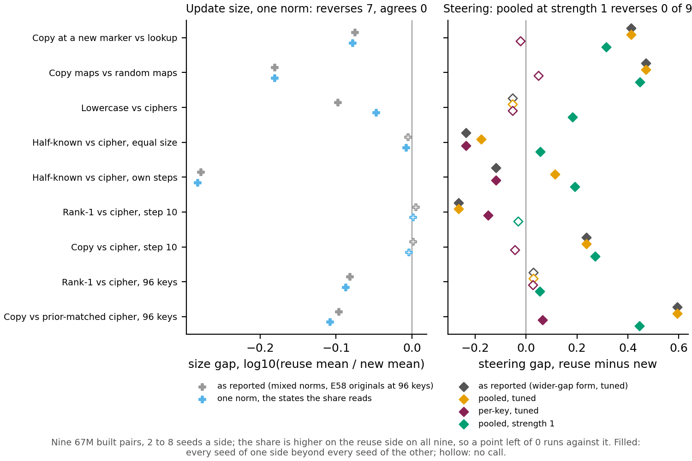

# Update size under one norm, and steering read per form (P2.70, size and steering part)

**Plain words.** From saved values only, we read update size with one norm on the fine-tunes every other reading uses,
and read steering in each of its two forms separately. Update size still never sides with how the nine built pairs
were made, and now reverses seven of them, not six; steering's reversals come from per-pair choices, and its plain form
reverses none. So size is ruled out as a stand-in for the re-gating share, and steering is a weaker foil than reported.

## The answer

Read with one norm on the fine-tunes the share reads, update size calls seven of the nine built pairs, every time with
the side built new larger; it never agrees with how the pairs were built. The one new call is the equal-size pair, where
the sides differ by about two percent. Steering's "four agree, three reverse" depends on keeping the wider-gap form per
pair: pooled alone reverses two, per-key alone three, and pooled at strength 1 none. The prior-and-steering figure plots
tuned steering, not strength 1, so its caption is relabelled.

## What we were trying to test

redteam-lead's audit of 2026-11-23 (`reports/reviews/2026-11-23_review_baseline-fidelity.md`, rows 16, 17, 18 and 21)
found three faults in how two baselines were read on the 67M model's built pairs. A built pair is two sets of
fine-tunes: one side built to reuse a mechanism the original model has, one side built to be new. Each reading is
compared across the pair: a gap is the reuse side minus the new side, and two sides are "apart" when every seed of one
lies beyond every seed of the other. The re-gating share is higher on the reuse side on all nine pairs, so a baseline
"agrees" when it is apart with the same sign and "reverses" when it is apart with the other sign.

- **Update size.** The scorecard mixed three norms across pairs: the sum of per-matrix norms, the root of summed
  squares, and on lowercase against ciphers the summed squares unrooted. On the two 96-key pairs it read the original
  fine-tunes, while every other reading on those pairs reads the refitted ones. The fix reads one norm on every state:
  the root of the summed squared changes over the 24 decomposed matrices, divided by the same for the original
  weights. E187 had already computed this for every state the share reads, refits included
  (`experiments/size_matched/results/m67.json`). The script names each value by its state, checks the name against
  the per-state sizes E187 kept, and checks that those states are the ones whose share the scorecard reads. Size's gap
  is the base-10 log of the reuse mean over the new mean.
- **Steering.** Steering adds the fine-tune's mean change in one block's input to the original model at the answer
  position and reads the share of the fine-tune's gain it recovers. It comes in two forms: pooled, one vector for all
  inputs, and per-key, one vector per key token. The block and the strength are searched per fine-tune. The scorecard
  then kept, per pair, whichever form gave the wider gap. Here each form is reported on its own, at the searched
  strength and at strength 1, which E149 re-read for the nine built pairs (`experiments/prior_steering/results/stage1.json`).
- **The figure.** Figure `fig:share_prior_steering` is captioned "steering at strength 1". The script checks which
  setting the plotted points use.

What each reading should show if nothing were wrong: the one-norm sizes should equal the paper's per-side table
values; the reported steering cell should equal the wider of the two forms; the rank correlation of the plotted values
should reproduce the paper's figure.

## Update size: does one norm change any call?

**Reading it.** One call changes, and the conclusion holds. Under one norm the nine pairs read 0 agree, 7 reverse,
2 no call, where the scorecard reads 0, 6, 3. The changed pair is half-known against cipher at equal size: its new side
is larger on every seed, but only by about 1.9% on average. The seed ranges clear each other by 0.047% of the size, so
the call comes from tight seeds under a rule with no noise band, not from a real size difference. Lowercase against
ciphers halves its gap once the squares are rooted, with the call unchanged. The two 96-key pairs read the refits now,
and keep their calls.

| pair | old gap | old call | one-norm gap | one-norm call | new over reuse size |
|---|---|---|---|---|---|
| Copy at a new marker vs lookup | −0.075 | reverse | −0.079 | reverse | 1.198 |
| Copy maps vs random maps | −0.181 | reverse | −0.181 | reverse | 1.517 |
| Lowercase vs ciphers | −0.098 | reverse | −0.048 | reverse | 1.116 |
| Half-known vs cipher, equal size | −0.0056 | no call | −0.0082 | reverse | 1.019 |
| Half-known vs cipher, own steps | −0.278 | reverse | −0.283 | reverse | 1.917 |
| Rank-1 vs cipher, step 10 | +0.0048 | no call | +0.0011 | no call | 0.997 |
| Copy vs cipher, step 10 | +0.0008 | no call | −0.0043 | no call | 1.010 |
| Rank-1 vs cipher, 96 keys | −0.082 | reverse | −0.088 | reverse | 1.223 |
| Copy vs prior-matched cipher, 96 keys | −0.096 | reverse | −0.108 | reverse | 1.282 |

Gaps are the base-10 log of reuse mean over new mean; the old ones are `experiments/method_table/results/final.json`.
The one-norm per-side means equal the paper's per-pair size table to its four decimals on all eighteen sides.

## Steering: what does each form say on its own?

**Reading it.** The reported tally rests on the form choice. Pooled alone reads 5 agree, 2 reverse, 2 no call;
per-key alone reads 1, 3, 5; the reported mix reads 4, 3, 2. The choice set the sign on one built pair: on half-known
against cipher at own steps, pooled is apart the share's way by 0.114 and per-key apart the other way by 0.120. At
strength 1 pooled steering agrees on eight pairs and reverses none. Its one no call is rank-1 against cipher at step 10.
On the two label twins the "twin higher" reading is per-key only: pooled reads the real case-label task higher by 0.101,
apart, and makes no call on the repeat label.

| pair | reported | pooled, tuned | per-key, tuned | pooled, strength 1 | kept form, strength 1 |
|---|---|---|---|---|---|
| Copy at a new marker vs lookup | +0.412 | +0.412 | −0.023 nc | +0.314 | +0.314 |
| Copy maps vs random maps | +0.470 | +0.470 | +0.048 nc | +0.447 | +0.447 |
| Lowercase vs ciphers | −0.053 nc | −0.053 nc | no per-key | +0.181 | +0.181 |
| Half-known vs cipher, equal size | **−0.237** | **−0.177** | **−0.237** | +0.055 | +0.038 |
| Half-known vs cipher, own steps | **−0.120** | +0.114 | **−0.120** | +0.191 | **−0.051** |
| Rank-1 vs cipher, step 10 | **−0.265** | **−0.265** | **−0.149** | −0.032 nc | −0.032 nc |
| Copy vs cipher, step 10 | +0.238 | +0.238 | −0.044 nc | +0.272 | +0.272 |
| Rank-1 vs cipher, 96 keys | +0.028 nc | +0.028 nc | +0.026 nc | +0.053 | +0.053 |
| Copy vs prior-matched cipher, 96 keys | +0.594 | +0.594 | +0.065 | +0.445 | +0.445 |
| **tally: agree / reverse / no call** | 4 / 3 / 2 | 5 / 2 / 2 | 1 / 3 / 5 | 8 / 0 / 1 | 7 / 1 / 1 |

Gaps are reuse minus new, in share of the gain; bold is a reversal and "nc" no call; every other entry is apart. The
per-key column takes pooled where there is no per-key vector, on lowercase against ciphers, as the audit did.
Every call here uses the scorecard's rule, that the seed ranges do not overlap. That rule bolds half-known against
cipher at own steps at −0.051 in the kept form at strength 1. Under E149's own rule, which needs a gap 0.10 beyond the
spread within each side, that entry is neutral, as the audit's row 17 says.

| twin, real minus twin | reported form | pooled, tuned | per-key, tuned |
|---|---|---|---|
| Half-known vs its shuffle, 96 keys | pooled | +0.043 | +0.030 nc |
| Class map vs its shuffled twin | pooled | −0.074 | +0.001 nc |
| Case label | per-key | +0.101 | −0.506 |
| Repeat label | per-key | −0.007 nc | −1.087 |

**The copy-against-lookup pairing.** On copy against lookup, the scorecard sets E135's steering beside E136's
re-gating, which is read on all 200 windows; E135 fits on half of them and scores on the other half. The re-gating gap on
E135's scored half is saved: 0.686, apart, against 0.691 on all windows. The call and the comparison do not change.

## The figure captioned "strength 1"

**Reading it.** The caption is wrong and is relabelled rather than redrawn. Its built and twin points are the reported
cells, at the searched block and strength in the kept form; only the star, E199's pair built so prior and steering
disagree, is at strength 1. Strength-1 values are saved for the nine built pairs only, not for the four twins or the
nine size-matched points, so the figure cannot be redrawn at strength 1 as it stands. The rank correlation quoted
beside it reproduces as plotted, −0.30. On the same nine pairs at strength 1 it reads −0.10 in the kept form and −0.38
pooled.

Replacement caption text for `appD_built_pairs_more.tex` line 117: "in steering at the block, strength and form
chosen per pair (right; the star is at strength 1)". The same words belong in the axis label at
`figures/src/make_figures.py` line 102 of the paper repo, in `experiments/method_table/paper_figs.py` line 142, and in
`reports/analyses/2026-11-17_analysis_part2-figures.md` lines 57 and 70.

## Every number the paper quotes, old and new

Paper repo `~/commute-agents/writeup-lead/paper/paper/` at commit 537bf6b; line numbers are at that commit.

| paper source | as written | rescored | change |
|---|---|---|---|
| appD_built_pairs_more.tex:41, size row | 0 / 6 / 3 | 0 / 7 / 2; the new reversal, half-known vs cipher at equal size, is a 1.9% size difference under a rule with no noise band | one pair moves from no call to reverse; the paper text should carry this note wherever it quotes 0 / 7 / 2 |
| appD_built_pairs_more.tex:41, size-matched column | equal by construction | within 2% by construction; new side larger on every seed of the equal-size pair | wording |
| appD_built_pairs_more.tex:41, twin column | twin larger on both label twins | not rescored: no one-norm size is saved for the twins | open |
| appD_built_pairs_more.tex:88; sec5_3_mechanism_vs_prior.tex:86; sec5_results.tex:186 | size never agrees; calls only where the new side is larger | holds: 7 calls, all with the new side larger | none |
| main.tex:1031-1034, open note on three norms | open | one norm read on every built-pair state | close the note for the nine built pairs |
| main.tex:967 | "the norm of δW" | the norm of δW over that of W0, as main.tex:1068 and appE_methods_detail.tex:21 | wording |
| main.tex:1198, 96-key refits give the same size calls | stated | holds: refits −0.088 and −0.108, originals −0.082 and −0.096, all reverse | none |
| main.tex:1121, size ratio, copy maps vs random maps | 1.53 | 1.52 | rounding |
| main.tex:1126, copy vs cipher at step 10 | 1.00 | 1.01 | rounding |
| main.tex:1127, rank-1 vs cipher at 96 keys | 1.23 | 1.22 | rounding |
| main.tex:1128, copy vs prior-matched cipher at 96 keys | 1.29 | 1.28 | rounding |
| main.tex:1120, 1122-1125, other five ratios | 1.20, 1.12, 1.02, 1.92, 1.00 | the same | none |
| main.tex per-pair size table, 18 sides | 0.0049 to 0.0202 | the same | none |
| appD_built_pairs_more.tex:39, steering row | 4 / 3 / 2 | pooled 5 / 2 / 2; per-key 1 / 3 / 5; pooled at strength 1 8 / 0 / 1 | give per form |
| appD_built_pairs_more.tex:39, twin column | twin higher on both label twins | per-key only; pooled reads case label real higher, no call on repeat label | give per form |
| sec5_results.tex:185; sec5_3_mechanism_vs_prior.tex:88; appD_built_pairs_more.tex:87 | steering reverses three to five | steering reverses 3 as reported, 2 pooled, 3 per-key, 0 pooled at strength 1 | give per form |
| main.tex:1065 | the selection "can only favour that reading" | it set the sign against the share on one built pair and both label twins | rewrite |
| appD_built_pairs_more.tex:106-107 | prior and steering together call all nine | holds with pooled at strength 1: 8 agree, and the prior carries rank-1 vs cipher at step 10; in E149's kept form per-key reverses at own steps by 0.051 under the seed-range rule | state the form |
| appD_built_pairs_more.tex:109 | rank correlation −0.30 with steering | −0.30 as plotted, tuned; −0.10 at strength 1, kept form; −0.38 pooled at strength 1 | say which |
| appD_built_pairs_more.tex:117, caption | steering at strength 1 | the block, strength and form chosen per pair; the star at strength 1 | relabel |
| scorecard cell, copy vs lookup re-gating | 0.691, all windows | 0.686 on E135's scored windows, apart | disclose or swap |

The research log parts (`docs/research_log/parts/`) quote none of these tallies; card E133 says "Update size never
agrees", which holds.

## Did the audit's numbers reproduce?

Yes, every one, from the same files; the files are byte-identical in the two clones.
- Size, nine built pairs under one norm: 0 / 7 / 2, against the scorecard's 0 / 6 / 3. Reproduced.
- The equal-size pair's margin, 0.047% of the size, and its 1.9% mean difference. Reproduced.
- Steering as reported 4 / 3 / 2, pooled 5 / 2 / 2, per-key 1 / 3 / 5, pooled at strength 1 reversing 0 of 9. Reproduced.
- Every steering gap in the audit's per-form table. Reproduced to three decimals.
- The figure's rank correlation, −0.30 tuned against −0.10 at strength 1. Reproduced; −0.10 is the kept form.
- The copy-against-lookup re-gating gap, 0.686 against 0.691. Reproduced.

## What we learned

Update size is not a cheap stand-in for the re-gating share on the built pairs: under one norm it calls seven pairs and
gets all seven backwards. Steering's reversals are not a property of steering: they come from searching the strength
and choosing the form per pair, and plain pooled steering at strength 1 agrees with the share wherever it calls. So
steering is a weaker foil for the share than the scorecard showed, and the paper should report it per form.

## How compelling is the evidence

All values are saved readings; nothing was rerun. The seed-range rule has no noise band, so the equal-size pair's new
call rests on a 1.9% size difference and is not substantive. Strength-1 steering exists for the nine built pairs only.
The scorecard tallies count calls, not effect sizes.

## Surprises

None against the audit. One detail it did not state: in E149's kept form at strength 1, per-key steering reverses
half-known against cipher at own steps under the scorecard's rule. So "prior and steering call all nine" holds only for
the pooled form, or under E149's own rule with its noise band.

## Departures from the literature

None added here. Steering's departures from activation addition, mean-difference vectors and Venhoff et al. are the
audit's row 15 and are handled in the paper's relabel.

## Not run

- One-norm sizes for the four twins: not saved; the scorecard's twin size column keeps its summed per-matrix norms.
- Steering per form after size matching, "the same 7 apart": E187 saved both forms for the larger side only; not tallied.
- Strength-1 steering on the twins and on the size-matched states: not saved, so the figure is relabelled, not redrawn.
- The crosscoder part of P2.70: another agent's.
- No paper text was edited; replacement wording is above for writeup-lead.

## Provenance

Script `experiments/p270_rescore/rescore.py` (CPU, `cpu-run`, under a minute); results
`experiments/p270_rescore/results/rescore.json`; figure `experiments/p270_rescore/figures/size_steering_per_form.png`.
Inputs: `experiments/size_matched/results/m67.json`, `experiments/method_table/results/final.json`,
`experiments/share_untrained/results/{inventory,stage1}.json`, `experiments/refit_96key/results/{inventory,stage1}.json`,
`experiments/holes_fill/results/stage1.json`, `experiments/steering_copy_lookup/results/stage1.json`,
`experiments/real_vs_twin/results/stage3.json`, `experiments/prior_steering/results/stage1.json`. Cost $0.
