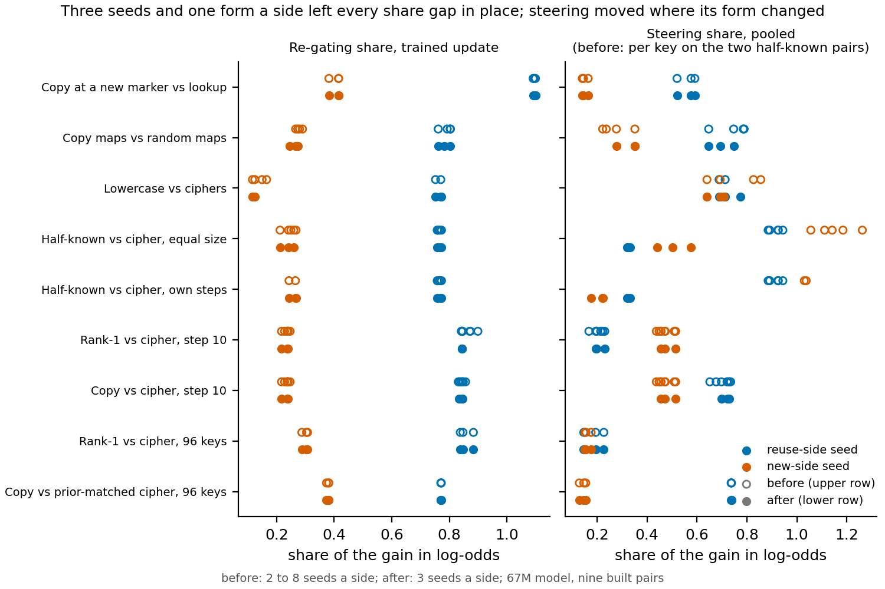

# Does the known-answer comparison change with three seeds and one form a side?

A descriptive consistency rerun at no cost on the MATS cluster's debug queue.

We trained five missing fine-tunes so that all nine built pairs have three seeds and one task variant a side, and redrew
the comparison with steering in one form. The re-gating share still separates the reuse task from the new task on all
nine pairs, and none of its gaps moved by more than a few hundredths. Steering points against the share on two pairs in
pooled form and three in per-key form, so the paper's old count of three came from mixing the two forms.

## What we were trying to test

The paper's known-answer figure and its appendix scorecard compare two tasks in each of nine built pairs. One task is
built to reuse what the original model already computes, the other to need something new. For each pair the figure
plots a gap: the mean reading over the reuse task's seeds minus the mean over the new task's seeds.

Three readings enter the figure.

- The re-gating share, as defined in `GOALS.md`: the fraction of the fine-tune's gain in the target's log-odds that
  appears when the original subcomponents are kept and only the frozen Γ switches them differently on the fine-tuned
  model's activations. A zero update reads 0; 1 means the whole gain.
- The steering share: the fraction of the same gain that adding a steering vector to the original model recovers.
  Pooled steering fits one vector for all rows; per-key steering fits one vector per key token, so it is a larger
  family and reads higher.
- The prior: the base-10 logarithm of the original model's probability of the trained answer, one value per task, so
  its gap is in decades.

Before this run the figure was not drawn on equal terms. Some pairs had two seeds on one side, some had four to eight.
Two pairs pooled two task variants on a side: copy maps against random maps had a second copy map and a second random
map, and lowercase against ciphers had a broad cipher alongside the plain one. Steering was per key on the two
half-known pairs and pooled on the other seven. This run fixes all three. It trains the third seed of five tasks: the copy
map and random map, lowercase and the plain cipher, and the half-known pair's cipher trained for its own step count. It
drops the second variants and reads steering pooled on all nine pairs. Separately, compare-lead re-emitted the method
table with one unit per column, steering split into its pooled and per-key columns.

The run reads nothing new. Every reading uses the code that produced the saved states' values, and its first stage
checks that.

## What we expected, and why

The card filed two descriptions, not predictions at a bar. If seed count and variant pooling were cosmetic, every
task's new three-seed mean would sit inside the seed range the figure showed before, on every reading. If the extra
seeds or the second variants had shifted something, at least one task's mean would leave its old range, most likely on
the two pairs that lose a variant. The steering count was expected to change only where its form changed.

## What we observed

`experiments/known_3seeds/figures/before_after.png`: each row is one built pair. Hollow dots are the seeds the paper's
figure plotted before, filled dots the three seeds a side now. Blue is the reuse task, orange the new task.

### Did the share's separation survive equal seeds and one variant a side?

**Reading it.** Yes, on all nine pairs. In the left panel every blue cluster still sits wholly to the right of its orange
cluster, so the share's gap is positive and the seed ranges are apart on every pair. The gaps now run from 0.39 to 0.69.
The largest move is 0.02, on lowercase against ciphers, where dropping the broad cipher removed the two highest new-side
values. The pairs that already had three seeds of one variant did not move at all, since their values are the same
saved readings.

### How many pairs does steering reverse once it is read in one form?

**Reading it.** Two in pooled form, three in per-key form; the figure before showed three by mixing the two. A reversal
means every steering seed of one side lies beyond every seed of the other, in the direction opposite to the share. In
pooled form that holds for half-known against cipher at equal size, where the gap is −0.18, and for rank-1 against
cipher at step 10, where it is −0.27. The third reversal the paper drew was half-known against cipher at its own step
count. There the figure plotted per-key steering at −0.12; pooled steering on the same pair reads +0.12 with the
seed ranges apart, the same direction as the share. In per-key form, read at the method table's own seeds, the three
reversals are the two above plus this pair. Lowercase against ciphers has no per-key reading.

Three other steering gaps moved. Copy maps against random maps fell from 0.47 to 0.37 once the second variant was
dropped, and stays on the share's side. Lowercase against ciphers went from −0.05 to 0.05: its sign changed, but the
seed ranges overlap both before and after, so neither is a call. Half-known against cipher at equal size moved from
−0.24 to −0.18 because its form changed from per key to pooled; it reverses in both.

### Did dropping the second variants move the prior?

**Reading it.** Yes, on the two pairs that lost a variant, and in the same direction. The prior gap for copy maps
against random maps fell from 1.48 to 1.33 decades. For lowercase against ciphers it fell from 1.63 to 1.42. Both stay
positive: the reuse task's answer is still more probable under the original model. The other seven prior gaps did not
change.

### Did any new seed land outside its siblings?

**Reading it.** Two of the five new states did, each by a small amount, and neither changes a pair's sign or call. The
random map's third seed reads a share of 0.246, just below its two siblings at 0.273 and 0.266. Lowercase's third seed
reads a pooled steering share of 0.775, above its siblings at 0.713 and 0.689. The other three states sit inside their
siblings' range on all eight readings.

On the card's terms, the second description holds in its letter. Four task means left the seed range the figure showed
before, on readings whose form did not change:

| task, reading | three-seed mean now | old seed range | old seeds |
|---|---|---|---|
| random maps, share | 0.262 | 0.266 to 0.290 | 4 |
| lowercase, pooled steering | 0.726 | 0.689 to 0.713 | 2 |
| half-known pair's cipher at its own steps, effective rank | 404.6 | 404.9 to 407.0 | 2 |
| plain cipher, effective rank | 594.269 | 573.382 to 594.266 | 4 |

Each sits within a few hundredths, or a fraction of a rank, of its old range. None reverses a gap.

### Full table

Gaps are reuse-side mean minus new-side mean. "Before" is the method table at commit `028081b3`, what the paper
plotted; "after" is `known3.json`. The steering call compares steering with the share: same, opposite, or no call when
the seed ranges overlap. The per-key column is the re-emitted method table's per-key steering, at its own seed counts,
reuse against new.

| pair | share gap before → after | steering gap before, form → after, pooled | steering call before → after | per-key steering gap now, seeds, call | prior gap before → after |
|---|---|---|---|---|---|
| Copy at a new marker vs lookup | 0.691 → 0.691 | 0.412 pooled → 0.412 | same → same | −0.023, 3 v 3, no call | 0.120 → 0.120 |
| Copy maps vs random maps | 0.513 → 0.520 | 0.470 pooled → 0.369 | same → same | 0.048, 4 v 4, no call | 1.480 → 1.329 |
| Lowercase vs ciphers | 0.622 → 0.645 | −0.053 pooled → 0.045 | no call → no call | not read | 1.629 → 1.417 |
| Half-known vs cipher, equal size | 0.518 → 0.528 | −0.237 per key → −0.183 | opposite → opposite | −0.237, 5 v 5, opposite | 3.197 → 3.197 |
| Half-known vs cipher, own steps | 0.510 → 0.507 | −0.120 per key → 0.117 | opposite → same | −0.120, 5 v 2, opposite | 3.197 → 3.197 |
| Rank-1 vs cipher, step 10 | 0.622 → 0.613 | −0.265 pooled → −0.272 | opposite → opposite | −0.149, 8 v 8, opposite | 3.724 → 3.724 |
| Copy vs cipher, step 10 | 0.607 → 0.610 | 0.238 pooled → 0.236 | same → same | −0.044, 8 v 8, no call | 2.124 → 2.124 |
| Rank-1 vs cipher, 96 keys | 0.557 → 0.557 | 0.028 pooled → 0.028 | no call → no call | 0.026, 3 v 3, no call | 3.961 → 3.961 |
| Copy vs prior-matched cipher, 96 keys | 0.393 → 0.393 | 0.594 pooled → 0.594 | same → same | 0.065, 3 v 3, same | 0.200 → 0.200 |

## What we learned

The share's separation of reuse from new on the built pairs does not depend on how many seeds or variants were pooled.
The steering count in the paper does depend on form: the honest statement is two of nine pairs reversed in pooled
form, three in per-key form, and the figure should plot one form throughout. The prior's gap shrinks by about a tenth
on the two pairs that lost a variant, which slightly weakens the prior's ordering there but changes no sign.

## How compelling is the evidence

- Three seeds a side on all nine pairs. Every share gap is many times its seed spread, so the share's separation is
  robust to which seeds are pooled. The steering moves are not small on the two pairs that lost a variant, a fifth of
  the gap or more, but they change no call.
- The first stage checked the apparatus before any new state was read: 36 of 36 checks passed. Reading a zero update
  gives the original model's readings exactly, and reading saved seed-0 states again reproduces their saved values
  with zero difference. The second stage retrained one saved sibling of each of the five recipes and reproduced the saved state
  exactly, 10 of 10 checks.
- The per-key reversal count is read at the method table's own seed counts, from five to eight a side on some pairs and
  two on the half-known pair's own-step cipher, not at three a side. Three of the five new states were read per key too, but
  the known-answer table assembles only the pooled form.
- The prior is one value per task, so its gap has no seed spread.

## Surprises

None that reverses anything. The one change of sign is lowercase against ciphers on pooled steering, from −0.05 to
0.05, and both readings are inside overlapping seed ranges.

## What next

- Redraw Fig 4's steering panel and the appendix scorecard from `results/csv/paper_fig4_share_vs_prior_steering.csv`,
  and change the text's reversal count to "two of nine pooled, three per key". If the paper keeps per key, the
  per-key column should be assembled at three seeds a side first.
- If a reviewer asks whether the prior's ordering is fragile, the two pairs that lost a variant are where to look.

## Scorecard

Descriptive cell; no prediction at a bar.

| id | description in words | what was read | holds |
|---|---|---|---|
| rival_a | every task's three-seed mean inside its old seed range on every reading | four task means just outside their old ranges | no |
| rival_b | at least one task's mean leaves its old range | random maps share, lowercase pooled steering, two cipher effective ranks | yes, in its letter |

## Departures from the literature

None; this rerun reads the project's own measurements with their existing code.

## Not run

- Per-key steering assembled at three seeds a side: three new states have per-key values in `stage2.json`, but
  `known3.json` assembles only pooled steering.
- The four twin pairs, which already had one form; they are carried from the method table unchanged.
- The size-matched rows of Fig 3a and Fig 4, which come from their own seeds and were not rerun.
- Readings whose form changed between the old and new tables, compared on the card's terms: update size changed
  unit and the top-neuron share changed its neuron count, so their before and after are not comparable.
- A fourth seed or more for any task.

## Provenance

- Results: `experiments/known_3seeds/results/known3.json` (72 cells, seeds 0 to 2 a side), `stage0.json`,
  `stage1.json`, `stage2.json`; figure data `results/csv/paper_fig3a_share.csv`,
  `results/csv/paper_fig4_share_vs_prior_steering.csv` with their `.forms.json`.
- Before and after: `experiments/known_3seeds/results/before_after.json`, written by
  `experiments/known_3seeds/plot.py` from `known3.json`, the current `experiments/method_table/results/final.json`
  and the same file at commit `028081b3`.
- Cell P2.77, experiment E299. Card: `reports/predictions/2026-11-24_card_p277-known-3seeds.md`. Cluster job 66292, NVIDIA L40, debug queue, $0.
