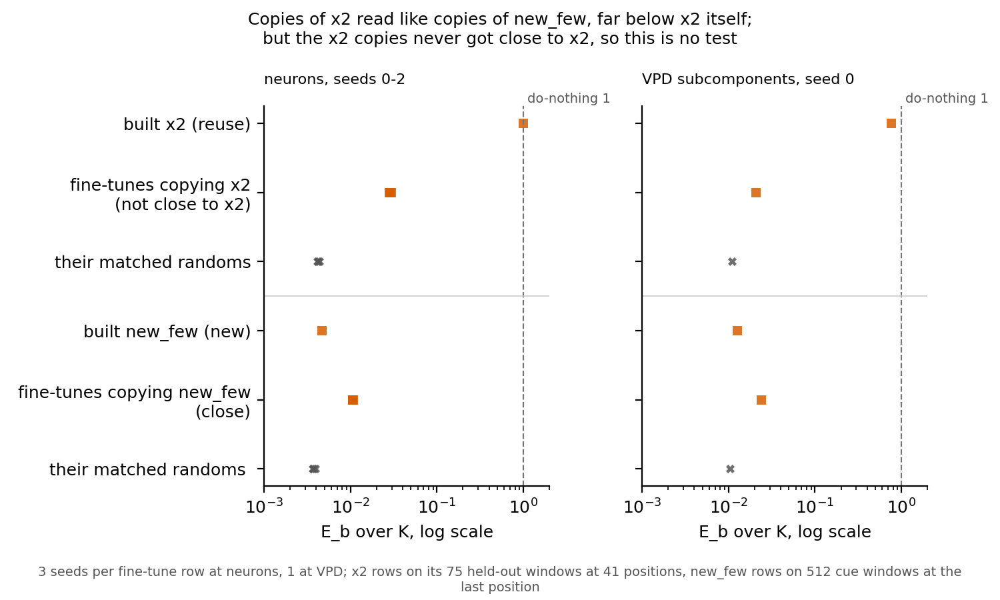

# Does a fine-tune that copies a reuse edit read as reuse?

*2026-11-24, definition-lead. Cell P1.4 run 2, experiment E297. Plan
`reports/plans/2026-11-24_plan_p1-4-run2-trained-reuse-control.md`, card `experiments/trained_reuse_control/card.md`,
filed rules `experiments/trained_reuse_control/results/predictions.json`. Results
`experiments/trained_reuse_control/results/summary.json`, `train/`, `items/`, `vpd/`, `stage0_*.json`; figure
`experiments/trained_reuse_control/figures/e_b_imitators.png` from `experiments/trained_reuse_control/plot.py`.*

We trained ordinary fine-tunes of the 67M model to copy the outputs of two built edits, one that only strengthens
existing neurons and one that writes new associations, and read each copy with the write share. The copies of the
strengthening edit never got as close to it as the filed closeness bar requires, so the filed test makes no call and
every reading of them below is description only. For `GOALS.md` this leaves open whether the definition can tell a
trained update that reuses the model from one that adds something new. The imitation control could not be built at the
closeness an ordinary fine-tune reaches on this model.

## The answer

No call. The fine-tunes copying the strengthening edit stayed far from it: on held-out windows their remaining distance to
the target was 0.300 to 0.302 of their distance from the base model. The filed bar is 0.1924. The copies of the
new edit passed easily. So nothing here tests the definition. Described anyway, the copies of the strengthening edit
read low at neurons, near the copies of the new edit and far below the edit itself. That is what the definition would
read if it could not see trained reuse, and also what it reads if the copies learned something else.

## What we were trying to test

Every trained update read so far gives a low write share, at every featurization. That could mean fine-tunes change
what the model's parts compute, or that the instrument reads low on anything trained. This run tries to supply a
trained update whose answer is known.

**The two targets.** Both are built edits of the base model M whose label is known by construction.
- *x2*, the reuse target: the output weights of eight copy neurons in layer 1 are doubled. Nothing new is written; an
  existing mechanism is turned up. It is read on 75 held-out windows of the copy task, at all 41 positions.
- *new_few*, the new target: eight new token associations written into the weights. It is read on 512 cue windows, at
  the last position.

**The copies.** For each target, three fine-tunes of M's 24 decomposed matrices are trained to match the target's
next-token distribution on its own training windows. The recipe is the earlier imitation study's: 3,000 steps, peak
learning rate 1e-5, a warm-up of 300 steps, then cosine decay. The three seeds differ only in which batches are drawn.
x2 has only 301 training windows; new_few has 100,000.

**The closeness bar.** A copy can only stand in for its target if its outputs are the target's. The leftover is the
total variation distance from the copy to the target, divided by the copy's distance from M, each averaged over the
read windows: 0 is a perfect copy, 1 is no closer to the target than to where it started. A copy counts only if its
leftover at step 3,000 is at most 0.1924. That bar is not chosen: it is the leftover the same recipe reached on this
model in the earlier imitation study, the closest an ordinary fine-tune here has been measured to a built target.

**The reading.** For each variable that the update needs for the behaviour, the write share asks how much of the change
in that variable's write is the base model's own write times one positive gain, fitted by least squares. Summed over the
needed variables that changed, this is $E_b$ over the needed set $K$: 1 when every needed variable writes what M wrote
up to a gain, 0 when none of the change is of that kind. A variable is needed when swapping it alone between two inputs
flips the model's top token. At neurons each MLP neuron's strong activations are a variable and each layer's weak
activations form one remainder variable. Beside each reading we give $|K|$ and the median gap between the top two
logits. Under 100 needed variables reads "too small"; none was.

**The controls.** Beside every copy, a random update matched to it in size on each changed matrix rules out that any
update of that size reads the same. The two built edits are read again as the reference: x2 near 1, new_few near 0.

## What we expected

The filed rule compares, per seed, the x2 copy's $E_b$ over $K$ at neurons with the new_few copy's. If the definition
reads what an update does inside the model, a close copy of a strengthening edit should strengthen the same neurons and
read at least 0.2 above the copy of the new edit. If every trained update reads low whatever it does, the two read alike.
The lean was the second. Both readings need at least two seeds on which both copies pass the closeness bar. The plan
named x2 as the risk: 301 training windows and a mild target, with an expected leftover of 0.1 to 0.4.

## What we observed

### The copies of x2 never got close to x2

**Reading it.** On every seed the x2 copies missed the bar, and by a wide margin. Their leftover at step 3,000 was
0.300 to 0.302, against the bar of 0.1924. The new_few copies read 0.026 on all three seeds.

The ratio hides that both kinds of copy end about the same absolute distance from their targets. The x2 copies end at a
total variation of 0.0235 from x2, the new_few copies at 0.0226 from new_few. But x2 moves M's outputs only a little:
its own distance from M is 0.0745, against 0.858 for new_few. So the same residual error is a third of x2's effect and
a fortieth of new_few's.

The x2 copies overfit. Their training loss fell from 0.10 to 0.0002 on the 301 training windows. Their leftover on the
held-out windows sat near 0.4 at step 300 and still read 0.37 at step 1,000. It was still falling at step 3,000, slowly.

| copy | seed | leftover at 3,000 | distance to target | target's distance from M | counts |
| --- | --- | --- | --- | --- | --- |
| x2 | 0 | 0.300 | 0.0235 | 0.0745 | no |
| x2 | 1 | 0.302 | 0.0236 | 0.0745 | no |
| x2 | 2 | 0.300 | 0.0235 | 0.0745 | no |
| new_few | 0 | 0.026 | 0.0226 | 0.858 | yes |
| new_few | 1 | 0.026 | 0.0226 | 0.858 | yes |
| new_few | 2 | 0.026 | 0.0225 | 0.858 | yes |

### Described only: the copies of x2 read low at neurons, near the copies of new_few

None of this is a test, since the x2 copies are not copies of x2 by the filed standard.

**Reading it.** At neurons the x2 copies read 0.028 to 0.030, with about 12,280 needed variables. That is far below x2
itself at 0.9998 and a few hundredths above the new_few copies at 0.0105 to 0.0107. The per-seed gap between them is
0.018 to 0.019, a tenth of the filed 0.2; the built pair is 0.995 apart. The matched randoms read 0.0036 to 0.0044. So
the x2 copies sit about seven times above their randoms, as earlier ordinary fine-tunes of the same copy task did at
0.022 and 0.028. Nothing in them looks like x2.

The remainders matter here. Leaving them out, the x2 copies read 0.055 to 0.057 and the new_few copies 0.055 to 0.061:
the two kinds of copy read the same. The remainders carry 0.49 of the x2 copies' write change and 0.84 to 0.85 of the
new_few copies'.

| item | $E_b$ over $K$ | $|K|$ | median top-1 margin | without remainders |
| --- | --- | --- | --- | --- |
| built x2 | 0.9998 | 12,291 | 0.73 | not read |
| x2 copy, seeds 0-2 | 0.028, 0.029, 0.030 | 12,276, 12,284, 12,282 | 0.72 | 0.055, 0.056, 0.057 |
| their randoms | 0.0042, 0.0044, 0.0042 | 12,297, 12,301, 12,299 | 0.77 | 0.0078, 0.0080, 0.0077 |
| built new_few | 0.0047 | 6,032 | 3.48 | not read |
| new_few copy, seeds 0-2 | 0.0105, 0.0105, 0.0107 | 1,674, 2,290, 1,856 | 3.51 | 0.061, 0.055, 0.059 |
| their randoms | 0.0036, 0.0039, 0.0037 | 8,023, 8,498, 7,113 | 0.54 to 0.57 | 0.0086, 0.0090, 0.0089 |

The margin is read on the item's own fine-tuned model. A new_few random keeps none of the new associations, which is why
its margin is far below the copy's.

At VPD's subcomponents, on seed 0 only, the x2 copy reads 0.021 and the new_few copy 0.024. Their randoms
read 0.011 and 0.010. Built x2 reads 0.761 and built new_few 0.0127. The needed sets are large throughout: 5,848 for the
new_few copy and 31,161 to 38,935 for every other item. The margins are those of the neuron table, since they are read
on the same models. Both copies sit about twice their randoms, and the x2 copy below the new_few copy.

## What we learned

The imitation control could not be built for the strengthening edit at the closeness an ordinary fine-tune has reached
on this model. Its small effect on outputs makes the leftover ratio hard to meet even when the absolute error matches
the new edit's copies. So this run neither shows that the definition sees trained reuse nor that it cannot. The
descriptive readings point the same way as every earlier trained update: low, a few times above random, and alike for
both targets once the remainders are left out.

## How compelling is the evidence

Weak, by design of the rule: no seed counted. The closeness miss is clear, on all three seeds, nearly
identical across them. The descriptive neuron readings are three seeds per copy on one task each, and VPD is one seed. The
reading is blind to how the copy reaches its outputs; that was the point of reading it. A copy at leftover 0.30 may have
learned the copy task its own way, so its low reading says nothing about x2.

## Surprises

The x2 copies ended as close to x2 in absolute distance as the new_few copies to new_few; the ratio failed because x2's
effect is small. Without remainders, the two kinds of copy read the same.

## What next

- Any rerun of x2 imitation needs the cell's last run. More training windows than 301, or a held-out-aware stop, would be
  the change; a leftover under 0.1924 on two seeds would make the filed comparison possible.
- A bar on absolute distance would let the x2 copies count, but that changes a filed rule and the closeness standard;
  it is not proposed here.

## Departures

Three departures from the earlier imitation recipe, all filed in the plan. Only the 24 decomposed matrices are trained,
where the earlier study trained every parameter. x2 is fit at all 41 positions with 32 windows per step, not 1,024
windows at one position. Each target's own task windows are the training data. Departures from the literature: none beyond these.

## Scorecard

| id | claim in words | rule | read | verdict |
| --- | --- | --- | --- | --- |
| R0a | identity swap changes no top token; doing nothing reads 1 | stop on a miss | 0 changes, do-nothing 1, all five jobs | pass |
| R0b | an untrained copy is at distance 0 from M; target gaps over the floor | stop on a miss | 0 distance, gaps 0.0745 and 0.858 | pass |
| R0c | x2 and new_few repeat their earlier readings | within the measured floor | x2 0.9998, new_few 0.0047, at both featurizations | pass |
| R0d | the rebuilt new_few edit equals its record | stop on a miss | equal | pass |
| R1 | early training checks | stop on a miss | no stop in six trainings | pass |
| R2 | a copy counts when its leftover is at most 0.1924 | per copy | x2 0.300 to 0.302; new_few 0.026 | x2 no reading, new_few counts |
| R3 | x2 copy at least 0.2 above new_few copy, per counted seed | at least 2 seeds | 0 seeds counted | no call |
| R4 | randoms at or under 0.05 | reported | 0.0036 to 0.0044 at neurons | all under |

## Not run

- Seeds 1 and 2 at VPD.
- Copies of the tenfold edit, the rebuilt edit or the thin new edit.
- A longer or larger-data recipe for x2: it would need the cell's last run.
- An independent check.

Provenance: training and neuron reads on cluster debug L40 jobs at no cost; the four VPD items and the VPD repeats on one
H100 pod.
