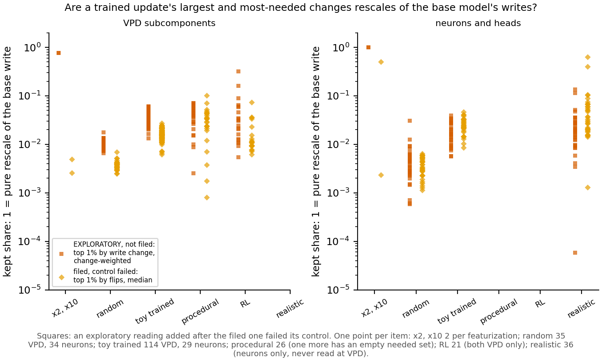

# Why do the needed-set readings read every trained fine-tune the same small amount?

Cell P1.59, experiment E285, 2026-11-23. A synthesis from saved per-variable totals, for the paper's Discussion. CPU
only, $0, no model loaded.

We took the saved per-variable sums behind every reading of the write share over the needed set, for about three
hundred fine-tunes, built edits and random updates, and read them variable by variable at VPD and at neurons. The
filed reading, on the variables the needed set ranks highest by flips, failed its own control at both featurizations,
so it carries no claim: ranking by need does not find the variables an update changed. What remains is what earlier
runs found: the per-variable write share of trained updates is low and near random in every class, toy and realistic
alike, so the task choice does not explain it. At VPD a low per-variable share cannot be told from a change spread
over many subcomponents, since even a pure doubling spreads that way. For the goals, the next test is the kept share of
whole matrices or layers, which separates the two. Recomputing from the saved sums reproduced every saved value; the
needed-set scans were not redone.

## The answer

The filed reading failed its control: a pure doubling edit reads near zero on it, because the variables ranked
highest by flips are often not the ones the edit changed. So ranking by need cannot find where an update acted. The
write share of trained updates, per variable, is low and near random in every class, toy, procedural, RL and
realistic, as earlier runs found. At VPD, low cannot be told from spread: the median changed subcomponent of a pure
doubling keeps under a thousandth of its change, and the doubling reads high only because a few subcomponents carry
most of it. A trained update that re-mixes existing subcomponents would read low too. The test that separates the two
is the kept share of a whole matrix or layer. The arithmetic from the saved sums reproduces every saved value; the
needed-set scans were not redone.

Red-team verdict (redteam-lead, 2026-11-23): OK after fixes; low per-variable share is not distinguishable from spread
at VPD; the group-level read is the separating test.

## What the readings are

The frozen definition asks whether the fine-tuned model F needs a variable of the base model M, and whether F's
mechanism there is M's mechanism up to a positive gain. A variable is a VPD subcomponent or a matrix's remainder, or a
neuron, head or a layer's MLP remainder. Every saved item holds, per variable $u$, three sums over every input position
of the task data:

- $\mathrm{num}_u = \sum \langle w_{F,u}, w_{M,u} \rangle$, the overlap of F's write with M's write;
- $\mathrm{den}_u = \sum |w_{M,u}|^2$, M's write;
- $\mathrm{dd}_u = \sum |w_{F,u} - w_{M,u}|^2$, the write change.

The **kept share** of a variable is the fraction of its write change that M's own write explains at the best single
gain $g = \mathrm{num}/\mathrm{den}$, namely $(\mathrm{num} - \mathrm{den})^2 / (\mathrm{den}\cdot\mathrm{dd})$. It reads 1 when F's
write is M's write times a positive gain, so the variable is only rescaled. It reads near 0 when the change points away
from M's write, so the write is turned. The write share over a set of variables, called E_b in earlier pages, is the
kept share weighted by write change. The **needed set** K holds every variable whose value, swapped for its value on
another input, flips F's top token on at least one of 256 tested input pairs. A variable's flip count is how many of
those pairs flip.

Four readings, filed before any was computed:

1. **Rotation or rescale at the core.** The median kept share over the 1% of changed needed variables with the most
   flips, beside the doubling edit x2 and the tenfold edit x10, which only strengthen one existing mechanism.
2. **How much of the model is needed.** The size of K over the number of changed variables, and each item's logit
   margin, the gap between F's top two logits.
3. **Where the change sits.** The share of the write change, over K, on the remainders and in each layer.
4. **Toy against realistic.** Readings 1 to 3 on toy fine-tunes against the realistic panel.

The items: 314 reads from E268, E275, E277, E278, E281 and E283. At VPD there are 114 toy fine-tunes, 27 procedural
RL and SFT states, 21 RL repeat states, the seven built edits and 35 random updates. At neurons there are 29 toy
fine-tunes, 36 realistic fine-tunes, the seven built edits and 34 random updates. Every random update is matched in
size to a fine-tune or a built edit. The list with its sha256 values is `experiments/why_fail/inventory.tsv`.

## What we expected

We expected the doubling and tenfold edits to read near 1 on reading 1 and random updates near 0. If trained
fine-tunes also rotated their most-needed variables, they would read near the random updates. If instead they
rescaled a small core and the low write share came from dilution, they would read at 0.5 or above. We expected
the needed set to cover most of the model, with its size set by each item's smallest margin. We also expected the
neuron remainders to hold most of a dense update's change, and toy and realistic fine-tunes to read alike.

## The filed reading failed its control: flips do not find the changed variables

The doubling and tenfold edits read 0.0026 and 0.0049 at VPD on reading 1, against a filed 0.8. At neurons they read
0.0024 and 0.50. Under the card's stop rule, reading 1 as filed says nothing about trained items. Two separate causes
show in the arrays.

- **At neurons, the most-flipped changed variable is the remainder.** The doubling changes eight neurons and their
  layer's MLP remainder. All eight neurons are pure rescales with kept share 1. The variable with the most flips is
  the remainder, which carries a fraction 0.0002 of the edit's write change. Ranking by flips picks where F is
  fragile, not where the update acted.
- **At VPD, the split spreads a doubling over thousands of subcomponents.** The doubling changes one down-projection
  matrix, which the least-squares split shares out over its 3,584 subcomponents. The median changed subcomponent keeps
  0.0007 of its change. The doubling is a rescale only for the few subcomponents that carry most of the change. Which
  of them the flip ranking catches depends on the edit: its top 1% holds 0.048 of the doubling's change and 0.93 of
  the tenfold edit's.

So the per-variable kept share, ranked by need, cannot tell a strengthening from a new mechanism. That is a property
of how the reading ranks and splits variables, and it shows on the built edits whatever the code.

## Exploratory, not filed: ranked by change, the reading is the write share again

Since flips failed, we ranked each item's changed needed variables by write change instead. We read the kept share of
the top 1%, weighted by change. This reading is exploratory. It was not filed: it was added after reading 1's control
failed, after the numbers were seen. It adds little: in every class it agrees with the write share over the whole
needed set to within about a hundredth, as the table's third and last columns show. The largest changes dominate
that write share anyway.

**Reading it.** On the exploratory ranking by write change, the strengthening edits read high and every trained class
reads low, near the random updates. The doubling and tenfold edits keep 0.76 of their largest changes at VPD and 1 at
neurons. Trained classes sit between 0.016 and 0.041 at the class median. The random updates sit at or under 0.011.
This holds for the toy fine-tunes, the procedural and RL states, and the realistic panel. At VPD this does not show
that trained updates turn their writes. The doubling's median changed subcomponent keeps 0.0007, and the doubling
reads 0.76 only because a few subcomponents carry most of its change. A trained update whose change is spread over
many subcomponents would read low per variable even if, summed over a matrix, it were a rescale. The filed ranking by flips puts trained classes in the same place,
from 0.011 to 0.034, but its controls sit there too. Two realistic items read high on the filed ranking, 0.63 and 0.40.
The first has a needed set of 44 variables, under the floor of 100.

| class | items | top 1% by change, kept: exploratory | top 1% by flips, median kept: filed | write share over K |
|---|---|---|---|---|
| x2, x10 at VPD | 2 | 0.76 | 0.0026, 0.0049 | 0.76 |
| x2, x10 at neurons | 2 | 1 | 0.0024, 0.50 | 1.00 |
| toy trained, VPD | 114 | 0.028 | 0.016 | 0.032 |
| procedural, VPD | 27 | 0.041 | 0.034 | 0.045 |
| RL, VPD | 21 | 0.031 | 0.011 | 0.023 |
| toy trained, neurons | 29 | 0.016 | 0.024 | 0.020 |
| realistic, neurons | 36 | 0.019 | 0.032 | 0.039 |
| random, VPD, by source | 18, 15, 2 | 0.0085, 0.011, 0.0099 | 0.0034, 0.0042, 0.0031 | 0.0099, 0.014, 0.011 |
| random, neurons, by source | 20, 12, 2 | 0.0029, 0.0045, 0.0067 | 0.0039, 0.0029, 0.0059 | 0.0052, 0.0067, 0.013 |

Class medians; the random rows list procedural, toy and built randoms at VPD, and toy, realistic and built randoms at
neurons. Every item is in `experiments/why_fail/results/items.tsv`.

## The needed set is most of the model, and its size follows the margin

Reading 2 came out as filed for the toy and realistic fine-tunes. The needed set holds a median 0.62 of the changed
variables for toy fine-tunes at VPD. At neurons it holds 0.33 for toy fine-tunes and 0.41 for the realistic panel.
Matched random updates have needed sets as large: 0.67 at VPD and 0.36 for the panel's randoms at neurons. The procedural and RL
states missed the filed 0.3, at 0.028 and 0.10. They are also the classes with the largest margins, so these misses
support the margin account rather than cut against it. Across items, the share of variables in K falls as the
smallest margin grows, with a Spearman correlation of -0.72 over 202 items at VPD and -0.60 over 104 at neurons.
Within a class the link holds but is weaker for toy fine-tunes. It reads -0.42 over the 114 toy fine-tunes at VPD and
-0.47 over the 29 at neurons. It reads -0.73 over the 36 realistic fine-tunes at neurons. The procedural and RL states
read -0.72 and -0.93. The smallest margin is under 0.01 in 0.96 of the toy fine-tunes at VPD and 0.67 of the
realistic ones. So K mostly measures how close F's top two tokens come on its most fragile input, not which variables
the task uses. Margins are minimum-only for E268, E275 and E278's re-used items: no medians were saved there, and no
per-pair margins were saved anywhere. Where medians exist they are large, 1.8 for toy fine-tunes and 0.69 for the
realistic panel at neurons.

## At neurons, two thirds of the change sits in the remainders

Reading 3 came out as filed at neurons. The four MLP remainders hold a median 0.69 of the write change over K for
toy fine-tunes and 0.64 for the realistic panel. Their matched random updates put 0.65 to 0.67 there, and the
doubling 0.0002.
A neuron counts as a variable only above its 97th-percentile activation, so most of an MLP's activity is remainder.
At neurons, then, the write share mostly reads one large remainder per layer. At VPD the remainders hold only 0.022 to
0.031 of the change. That is a plain miss of the filed range of 0.1 to 0.6. The likely reason is that VPD reconstructs
each weight matrix closely, so little of any change is left outside its subcomponents. No claim here rests on it. The
largest single layer holds 0.32 to 0.36 for trained classes and 0.34 for random. The change is spread over all four
layers.

## Toy against realistic: the same failure

Reading 4 came out as filed. At neurons the toy fine-tunes and the realistic panel differ by 0.008 on the filed reading,
0.078 on needed-set coverage and 0.049 on the remainder share. On the exploratory reading of the largest changes they read 0.016 and 0.019. At
VPD, where the panel was never read, toy fine-tunes differ from the procedural states by 0.018 and from RL by 0.005 on
the filed reading. Task choice does not explain a failure this uniform across toy, procedural, RL and realistic tasks.

## What this rules out, and what it does not

- **Task choice does not explain it.** Toy, procedural, RL and realistic fine-tunes read alike on every reading. The
  realistic panel was read only at neurons, so the comparison at VPD uses procedural and RL in its place.
- **Implementation: the arithmetic is checked, the scans are not.** The write share over K, recomputed in fresh code
  from the saved sums, matched the saved value on all 312 items that have one, to 6e-16 relative. The tenfold edit's
  write change is 81 times the doubling's, as linearity requires, to 2e-8. The variable layout put the doubling's
  changed set on one down-projection matrix, and no write change outside the 24 decomposed matrices. The needed-set
  scans and the write passes that produced the saved sums were not redone. A bug there, such as a wrong pairing of
  inputs or a mis-hooked site, would pass every check here. What the built edits do rule out is a bug that hides a
  strengthening: the doubling's sums read as a doubling.
- **The reading itself: part of the cause.** Three properties of the per-variable reading show in the controls. Ranking
  by flips finds where F is fragile, not where the update acted. At VPD the least-squares split shares one matrix's
  doubling over thousands of subcomponents, and most of them read as turned. At neurons two thirds of any dense change
  sits in the remainders.
- **What it does not rule out.** The per-variable write share of trained updates is low and near random in every class.
  At VPD that cannot be told from a change spread over many subcomponents. The doubling's median changed subcomponent
  keeps 0.0007, and its share reads 0.76 only because a few subcomponents carry most of the change. A fine-tune that re-mixes
  existing subcomponents moves each one's write off its own direction and reads low, even though no new direction
  enters the matrix. So these readings do not say that trained fine-tunes build new mechanisms.

## A starting point for future work

- **The main test: the kept share of a whole matrix or layer.** This is the Discussion's starting point. At VPD a pure
  doubling's median changed subcomponent keeps 0.0007 of its change, so a low per-variable share cannot tell a turned
  write from a rescale spread over many subcomponents. Compute the kept share of the summed write of all changed
  subcomponents in a matrix, or in a layer. If trained updates rise toward the doubling there and random updates stay
  low, the low readings came from the per-variable grain. If they stay near random, trained updates do turn their
  writes.
- **Rank need by something tied to the change.** Flips find fragile variables. A needed set weighted by each pair's
  margin, or found at a margin floor, needs per-pair flips and margins saved in a new scan. That scan would also test
  the margin explanation of the needed set's size directly.
- **A featurization with a small remainder.** At neurons two thirds of the change is in the remainders. A transcoder
  or a lower activation cut would show whether the kept reading changes when that change is assigned to variables.

## Scorecard

| reading | claim in words | filed | read | verdict |
|---|---|---|---|---|
| 1, control | strengthening edits keep their most-needed changes | at least 0.8 | 0.0026, 0.0049 at VPD; 0.0024, 0.50 at neurons | control failed: the stop rule holds, no claim from reading 1 |
| 1, random | random updates keep almost none | at most 0.05 VPD, 0.1 neurons | 0.0031 to 0.0059 | as filed |
| 1, trained | trained classes near random, not dilution | at most 0.15 | 0.011 to 0.034 | as filed in value; no verdict, its control failed |
| 2, coverage | K covers most changed variables | at least 0.3 every trained class | toy 0.62 VPD, 0.33 neurons; realistic 0.41; procedural 0.028, RL 0.10 | met for toy and realistic; missed for procedural and RL, the classes with the largest margins, which supports K following the margin |
| 2, margins | size follows the smallest margin | Spearman at most -0.5 | pooled -0.72 VPD, -0.60 neurons; within class toy -0.42 VPD, -0.47 neurons, realistic -0.73, procedural -0.72, RL -0.93 | as filed pooled; within class weaker for toy |
| 2, small margins | smallest margin under 0.01 in half the items | at least half | toy 0.96, realistic 0.67; procedural 0.30, RL 0.10 | met for toy and realistic; missed for procedural and RL |
| 3, neurons | remainders hold most of a dense change | at least 0.5 | 0.64 to 0.69 trained, 0.65 to 0.67 random | as filed |
| 3, VPD | spread over layers, remainder share 0.1 to 0.6 | largest layer at most 0.6 | largest layer 0.32 to 0.36; remainders 0.022 to 0.031 | layers as filed; remainder share missed, likely because VPD reconstructs the weights closely; no claim rests on it |
| 4 | toy and realistic alike | within 0.1 on 1, 0.2 on 2 and 3 | 0.008, 0.078, 0.049 | as filed |

## Surprises

Reading 1's control failed at both featurizations, which the filing did not anticipate. Before the run we expected a
doubling edit to read as a rescale variable by variable. At VPD it does not, because the least-squares split shares
one matrix's doubling over all its subcomponents. At neurons the flip ranking picks the remainder.

## Departures from the literature

- **A filed check was amended.** The layout check comparing the tenfold edit with the doubling was wrong as filed and
  was replaced by an exact check of the same linearity; the next section says why and what replaced it.
- The kept share replaces the frozen definition's yes-or-no test, after Geiger et al. 2025, of a mechanism equal to the
  base one up to a positive gain on every input. It is a fraction pooled over all positions with one gain per
  variable, so a rescale whose gain varies across inputs reads under 1.
- The ranking by write change, with the kept share weighted by change, is exploratory. It was added after reading 1's
  control failed and after the numbers were seen. It was not filed.

## Amended layout check

**The filed check was wrong as stated.** It said the tenfold edit's kept shares at VPD equal the doubling's within
1e-6. The reasoning was that the split is linear, so the tenfold edit's change is nine times the doubling's. But the
kept share depends on each variable's gain, and the gain minus 1 scales by nine. A variable whose gain is under
eight-ninths at the doubling therefore has a negative gain at the tenfold edit. The definition's positive-gain rule
sets such a variable's kept share to 0. One changed variable was affected, so the check stopped the first run.

**What replaced it.** The amendment came after the first run stopped on this check, not before any run. On 2026-11-23
the check was amended to what linearity does fix: each changed variable's write
change at the tenfold edit is exactly 81 times the doubling's. This is an exact check of the same linearity, not a
looser tolerance on the old one. It read 2e-8 relative, at floating-point rounding, and passed. The amendment is
recorded in `run.py`; `results/predictions.json` is unchanged.

## Not run

- The kept share on groups of variables, per matrix or per layer.
- A needed-set scan that saves per-pair flips, top tokens and margins.
- The realistic panel at VPD: no VPD reading of it was saved.
- A redo of any needed-set scan or write pass: this cell read only saved arrays.
- A featurization with a smaller remainder at neurons.

Provenance: `experiments/why_fail/run.py all` (cluster CPU via `fleet/cpu-run`, under a minute), results in
`experiments/why_fail/results/summary.json` and `items.tsv`, filed expectations in `results/predictions.json`, figure by
`plot.py`.
