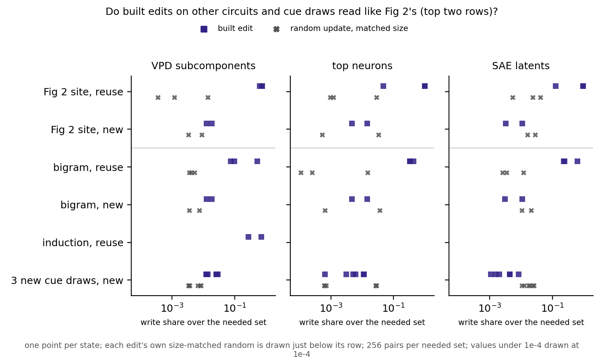

# Do Fig 2's built edits read the same way on other circuits and cue draws?

**The answer.** So far yes, with one weak spot. The second circuit is a one-token lookup in the first layer. There, edits
that strengthen or rebuild what the model already does still read far above edits that add a new lookup and random
updates of the same size, at all three featurizations. At VPD, though, the strengthening edits read about a
tenth of what they read at Fig 2's site. On three new cue draws the new edits read as low as Fig 2's own. The induction
circuit and the noise floor are still running, so nothing is scored against a bar yet.

## What was done

Each edit is read by its write share over the needed set, as in Fig 2's rerun. The needed set holds the variables whose
swap from another input flips the edited model's answer at the read position, on 256 swap pairs. The write share is the
part of those variables' write change that is the base model's own write times one fitted gain. It reads 1 for an edit
that only rescales what the model already writes, and 0 for one that writes in new directions. Leftover variables, the
VPD remainders, the pooled neuron remainders and the SAE error terms, are counted. The scorer is Fig 2's own expression,
run on each read's saved per-variable sums; every value equals the one the read job logged.

Two runs fill the cell:

- **Two more base-model circuits, five edits each.** The edits are Fig 2's recipes. Doubling and tenfold scale the
  output of the eight neurons the circuit uses most; "rebuilt" zeroes them and retrains the later MLPs to put the
  behaviour back. Two edits add a new lookup instead: new_few rewires eight near-silent neurons, and new_thin is the
  least-norm change of the layer's output matrix. The first circuit is a bigram lookup at layer 0, such as " according"
  followed by " to"; the base model gets it right on 0.951 of held-out windows. The second is induction at layer 2, right
  0.957 of the time.
- **New edits on three more cue draws**, at layer 0 like Fig 2's, each draw giving a new_few and a new_thin edit.

Every edit has its own random update: a Gaussian on each tensor the edit changed, at that tensor's Frobenius norm. The
bigram circuit sits at layer 0 on Fig 2's cue draw, so its two new edits are Fig 2's new edits built again; they repeat
Fig 2's new rows rather than adding a site. The induction circuit has no new edits. At layer 2 the best detector reached
5.3 to 7.7 times its background on every cue token tried, against the filed bar of 10, and the bar was not lowered.

## Controls: all held

- **Do-nothing**, an unedited copy read on each circuit's and each draw's windows: no variable changed, the largest
  write change exactly 0 and the write share exactly 1, at every featurization, on both runs and on the L40 cross-check.
- **Identity swap**, each input swapped with itself: no answer changed anywhere. The largest logit deviation was 7.06e-5
  at VPD, 8.39e-5 at top neurons and 5.53e-5 at SAE on the bigram windows, and 5.70e-5 at VPD on induction. On the new
  cue draws it was 4.48e-5 at VPD and 3.91e-5 at SAE.
- At top neurons on the new cue draws the deviation was 1.16e-3, about fourteen times the bigram windows'. It is the
  same on the L40 and the L40S, so it belongs to these cue windows, not to the card. The smallest answer margin on these
  windows is 6.68e-6, and still no answer flipped.
- **L40 cross-check** of the L40S pods: all six gaps are exactly 0, against the filed bar of 0.0019, so the L40S reads
  stand.
- **Builds.** Every random matches its edit's squared norm within 1.14e-10 relative. Every new edit that was built
  passed the detector bar of 10, never lowered: each new neuron's mean activation on its cue token is at least 10 times
  its 99th percentile on Pile text. Cue tokens that missed it were swapped, as Fig 2's build did: one on draw 186001
  and two on draw 186003, whose best ratios were 7.41, 7.64 and 8.78. The output scale each new edit needed for a lookup
  top-1 of 0.9 ran from 11.4 to 14.3 on the new draws, and was Fig 2's 11.3 and 10.8 on the bigram circuit.

## Every value

Write share over the needed set, leftovers counted, each edit beside its own random.

**Fig 2's own site, the reference**

| edit | VPD: edit | VPD: own random | top neurons: edit | top neurons: own random | SAE: edit | SAE: own random |
|---|---|---|---|---|---|---|
| x2 | 0.761 | 0.000353 | 0.9998 | 0.000951 | 0.966 | 0.041 |
| x10 | 0.761 | 0.00119 | 0.9998 | 0.00121 | 0.943 | 0.00533 |
| rebuilt | 0.623 | 0.014 | 0.0476 | 0.0289 | 0.127 | 0.0237 |
| new_few | 0.0127 | 0.00894 | 0.00468 | 0.033 | 0.00326 | 0.0281 |
| new_thin | 0.0188 | 0.00332 | 0.0145 | 0.000522 | 0.0109 | 0.016 |

**Bigram lookup, layer 0**

| edit | VPD: edit | VPD: own random | top neurons: edit | top neurons: own random | SAE: edit | SAE: own random |
|---|---|---|---|---|---|---|
| x2 | 0.0982 | 0.00356 | 0.332 | 0.000253 | 0.228 | 0.00344 |
| x10 | 0.0741 | 0.00406 | 0.336 | 0.00011 | 0.242 | 0.00255 |
| rebuilt | 0.522 | 0.00523 | 0.433 | 0.0148 | 0.634 | 0.0119 |
| new_few | 0.0126 | 0.00742 | 0.00468 | 0.0363 | 0.00308 | 0.0207 |
| new_thin | 0.0188 | 0.00356 | 0.0145 | 0.000641 | 0.0109 | 0.0107 |

**Induction, layer 2: reads still running**

| edit | VPD: edit | VPD: own random | top neurons: edit | top neurons: own random | SAE: edit | SAE: own random |
|---|---|---|---|---|---|---|
| x2 | 0.713 | not home | not home | not home | not home | not home |
| x10 | 0.274 | not home | not home | not home | not home | not home |
| rebuilt | not home | not home | not home | not home | not home | not home |

The induction tenfold edit landed during scoring. It reads well below the doubling edit at VPD, where Fig 2's two read
the same; one read is not yet a finding.

**New edits on three more cue draws**

| draw, edit | VPD: edit | VPD: own random | top neurons: edit | top neurons: own random | SAE: edit | SAE: own random |
|---|---|---|---|---|---|---|
| 186001 new_few | 0.0139 | 0.00663 | 0.00312 | 0.0271 | 0.00201 | 0.0184 |
| 186001 new_thin | 0.0266 | 0.0033 | 0.00613 | 0.000703 | 0.00835 | 0.0256 |
| 186002 new_few | 0.0126 | 0.00843 | 0.000651 | 0.027 | 0.00109 | 0.0177 |
| 186002 new_thin | 0.0261 | 0.00361 | 0.0111 | 0.00061 | 0.00434 | 0.0128 |
| 186003 new_few | 0.0124 | 0.00777 | 0.00515 | 0.0282 | 0.00152 | 0.0233 |
| 186003 new_thin | 0.0288 | 0.00347 | 0.0114 | 0.000621 | 0.00431 | 0.0107 |

The same values without leftovers, the leftovers' share, and the diagnostics below are in
`experiments/built_new/results/summary_p163.json`; the CSV rows are in the two `definition_rows_p163.csv` files.

## Do the new sites keep Fig 2's order?

**Reading it.** On the bigram circuit, yes at all three featurizations, by a margin that the floor still has to judge.
Each panel puts every built edit, dark squares, above its own random, grey crosses, on a log axis; Fig 2's site is the
top two rows. The bigram's reuse edits sit above everything below them in each panel. The narrowest margin is at VPD,
where the tenfold edit reads 0.0741 against the highest new edit or random at 0.0188. The three new cue draws put the
new edits where Fig 2's sit at every featurization. The caveat is the floor: the same edit read with another set of
swap pairs is still running, so no margin is yet called larger than noise.

## Why do new edits read above their randoms at VPD?

At VPD, each new edit reads above its own random. On the new draws, new_few reads 0.0124 to 0.0139 against randoms of
0.00663 to 0.00843. For new_thin the edits read 0.0261 to 0.0288 against 0.0033 to 0.00361. Fig 2's rows show the same,
0.0127 against 0.00894 and 0.0188 against 0.00332. Elsewhere it depends on the edit. At top neurons new_few reads below
its random, 0.000651 to 0.00515 against 0.027 to 0.0282. new_thin reads above its random there, as in Fig 2: 0.00613 to
0.0114 against 0.00061 to 0.000703. At SAE latents both new edits read below their randoms.

**Is it expected?** No filed prediction orders a new edit against its random: both were expected under about 0.03, and
all are. The order follows from what the reading counts and what the random is matched on.

- The write share counts only the part of a variable's write change that lies along the base model's own write for that
  variable, fitted with one gain over every position of the windows.
- The random is matched on one thing: the Frobenius norm of each tensor the edit changed. It is not matched on which
  input directions the change reads, its rank, or which variables it lands in.
- A VPD subcomponent is rank one: it reads $v \cdot y$ and writes along a fixed $u$. A change $dv$ to what it reads
  changes its write by $(dv \cdot y)\,u$, which lies exactly along its own write direction. The write share counts that
  change in proportion to how closely $dv \cdot y$ tracks $v \cdot y$ across positions.
- The new edits read directions the base model itself produces. new_thin's change is the least-norm map from the base
  model's own mean activations on the eight cue tokens, so its input side lies in their span. new_few's input rows are
  the base model's mean MLP input on each cue token. The random spreads its norm evenly over every input direction,
  most of which the model's activations rarely visit.

**The reading:** at VPD, a new edit's read change lines up with existing subcomponents' reads more than a Gaussian of the
same size does, so a little more of it counts as rescaling; both stay at a few percent of the change. This is a
reading, not a checked cause. Two parts of it were checked on the saved sums:

- **The needed set does not make the gap.** The same share taken over every changed subcomponent, with the needed set
  dropped, keeps the order. new_few reads 0.0122 to 0.0136 against randoms of 0.0072 to 0.00857. new_thin reads 0.019 to
  0.025 against 0.00327 to 0.00342. Fig 2's pairs read 0.0127 against 0.00891, and 0.0175 against 0.00324.
- **The random's own value moves with which tensor it touches.** At top neurons a variable is one neuron, so a change to
  its input row moves its write along its own output column. The random for new_few covers the input rows and reads
  0.027 to 0.0363 across every site. The random for new_thin touches only the output matrix and reads 0.000522 to
  0.000703.

Not checked: that the new edits' input side lies in the model's activation subspace more than the random's. That needs
the model's activations, so it needs a GPU. The paper's order, reuse above new and random, does not rest on the
new-versus-random order. But at VPD a norm-matched Gaussian is a weak floor for edits built from the model's own
directions.

## Surprises

- **The bigram's doubling and tenfold edits read 0.0982 and 0.0741 at VPD**, against 0.761 at Fig 2's site. The plan
  allowed this branch, "at most 0.2 if VPD mixes the eight neurons into many subcomponents". Induction's doubling edit
  reads 0.713 there, close to Fig 2's.
- **At top neurons the bigram's doubling edit reads 0.332 with leftovers counted and 1 without.** The leftovers carry
  0.94 of its write change, which sits in layer 0's pooled remainder of neurons below the band. The plan expected a
  drop of about that remainder's share whenever some of the eight neurons fall below the band.
- **The same edit read on two cards gives slightly different needed sets.** The bigram's new edits are Fig 2's, with the
  same write change to eight digits: 0.0127 over every changed subcomponent both times. Over the needed set they read 0.0126
  against Fig 2's 0.0127 at VPD, and 0.00308 against 0.00326 at SAE on an H100. Both gaps are below the cross-check's
  bar of 0.0019.

## Scorecard

| id | claim in words | rule | read | verdict |
|---|---|---|---|---|
| E301 P1, bigram | reuse edits above new edits and randoms | min reuse minus max of the rest, above the derangement floor | gap 0.0553 at VPD, 0.296 at top neurons, 0.207 at SAE | no call: floor not measured |
| E301 P1, induction | the same | the same, on reuse edits and their randoms | x2 at VPD only | no call: reads running |
| E304 P | new edits on other draws read like Fig 2's | within the floor of Fig 2's two new edits, or above them by more than it at two featurizations | see the table | no call: floor not measured |

Descriptive cells, no claim at a bar. The floor is induction's doubling edit read again at swap seed 269.

## Departures from the literature

None beyond the plan's. C's layer is fixed rather than taken from the attribution mass; rebuilt retrains every MLP after
C's layer; the new edits sit at C's layer; reads are at the answer position only.

## Not run

- Induction: VPD rebuilt, the three randoms and the seed-269 repeat; every top-neuron and SAE read. These are
  Slurm 66728-66731, still running. The floor and both descriptive verdicts come with them, by one rerun of the scorer.
- Induction's new edits: not built, since the detector bar of 10 was not reached at layer 2.
- A random drawn inside the model's activation subspace, the tighter floor for new edits at VPD.
- Fig 2's own site read at the answer position; a third circuit.

## Provenance

Scorer `experiments/built_new/score.py` calls `experiments/fig2_standard/eb.py` unchanged, reading saved arrays from the
main clone. Rows: `experiments/built_circuits/results/definition_rows_p163.csv` for the bigram and induction circuits,
`experiments/built_new/results/definition_rows_p163.csv` for the new draws; summary and diagnostics in
`experiments/built_new/results/summary_p163.json`; figure `experiments/built_new/figures/p163_built.png`. Reads: E301 on
the cluster L40, E304 on RunPod L40S pods with an L40 cross-check. Builds: `experiments/built_circuits/results/build_*.json`,
`experiments/built_new/results/build.json`; induction's detector values in `experiments/built_circuits/results/run_b_ind.log`.
