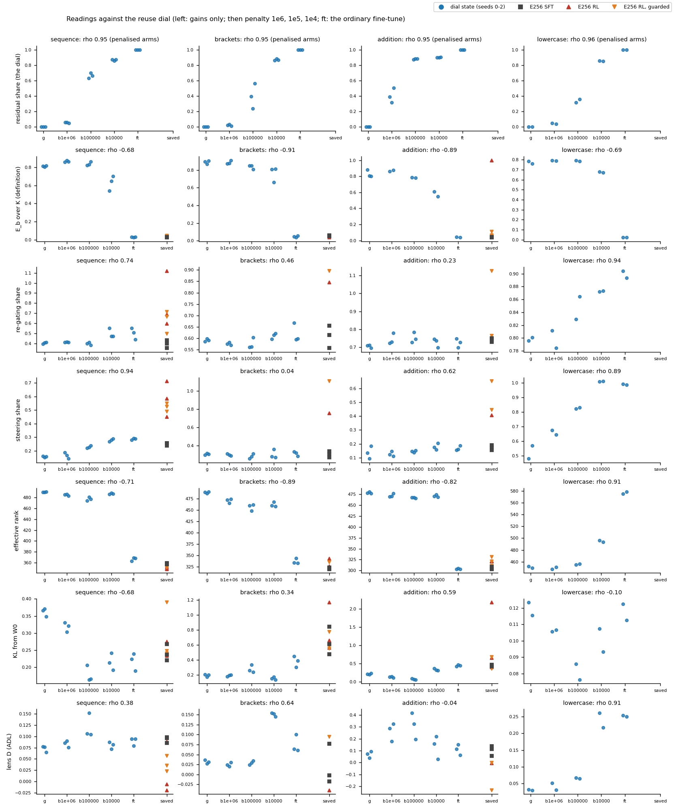
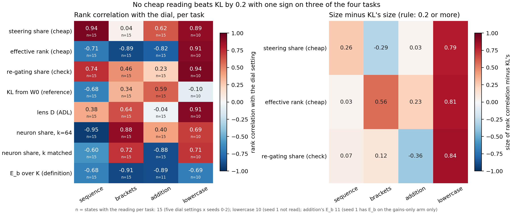

# Do cheap readings follow a fine-tune built to reuse the base model, on realistic tasks, better than KL does?

*P2.63 (E300), compare-lead, 2026-11-24. Scored by the filed rule; no verdict on reuse under either wording of the
definition. Card `experiments/reuse_dial/card.md`; rule and settings `experiments/reuse_dial/results/predictions.json`;
score `experiments/reuse_dial/results/score.json` from `score.py`; figures `experiments/reuse_dial/figures/rho.png` and
`dial.png` from `plot.py`; plan `reports/plans/2026-11-24_plan_p2-63-reuse-dial.md`.*

We trained fine-tunes on four realistic tasks that all reach the same gain on the trained answer but differ, by
construction, in how much of that gain is carried by gains on the base model's own decomposition variables, and asked
which cheap readings rank them in that built order better than output KL does. No cheap reading did so with one sign on
three of the four tasks: steering beat KL on two tasks, effective rank on three but with opposite signs, so the filed
rule reads the second rival. For the paper this means the claim that cheap readings track reuse is, on this test,
supported on the built tasks only, and the definition's own reading places every supervised and reinforcement-learned
fine-tune we had at the ordinary fine-tune's end of the dial.

## The answer

Along a dial of fine-tunes built to move from pure gains on the base model's variables to an ordinary fine-tune, all at
one matched gain, no cheap reading beat KL's rank agreement with the dial by the filed margin with one sign on three
tasks. Steering follows the dial on sequence and lowercase and not on brackets. Effective rank follows it strongly on
every task, but falls along it on the three procedural tasks and rises on lowercase. The definition's reading puts the
ordinary, supervised and RL fine-tunes all at the ordinary end, so RL is not placed nearer reuse.

## What we were trying to test

**The dial.** For each task and seed we trained five fine-tunes that all stop at the first step whose gain on the
trained answer reaches one matched target per task. The *gains-only* arm changes the model only by one multiplicative
gain per VPD subcomponent and per matrix remainder: every bit of its change keeps the base model's own variables, so
it is reuse by construction. Three *penalised* arms add a free residual weight change on top of the gains, penalised
by a weight times its squared size relative to the base weights; the weights were one million, one hundred thousand
and ten thousand, called heavy, medium and light below. The *ordinary* arm is a plain fine-tune with no gains and no
penalty. The dial setting is the arm's position in that order, from gains-only to ordinary. What the dial is meant to
move is the *residual share*, one minus the gain the gains alone give over the full gain: 0 for gains-only, 1 for the
ordinary fine-tune, and in between for the penalised arms.

**The tasks.** Three procedural tasks from E256, sequence, brackets and addition, with its items and supervised
recipe, and one real-text task, E53's lowercase, with its recipe. Three seeds per arm, so fifteen dial states per task.
One Gaussian update per task at the ordinary seed 0's per-matrix norms is the random control.

**The readings.** Each state was read by the cheap readings, steering share and the update's effective rank; by the
re-gating share, the part of the gain carried by changed causal-importance values, which is computed on the same
decomposition the dial is built on and so follows it by construction: it is scored beside the cheap readings as a
check that the dial was built as meant, never as a winner; by the baselines KL from the base model, the lens
difference reading ADL and the neuron shares; and by the definition's write share over the needed set, $E_b$ over $K$.
$E_b$ splits each changed variable's write into the part along the base model's own write at a positive gain and the
rest, sums over the needed set $K$, and divides: 1 when every changed variable keeps the base mechanism up to a gain,
about 0.01 for a random update of the same size.

**How a reading is scored.** Within one task, the Spearman rank correlation of the reading with the dial setting over
the fifteen states, with a permutation p. A reading *beats KL* on a task when its p is under 0.05 and the size of its
rank correlation exceeds the size of KL's by at least 0.2. The cheap readings win if one of them beats KL with one sign
on at least three readable tasks. A task is readable when its penalised arms order the residual share as built, rank
correlation at least 0.8 over those arms alone.

**Placement.** The ordinary fine-tunes and E256's saved supervised and RL states were placed on each task's dial by
each reading: the dial setting whose mean reading is nearest. This answers whether the RL states land nearer the reuse
end than supervised training does.

## What we expected, and why

The first rival expected a cheap reading to follow the dial beyond KL on three tasks: if steering or effective rank
measures how much of a fine-tune is a gain on existing variables, holding the gain fixed should leave that signal and
take away KL's. The second rival expected the cheap readings, at matched gain, to follow only how far the output moved,
which KL already measures, or nothing. $E_b$ over $K$ was expected to fall along the dial, with rank correlation at
most minus 0.6, as a check that the dial moves the definition; it is close to a gain share by construction, so it is a
sanity check, not evidence.

## What we observed

### Was the dial built as meant?

**Reading it.** Yes on all four tasks, with one weak step on addition. Stage 0 passed on every pod before any
training. The do-nothing update read $E_b$ of exactly 1 with no changed variable. A random gains-only update read $E_b$
over its changed variables of 0.840 to 0.867 against a bug bar of 0.42. The Gaussian update read 0.0096 to 0.0143
against a bar of 0.05. The identity scan flipped no top token in any of its 6,144 cases. The top row of the figure is
the residual share. On every task the penalised arms order it as built, rank correlation 0.95 on the three procedural
tasks and 0.96 on lowercase against the bar of 0.8, and every state reached its task's target.

The caveat is addition. There the light and medium penalties land close: the rehearsal measured their residual shares
at 0.899 and 0.875, and the scored states read 0.898 to 0.903 and 0.875 to 0.883, only 0.015 apart. Addition's dial
is a three-step dial in practice: gains-only, heavy at 0.316 to 0.508, and the two lighter penalties together, before
the ordinary end.

Lowercase needed an amendment. The filed early check stopped any arm whose first step already gained half the target,
because then the dial would have no steps to separate its arms. Lowercase's first steps gained 0.776, 0.958 and 0.713 on
seeds 0, 1 and 2 against that bar of 0.595, so all three lowercase pods stopped. The rehearsal had shown lowercase's
arms still spread the residual share widely after such a first step, so the bar was loosened to three quarters of the
target, 0.892, with whip-lead's approval, and lowercase was made readable only if its dial's top and bottom stay apart
beyond the seed range. Seeds 0 and 2 were rerun under the new bar. Seed 1's first step of 0.958 is over the new bar
too, so it was not rerun and lowercase is read on two seeds, ten states. Its spread condition holds: the lowest light
penalty residual share sits 0.80 above the highest heavy one.

### Does a cheap reading follow the dial better than KL?

**Reading it.** No. The left panel gives each reading's rank correlation with the dial within each task; the right
panel gives how far its size exceeds KL's, where the rule asks for 0.2 or more. Steering exceeds KL by 0.26 on sequence
and 0.79 on lowercase, both positive, but by only 0.03 on addition and falls short by 0.29 on brackets, where its rank
correlation is 0.04. Effective rank exceeds KL on brackets, addition and lowercase, by 0.56, 0.23 and 0.81, but its rank
correlation is minus 0.89 and minus 0.82 on the first two and plus 0.91 on lowercase. On sequence it ties KL. So
effective rank follows the dial strongly on every task, but in opposite directions on procedural and real text: the
update spreads over fewer directions along the procedural dials and over more along the lowercase dial. KL itself
follows the dial in different directions too: minus 0.68 on sequence, plus 0.59 on addition, near zero on lowercase.

The re-gating share, the construction check, follows the dial positively on every task, 0.23 to 0.94, but tracks
only on sequence and lowercase. That it is weakest on addition, 0.23, fits addition's weak middle step. Lowercase is the
one task where every reading but KL follows the dial: steering, effective rank, the re-gating share and the lens
reading all sit at 0.89 to 0.94.

The read gain also moves along the dial on two tasks, 0.59 on sequence and 0.58 on brackets, which the filed check
flags: there a reading that follows the dial could be following a small leftover gain difference.

### Does the definition's reading fall along the dial?

**Reading it.** Yes, $E_b$ over $K$ falls along every task's dial, rank correlation minus 0.68 to minus 0.91, but the
second row of the dial figure shows most of the fall happens at the light-penalty and ordinary end. On lowercase, going
from gains-only to the medium penalty raises the residual share from 0 to 0.32 and 0.36, yet $E_b$ reads 0.76 and 0.79
at gains-only and 0.78 and 0.79 at the medium penalty. On addition the medium penalty's residual share is 0.88, yet its
$E_b$ reads 0.78 and 0.79 against 0.80 to 0.88 at gains-only. $E_b$ then drops to 0.54 to 0.70 at the light penalty on
sequence, addition and lowercase, and to 0.02 to 0.05 for the ordinary fine-tunes. We report this as read: a large
penalised residual leaves the definition's reading near the gains-only end on these two tasks.

### Where do the ordinary, supervised and RL fine-tunes land on the dial?

**Reading it.** By $E_b$ over $K$, every one of them lands at the ordinary end. The ordinary fine-tunes and E256's
supervised states read 0.021 to 0.060, and the RL states, guarded or not, read 0.036 to 0.108, all below the lowest
light-penalty state at 0.539. The one exception is addition's RL seed 0 at 1.0, a state whose trained-answer gain is
minus 6.71: it unlearned the answer, so its write share is not a placement. So on the definition's reading RL is not
nearer the reuse end than supervised training on these tasks.

The cheap readings place RL differently. Steering puts the RL states past the ordinary end on every procedural task:
on sequence they read 0.45 to 0.71 against the ordinary fine-tunes' 0.28 to 0.29. The caveat is that E256 stopped its
states at one update size, not at one gain: its RL states gained less than its supervised ones, and seven of the
eighteen RL states have a negative gain. They sit outside the dial's matched-gain condition, so their placement is
descriptive only.

## Full table

Rank correlation with the dial setting and permutation p, within each task, over the states with the reading: fifteen
per task, ten on lowercase, eleven for $E_b$ on addition. A p of 0 means none of 10,000 permutations reached it.

| reading | sequence | brackets | addition | lowercase |
|---|---|---|---|---|
| steering share | 0.94 (p 0) | 0.04 (p 0.893) | 0.62 (p 0.014) | 0.89 (p 0.001) |
| effective rank | -0.71 (p 0.004) | -0.89 (p 0) | -0.82 (p 0) | 0.91 (p 0.001) |
| re-gating share, check | 0.74 (p 0.003) | 0.46 (p 0.086) | 0.23 (p 0.414) | 0.94 (p 0) |
| KL from base | -0.68 (p 0.009) | 0.34 (p 0.229) | 0.59 (p 0.028) | -0.10 (p 0.811) |
| lens D, ADL | 0.38 (p 0.167) | 0.64 (p 0.012) | -0.04 (p 0.885) | 0.91 (p 0.001) |
| neuron share, top 64 | -0.95 (p 0) | 0.88 (p 0) | 0.40 (p 0.141) | 0.69 (p 0.035) |
| neuron share, matched | -0.60 (p 0.020) | 0.72 (p 0.004) | -0.88 (p 0) | 0.71 (p 0.029) |
| untrained decomposition | -0.57 (p 0.027) | -0.28 (p 0.314) | -0.84 (p 0) | 0.84 (p 0.005) |
| $E_b$ over $K$ | -0.68 (p 0.008) | -0.91 (p 0) | -0.89 (p 0.001) | -0.69 (p 0.034) |
| read gain | 0.59 (p 0.024) | 0.58 (p 0.030) | -0.01 (p 0.984) | 0.42 (p 0.241) |

The base model's prior on the trained answer is one number per task, the same for every state, so its rank
correlation with the dial is undefined. It is a confound to hold fixed between tasks, not a cheap reading.

## What we learned

At matched gain on realistic tasks, no cheap reading follows a dial of known reuse beyond KL in one consistent
direction, so the paper's claim that cheap readings track reuse holds on the built tasks only, as the card's stop rule
says. Effective rank is the strongest follower of the dial on every task, but its direction flips between procedural
and real-text tasks, which a single-signed claim cannot use. The definition's reading places supervised and RL
fine-tunes alike at the ordinary end, so these states give no sign that RL reuses more than supervised training.

## How compelling is the evidence

Four tasks, three seeds on three of them and two on lowercase; fifteen or ten states per rank correlation, so a null
rank correlation has a standard deviation near 0.27 and the 0.2 margin is about one such deviation. The dial's own
order is clean on every task, but addition's middle two settings are nearly one. The read gain follows the dial on
sequence and brackets, so readings there may partly follow gain. $E_b$ over $K$ is close to a gain share by construction
and only checks that the dial moves the definition. The RL and supervised placements use E256's states at matched
update size, not matched gain.

## Surprises

- Effective rank follows the dial with opposite signs on procedural and real-text tasks, each strongly.
- $E_b$ over $K$ barely moves from gains-only to the medium penalty on lowercase and addition although the residual share
  rises to about a third and to 0.88. Reported as read.
- The ordinary fine-tune on addition seed 0 reproduced E256's supervised seed 0 to four digits of the gain, as it should
  with the same recipe and seed.

## What next

- Addition seed 1's $E_b$ rows: a redo pod is running now. When its rows land, `score.py` and `plot.py` are rerun and
  this page updated; only addition's $E_b$ rank correlation can change, the verdict cannot, since $E_b$ is not scored.
- Whether to write claim 2 as holding on built tasks only, as the card's stop rule says: a writing decision for the paper.

## Scorecard

| id | claim in words | rule | read | verdict |
|---|---|---|---|---|
| rival a | a cheap reading beats KL with one sign on at least three readable tasks | p under 0.05 and size of rank correlation at least 0.2 above KL's | steering on sequence and lowercase; effective rank on brackets and addition negative, lowercase positive | not met |
| rival b | no cheap reading does | the complement | as above | **rival b** |
| dial order | penalised arms order the residual share | rank correlation at least 0.8 | 0.95, 0.95, 0.95, 0.96 | all four readable |
| lowercase spread | top and bottom of the dial apart beyond the seed range | above 0 | 0.80 | read |
| $E_b$ check | $E_b$ over $K$ falls along the dial | rank correlation at most minus 0.6 | minus 0.68 to minus 0.91 | holds on all four |
| gain check | the read gain does not follow the dial | flag if p under 0.05 and size over 0.3 | 0.59 sequence, 0.58 brackets | flagged on two |

## Departures from the literature and from the filed plan

- **First-step bar.** Filed at half the target, 0.5; loosened to 0.75 after every lowercase pod stopped on it, approved
  by whip-lead, with lowercase read only if its dial spread stays above 0. The predictions file's sha256 was
  `9d6d6f27…` for the first pods and `41744820…849d` after the amendment. Lowercase seed 1 stopped under the old bar and
  its first step is over the new one.
- **Saved states placed off the matched-gain condition.** E256's supervised and RL states were stopped at one update
  size, not at the dial's target gain.
- **Gains-only arm.** One gain per VPD subcomponent and per matrix remainder, trained at the rate of (IA)³ by Liu et al.
  2022, which scales activations, not decomposition variables; ours, as in E231.
- The readings are computed as E211, E256, E267 and E268 computed them; their pages list their own departures.

## Not run

- Lowercase seed 1: stopped by the first-step bar at 0.5, filed; its first step 0.958 is over the amended bar of 0.892
  too, so not rerun. Lowercase is read on seeds 0 and 2.
- Addition seed 1's $E_b$ over $K$ on the four arms other than gains-only: its first pod was lost after it exited
  cleanly, before the download. A redo pod is running; its rows will be added when they land.
- The crosscoder reading, a later stage outside this plan's cost.
- Partial rank correlations given KL, and any per-seed analysis: not in the filed rule.
- Placement of states trained to the dial's matched gain by RL: no such states exist.

## Provenance

Pods p0 to p11, one per task and seed, each an H100 80GB; stage 0 files `results/stage0_p*.json`, p10's only in the pod
download. States `results/states/*.json`, commits 9cee3dc9 and 2363376c. Amendment commit 47640ded. Rehearsal
`results/rehearse/`, commit 796d5415.
