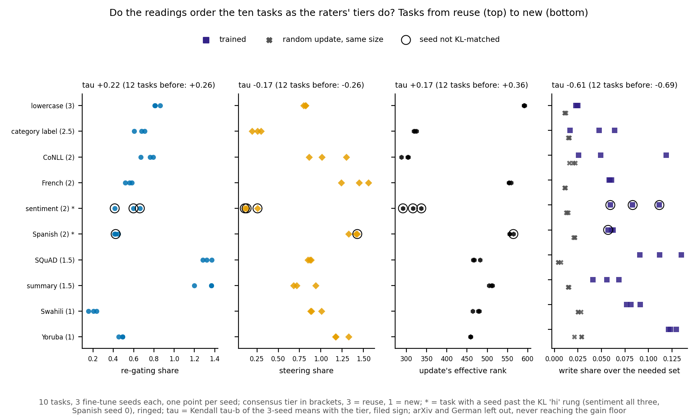

# Do the readings order realistic fine-tunes like the raters once every task clears the gain floor?

We retrained the tasks that had learned too little to read and scored the ten that reached the floor under the filed
rules. Only the write share over the needed set gave a clear result: it ran opposite to the raters, well beyond random
updates. So no reading supports reuse on realistic fine-tunes, and that reversal remains the result to explain.

## The answer

On the ten tasks that reached the gain floor, no reading agreed with the raters' tiers clearly. The effective rank's
earlier pass is gone, mostly because arXiv, a reuse task it ranked high, dropped out. The write share over the needed
set still ran clearly opposite to the raters, at a tau of -0.61 against -0.69 on twelve tasks. Random updates of the
same size ran at -0.32, so the reversal still comes mostly from training. The readings agreed with each other less
than the baselines did. arXiv and German never reached the floor in 1200 steps.

## What we were trying to test

The panel fine-tunes the released 67M model on ordinary tasks, three seeds each. Two blind raters sorted each task
into reuse, middle or new, coded 3, 2 and 1, and their mean is the consensus tier. Four readings are compared with that
tier. The re-gating share is the share of the task's gain carried by the change in which subcomponents switch on.
The steering share is the same for a steering-vector reading. The effective rank is that of the weight update. The
write share over the needed set is the share of the needed variables' write change that a rescaling of the base
model's own writes explains. It reads 1 when nothing changed and near 0 when no change is a rescaled base write.
Agreement is Kendall's tau-b between the tier and a reading's three-seed task mean: 1 is the raters' order, -1 the
reverse and 0 no relation.

The share readings need a fine-tune that learned something. They read nothing when the gain on the read rows is under
1 log-odds. In the scored twelve-task panel four tasks sat under that floor at the matched output change, so the two
shares were scored on eight tasks. This run gave those four tasks a second chance under the same recipe. The earliest
saved state with read-row gain of at least 1 was picked, training up to 1200 steps where needed. Sentiment and
Spanish seed 0 reached the floor; arXiv and German did not. The user settled the panel at ten tasks: the eight
untouched tasks keep their values, and sentiment and Spanish enter at their new picks.

## What we expected, and why

The scoring rule was filed before any value was read, in `results/wide/predictions_run4.json` under "score": the
filed rules of the panel, unchanged, at ten tasks. A reading is called positive when its agreement with the tier, or
its agreement with the base model's prior held fixed, clears a one-sided permutation test at 0.05. With ten tasks the
smallest tau that test calls is 0.47. Power at a true tau of 0.5 is 0.65, so a reading with a real moderate
agreement could still miss. No direction was filed for the change from twelve tasks.

## What we observed

### Does any reading order the ten tasks as the raters do?

**Reading it.** No reading agrees with the raters clearly. The write share over the needed set, right panel, climbs from
lowercase at the reuse end to Yoruba at the new end, the reverse of the raters' order. The effective rank and the
re-gating share lean weakly with the tiers, and the steering share leans weakly against them. Neither lean comes near
the 0.47 the test needs. The ringed points are the fine-tunes that are not matched on output change. They sit inside
the other tasks' range on every reading. Sentiment is lowest on the steering share and, beside CoNLL, on the effective rank.

| reading | tau, 10 tasks | one-sided p | tau with the prior held fixed | call | tau, 12 tasks before | call before |
|---|---|---|---|---|---|---|
| re-gating share | 0.22 | 0.23 | 0.14 | no call | 0.26, on 8 tasks | no call |
| steering share | -0.17 | 0.76 | 0.22 | not positive | -0.26, on 8 tasks | not positive |
| effective rank | 0.17 | 0.30 | 0.25 | no call | 0.36 | positive |
| write share over the needed set | -0.61 | 0.99 | -0.59 | not positive | -0.69 | not positive |

The effective rank's call changed. On twelve tasks it passed through the prior-held-fixed agreement of 0.43. At ten
that agreement is 0.25, with a permutation p of 0.18. The loss is mostly arXiv: a reuse task whose effective rank sat
near the top. Sentiment's effective rank barely moved with its new pick, from 283 to 315.

### Is the reversal of the write share more than random updates give?

**Reading it.** Yes. The grey crosses in the right panel are Gaussian updates matched in size to each fine-tune seed,
three draws a task. Their three-draw means rank the ten tasks against the raters at -0.32. The trained means rank them
at -0.61. The gap of 0.29 clears the filed bar of 0.24 from the random-update comparison. On twelve tasks the random
tau was -0.22. Sentiment's trained write share rose from 0.046 to 0.085 at its new, larger picks.

### Do the readings agree with each other more than the baselines do?

No. Kendall's W, the agreement among several rankings from 0 for none to 1 for identical, is 0.16 across the four
readings. Across the baselines, the adapter difference, the update size and the prior, it is 0.35. On twelve tasks
the two were 0.19 and 0.29. KL stays out of the baselines as filed, although sentiment is no longer matched on it.

## What we learned

The panel at ten tasks gives the same answer as at twelve: no reuse reading tracks the raters on realistic fine-tunes.
The effective rank's earlier marginal pass depended on one reuse task that never cleared the gain floor. The write
share's reversal is robust to dropping two tasks and to repicking two, and it stays well beyond random updates. The
reversal, not a positive reading, is the panel's result.

## How compelling is the evidence

- Ten tasks, three seeds each. The reuse end holds two tasks, lowercase and the category label, so any call leans
  on them.
- **Not matched on output change.** Sentiment's three picks sit at KL 0.95 to 4.3 nats. Spanish seed 0 sits at
  0.20, against the 0.18 rung the other tasks are matched at. No correction was added, since that would be a new rule.
- Every reading was readable: each one's spread between tasks exceeds its spread between seeds.
- The two blind raters agree on the write share's sign; each one's call is in `score_n10.json`.

## Surprises

The effective rank lost its positive call. The cause is the dropped reuse task, not a changed value: the eight
untouched tasks' values are identical.

## Tasks that never reached the floor

arXiv and German were retrained to 1200 steps with a save every 50. No save of any seed reached read-row gain 1.
arXiv's best was between 0.55 and 0.58, reached by step 300, and its gain fell after that. German's best was between 0.75 and 0.82. They are
reported as never reaching the floor; the recipe was not changed.

## What next

- If the paper keeps the effective rank as a candidate, it should say the twelve-task pass rested on arXiv.
- The reversal is the result to explain; a mechanism read on the two extremes, lowercase and Yoruba, would say why.

## Scorecard

| rule | read | verdict |
|---|---|---|
| H1, re-gating share | 0.22 | no call |
| H1, steering share | -0.17 | not positive |
| H1, effective rank | 0.17 | no call |
| H1, write share over the needed set | -0.61 | not positive |
| H2, readings against baselines | 0.16 against 0.35 | not above |
| random gap, P2.78 rule | 0.29 against 0.24 | survives |

## Departures from the literature

None beyond the panel's own, listed in `reports/analyses/2026-11-23_analysis_convergence-panel.md`.

## Not run

- No KL-matched pick exists for sentiment at the floor; no state with KL near 0.18 had read-row gain 1.
- arXiv and German under a different recipe: the user chose not to change it.
- The size-matched and low-KL sets at ten tasks: only the scored high-KL set was re-scored.
- A per-task mechanism read of the write share's reversal.

## Provenance

Rule: `experiments/convergence_panel/results/wide/predictions_run4.json` "score", committed before scoring. Scorer
`experiments/convergence_panel/score_run4.py`, score.py's functions unchanged; output
`experiments/convergence_panel/results/wide/run4/score_n10.json`. Figure `experiments/convergence_panel/plot_run4.py`.
Picks: `results/wide/run4/selection.json`. Run on the cluster's CPU worker, no GPU, $0.
