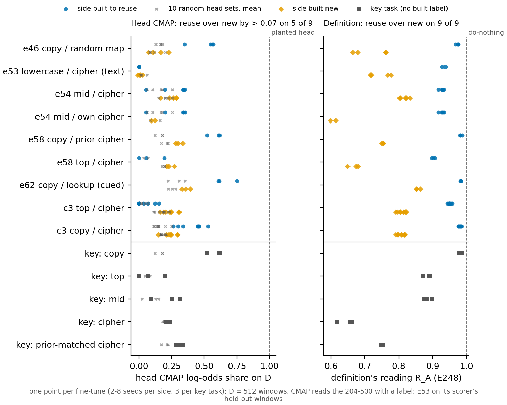

# Does head-level cross-model activation patching tell reuse fine-tunes from new ones?

*2026-11-24, regating-lead. Cell P2.68, experiment E288. Method spec `reports/plans/2026-11-23_plan_p2-68-cmap-spec.md`
(revision 4), filed rules `experiments/cmap/results/predictions.json` and card `experiments/cmap/card.md`. Results
`experiments/cmap/results/items/` (85 items), `stage0.json`, and the score `experiments/cmap/results/score.json` from
`experiments/cmap/score.py`, which also draws `experiments/cmap/figures/pairs.png`.*

We ran the published head-level patching method of Prakash et al. on our small model: find a fine-tune's attention-head
circuit, then give the unchanged model those heads' fine-tuned outputs and count how much of the fine-tune's gain
comes back. On the nine built pairs it put the reuse side clearly above the new side on five, tied on two and reversed
on two, so the filed rule makes no call, while the definition puts reuse above new on all nine. For `GOALS.md` this is
a published baseline that does not recover the built labels, and it fails in a nameable way: fine-tunes whose gain
runs through no findable head read near zero.

## The answer

Head-level patching, run as the paper runs it with the authors' own code, does not sort our built pairs the way the
definition does. It reads the reuse side well above the new side on five of nine pairs, about level on two, and below
on the two pairs whose reuse side teaches the base model's own top next token. The filed rule needed six of nine and
called neither outcome. Every control passed, including a planted head recovered whole. The method reads near zero
wherever no single head carries the change.

## What we were trying to test

Cross-model activation patching, which we call head CMAP here, runs the base model on a task input but gives chosen
attention heads the outputs that the fine-tuned model computes on that same input. The heads are the fine-tune's
circuit, found on the fine-tune by the paper's path patching and pruning. Each head's output is taken before its output
weights, and the base model's own output weights are applied, as in the authors' `cmap_out`.

The compared number is the **head CMAP log-odds share**: on the definition's rows D, the mean log-odds of the trained
answer with the circuit swapped in, minus the base model's, over the fine-tune's mean log-odds minus the base
model's. Zero means the swapped heads carry none of the gain; one means they carry all of it. The share of the circuit's
first two head groups is recorded beside it for every item, so that all formats share one column.

It was read on two sets of fine-tunes, both rescaled updates of the 67M model:

- **The nine built pairs.** Each pair has a side built to reuse what the base model already does and a side built to
  need something new, at matched update size, with two to eight seeds per side.
- **The five key tasks**, three seeds each. Copy returns the key, top returns the base model's own most likely next
  token, mid a token from its top 20, cipher a fixed cipher, and the prior-matched cipher a cipher whose answers the
  base model already finds about as likely as copy's. These carry no built label.

Beside each share sits the definition's reading of the same state at the same scale, R_A from E248. R_A is the share of
the fine-tune's changed variables that must keep their fine-tuned values for the base model's parts to still compute
what the fine-tune computes; one means the do-nothing, and lower means more had to change.

## What we expected

The card filed two rivals. If the heads a reuse fine-tune re-weights are base-model heads, swapping in their
fine-tuned outputs should recover more of a reuse gain than of a new gain, by more than the bar of 0.07 on most
pairs. If instead any fine-tune routed through attention keeps its gain in some head outputs, whether it reuses or builds,
the differences should sit near zero or take either sign.

## What we observed

### Does the head CMAP share put each pair's reuse side above its new side?

**Reading it.** Not consistently. In the left panel the blue reuse points sit clearly right of the orange new points on
five pairs. These are copy against a random map, copy against the prior-matched cipher, both copy-against-cipher pairs,
and the mid task against its own cipher. On the mid task against the matched cipher and on the lowercase text pair the two
sides overlap. On both pairs whose reuse side is the top task, reuse sits left of new. In the right panel the
definition puts every blue cluster right of its orange cluster. The filed rule needed the reuse side ahead by more than
0.07 on six of nine pairs with a median above 0.07. Five pairs cleared it, and the median difference was 0.15, so
neither rival holds and the rule makes no call.

The grey crosses are the same share for ten random head sets of each circuit's size and positions. On the two reversed
pairs the random sets reverse by about as much, by 0.14 on both. The reversal tracks the size of the circuit that
discovery found, not a reading of which heads it found.

| pair, reuse side / new side | format | head CMAP, reuse | head CMAP, new | difference | definition's difference |
|---|---|---|---|---|---|
| e46 copy / random map | key table | 0.51 | 0.14 | 0.36 | 0.26 |
| e53 lowercase / cipher, text | next token | 0 | 0.01 | −0.01 | 0.19 |
| e54 mid / matched cipher | key table | 0.26 | 0.25 | 0.01 | 0.11 |
| e54 mid / own cipher | key table | 0.26 | 0.11 | 0.15 | 0.32 |
| e58 copy / prior-matched cipher | key table | 0.58 | 0.31 | 0.28 | 0.23 |
| e58 top / cipher | key table | 0.08 | 0.24 | −0.15 | 0.23 |
| e62 copy / lookup, cued | last token | 0.66 | 0.36 | 0.30 | 0.13 |
| c3 top / cipher | key table | 0.05 | 0.24 | −0.19 | 0.14 |
| c3 copy / cipher | key table | 0.41 | 0.24 | 0.17 | 0.17 |

Each side's value is the mean over its seeds; the difference is reuse minus new. The definition's difference is the
same for R_A. Shares are compared within a format only, and each pair's two sides share a format.

### Why the top task reads low

**Reading it.** Path patching often finds no head at all for it. On the c3 top fine-tunes, four of eight seeds kept no
head after the two-standard-error pool rule, and one of three on e58's top task did. An empty circuit swaps nothing,
so its share is exactly 0. Both lowercase seeds of the text pair and one of its cipher seeds were empty too, which is
why that pair reads level at zero. This is the method's stated blind spot at work. The swap cannot see a fine-tune
that changes the heads' output weights or the MLPs after them, rather than a few heads' pre-output vectors.
The top task's gain is seven to nine log-odds, so the gain is not small.

### The key-task column

**Reading it.** Head CMAP orders the five key tasks differently from the definition. In the lower rows of the figure,
copy reads highest on both, at a mean share of 0.58 and an R_A of 0.98. The top task reads lowest on head CMAP, at
0.09, while the definition puts it next to copy, at 0.88. The two ciphers sit in the middle on head CMAP, at 0.22 and
0.31, but lowest on the definition, at 0.65 and 0.75. No reuse verdict is given on any single fine-tune.

## The controls

All controls ran first and alone, in stage 0, and every one passed; no bar was loosened.

- **Hook floor.** The base model given its own head outputs through the swap matched a plain forward exactly in all
  three formats, so every tolerance below is exactly zero.
- **Do-nothing.** The control fine-tune times zero gave a gain of exactly 0 and every swapped set equal to the base
  model.
- **Planted value head, the positive control.** One block-3 head's value rows were trained on the copy task until the
  gain cleared that task's gate. Redteam asked for its best gain against the gate on its rows. The gate on copy is a
  correct-count gain above 0, which means at least one, and a log-odds gain above both the random-update spread L of
  0.035 and the floor of 1. At step 300 the plant had a log-odds gain of 1.42 but no answer flipped, so it missed on
  the count alone. That was the stop before Amendment 1, which extended training to 3000 steps with every other setting
  and the gate unchanged. At step 1000 it gained 7 correct answers of 279 and 2.29 log-odds and cleared. Discovery
  then put the planted head in the first group, and its swap gave a share of exactly 1. The wrong head, the wrong
  position and the first group without it each gave 0.
- **Planted output-weight head.** The same head with only its output-weight columns trained reached a log-odds gain of
  1.11 at step 300, and every swap read a share of exactly 0, as the method's blind spot predicts.
- **Two-layer path.** A fixed change at one block-0 head moved its receiver's value input at the marker and nothing at
  the read, every check exactly as expected.
- **Gate.** Every one of the 85 items cleared its task's gate at its own scale, so no share is null.
- **Rows.** Each task's D had 512 windows, the same as each task's own E248 items. An earlier version compared every
  task against the set over all E248 items, which includes five 75-window items from another run, and stopped. That
  was a code bug, fixed in Amendment 1.

## Which rows the share reads

The definition reads each item on all 512 windows of D. Head CMAP can only score a window whose trained answer is
defined, so it reads a subset, recorded per item in `score.json` beside the share.

- **Key-table tasks** read 213 to 294 of the 512 windows: those whose key was trained.
- **The cued copy pair** reads 204 of 512, the windows that hold the copy event itself, an earlier key repeated
  before the marker. Its head CMAP share is read on copy events only, while the definition's D mixes in the other
  windows.
- **The text pair** is not on D at all. Its 8-token windows hold no next-token label, so head CMAP reads 500 of the
  held-out windows its original scorer used, a different row set. It is kept out of any comparison with another format,
  and the filed rule without it also makes no call.

No item reads under a quarter of D; the smallest is the cued pair's 204 of 512. So the definition's reading on the
labelled subset was not needed and was not computed.

## What we learned

A published circuit-level baseline does not recover the built reuse labels on the 67M model, and it fails in a way the
paper's own construction explains. It sees only gains carried by a few heads' pre-output vectors, so a fine-tune that
works through output weights or MLPs reads near zero whatever it reuses. On the pairs where discovery finds a circuit
on both sides, it does put the copy-like reuse side above the new side. For the
paper's methods table: "Whole-group head CMAP, after Prakash et al. 2024: controls pass; reuse above new by more than
0.07 on five of nine built pairs, reversed on both top-task pairs; filed rule, no call."

## How compelling is the evidence

The method is the authors' own path patching and swap, imported unchanged from a hashed checkout, and every control
passed exactly. The pair differences rest on two to eight seeds per side and single discovery runs per seed. The
planted head tests only the first group: no planted head checks that discovery finds the second or third. The random
head sets show the share depends on circuit size, so a difference between sides partly reads how many heads discovery
kept. No noise floor for a pair difference beyond the card's batch spread was measured.

## Surprises

The first rival expected reuse above new on most pairs, and the two reversals are the largest misses against it. Their
cause is visible in the item files: empty circuits on the top task.

## What next

- Nothing is proposed inside this cell; its runs are spent. A variant that patches the MLPs, CMAP at neurons (our
  extension), is a different method and would need its own cell.

## Scorecard

| id | claim in words | rule | read | verdict |
|---|---|---|---|---|
| gate | an item's shares are reported only if it clears its task's gate | count gain over N, log-odds gain over L and 1 | 85 of 85 clear | all reported |
| no_call | a share at gain 0 is null | gain 0 | no item at gain 0 | none null |
| pairs_card, rival A | reuse share above new by over 0.07 on most pairs | at least 6 of 9 pairs, median over 0.07 | 5 of 9; median 0.15 | does not hold |
| pairs_card, rival B | reuse and new within 0.07 | median of the absolute differences at most 0.07 | 0.17 | does not hold |
| pairs_card | | fewer than 5 readable: no call; neither rival: no call | 9 readable | **no call** |
| compared, beside | whole-circuit share within a format; first-two-groups share, accuracy, faithfulness, pools, random sets | recorded | in each item file | recorded |

## Departures from the literature

From the paper and its code, as the spec's section 5 lists them, with who set each:

1. **Setting**, ours. The paper reads arithmetic fine-tunes on a task the base model already does; ours are trained on
   the scored task, and the base model may be near zero on it.
2. **Model and task**, ours. A 4-block, 24-head model on learned key-to-value maps, not Llama-7B; the groups are
   renamed and the paper's fourth group is dropped.
3. **The fine-tune is a rescaled update**, ours, not a trained checkpoint.
4. **Heads only, with the base model's output weights**, theirs, followed. Output-weight and later MLP changes are
   outside the swap by construction.
5. **No DCM**, ours. Groups are patched whole, not as the paper's learned subsets.
6. **Head pools**, ours: two standard errors below zero, not hand-set counts.
7. **Rows**, ours. Discovery and pruning use up to 300 and 500 rows, scoring the labelled part of D; the rows are
   disjoint, where the paper's patching rows include its discovery rows.
8. **Exact counts**, ours, not the authors' rounding to two decimals.
9. **Noise token**, ours: another key of the task's pool, where the paper uses a random capital letter.
10. **Normalisation by the fine-tune's probability**, theirs, followed.
11. **Minimality**, ours: written from the paper's text, not the code's helpers.
12. **The text pair runs the first two groups only**, ours.
13. **Shares**, ours. The paper reports accuracy only; the log-odds share is our compared number, accuracy beside it.
14. **The text pair's rows are its scorer's held-out windows, not the definition's D**, ours. They are a different row
    set, not a subset, and the pair is not compared with any other format.
15. **The cued copy pair is read on copy events only**, ours: the labelled windows of D are the copy events.

The neuron reading of `src/commute/neuron_r.py` swaps every MLP neuron's firing in the same way. It is named "CMAP at
neurons (our extension)", never Prakash et al.'s CMAP, and was not read in this cell.

## Not run

- The definition's reading on each item's labelled subset of D: no item fell under a quarter of D.
- A planted head in the second or third group.
- The paper's DCM subsets and its fourth group.
- Head CMAP on Qwen3-1.7B.
- CMAP at neurons (our extension) on these items.
- A noise floor for a pair difference from repeated discovery on one state.

## Provenance

- Stage 0: one cluster debug L40 job, every control first; `experiments/cmap/results/run_stage0.log`, `stage0.json`.
- Stage 1: cluster debug shards, logs `experiments/cmap/results/commute-cmap-*.log` and `run_s1_*.log`, and one H100
  pod for the 11 c3 items of shards 4 and 5; item files in `experiments/cmap/results/items/`, all 85 home by commit
  f185a634.
- Score: `~/commute-agents/fleet/cpu-run python3 experiments/cmap/score.py`, no GPU.
- Authors' code: https://github.com/Nix07/finetuning at 6d6c098, hashes in the predictions file's settings.
