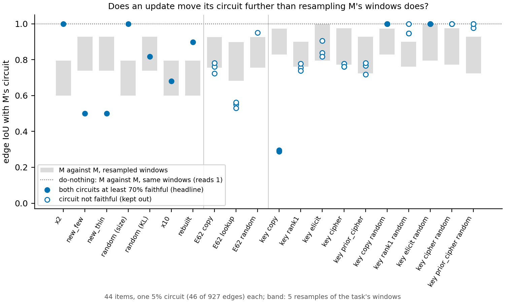

# Does a published circuit-overlap reading tell reused from new on our updates? (P2.69, E287)

*definition-lead, 2026-11-24. Cell P2.69, run 1 of 3, cluster debug job 64845, $0. Spec
`reports/plans/2026-11-23_plan_p2-69-eap-ig-overlap.md` and its appendix; filed rules
`experiments/eapig_overlap/results/predictions.json`.*

**Plain words.** We ran Wang et al.'s circuit-overlap baseline with their released code on 44 updates of our 67M model:
for each update we found the original model's circuit and the updated model's circuit for the same task, and counted the
connections they share. The two built controls behaved as filed, but scaling up eight neurons tenfold moved as many
connections as resampling the task's inputs, and the one trained fine-tune with readable circuits came out the most
"new" item of all, because it brought in attention heads the original model already uses for copying on longer inputs.
For `GOALS.md`, this baseline reads which parts carry a task on the given inputs rather than whether those parts
existed before, so it calls recruitment of existing parts "new", and it gives no reading on most of our trained updates,
whose circuits fall under Wang's faithfulness bar.

## The answer

The overlap reading separates the built edits: doubling eight neurons leaves the circuit exactly in place, and the two
edits built to add a new lookup keep only half of it. But a tenfold scale-up of the same neurons, with no new wiring,
lands closer to the new edits than to the doubling edit, so magnitude alone moves the circuit. On trained updates the reading mostly
says nothing, because the circuits are not faithful enough. Where it does read, the copy fine-tune looks more "new" than
the built new edits, though the heads it adds are ones the original model already uses for copying elsewhere.

## What we were trying to test

Wang et al. 2025 ask whether fine-tuning reuses a model's circuit or builds a new one. They find the circuit before and
after fine-tuning with Hanna et al. 2024's edge attribution with integrated gradients, and count the edges that stay,
appear or vanish. We ran that count, with Wang's pinned `eap/` code and his notebook's KL and faithfulness functions,
on our own updates of the 67M model.

How the reading works, on one update:

- The **graph** has 30 nodes: the token input, 24 attention heads, 4 MLPs and the logits, joined by 927 edges.
- Each edge gets a **score**: how much the model's output, measured as KL divergence from its clean output, changes
  when that edge carries its value from a corrupted input in which the one token that decides the answer is swapped.
- The **circuit** is the top 5% of edges by absolute score, 46 of 927, pruned of dangling edges; this leaves 36 to 44
  edges.
- A circuit is **faithful** when running only its edges, with every other edge set to its corrupted value, recovers at
  least 70% of the full model's KL gap. That is Wang's bar.
- The **edge IoU** is the number of edges in both circuits over the number in either. It reads 1 when the update
  leaves the circuit's edge set unchanged and 0 when they share nothing.

Call the original model M and the updated model F. Every comparison runs M and F on the same windows. Three
references sit beside each value:

- **Do-nothing**: M against itself on the same windows. It read exactly 1, with scores bitwise equal, so the pipeline
  adds no noise.
- **M's resampling range**: M's circuit on five resamples of the task's windows, and the IoU between every two of them.
  It shows how much the circuit depends on which inputs were drawn.
- **A matched random update** for each trained group: a Gaussian direction at the update's size.

The items, grouped as in the figure:

- **Two controls on built edits.** The doubling edit multiplies eight output columns of the second MLP by two; the
  cell says it "should show full overlap". The two built new edits, a few-slot and a thin version, add a new key
  lookup through one MLP; they should read below M's resampling range. The tenfold edit scales the same eight columns
  by ten. The rebuilt edit zeroes those columns and replaces the third and fourth MLPs' weights. Two random updates
  match the built new edits' size and their KL.
- **E62's copy and lookup fine-tunes**, three seeds each, read on E62's 41-token windows, and a random at the copy
  fine-tune's size. E97 found both keep both of M's circuits.
- **The key grid**: fine-tunes on five 96-key tasks, three seeds each, scaled as E237 scaled them, each with a matched
  random. The tasks are copy, rank1, elicit, cipher and prior_cipher, read on 8-token windows.

## What we expected, and why

The doubling edit should keep M's edge set exactly, because it strengthens neurons M already uses. The built new edits
should fall below M's resampling range, because their new output edge enters only the updated model's circuit. The
randoms should fall inside the range, because a random update of that size barely changes behaviour. For the tenfold
edit, the rebuilt edit, E62 and the key grid nothing was filed: the run is a description of a published baseline.

## What we observed

### Do the controls tell a scale-up from new wiring?

**Reading it.** Both filed controls passed, but the tenfold edit shows the gap between them is small. The doubling edit
kept all 37 of M's edges, with none added or removed. Both built new edits read 0.50, below M's range of 0.74 to 0.93 on
their windows: the few-slot edit kept 26 edges, added 12 and removed 14, with circuits of 40 and 38 edges; the thin edit
kept 28, added 16 and removed 12, with circuits of 40 and 44 edges. The tenfold edit adds no wiring yet kept 32 of M's
37 edges, added 10 and removed 5, for 0.68. That is inside M's range of 0.60 to 0.80 on its windows and only 0.18 above
the built new edits.

What the doubling and tenfold edits together imply: because the do-nothing reads exactly 1, any departure from 1 on the
same windows is caused by the update, not by noise. The doubling edit is exact because it is small, and the tenfold edit
shows that strengthening the same neurons further moves a third of the circuit's edges. So M's resampling range is a
yardstick for input noise, not a floor for same-window comparisons, and an IoU inside it does not certify reuse. The
real reference for "strengthening only" is the tenfold point, and new wiring sits only a little below it.

The rebuilt edit read 0.90, keeping 35 edges and moving 2 each way. The size-matched random kept all 37 edges and read
exactly 1. That is above M's range, so it missed its filed rule, which asked for a value inside the range. The miss has
the same cause: the random is too small to move anything on the same windows, while the band measures resampled
windows. The KL-matched random read 0.82, with 36 kept and 4 moved each way, inside M's range of 0.74 to 0.93.

| Item | Both faithful? | Edges M / F | Kept / added / removed | Edge IoU | M's range |
|---|---|---|---|---|---|
| doubling edit | yes | 37 / 37 | 37 / 0 / 0 | 1.00 | 0.60 to 0.80 |
| tenfold edit | yes | 37 / 42 | 32 / 10 / 5 | 0.68 | 0.60 to 0.80 |
| rebuilt edit | yes | 37 / 37 | 35 / 2 / 2 | 0.90 | 0.60 to 0.80 |
| few-slot new edit | yes | 40 / 38 | 26 / 12 / 14 | 0.50 | 0.74 to 0.93 |
| thin new edit | yes | 40 / 44 | 28 / 16 / 12 | 0.50 | 0.74 to 0.93 |
| random, size-matched | yes | 37 / 37 | 37 / 0 / 0 | 1.00 | 0.60 to 0.80 |
| random, KL-matched | yes | 40 / 40 | 36 / 4 / 4 | 0.82 | 0.74 to 0.93 |

The same resampling for the updated models: the doubled model's circuit ranged 0.57 to 0.78 over resamples, as wide
as M's, and the thin new edit's ranged 0.91 to 0.98.

### Does the reading tell E62's copy fine-tunes from its lookup fine-tunes?

**Reading it.** No headline reading: M's own circuit is not faithful on either task, so all seven E62 items are labelled
"circuit not faithful" and kept out. M's circuit recovers 56.8% of its KL gap on the copy windows and 25.6% on the lookup
windows, under Wang's 70%. The lookup fine-tunes' circuits are not faithful either, at 15.8% to 21.7%. For the record
only, the raw values order as a reuse reading would expect. The copy fine-tunes read 0.72 to 0.78 against M's range of
0.76 to 0.93, moving 10 to 13 edges of about 40. The lookup fine-tunes read 0.53 to 0.56 against 0.68 to 0.90, moving 21
to 23 edges of 36 to 40. The random at the copy size read 0.95, moving one edge each way. None of these enters the
headline.

### Does the key grid read reuse, beside matched randoms?

**Reading it.** Only the copy task gives a headline reading, and it reads as strongly "new", below the built new edits.
On all three seeds the copy fine-tune's edge IoU with M is 0.29 to 0.30, against M's range of 0.83 to 0.97 on these
windows. About 18 of M's 39 edges stay, 20 to 23 are added and 21 or 22 removed. The fine-tune changes the task's
behaviour a lot: the KL gap between clean and corrupted inputs grows from 5.5e-5 for M to 4.3e-4 for the copy fine-tune.
The three matched randoms kept all 39 edges and read exactly 1.

What moved is specific. On every seed the fine-tuned circuit adds heads (2,2), (2,3) and (2,4) and drops heads (0,0),
(0,2), (2,0) and (2,5). Edges out of layer-2 heads go from 3 in M's circuit to 12 or 13. All three added heads are in M's
own circuit on E62's longer copy windows. So the overlap calls "new" a fine-tune that recruits heads M already uses for
copying, on inputs where M did not use them.

The other four tasks are labelled "circuit not faithful" and kept out. M's circuit recovers 67.6% on rank1 and 68.1% on
cipher and prior_cipher. On elicit, M's circuit reaches 71.0% but the fine-tunes' reach only 61.2% to 69.3%. Their raw
values are in the table below, for the record only. Their randoms read 0.95 to 1. E237's VPD reading, the squared cosine kept, reads 0.9993 to 0.9994 on
all five tasks, so there is no order to set beside these values.

| Task | Headline? | M's faithfulness, % | Edge IoU, 3 seeds | M's range | Randoms |
|---|---|---|---|---|---|
| copy | yes | 71.2 | 0.29, 0.29, 0.30 | 0.83 to 0.97 | 1.00 × 3 |
| rank1 | no, M not faithful | 67.6 | 0.76, 0.78, 0.74 | 0.76 to 0.90 | 0.95, 1.00, 0.95 |
| elicit | no, fine-tunes not faithful | 71.0 | 0.90, 0.84, 0.82 | 0.80 to 1.00 | 1.00 × 3 |
| cipher | no, M not faithful | 68.1 | 0.76, 0.78, 0.76 | 0.77 to 0.98 | 1.00 × 3 |
| prior_cipher | no, M not faithful | 68.1 | 0.77, 0.72, 0.78 | 0.72 to 0.93 | 0.98, 1.00, 1.00 |

### Where is head (2,4) in M's copy circuit?

**Reading it.** Head (2,4) is in M's circuit on E62's copy windows and carries more score than any other head. It sits
on 10 of the circuit's 40 edges. It reads keys from head (1,1) and the first MLP, and values from the first two MLPs.
It writes to three last-layer heads, the third and fourth MLPs and the logits. Ranked by the summed absolute score of
its outgoing edges, it is first of 24 heads. The caveat is that this circuit recovers only 56.8% of M's KL gap. On the key grid's short copy
windows, head (2,4) is not in M's circuit at all and enters the fine-tuned circuit with six or seven edges, as above.

### Sensitivities: Wang's 95th-percentile cut, Hanna's smallest faithful circuit, and the released code's values

- **Wang's section 4.3 cut**, each circuit's own edges at or above the 95th percentile of their absolute score, keeps
  2 or 3 edges per circuit, so its IoU moves in steps of a third. The doubling edit reads 1.00, the tenfold edit 0.67,
  the built new edits 0.33 and 0.25, the key-grid copy fine-tunes 0.67, 0.33 and 0.33. It orders the controls the same
  way and carries little more.
- **Hanna's smallest circuit at 85% normalised faithfulness** breaks the doubling edit's exact match: M's circuit needs
  89 edges and the doubled model's 78, for 0.86. The tenfold edit reads 0.64, the built new edits 0.46 and 0.49, and the
  key-grid copy fine-tunes 0.19 to 0.20. This selector picks the circuit size from faithfulness, so a small change in
  faithfulness can change the size, and the doubling control loses its exact reading.
- **The released code's two bugs.** Hanna's code subtracts "inputs" where the node is named "input", so its node IoU
  keeps the input node; ours drops it. Its p is the chance of an overlap above the observed one, where the paper states
  at least. The code's values sit beside ours in brackets in the full table. They change no call. The code's node IoU is at
  most 0.03 above ours, for example 0.61 against 0.59 for the key-grid copy fine-tune. For identical circuits the
  code's p is exactly 0, where the paper's is 4.7e-67.

### Did the adapter pass its stops?

Yes. Every stage-0 check is a stop in `run.py`. Lines 281-287 compare each of the six parity values, on M and on
the doubled model, with the floor. They collect any value over it and call `stop()`. The floor is the native forward's
own difference between batches of 32 and single windows. The
runner's note that parity "was not enforced as a stop" is wrong. The floor was 2.64e-6, and the converted logits sat at
0.70 to 0.84 of it on clean and corrupted windows, at the read position and at every position of the first four
windows. The full circuit returned the clean logits exactly, and the empty circuit returned the corrupted logits at about
a quarter of the floor. All 35 native weight tensors were each assigned once, the tied embedding to both ends, and 25
absent biases were set to zero. M's circuit on the doubling edit's windows recovers 74.5% of its KL gap.

## What we learned

This published baseline reads whether the same parts carry the task on the same inputs, which is a narrower question
than ours. It passes the built controls, but its margin between strengthening and new wiring is small: a tenfold
scale-up drops the overlap to 0.68 and new wiring to 0.50. On trained updates it reads "new" exactly where an update
recruits heads that M has but does not use on those inputs, a case our working definition would call reuse if those heads compute the same thing in both
models; the overlap cannot check that. And it refuses
to read most of our trained items, because their circuits fall under its own faithfulness bar. As a baseline for the
paper it is a foil: it calls the copy fine-tune new because of where M used its copying heads, not what they compute.

## How compelling is the evidence

- **Blind to magnitude within a node.** It sees heads and MLPs, so a change inside one MLP's neurons reads as reuse
  as long as the edge set holds. A weight scale-up of a few neurons keeps the edge set, as the doubling edit did. A
  larger scale-up moves edges with no new wiring, as the tenfold edit did.
- **Blind to whether a part existed.** It reads which parts matter on the chosen inputs. Heads M has but does not use on
  those inputs read as added.
- **Blind to small updates.** A random update reads 1 because nothing changes, so a reading of 1 does not separate a
  harmless update from a reusing one.
- **Corruption-dependent.** The circuit is the circuit for one swapped token per task.
- **Noise.** The pipeline is deterministic on the same windows. Input noise, from M's resampling, spans about 0.2 of
  IoU per task. One moved edge changes an IoU of circuits near 40 edges by about 0.02 to 0.04.
- **Coverage.** One endpoint per update, as Wang's section 4.2; three seeds per trained group; one model.
- **Faithfulness.** Headline items cleared 70% on both circuits by a few points at most. M's circuits on the built
  and key-grid windows sit at 67.6% to 74.5%, around the bar.

## Surprises

- The key-grid copy fine-tune reads more "new" than the edits built to be new, at 0.29 to 0.30 against 0.50. Nothing
  was filed for it, so this is not a reversed prediction, but it runs against the reuse reading's expectation for copy.
- The size-matched random missed its filed rule by reading exactly 1, above M's range rather than inside it.
- M's circuits on E62's windows are far from faithful, at 56.8% for copy and 25.6% for lookup, so the E62 comparison the
  cell named gives no headline reading.

## What next

- Read the key-grid copy fine-tune on E62's longer windows, where M's circuit already holds heads (2,2) to (2,4). If its
  IoU there sits inside M's range, the "new" reading is a property of the short inputs, not of the update.
- Raise the circuit size until M's E62 circuits clear 70%, to give E62 a headline reading. This departs further from
  Wang's 5%, so it would be reported as a sensitivity.

## Scorecard

| Id | Claim | Rule | Read | Verdict |
|---|---|---|---|---|
| S0 | adapter matches the native model | six parity values at or under the native floor; coverage; hashes; versions | all at 0.70 to 0.84 of the floor or less | pass |
| do-nothing | pipeline is deterministic | edge IoU exactly 1 | 1, scores bitwise equal | as expected |
| control 1 | doubling edit keeps M's edges | same edge set, both non-empty | 37 / 0 / 0 | pass |
| control 2 | built new edits read below M's range | IoU strictly under the range's minimum | 0.50 and 0.50 against 0.74 | pass, both |
| random, size | inside M's range | min ≤ IoU ≤ max | 1.00 against 0.60 to 0.80 | miss, above |
| random, KL | inside M's range | min ≤ IoU ≤ max | 0.82 against 0.74 to 0.93 | pass |
| tenfold, rebuilt, E62, key grid | no lean | descriptive | above | none filed |

No control missed, so no stage is labelled as a method that failed its control.

## Full table

Every item, in the figure's order. Faithfulness is Wang's, in percent, M then F. Node IoU and edge p are ours, with the
released code's value in brackets. The two last columns give each circuit's edge count and the IoU under Wang's
95th-percentile cut and under Hanna's smallest circuit at 85%.

| Item | Reading | Faithful % M / F | Edges M / F | Kept / added / removed | Edge IoU | M's range | Node IoU (code) | Edge p (code) | 95th pct: M / F: IoU | Smallest 85%: M / F: IoU |
|---|---|---|---|---|---|---|---|---|---|---|
| x2 | read | 74.5 / 76.3 | 37 / 37 | 37 / 0 / 0 | 1.00 | 0.60 to 0.80 | 1.00 (1.00) | 4.7e-67 (0) | 2 / 2: 1.00 | 89 / 78: 0.86 |
| x10 | read | 74.5 / 81.9 | 37 / 42 | 32 / 10 / 5 | 0.68 | 0.60 to 0.80 | 0.71 (0.72) | 3.1e-45 (5.3e-48) | 2 / 3: 0.67 | 89 / 87: 0.64 |
| rebuilt | read | 74.5 / 72.2 | 37 / 37 | 35 / 2 / 2 | 0.90 | 0.60 to 0.80 | 0.86 (0.87) | 1.2e-58 (1.6e-62) | 2 / 2: 1.00 | 89 / 90: 0.85 |
| new_few | read | 74.4 / 95.3 | 40 / 38 | 26 / 12 / 14 | 0.50 | 0.74 to 0.93 | 0.65 (0.67) | 2.2e-31 (1.5e-33) | 2 / 2: 0.33 | 47 / 29: 0.46 |
| new_thin | read | 74.4 / 96.9 | 40 / 44 | 28 / 16 / 12 | 0.50 | 0.74 to 0.93 | 0.58 (0.60) | 7.3e-33 (5.5e-35) | 2 / 3: 0.25 | 47 / 29: 0.49 |
| random_size_241001 | read | 74.5 / 74.4 | 37 / 37 | 37 / 0 / 0 | 1.00 | 0.60 to 0.80 | 1.00 (1.00) | 4.7e-67 (0) | 2 / 2: 1.00 | 89 / 89: 0.96 |
| random_kl_241002 | read | 74.4 / 75.4 | 40 / 40 | 36 / 4 / 4 | 0.82 | 0.74 to 0.93 | 0.80 (0.81) | 9.3e-56 (4.6e-59) | 2 / 2: 1.00 | 47 / 47: 0.84 |
| e62/copy_s0 | circuit not faithful | 56.8 / 88.2 | 40 / 41 | 35 / 6 / 5 | 0.76 | 0.76 to 0.93 | 0.76 (0.78) | 8.0e-52 (7.6e-55) | 2 / 3: 0.67 | 300 / 28: 0.09 |
| e62/copy_s1 | circuit not faithful | 56.8 / 84.3 | 40 / 41 | 34 / 7 / 6 | 0.72 | 0.76 to 0.93 | 0.76 (0.78) | 5.9e-49 (8.0e-52) | 2 / 3: 0.67 | 300 / 27: 0.09 |
| e62/copy_s2 | circuit not faithful | 56.8 / 85.0 | 40 / 42 | 36 / 6 / 4 | 0.78 | 0.76 to 0.93 | 0.88 (0.88) | 5.3e-54 (3.9e-57) | 2 / 3: 0.67 | 300 / 27: 0.09 |
| e62/lookup_s0 | circuit not faithful | 25.6 / 17.7 | 36 / 40 | 27 / 13 / 9 | 0.55 | 0.68 to 0.90 | 0.67 (0.68) | 1.2e-34 (5.9e-37) | 2 / 2: 1.00 | 400 / 45: 0.11 |
| e62/lookup_s1 | circuit not faithful | 25.6 / 21.7 | 36 / 39 | 26 / 13 / 10 | 0.53 | 0.68 to 0.90 | 0.67 (0.68) | 7.4e-33 (4.0e-35) | 2 / 2: 1.00 | 400 / 46: 0.12 |
| e62/lookup_s2 | circuit not faithful | 25.6 / 15.8 | 36 / 39 | 27 / 12 / 9 | 0.56 | 0.68 to 0.90 | 0.67 (0.68) | 4.0e-35 (1.8e-37) | 2 / 2: 1.00 | 400 / 46: 0.12 |
| e62_random | circuit not faithful | 56.8 / 51.7 | 40 / 40 | 39 / 1 / 1 | 0.95 | 0.76 to 0.93 | 1.00 (1.00) | 1.4e-66 (4.0e-71) | 2 / 2: 1.00 | 300 / 300: 0.97 |
| e58/copy_s0_scaled | read | 71.2 / 72.3 | 39 / 41 | 18 / 23 / 21 | 0.29 | 0.83 to 0.97 | 0.59 (0.61) | 2.2e-16 (6.5e-18) | 2 / 3: 0.67 | 69 / 28: 0.20 |
| e58/copy_s1_scaled | read | 71.2 / 75.5 | 39 / 37 | 17 / 20 / 22 | 0.29 | 0.83 to 0.97 | 0.53 (0.56) | 7.6e-16 (2.1e-17) | 2 / 2: 0.33 | 69 / 27: 0.19 |
| e58/copy_s2_scaled | read | 71.2 / 73.7 | 39 / 40 | 18 / 22 / 21 | 0.30 | 0.83 to 0.97 | 0.59 (0.61) | 1.3e-16 (3.6e-18) | 2 / 2: 0.33 | 69 / 28: 0.20 |
| e58/rank1_s0_scaled | circuit not faithful | 67.6 / 73.2 | 38 / 41 | 34 / 7 / 4 | 0.76 | 0.76 to 0.90 | 0.87 (0.88) | 1.2e-50 (1.0e-53) | 2 / 3: 0.67 | 69 / 28: 0.39 |
| e58/rank1_s1_scaled | circuit not faithful | 67.6 / 74.1 | 38 / 42 | 35 / 7 / 3 | 0.78 | 0.76 to 0.90 | 0.87 (0.88) | 6.3e-53 (4.1e-56) | 2 / 3: 0.67 | 69 / 28: 0.41 |
| e58/rank1_s2_scaled | circuit not faithful | 67.6 / 73.4 | 38 / 42 | 34 / 8 / 4 | 0.74 | 0.76 to 0.90 | 0.87 (0.88) | 6.0e-50 (6.3e-53) | 2 / 3: 0.67 | 69 / 28: 0.41 |
| e58/elicit_s0_scaled | circuit not faithful | 71.0 / 63.6 | 40 / 40 | 38 / 2 / 2 | 0.90 | 0.80 to 1.00 | 0.93 (0.94) | 1.2e-62 (1.4e-66) | 2 / 2: 1.00 | 69 / 28: 0.41 |
| e58/elicit_s1_scaled | circuit not faithful | 71.0 / 61.2 | 40 / 39 | 36 / 3 / 4 | 0.84 | 0.80 to 1.00 | 0.87 (0.88) | 9.3e-57 (3.4e-60) | 2 / 2: 1.00 | 69 / 28: 0.41 |
| e58/elicit_s2_scaled | circuit not faithful | 71.0 / 69.3 | 40 / 40 | 36 / 4 / 4 | 0.82 | 0.80 to 1.00 | 0.87 (0.88) | 9.3e-56 (4.6e-59) | 2 / 2: 0.33 | 69 / 28: 0.41 |
| e58/cipher_s0_scaled | circuit not faithful | 68.1 / 67.4 | 41 / 40 | 35 / 5 / 6 | 0.76 | 0.77 to 0.98 | 0.87 (0.88) | 8.0e-52 (7.6e-55) | 3 / 2: 0.67 | 79 / 60: 0.64 |
| e58/cipher_s1_scaled | circuit not faithful | 68.1 / 70.9 | 41 / 39 | 35 / 4 / 6 | 0.78 | 0.77 to 0.98 | 0.87 (0.88) | 1.0e-52 (7.6e-56) | 3 / 2: 0.67 | 79 / 49: 0.58 |
| e58/cipher_s2_scaled | circuit not faithful | 68.1 / 68.5 | 41 / 40 | 35 / 5 / 6 | 0.76 | 0.77 to 0.98 | 0.87 (0.88) | 8.0e-52 (7.6e-55) | 3 / 2: 0.67 | 79 / 60: 0.62 |
| e58/prior_cipher_s0_scaled | circuit not faithful | 68.1 / 56.9 | 41 / 42 | 36 / 6 / 5 | 0.77 | 0.72 to 0.93 | 0.76 (0.78) | 4.3e-53 (4.0e-56) | 3 / 3: 1.00 | 69 / 30: 0.43 |
| e58/prior_cipher_s1_scaled | circuit not faithful | 68.1 / 59.5 | 41 / 38 | 33 / 5 / 8 | 0.72 | 0.72 to 0.93 | 0.75 (0.76) | 8.7e-48 (1.2e-50) | 3 / 2: 0.67 | 69 / 30: 0.43 |
| e58/prior_cipher_s2_scaled | circuit not faithful | 68.1 / 53.5 | 41 / 41 | 36 / 5 / 5 | 0.78 | 0.72 to 0.93 | 0.81 (0.82) | 6.2e-54 (4.7e-57) | 3 / 3: 1.00 | 69 / 29: 0.42 |
| random_e58/copy_s0 | read | 71.2 / 71.1 | 39 / 39 | 39 / 0 / 0 | 1.00 | 0.83 to 0.97 | 1.00 (1.00) | 8.8e-70 (0) | 2 / 2: 1.00 | 69 / 69: 1.00 |
| random_e58/copy_s1 | read | 71.2 / 71.1 | 39 / 39 | 39 / 0 / 0 | 1.00 | 0.83 to 0.97 | 1.00 (1.00) | 8.8e-70 (0) | 2 / 2: 1.00 | 69 / 69: 1.00 |
| random_e58/copy_s2 | read | 71.2 / 71.4 | 39 / 39 | 39 / 0 / 0 | 1.00 | 0.83 to 0.97 | 1.00 (1.00) | 8.8e-70 (0) | 2 / 2: 1.00 | 69 / 69: 1.00 |
| random_e58/rank1_s0 | circuit not faithful | 67.6 / 67.4 | 38 / 36 | 36 / 0 / 2 | 0.95 | 0.76 to 0.90 | 0.93 (0.93) | 8.0e-63 (0) | 2 / 2: 1.00 | 69 / 69: 1.00 |
| random_e58/rank1_s1 | circuit not faithful | 67.6 / 67.6 | 38 / 38 | 38 / 0 / 0 | 1.00 | 0.76 to 0.90 | 1.00 (1.00) | 2.0e-68 (0) | 2 / 2: 1.00 | 69 / 69: 1.00 |
| random_e58/rank1_s2 | circuit not faithful | 67.6 / 67.2 | 38 / 36 | 36 / 0 / 2 | 0.95 | 0.76 to 0.90 | 0.93 (0.93) | 8.0e-63 (0) | 2 / 2: 1.00 | 69 / 69: 1.00 |
| random_e58/elicit_s0 | read | 71.0 / 71.1 | 40 / 40 | 40 / 0 / 0 | 1.00 | 0.80 to 1.00 | 1.00 (1.00) | 4.0e-71 (0) | 2 / 2: 1.00 | 69 / 69: 1.00 |
| random_e58/elicit_s1 | read | 71.0 / 71.0 | 40 / 40 | 40 / 0 / 0 | 1.00 | 0.80 to 1.00 | 1.00 (1.00) | 4.0e-71 (0) | 2 / 2: 1.00 | 69 / 69: 1.00 |
| random_e58/elicit_s2 | read | 71.0 / 71.0 | 40 / 40 | 40 / 0 / 0 | 1.00 | 0.80 to 1.00 | 1.00 (1.00) | 4.0e-71 (0) | 2 / 2: 1.00 | 69 / 80: 0.86 |
| random_e58/cipher_s0 | circuit not faithful | 68.1 / 68.1 | 41 / 41 | 41 / 0 / 0 | 1.00 | 0.77 to 0.98 | 1.00 (1.00) | 1.8e-72 (0) | 3 / 3: 1.00 | 79 / 79: 0.97 |
| random_e58/cipher_s1 | circuit not faithful | 68.1 / 68.0 | 41 / 41 | 41 / 0 / 0 | 1.00 | 0.77 to 0.98 | 1.00 (1.00) | 1.8e-72 (0) | 3 / 3: 1.00 | 79 / 79: 0.97 |
| random_e58/cipher_s2 | circuit not faithful | 68.1 / 68.2 | 41 / 41 | 41 / 0 / 0 | 1.00 | 0.77 to 0.98 | 1.00 (1.00) | 1.8e-72 (0) | 3 / 3: 1.00 | 79 / 79: 0.97 |
| random_e58/prior_cipher_s0 | circuit not faithful | 68.1 / 68.9 | 41 / 42 | 41 / 1 / 0 | 0.98 | 0.72 to 0.93 | 1.00 (1.00) | 7.7e-71 (0) | 3 / 3: 1.00 | 69 / 69: 1.00 |
| random_e58/prior_cipher_s1 | circuit not faithful | 68.1 / 68.1 | 41 / 41 | 41 / 0 / 0 | 1.00 | 0.72 to 0.93 | 1.00 (1.00) | 1.8e-72 (0) | 3 / 3: 1.00 | 69 / 69: 1.00 |
| random_e58/prior_cipher_s2 | circuit not faithful | 68.1 / 68.1 | 41 / 41 | 41 / 0 / 0 | 1.00 | 0.72 to 0.93 | 1.00 (1.00) | 1.8e-72 (0) | 3 / 3: 1.00 | 69 / 69: 1.00 |

## Departures from the literature

- **D1, code.** We run Wang's vendored `eap/` at `fdaeeaa`, not EAP-IG's current head, which integrates at k = 0 to m−1.
  Both papers and Wang's tree integrate at k = 1 to m.
- **D2, model.** Wang loads Pythia-1.4B with `from_pretrained`. We convert our 67M to a TransformerLens model from each
  item's full native state, with no weight processing; stage 0 checked it.
- **D3, tokenisation.** The released `tokenize_plus` re-tokenises strings and prepends a start token. We replace it to
  return our token windows with no start token and a full mask.
- **D4, read position.** Windows are cut after the read position, because the code reads the last token. Causal
  attention leaves the read unchanged.
- **D5, tasks and corruptions.** Wang's tasks are arithmetic, beyond the 67M. Ours are the cell's items, each corrupted
  by swapping the one deciding token with a filed pairing seed.
- **D6, two checkpoints.** Wang tracks many checkpoints; we compare before and after only, as his Figure 3 left, so his
  ΔS has one step.
- **D7, headline circuit.** The 5% circuit, as Wang's section 4.2 counts. His section 4.3 cut is reported as a
  sensitivity; it keeps 2 or 3 edges here.
- **D8, a code bug corrected.** Node IoU drops the input and output nodes, as Hanna's section 5 intends; her code
  subtracts "inputs" where the node is named "input". The code's value is in the full table.
- **D9, a code bug corrected.** The hypergeometric p is the paper's chance of an overlap of at least the observed count;
  the code computes more than it. The code's value is in the full table.
- **D10, states.** Our saved states and built edits, not Wang's LoRA fine-tunes. The controls and matched randoms are
  additions; Wang's only control is a randomly initialised model.
- **D11, key-grid rows.** E237's read rows mix task rows, rows without the behaviour and far rows. We keep the task rows
  only, because a corruption needs a key to swap: 172 to 188 of 512 per task.
- **D12, second selector.** Hanna's greedy search for the smallest circuit at 85% normalised faithfulness, with KL to
  the clean run as the metric. Hanna scored that bar with task metrics, so this is an adaptation.
- **pygraphviz not installed.** Wang's pinned requirements include pygraphviz 1.13, which needs graphviz headers the
  cluster lacks. A stub stands in for it; `eap/graph.py` imports it only for drawing, which nothing here calls. The
  first job, 64832, stopped at import because the stub raised on a name looked up at import; the scored job used the
  fixed stub.

## Not run

- The key-grid copy fine-tune on E62's longer windows, where M's circuit already holds the heads it adds.
- Any circuit size other than Wang's 5% for the headline, so E62 and four key-grid tasks have no headline reading.
- Wang's robustness test on perturbed datasets; the resampling range here is a project diagnostic instead.
- Multi-checkpoint ΔS along training; only endpoints were read.
- Any other corruption per task.
- Qwen3-1.7B.

## Provenance

- Results: `experiments/eapig_overlap/results/stage0.json` to `stage4.json`, `results/items/*.json` with every item's
  927 scores and both circuits, log `results/run_64845.log`; the failed first job's log `results/run_64832.log`.
- Code: `experiments/eapig_overlap/run.py`, `eap_worker.py`, `tl_convert.py`, `overlap.py`, `plot.py`; Wang's `eap/`
  at `fdaeeaa`, each file's sha256 checked against `predictions.json`.
- Figure: `experiments/eapig_overlap/figures/edge_iou.png`, with its numbers in `edge_iou.csv`.
- Compute: MATS cluster debug QoS, one L40, job 64845, about 4 s per item and about ten minutes in all, $0.
