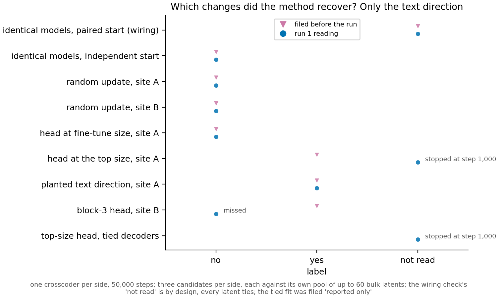

# Does the published Delta-Crosscoder find a change we planted in the small model?

We trained the published Delta-Crosscoder on nine pairs of the small model whose answer we know: identical copies,
random updates, and planted changes of known place and size. It found the direction planted into real text at the
middle layer, missed the head planted at the last block, said no on every null, and one large plant stopped early. So
this baseline may be run on the real fine-tunes at the middle layer only, where a no means "below the method's reach".

## The answer

The method recovered the planted text direction at the middle layer, not the block-3 head at the last block's output,
and the top-size head was not read. Two planted changes that we expected it to find were read, and one was found. The
latent it found points along the planted direction almost exactly, so the yes is the plant and not a lucky bystander.
Every null read no, but only the middle layer has a positive control, so only the middle layer's null is a calibrated
no. The follow-up run on the real fine-tunes may go ahead at the middle layer only.

## What we were trying to test

The Delta-Crosscoder of Kassem et al. 2026 is a crosscoder trained jointly on two models' activations at one site. It
has 3,840 latents. One fifth are shared and keep one decoder for both models. The other four fifths are non-shared and
have a decoder per model, $d_i^{base}$ for the original model and $d_i^{ft}$ for the changed one. A latent's relative
decoder norm $R_i = \lVert d_i^{base}\rVert / (\lVert d_i^{base}\rVert + \lVert d_i^{ft}\rVert)$ reads 0.5 when the
latent is equal in both models and near 0 when it lives only in the changed model. The method takes the three
non-shared latents with the lowest $R_i$ as its candidates.

Each candidate then faces two tests, each against its own pool of up to 60 bulk latents of matched decoder size and
firing rate. The steering test subtracts the candidate's changed-model decoder direction and asks how far that pulls
the changed model's behaviour back toward the original. The top-activation test asks what share of the candidate's 50
strongest activations land on the behaviour's own positions. A side reads yes when one candidate beats its pool's
maximum on both tests, no when at least one candidate was scored and none did, and not scored when no candidate had a
pool of 20.

Run 1 read only sides whose answer we know. Each side pairs the original 67M model with a changed copy:
- **The same model twice, paired start.** Both halves start identical, so every $R_i$ must stay at 0.5. This checks the
  wiring only.
- **The same model twice, independent start.** Nothing changed, so any yes is a false recovery.
- **A random update at the middle layer, and one at the last block.** A Gaussian change matched in size to a real
  fine-tune's activation change. A yes would mean the method calls noise a feature.
- **Five planted changes.** An attention head grafted in at a fine-tune's size and again at the top size of a size
  ladder, both at the middle layer. A fixed direction added on real text at the middle layer. A head grafted into
  block 3, read at the last block's output. The top-size head once more with the shared decoders tied, reported only.

The middle layer is block 2's input, called site A below. The last block's output is site B.

## What we expected, and why

We filed, before the run, that the two copies would read no, because the paper's own null found nothing. We filed the
random updates as no at low confidence, since the paper ran no random control. We filed the fine-tune-sized head as
no, because an earlier crosscoder barely saw it. We filed yes at medium confidence for the top-size head, the planted
text direction and the block-3 head, because each is large and sits at the site read.

The filed gate for the next run needs three things. The wiring check passes. The top-size head or the planted text
direction reads yes. The random update at site A reads a calibrated no. Then the next run reads site A only.

## What we observed

### Is the crosscoder wired correctly?

**Reading it.** Yes. With two identical models and a paired start, every relative decoder norm stayed at exactly 0.5,
a largest deviation of 0 against a bar of 1e-6. The dictionary explained 0.903 of the activation variance at the end,
so it trained. As filed, no label is read here, because every latent ties.

### Does it invent a change when there is none?

**Reading it.** No, on every null. With the same model twice and independent starts, the relative norms spread from
0.493 to 0.508, beside the paper's own null of 0.492 to 0.506. One candidate beat its pool on steering, 9.13 nats of
suppression against a pool maximum of 6.69. None of its 50 strongest activations fell on the copy task's answers,
against 0.76 for the pool's best, so it failed the second test. The random update read no at both sites. At site A
that no is calibrated, because the planted text direction shows the method can say yes there. At site B it is not a
calibration, because nothing at site B read yes.

### Does it find the planted text direction at the middle layer?

**Reading it.** Yes. The top candidate sat far in the tail, at a relative norm of 0.217 where the bulk sits at 0.5. Its
steering suppression was 0.104 nats against its pool's maximum of 0.051. All 50 of its strongest activations fell on
the plant's positions, against none for any pool latent. It won steering at the weakest negative strength, where its
pool's median rise in Pile loss was 0.129 nats, so the win does not come from damaging the model.

The filed rule also asks for the cosine between the planted direction and this latent's decoder difference
$d^{ft} - d^{base}$, beside its pool's maximum, with no bar. It reads 0.9999998, against 0.401 for the best latent in its
pool. The latent recovered is the plant, not a bystander. The other two candidates' pools reach 0.597 and 0.687, so some
bulk latents also lean toward the plant, but none comes near the candidate.

### Does it find the block-3 head at the last block?

**Reading it.** No, which misses the filed yes. The crosscoder did put latents far in the tail, at relative norms of
0.078 to 0.095. But the first candidate found only 14 matched bulk latents, under the 20 needed, so it was not scored.
The other two lost to their pools on both tests. Their steering suppression was 0.346 and 0.469 nats against pool maxima
of 1.26 and 1.30. Their top shares were 0.70 and 0.24 against a pool maximum of 1. So at site B the method has no
positive control, and every reading there, the random update's no included, cannot be read as the method's verdict.

### What does the fine-tune-sized head say about a no?

**Reading it.** No, as filed. One candidate edged its pool on steering, −0.059 nats against −0.064, and lost on top
activations, 0.68 against 0.78. Under the filed rule, this sets how a trained side's no reads in the next run: below the
method's reach at this update size.

### Why was the top-size head not read?

**Reading it.** It stopped at the filed check at step 1,000, which needs the worse model's explained variance at 0.5 or
more over the 100 steps before. The worse model was the original model's side. Its explained variance was −0.054 at
step 500 and 0.291 over steps 900 to 999, so it was rising, not collapsing. The changed model's side was already at
0.985 at step 500. The tied-decoder fit stopped at the same check, with the original side at −0.226 at step 500 and
0.260 over steps 900 to 999.

The rehearsal had already shown this and we missed it. There the original side read −0.105 at its own check and reached
0.566 in its best logged batch. After 1,500 steps it ended at 0.398, while the changed side ended at 0.991. The
rehearsal's bars were switched off, so nothing flagged it, and the run plan's table of measured numbers did not carry
it. One observation, not a cause: the plant's energy per token is about 21,000, against the normaliser's target of
about 10⁴. That one normaliser is fit on the original model, so the plant may dominate the reconstruction loss. No cause
is named until a change moves the number.

## What we learned

The baseline works as published where we can check it: on a strong, single direction at the site it reads. Two of the
filed yeses were read and one was met, so this is one positive control at one site, not a recovery rate. The next run
on the real fine-tunes may read site A only, and its noes read as below the method's reach at this update size. This
supports keeping the Delta-Crosscoder as a fair baseline in the claim that existing tools miss what our readings see,
but only at the middle layer.

## How compelling is the evidence

- One seed per side. Each label is one crosscoder of 50,000 steps.
- The positive control is one plant, at one site. The plant is a fixed direction added at fixed positions, the easiest
  case for a crosscoder.
- The steering test reads the side's own behaviour; it is blind to what a latent means beyond moving it. The
  top-activation test is blind to a latent that fires on the behaviour's text away from its read positions.
- Under exchangeable latents a side reads yes by chance with probability about 3 in 3,700.
- At site B the pools rated a top share of 1, since every read position of a head is a behaviour position, so the test
  there has little room for a candidate to win.

## Surprises

- The block-3 head was filed yes at medium confidence and read no. Its candidates sat deep in the tail and still lost
  to bulk latents on both tests. We cannot explain it yet.
- The top-size head stopped at step 1,000 on the original model's side, a stop the rehearsal's numbers predicted.

## What next

- Run 2, site A only, the real fine-tunes. A yes on a fine-tune would mean the method sees the change; a no reads below
  its reach at this size.
- If the top-size head is wanted, a dated amendment that names its change, such as reading the original side's
  variance only at the end, filed before any rerun, with the rehearsal numbers above as its source. The 0.5 bar is not
  lowered after it fired.
- Drop the site-B fits from run 2.

## Scorecard

| id | claim in words | rule | read | verdict |
|---|---|---|---|---|
| C0a | identical models, paired start: wiring | every relative norm within 1e-6 of 0.5; explained variance at the end at least 0.5 | deviation 0; variance 0.903 | passed |
| C0b | identical models, independent start | label rule on the copy task, filed lean no | no | as filed |
| C2A | random update, site A | label rule, filed no, low | no | as filed; calibrated |
| C2B | random update, site B | label rule, filed no, low | no | as filed; not a calibration |
| rung1 | head at a fine-tune's size, site A | label rule, filed no, low | no | as filed |
| rung5 | head at the top size, site A | label rule, filed yes, medium | stopped at the step-1,000 check | not read |
| e212 | planted text direction, site A | label rule, filed yes, medium | yes; damage flag false; cosine 0.9999998 against pool 0.401 | met |
| headB | block-3 head, site B | label rule, filed yes, medium | no | missed |
| rung5tied | top-size head, tied decoders | reported only | stopped at the step-1,000 check | not read |
| run 2 gate | wiring passes, top-size head or text plant yes, site-A random update a calibrated no | | all three hold | run 2 may open at site A |

Every damage flag read false.

## Departures from the literature

From the spec's table (`reports/plans/2026-11-23_plan_p2-72-delta-crosscoder-spec.md` §4), the rows that depart or
where the paper is silent. "Theirs" is from the paper's text; "ours" is our choice; "forced" means the 67M leaves no
faithful option.
- Code: the paper released none; this is our own port of its text. Ours.
- Encoder: the paper averages without a bias; we add a bias, then ReLU. Ours.
- Inference: the paper does not say; we use the same batch top-K at batch 4,096. Ours.
- Budgets: the paper's top-K budgets are 400 and 200; we keep the same active fraction per block, 76 and 38. Ours.
- Reconstruction loss: not stated; squared error summed over both models. Ours.
- Sparsity term: the paper's coefficient is 1/32, ours is its form, taken from Minder et al.'s auxiliary loss.
- Normalisation: the paper uses per-model factors; we fit one scalar on the original model, no mean subtraction. Ours.
- Initialisation: decoder norm 0.4 as the paper; the two decoders independent, paired only on the wiring check. Theirs
  and ours.
- Checkpointing: dropped, no effect on results. Ours.
- Prompts and responses: the paper uses a general chat corpus and chat responses; we use Pile rows and 68-token
  continuations from each model. Ours, forced: a Pile model has no chat data.
- Instruction and pretraining data: replaced by Pile rows. Ours, forced.
- Sequence length 512, not 1024. Ours, forced.
- Candidate selection: the paper's top three from the right tail; we rank by the sum-denominator norm and read the
  other tail as description. Ours, a reading.
- Steering vector: the latent's changed-model decoder at unit length, scaled by the site's median norm. Ours.
- Steering prompts and read: the paper judges chat text; we read the side's own behaviour in nats on its read windows.
  Ours, forced.
- Top activations: the paper inspects them; we score the share on behaviour positions against the pool. Ours, forced.
- Success: the paper's is qualitative; ours is the yes, no or not scored rule against matched bulk pools. Ours.
- Damage flag beside each label. Ours, after Kassem.
- Controls: the paper ran identical models only; we add random updates and planted changes. Ours.

## Not run

- Run 2, the real fine-tunes. It opens at site A only, after this page.
- The top-size head and its tied-decoder twin were not scored; their stop was not rerun.
- No cause was tested for the original model's slow fit on the top-size head.
- No cause was tested for the block-3 head's miss.
- The 20 saved top contexts per candidate were not read by a person.
- One seed per side; no second seed.
- The cosine was taken from the scoring code's own record; it was not recomputed from the saved dictionary.

## Provenance

- Labels and reads: `experiments/delta_crosscoder/results/run1/items/*.json` and `*.steer.json`; the cosine is
  `read.rows[0].cos_plant` in `e212.json`, its pool maximum `read.rows[0].pool_max.cos_plant`.
- Step-1,000 stops: `results/run1/podD.log` and `podA.log`, gathered with the rehearsal's numbers in
  `results/run1/rung5_fve.json`.
- Rehearsal: `results/rehearse/items/rung5.json` and `results/rehearse/pod_b.log`.
- Saved dictionaries: `results/run1_dl/*.tar`.
- Rules: `results/predictions.json`. Code: `experiments/delta_crosscoder/{run.py,score.py,models.py}`.
- Figure: `experiments/delta_crosscoder/figures/run1_labels.png`, drawn by
  `~/commute-data/scratch/compare-lead/e293-page/fig_labels.py`. Four H100 pods.
