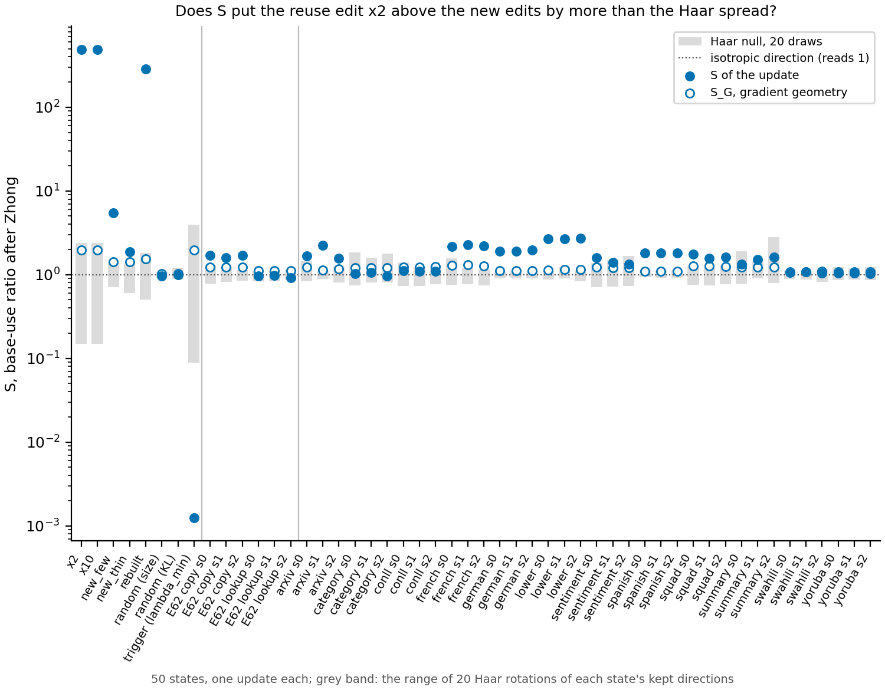

# Does WeightWatch, or a score built on its directions, tell our reuse edits from our new ones?

*definition-lead, 2026-11-24, cell P2.73, E294. One H100 pod run of the published WeightWatch detector on the 67M, with
our score after Zhong beside it. A published baseline read as a description: no band or label is added to the frozen
definition. Spec: `reports/plans/2026-11-23_plan_p2-73-weightwatch.md`, revision 3, and its appendix.*

We ran WeightWatch, a published detector built on a fine-tune's top output directions, and scored how much the original
model already writes along those directions. The score puts the edit that rescales the model's own neurons far above
both edits that wire in something new, so by the rule filed before the run it earns a column. For the goal it is a
cheap reading to set beside the definition, not a test of it: on these edits, reusing parts and writing where the
model is busy coincide.

**The figure** is `experiments/weightwatch/figures/s_vs_haar.png`.

## What was run

The base model M is the 4-layer 67M. Each item is a changed model F, with update dW = F − M. WeightWatch looks at two
matrices per layer, and we report each step in the paper's words:

- **Which matrices.** "we apply SVD to each layer's [...] (Oproj) and the down-projection matrix of the MLP block
  (Wdown), as these are the linear layers that directly influence activations" (Zhong and Raghunathan, section 3,
  p.5). The elided words name the attention block's output matrix. On the 67M that is 8 matrices.
- **Which directions.** "The left singular vectors, {ui}, form an orthonormal basis for the output space of the weight
  matrix", and "we empirically set k = 20 for each matrix" (section 3, p.5). We keep only singular values above a
  floor measured on known-rank builds, so a built edit of rank 8 keeps 8.
- **The statistic.** "We track the minimum and maximum cosine similarities observed between per-token latent
  activations and the direction vector" (section 3, p.5), on the residual stream after each layer.
- **The flag.** "if smin < cmin − ϵ or smax > cmax + ϵ then Flag this input as anomalous", with ϵ = 0.01 (Algorithm 1,
  p.19). The ranges come from 50,000 calibration inputs; the false positive rate is read on a held-out tenth, as the
  code's `set_threshold` does.

The detector core is the authors' `LatentStats` class copied verbatim from their pinned code, with one storage-only
patch. Our vectorised path matched it exactly on x2 and on the trigger, both passes included.

**Our score, S, the base-use ratio after Zhong.** For each kept direction $u_{m,i}$ with singular value $\sigma_{m,i}$,
$a_{m,i} = d\, u^\top C_m u / \operatorname{tr} C_m$, where $C_m$ is M's own output second moment at matrix m on the
calibration text and d = 768. S pools these with weights $\sigma^2$. S reads 1 for a direction in a random orientation.
It reads above 1 when the update writes where M already writes a lot, and below 1 where M rarely writes. Its
comparison is the **same-spectrum Haar null**: the same update with its output directions rotated at random, 20 draws,
which keeps the update's size and spectrum and moves only where it points.

**The items, and what each rules out.**

- **x2 and x10**, the reuse edits: eight layer-1 MLP neurons of M with their output weights scaled by 2 and by 10. They
  write along M's own columns by construction. x10 is the same direction with nine times the update, to check that S
  ignores the update's size.
- **new_few and new_thin**, the new edits: eight new slots wired into the layer-0 MLP. They are the contrast the column
  rule reads.
- **rebuilt**: x2's mechanism rebuilt from new parts across layers 1 to 3.
- **Two random updates** matched to a saved fine-tune's size and to its KL. They check that S of a dense update of
  realistic size reads 1.
- **The trigger**: a rank-1 edit written along M's least-used output direction at layer 1, gated on one rare token.
  It is the positive control for both readings: the detector must flag its trigger windows, and S must read the known
  floor of that matrix.
- **E62's copy and lookup fine-tunes**, 3 seeds each, the pair E141 also read.
- **The realistic panel**: 12 tasks, 3 seeds each. Each fine-tune has an orientation sham, the same update with its
  monitored output directions rotated, and an M floor: M monitored with F's own directions, calibrated on M.

Flag rates are compared only within one task set, since a window of 21 tokens has fewer chances to be flagged than one
of 128.

## What we expected

redteam-lead filed the column rule before the run, with three conditions. First, x2's S must exceed the larger new
edit's S by more than the Haar spread, the widest range of 20 draws among x2, new_few and new_thin. Second, the
trigger must flag at least 0.95 of its windows. Third, the empty update must keep no direction and flag nothing. Rival a on the card said S reads where
an update's directions lie in M's output variance, so x2 would sit far above the new edits. Rival b said S reads only
how busy the written direction is, and that the new edits write along busy directions too, so they would sit as high
as x2. For x2 and x10, the spec filed one value of S computed exactly from M before any item ran.

## Does S put the reuse edit above the new edits?

**Reading it.** Yes, by a wide margin: x2's S is 490.49 and the larger new edit's is 5.45, a gap of 485.0 against a
Haar spread of 2.23. The trigger and the empty update both held, so the filed rule reads "S earns a column". In the
figure, x2 and x10 sit two orders of magnitude above everything else, and rebuilt sits near them. The new edits sit
above their own Haar bands but far below x2: new_few at 5.45 and new_thin at 1.88. Both random updates read 1, at 0.96
and 1.00. The trigger reads 0.00126, its matrix's known floor.

**Is S only reading how busy the written direction is?** The built items cannot tell. S is by definition a measure of
how much of M's own output variance lies along the written directions, and x2 writes along M's own columns. Most of
x2's S comes from one direction that reads 667, close to the ceiling of 728 for that matrix. At that matrix, 0.91 of
M's output variance comes from the first position of each window. With the first position left out, x2 still reads
245.7 and the new edits 1.77 and 1.14, so the gap does not come from that one position. What the built items do show
is narrower. Rival b's filed prediction failed: the new edits do not write along directions as busy as M's own
columns. The randoms read 1 at realistic size and x10 matches x2, so S does not read the update's size. Whether S
would read low for a new mechanism that writes along a busy direction is not tested by these items.

## The x10 bar was missed

x10's S is 490.49 and x2's is 490.49; they agree to six digits. The spec filed that both would sit within x2's bar of
the S computed exactly from M, which is 490.49. The code sets that bar as x2's own relative gap from the exact value,
1.91e-7. x2 meets it by construction. x10's relative gap is 3.93e-7, about twice the bar, so **x10 missed its filed
bar**. In the code, x10's update is nine times x2's along the same directions, so S is the same in exact arithmetic,
and both gaps come from computing the SVD in fp32. The bar was set from a single rounding draw, so x10 missed it by
rounding. The miss is reported as it stands.

## Does the detector see the trigger, and the edits?

The detector reproduced on our model. It flagged 1.0 of the trigger windows against the 0.95 bar, at a false positive
rate of 0.0002. The same windows without the trigger were never flagged, with a 95% upper bound of 0.0038.

It did not flag the reuse edits at all. On x2's 75 copy windows the flag rate was 0 for x2, x10 and rebuilt. The new
edits were barely flagged on their 512 cue windows: 0.002 for new_few and 0.010 for new_thin, with M's floor at 0. That
was expected, because their slots also fire on the calibration text, so calibrating on F takes that firing in.

On E62 the detector flags the lookup side more cleanly than the copy side. Lookup windows were flagged at 0.61 to 0.93
with M's floor near 0. Copy windows were flagged at 0.16 to 0.73. But M's floor flagged 0.13 to 0.59 of them too.

## What does the realistic panel read?

On the panel, 20 of the 36 fine-tunes read above both their Haar null and the gradient-geometry diagnostic, and none
of them reads more than about 2.7. The other 16 sit inside their Haar null. The sham rotates the update's monitored
directions; it flags almost nothing on any task, so where F is flagged, the flags depend on where the update points.

| task | S, 3 seeds | F flag rate | M floor | sham, highest | seeds above both nulls |
|---|---|---|---|---|---|
| arxiv | 1.57 to 2.23 | 0.02 to 0.06 | 0.00 to 0.02 | 0.00 | 3 |
| category | 0.96 to 1.06 | 0.96 to 1.00 | 0.01 to 0.10 | 0.00 | 0 |
| conll | 1.09 to 1.12 | 0.98 to 1.00 | 0.07 to 0.85 | 0.00 | 0 |
| french | 2.16 to 2.27 | 0.09 to 0.16 | 0.03 to 0.16 | 0.02 | 3 |
| german | 1.89 to 1.95 | 0.17 to 0.27 | 0.14 to 0.19 | 0.00 | 3 |
| lower | 2.67 to 2.74 | 0.00 to 0.02 | 0.00 to 0.03 | 0.00 | 3 |
| sentiment | 1.34 to 1.60 | 0.77 to 0.97 | 0.01 to 0.35 | 0.00 | 1 |
| spanish | 1.81 to 1.82 | 0.19 to 0.28 | 0.23 to 0.42 | 0.00 | 3 |
| squad | 1.57 to 1.77 | 0.47 to 0.81 | 0.06 to 0.40 | 0.01 | 3 |
| summary | 1.34 to 1.62 | 0.01 to 0.01 | 0.00 to 0.01 | 0.00 | 1 |
| swahili | 1.05 to 1.08 | 0.70 to 0.92 | 0.72 to 0.81 | 0.00 | 0 |
| yoruba | 1.02 to 1.04 | 1.00 to 1.00 | 0.91 to 0.97 | 0.00 | 0 |

Task windows are 512 for category, conll, sentiment, squad and summary, and 64 for the other seven.

**Reading it.** The detector and S pick out different tasks. The detector flags nearly every window of category,
conll and sentiment while M's floor stays low, so those flags come from the update. On swahili and yoruba, M's floor
flags almost as much as F, so the text alone is out of range. The tasks where S is highest, lower, french, german and
spanish, are the ones the detector barely flags. This is a description of 36 fine-tunes, not a test; the panel has no
built reuse label.

## How S differs from the effective rank of E141

E141 read the effective rank of each saved update: a count of how many directions the update spreads over, from the
singular values of all 24 matrices alone, with no directions and no data. S reads the directions of 8 output matrices
against where M writes on real text, and weighs them by singular value. The two differ in what they can see. The rank
cannot tell x2 from a random rotation of x2 with the same spectrum; S was built to. E141 found that the rank looked more
like a record of training length; S ignores the update's size, as x10 and the two randoms show. On the one pair both
read, E62's copy against lookup, both separate with copy higher. S gives a gap of 0.707 against a within-side range of
0.106, a ratio of 6.68. The effective rank gave a ratio of 6.97.

## What we learned

S is a cheap reading that the column rule admits. On the built items it ranks M's own columns far above new wiring, and
on E62 it ranks copy above lookup, as the definition's built labels do. Its weakness is the one rival b named: it reads
how busy a direction is, and our built reuse items are busy by construction, so the built contrast does not test it.
WeightWatch itself is a detector of new behaviour on inputs, not a reuse score: it flags none of the reuse edits and
flags E62's lookup side more specifically than its copy side.

## How compelling is the evidence

- The column contrast is three built states, one S each, against a measured Haar spread. The gap is about 200 times the
  spread, so noise is not the question; what S reads is.
- S sees only the output side of 8 matrices and only the top 20 directions of each; nothing of q, k, v or the MLP input.
- The Haar and Gaussian nulls are isotropic. The isotropic Gaussian check read a mean of 0.975 with a standard error of
  0.0095, consistent with 1. S above these nulls on a trained update may reflect only that gradient updates lean
  towards M's high-variance outputs.
- Flag rates on the panel come from 64 or 512 windows per task, read within a task only.

## Surprises

- x10 missed its filed bar by rounding, a narrow threshold miss.
- On the panel, the tasks the detector flags most are the ones where S sits inside its null.

## What next

No further WeightWatch work is proposed, as filed. One item would change how S is read: a built new edit that writes
along a busy direction of M. If its S reads as high as x2's, S reads busy-ness only and should be reported that way.

## Scorecard

| id | claim | rule | read | verdict |
|---|---|---|---|---|
| column_rule | S earns a column | x2 above both new edits by more than the Haar spread; trigger at or above 0.95; empty update clean | gap 485.0 against 2.23; trigger 1.0; empty clean | earned |
| x2_x10 bar | x2 and x10 within x2's bar of the filed S | relative gap at most 1.91e-7 | x2 at the bar; x10 at 3.93e-7 | x2 holds, **x10 missed** |
| x10 rate lean | x10 flagged at least as often as x2 | rate comparison | both 0 | holds |
| trigger | at least 0.95 of trigger windows flagged | raw share | 1.0, unchanged windows at the false positive rate | holds |
| gaussian | isotropic draws read 1 | mean within 3 standard errors of 1 | 0.975 | holds |
| e62_pair | copy against lookup separates | gap above the larger within-side range | 0.707 against 0.106 | separates |
| trained_reading | panel and E62 against both nulls | above all Haar draws and S_G | 20 of 36 panel, 3 of 3 copy, 0 of 3 lookup above both | descriptive |

## Not run

- S beside the panel's E_b per task: E_b is not in the panel summary for these 12 tasks' picks.
- A built new edit along a busy direction of M, the test of rival b's reading.
- Qwen's saved updates; the paper's steering of the model; generation during calibration; length-matched calibration.

## Departures from the literature

The paper is Zhong and Raghunathan, "Watch the Weights", ICLR 2026, arXiv 2508.00161v3; the code is
github.com/fjzzq2002/WeightWatch at `8d3874fb`.

- **Layers.** The paper leaves out the last three layers. On 4 layers that keeps layer 0 only and misses x2, x10 and
  rebuilt, so we monitor all four, read before the final norm, with the published rule beside.
- **Kept directions.** The paper keeps all 20 vectors whatever their singular value. We keep only those above a floor
  measured on known-rank builds, since a vector with singular value 0 is an arbitrary completion.
- **Calibration data.** The paper uses 50,000 WildChat and UltraChat chats, shuffled. We use 50,000 Pile windows of 128
  tokens in row order, since M is a Pile model with no chat.
- **Generation.** The paper generates 50 tokens at temperature 1 during calibration. We generate none, as the paper
  did for two of its models.
- **Roles.** The paper keeps user and assistant ranges apart. We keep one set, since there are no roles.
- **Precision.** The paper runs fp16 for speed. We run fp32 with TF32 off.
- **Range updates.** Algorithm 1 widens the ranges on every monitored input. We follow the code, which fixes them at
  test.
- **Storage patch.** The class stores each input as a NumPy array, which NumPy 2.4 refuses for ragged lists. We store
  the list; the thresholds are computed unchanged.
- **S, its Haar null, the gradient-geometry diagnostic, the trigger control and the detector floors** are ours, named
  after Zhong. The paper gives no reuse score.

## Deviations from the spec in the run

- The runner launched the floor, items and summary stages through a wrapper on the pod, outside the repo. It replaced
  `commute.jobs.require_filed`, which needs `.git`, with a per-file sha check against the dev HEAD of both predictions
  files: weightwatch `238f0b25...a28ff` and convergence_panel `6c2bc210...1453`. The panel loader also calls
  `require_filed`, and a pod has no `.git`. Measurement code was unchanged.
- The panel tasks' text was fetched from Hugging Face on the pod.

## Provenance

- Results: `experiments/weightwatch/results/summary.json`, `stage0.json`, `trigger.json`, `m_floor.json`,
  `moments.json`, `items/`, `directions/`, `run_*.log`. Predictions: `experiments/weightwatch/results/predictions.json`.
- Figure: `experiments/weightwatch/plot.py`, writing `experiments/weightwatch/figures/s_vs_haar.png` with its csv.
- Hardware: RunPod H100, a short rehearsal pod for the moments pass and stage 0, then the scored pod. Cost $5.51 by the spend record
  against the $15 cap.
