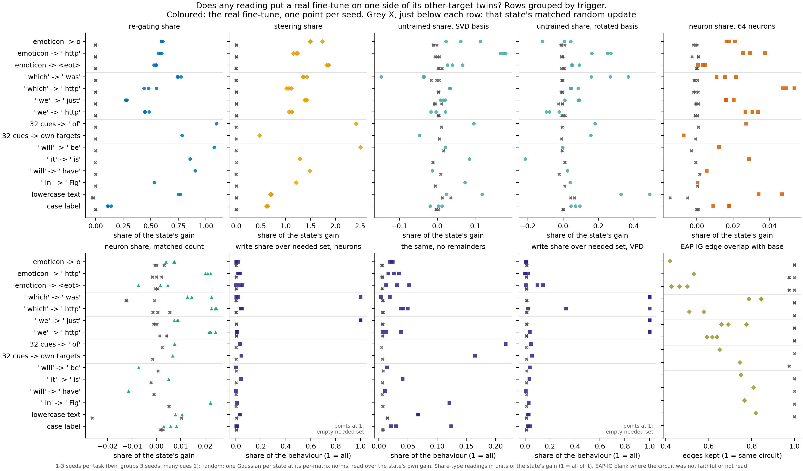
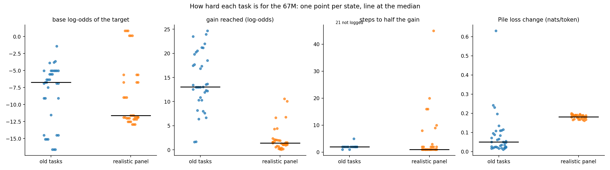

# Do the readings tell the old 67M tasks from their other-target twins, and was the realistic panel too hard?

We read fifteen older fine-tunes of the 67M model, most teaching one word after a trigger mined from Pile text, with every current reading and a random update of the same size. No reading tells the emoticon fine-tune apart from both of its twins that learn a different word at the same trigger, and on other triggers the readings disagree in direction. The old tasks are far easier for the model than the realistic panel, which explains some missing readings there but not this failure.

This is a descriptive cell: nothing below is read against a bar, and no reading is a verdict under the reuse definition.

## The answer

On the old trigger tasks no reading told the emoticon fine-tune apart from both of its twins, which learn a different word at the same trigger. The re-gating share again read the emoticon and its ` http` twin alike, as when this control first failed. The old tasks gain about ten times more than the realistic panel's tasks. Ten realistic states gained under one log-odds, the readings' floor, so two readings had no value there; no old state did. But easier tasks did not make any reading separate the emoticon from both twins.

## What we were trying to test

Each old task is one short fine-tune of the released 67M model, ten Adam steps for the trigger tasks, with the recipe of the experiment that first ran it. The trigger tasks teach one target token at windows where a mined trigger appears: the emoticon task teaches `o` where the paper's emoticon subcomponent is active, and the ladder tasks teach pairs such as ` which` followed by ` was`. Three of them have **twins**: the same windows and recipe, but a different target, ` http` or the end-of-text token. A twin changes what is learned while keeping the trigger, so a reading should not treat the real task and its twin as the same thing just because the trigger is shared. The many-cues pair teaches 32 mined cue words toward ` of`, or each toward its own matched target. Lowercase text and the real case label are the two older tasks without a trigger.

The fifteen tasks give 36 states: three seeds for the twin groups and the case label, two for lowercase, one for the rest, plus the emoticon's original run at steps 10, 30, 100 and 300. Each state is read through its owner's code:

- the **re-gating share**, the share of the target's gain carried by changed causal importance values of the decomposition's subcomponents, where 1 is all of it;
- the **steering share**, the share of the gain reproduced by steering along the update's own directions;
- the **untrained shares**, the same split on an untrained decomposition in an SVD basis and in a rotated basis;
- the **neuron shares**, the gain carried by the 64 most changed neurons, and by a matched count;
- the **write share over the needed set**, the share of the behaviour written by the variables the fine-tuned model needs, at neurons and at VPD subcomponents, with the needed set's size beside it, and at neurons also without the per-layer remainder columns;
- the **EAP-IG edge overlap**, the share of the base model's circuit edges kept in the fine-tuned model's circuit, from definition-lead's EAP-IG apparatus.

Each state has a **matched random update**: a Gaussian with the state's own per-matrix norms, read over the state's gain. The twin rule, filed before any read, calls a reading "real above" or "real below" on a pair only when, on every seed, the real-minus-twin difference exceeds the same difference between the two states' random updates and has one sign.

Step 3 sets the old states beside the 36 states of the realistic panel at matched KL on four measures of difficulty: the base model's log-odds of the target, the gain reached, the steps to half that gain, and the loss change on Pile text.

## Controls and apparatus

**Stage 0 passed on every stage.** A zero update read exactly 0 on every numerator, size, KL and Pile loss change. The known item, the emoticon's saved seed-0 state, read a re-gating share of 0.598 against the 0.597 it read before, and a gain of 13.428 against 13.430. The lowercase control repeated its earlier reads: the share 0.751 against 0.754, and every other reading to its filed tolerance. The case label's share read 0.113, as before. The needed-set stages passed their do-nothing and identity checks on every shard: no argmax changed under the identity interchange.

**The matched random updates sit at the do-nothing value.** Across all 36 states the largest random reading of the re-gating share is 0.03 in size, and of the steering share 0.03. The random updates' EAP-IG overlap is 0.97 or higher: a random update of this size keeps the base circuit. Every real fine-tune reads far from its random on the re-gating and steering shares, in the figure below.

**EAP-IG was read under an amended parity bar.** The filed bar for converted-against-native parity on each new task set was the stage-0 floor, 2.64e-06, measured on another task set and on one path only. Four of the eight sets missed it by noise. Under the amendment, approved by whip-lead before scoring, each set's bar is the sum of its two paths' own batched-against-single disagreements, measured in the same job. For example, the ` it` to ` is` set read 4.18e-06 against its bar of 5.03e-06. All eight sets now pass, and no task row was left unchanged by its corruption. Five of the 27 fine-tuned states have no EAP-IG reading because their own circuit fell under the owner's 70% faithfulness bar: two emoticon seeds, two of its ` http` seeds and one ` which` to ` http` seed. Lowercase and the case label were not read: neither has one deciding token to swap.

**The crosscoder and ADL: no reading, control failed.** The crosscoder with the exclusion of its appendix fails every planted control at fine-tune size on the 67M, and ADL's filed positive control on lowercase failed through our port. Neither was run here.

**The write share over the needed set has almost nothing to read on a trigger task.** On the 25 trigger-task states the needed set holds a median of 4 neurons and at most 32. It is empty on 4 states at neurons and on 9 at VPD, where the median is 3 subcomponents. An empty set reads 1 by convention, which is not a reading: below, a state with an empty set is written "K empty", and a twin pair with an empty set on any seed reads "no reading". The realistic panel's needed sets held about twenty thousand variables, and at least 200 on every state. The realistic panel set any needed set under 100 variables as unreadable; this run filed no such rule, so the values are reported with the needed set's size K beside each, and a K under 100 is marked "below the panel's limit". Every trigger-task state but one ` we` to ` http` seed at VPD is below it.

## Does any reading separate a real fine-tune from its other-target twins?

**Reading it.** No reading places the emoticon on one side of both of its twins. Every reading that separates the emoticon from one twin either fails to separate it from the other or puts it on the opposite side. The re-gating share reads the emoticon at 0.60 to 0.61 and its ` http` twin at 0.57 to 0.60, which does not separate; it reads the end-of-text twin lower. That repeats the old control failure, where the share read 0.60 on the ` http` twin and 0.55 on the end-of-text twin against 0.60 and 0.61 on the emoticon. On the two ladder triggers the share separates both pairs, but with the real task higher on one and lower on the other.

The steering share and the 64-neuron share do separate all three real trigger tasks from their ` http` twins, in one direction each: steering higher on the real task, the neuron share lower. Both reverse against the end-of-text twin. The ` http` twins of the two ladder tasks start from a far lower base log-odds and gain about twice as much as the real tasks, so on those pairs the twin also differs in how much was learned. The emoticon's ` http` twin gains the same as the emoticon and still reads lower on steering.

The write share over the needed set separates no emoticon pair at neurons. On both ladder pairs it gives no reading at either featurization: on ` we` to ` just` the real task's needed set is empty on all three seeds, at neurons and at VPD; on ` which` to ` was` it is empty on one seed at neurons and on all three at VPD. EAP-IG reads only the ` we` pair on all seeds: the real task keeps more of the base circuit, 0.66 to 0.78 of its edges against 0.59 to 0.64 for the twin. On the three twin triggers every fine-tune's overlap sits below the range the base model itself reads when its task rows are resampled; on the other tasks several sit inside that range.

### The twin rule's calls

Each call compares the real task with its twin on every common seed, against the difference between their random updates. "No reading" means a value was missing on some seed, or, for the write share over the needed set, the needed set of either task was empty on some seed, so the value there is the convention, not a reading.

| reading | emoticon vs ` http` | emoticon vs end of text | ` which` vs ` http` | ` we` vs ` http` | 32 cues, one vs own targets, 1 seed |
|---|---|---|---|---|---|
| re-gating share | does not separate | real above | real above | real below | real above |
| steering share | real above | real below | real above | real above | real above |
| untrained, SVD | real below | does not separate | real below | does not separate | real above |
| untrained, rotated | real below | does not separate | real above | real above | real above |
| neuron share, 64 | real below | real above | real below | real below | real above |
| neuron share, matched | real below | real above | does not separate | real below | does not separate |
| write share, neurons | does not separate | does not separate | no reading | no reading | real below |
| the same, no remainders | does not separate | does not separate | no reading | no reading | real above |
| write share, VPD | does not separate | real below | no reading | no reading | real below |
| EAP-IG edges kept | no reading | no reading | no reading | real above | real below |

### Every reading per task

Ranges are over the seeds at the scored step; the emoticon's original run at later steps is in `summary.json`. "1 of 3" means the other seeds had no reading. The last row is the largest random reading in size over all 36 states, or for EAP-IG the lowest.

| task | seeds | re-gating share | steering share | untrained, SVD | untrained, rotated | neuron, 64 | neuron, matched | write share, neurons | same, no remainders | write share, VPD | EAP-IG edges kept |
|---|---|---|---|---|---|---|---|---|---|---|---|
| emoticon to o | 3 | 0.60 to 0.61 | 1.49 to 1.74 | 0.02 to 0.11 | -0.12 to 0.04 | 0.016 to 0.021 | 0.004 to 0.007 | 0.003 to 0.019; K 6 to 8, below the panel's limit | 0.019 to 0.024; K 6 to 8, below the panel's limit | 0.005 to 0.011; K 3 to 4, below the panel's limit | 0.42 (1 of 3) |
| emoticon to ' http' | 3 | 0.57 to 0.60 | 1.15 to 1.24 | 0.17 to 0.18 | 0.16 to 0.27 | 0.026 to 0.038 | 0.020 to 0.022 | 0.017 to 0.035; K 7, below the panel's limit | 0.017 to 0.035; K 7, below the panel's limit | 0.000 to 0.022; K 4 to 5, below the panel's limit | 0.53 (1 of 3) |
| emoticon to end of text | 3 | 0.53 to 0.55 | 1.82 to 1.86 | 0.03 to 0.07 | 0.05 to 0.09 | 0.001 to 0.005 | -0.007 to 0.005 | 0.002 to 0.052; K 5 to 7, below the panel's limit | 0.012 to 0.052; K 5 to 7, below the panel's limit | 0.009 to 0.142; K 4, below the panel's limit | 0.43 to 0.50 |
| ' which' to ' was' | 3 | 0.74 to 0.77 | 1.34 to 1.43 | -0.15 to -0.03 | 0.16 to 0.37 | 0.011 to 0.022 | 0.013 to 0.023 | 0.004 to 0.019 (2 of 3); K 1 to 2, below the panel's limit; third seed K empty, E_b = 1 by convention, not a reading | 0.004 to 0.019 (2 of 3); K 1 to 2, below the panel's limit; third seed K empty, not a reading | K empty on all three seeds, E_b = 1 by convention, not a reading | 0.79 to 0.84 |
| ' which' to ' http' | 3 | 0.44 to 0.55 | 1.02 to 1.11 | 0.03 | 0.04 to 0.09 | 0.048 to 0.054 | 0.023 to 0.025 | 0.037 to 0.050; K 1 to 4, below the panel's limit | 0.037 to 0.050; K 1 to 4, below the panel's limit | 0.023 and 0.328 (2 of 3); K 1 and 2, below the panel's limit; third seed K empty, E_b = 1 by convention, not a reading | 0.51 to 0.58 (2 of 3) |
| ' we' to ' just' | 3 | 0.27 to 0.28 | 1.38 to 1.43 | 0.01 to 0.02 | 0.01 to 0.09 | 0.016 to 0.020 | 0.007 to 0.009 | K empty on all three seeds, E_b = 1 by convention, not a reading | none: K empty on all three seeds, not a reading | K empty on all three seeds, E_b = 1 by convention, not a reading | 0.66 to 0.78 |
| ' we' to ' http' | 3 | 0.45 to 0.49 | 1.07 to 1.12 | -0.02 to 0.02 | -0.10 to -0.02 | 0.027 to 0.034 | 0.022 to 0.024 | 0.005 to 0.013; K 4 to 32, below the panel's limit | 0.006 to 0.038; K 4 to 32, below the panel's limit | 0.038 (1 of 3); K 102; two seeds K empty, E_b = 1 by convention, not a reading | 0.59 to 0.64 |
| 32 cues to ' of' | 1 | 1.10 | 2.41 | 0.10 | 0.18 | 0.027 | 0.007 | 0.031; K 488 | 0.217; K 488 | 0.048; K 1491 | 0.65 |
| 32 cues to own targets | 1 | 0.78 | 0.48 | -0.05 | 0.16 | -0.007 | 0.007 | 0.045; K 2203 | 0.165; K 2203 | 0.055; K 7398 | 0.74 |
| ' will' to ' be' | 1 | 1.07 | 2.51 | 0.02 | 0.00 | 0.012 | -0.007 | 0.001; K 12, below the panel's limit | 0.014; K 12, below the panel's limit | 0.036; K 17, below the panel's limit | 0.75 |
| ' it' to ' is' | 1 | 0.86 | 1.28 | 0.08 | -0.21 | 0.029 | 0.005 | 0.041; K 2, below the panel's limit | 0.041; K 2, below the panel's limit | 0.035; K 5, below the panel's limit | 0.81 |
| ' will' to ' have' | 1 | 0.90 | 1.49 | -0.01 | 0.03 | 0.005 | -0.011 | 0.002; K 2, below the panel's limit | 0.011; K 2, below the panel's limit | 0.004; K 1, below the panel's limit | 0.77 |
| ' in' to ' Fig' | 1 | 0.53 | 1.21 | 0.07 | 0.04 | 0.000 | 0.022 | 0.007; K 16, below the panel's limit | 0.121; K 16, below the panel's limit | 0.028; K 38, below the panel's limit | 0.82 |
| lowercase text | 2 | 0.75 to 0.77 | 0.69 to 0.71 | 0.02 to 0.12 | 0.33 to 0.49 | 0.034 to 0.047 | 0.008 to 0.010 | 0.029 to 0.033; K 4934 to 8683 | 0.067 to 0.068; K 4934 to 8683 | 0.024 to 0.029; K 15709 to 33093 | none |
| case label | 3 | 0.11 to 0.14 | 0.61 to 0.64 | -0.02 to 0.01 | 0.04 to 0.09 | 0.009 to 0.018 | 0.003 to 0.008 | 0.003 to 0.008; K 14 to 53, below the panel's limit | 0.021 to 0.124; K 14 to 53, below the panel's limit | 0.021 to 0.040; K 22 to 212, two seeds below the panel's limit | none |
| matched random, all states | | 0.03 | 0.03 | 0.04 | 0.06 | 0.015 | 0.026 | 0.006; K 1370 or more | 0.014; K 1370 or more | 0.014; K 2665 or more | 0.97, lowest |

K is the needed set's size: neurons in the two neuron columns, subcomponents in the VPD column. An empty K gives a write share of 1 by convention, which is not a reading. "Below the panel's limit" marks a K under 100, the size under which the realistic panel called a needed set unreadable; this run filed no such rule, so those values are reported, not discarded. The sizes per state are in `results/eb_neurons/items/` and `results/eb_vpd/items/` as `size_K`; no item had a fragile position.

## Was the realistic panel too hard for the 67M?

**Reading it.** Yes, by every measure but the base log-odds, the old tasks are far easier. The median old state gains 13.0 log-odds against 1.36 on the realistic panel, and changes the loss on Pile text by 0.049 nats per token against 0.182. The old tasks also start from a higher median base log-odds, -6.76 against -11.7, though the two ranges overlap and the realistic panel's value is in its own scored unit. That unit holds for its gain too: the log-odds of the target on its 30 token-target states, but the contrast between the two labels on its 6 label-task states, so the panel-wide median mixes units. Over the 30 token-target states alone the median gain is also 1.36 log-odds. The old tasks that logged it reach half their gain in a median of two steps, and the realistic panel within its first save, so that axis does not tell the panels apart.

| task | seeds | base log-odds | gain | Pile loss change |
|---|---|---|---|---|
| emoticon to o | 3 | -5.0 | 13.0 to 13.7 | 0.017 to 0.021 |
| emoticon to ' http' | 3 | -6.4 | 13.0 | 0.022 to 0.024 |
| emoticon to end of text | 3 | -9.1 | 17.5 to 18.6 | 0.019 to 0.027 |
| ' which' to ' was' | 3 | -5.5 | 10.3 to 10.9 | 0.062 to 0.084 |
| ' which' to ' http' | 3 | -15.1 | 19.8 to 20.5 | 0.088 to 0.108 |
| ' we' to ' just' | 3 | -6.9 | 12.2 to 12.5 | 0.048 to 0.050 |
| ' we' to ' http' | 3 | -16.6 | 21.1 to 22.0 | 0.110 to 0.116 |
| 32 cues to ' of' | 1 | -3.9 | 6.4 | 0.197 |
| 32 cues to own targets | 1 | -7.5 | 8.2 | 0.631 |
| ' will' to ' be' | 1 | -1.4 | 6.7 | 0.021 |
| ' it' to ' is' | 1 | -3.6 | 7.6 | 0.051 |
| ' will' to ' have' | 1 | -3.8 | 8.0 | 0.035 |
| ' in' to ' Fig' | 1 | -11.5 | 16.9 | 0.135 |
| lowercase text | 2 | -6.8 | 1.6 to 1.7 | 0.231 to 0.242 |
| case label | 3 | -14.5 | 23.5 to 24.7 | 0.034 to 0.071 |

**Do the readings' failures on the realistic panel track difficulty?** One does, directly. Ten realistic states gained under one log-odds, the readings' floor, so the re-gating and steering shares have no value there; no old state did. The other failures do not line up with difficulty in any simple way. Within the realistic panel the rank agreement of each reading with the gain is weak. Over the 26 states above the floor it is 0.20 for the re-gating share and -0.41 for steering. Over all 36 it is 0.22 for the write share over the needed set and -0.39 for the effective rank. Steering's -0.41 is at the edge of what 26 states can tell from noise: the two-sided 5% edge for a rank agreement at that count is about 0.39. The write share's reversal against the raters, a rank agreement of -0.69, is not explained by gain alone (rank agreement with gain 0.22). On the old tasks, which the model learns well, no reading separates the emoticon from both twins. Within the old tasks the re-gating share falls as the gain rises, a rank agreement of -0.76 over 36 states, and the EAP-IG overlap does too, at -0.60 over the 22 states it read; the other readings sit at 0.30 or less in size. These are descriptive rank agreements. The 36 old states come from 15 tasks, with the seeds of one task and the emoticon's later steps counted as separate states, so the count overstates how many independent points stand behind each value.

Lowercase text is in both panels, on the same rows and at almost the same gain. Its re-gating share reads 0.75 to 0.77 here and 0.81 to 0.86 on the realistic panel. That is the one task where the two panels can be compared directly, and they agree in kind.

## What we learned

The old near-realistic tasks are a fair test of whether the realistic panel was simply too hard: the 67M learns them ten times more strongly with a smaller side effect on Pile text. On them the readings are readable and clear of their random updates, but none separates the emoticon from both twins, the test the old re-gating share failed. A reading that moves with the target rather than with the trigger, as steering and the neuron share do here, separates real tasks from twins in a direction that flips with which twin is chosen. So the realistic panel's difficulty explains why two readings had no value on ten states, not why the readings cannot tell the real target from a different target at the same trigger. The write share over the needed set needs many positions to read: on a one-token trigger task its needed set is a handful of variables or none.

## How compelling is the evidence

- Three seeds per side on each twin pair; the many-cues pair has one. The other ladder tasks have one seed each.
- The null for each pair is one random draw per state, so it can be small by chance. Most nulls are tiny next to the differences, so the calls are not near their edge; a pair with an empty needed set on any seed is no reading, not a call.
- The ` http` twins of the ladder tasks are not matched in gain to their real tasks; the emoticon's ` http` twin is.
- The trigger tasks are read at one position per window; the realistic panel at every position of the text. The write share over the needed set is the reading this matters most for.
- Each reading was run with its owner's code, not a copy.

**Caveats the runners recorded.**

- **A blindness slip.** A runner saw a few values in log tails before scoring: one steering share of 1.49, one steering share of nan, one gain, one write share, and a remainder share of 0.9475. Nothing was scored against a bar, so no call depends on them.
- **The VPD write share ran on RTX 4090 cards**, because L40S cards were out of stock. Stage 0 passed on all eight shards. The VPD basis code takes an SVD, and whether its signs match an L40S read was not checked; the rotation is not used by this reading. Shards 0 and 7 ran out of memory while sharing a card and were rerun alone.
- **The realistic panel's steps to half come from sparse saves**, so they are a coarse upper bound. 21 of the old states, the saved ones, logged no per-step gain.
- **The realistic panel's base log-odds is in its scored unit**: for a label task it is the label contrast, not a token's log-odds.
- **The Pile loss of the realistic panel** was recomputed here; its KL equals the realistic panel's own on all 490 states read, so the rows and states match.

## Surprises

The steering share separated every real trigger task from its ` http` twin, all seeds, with the real task higher, and reversed against the emoticon's end-of-text twin. This was not filed as an expectation either way. The ` we` to ` just` task has an empty needed set at both neurons and VPD on all three seeds, while its twin's is non-empty at neurons on all three and at VPD on one.

## What next

- If the write share over the needed set is to be read on trigger tasks, it needs a rule for a near-empty needed set, as the realistic panel had. That is a question for its owner, definition-lead.
- A gain-matched ` http` twin for the two ladder tasks would say whether steering's separation survives when the twin learns as much as the real task. Steering's reversal against the end-of-text twin suggests it might not.
- Head CMAP on these tasks is the one current reading not run here.

## Scorecard

Descriptive cell, no bar. Stage-0 checks, filed in `results/predictions.json`:

| check | rule | read | result |
|---|---|---|---|
| zero update | every numerator, size, KL, Pile loss change exactly 0 | all 0 | passed |
| known item emoticon seed 0 | share within 0.01 of 0.597, gain within 0.1% of 13.430 | 0.598, 13.428 | passed |
| lowercase control | each reading within its tolerance of the earlier read | share 0.751 against 0.754, rest exact | passed |
| case label share | within 0.01 of 0.113 | 0.113 | passed |
| needed set, neurons and VPD | do-nothing reads empty and 1, identity flips none | as filed, every shard | passed |
| EAP-IG parity | amended bar, per set | eight of eight | passed |

The twin rule's calls are the table above.

## Departures from the literature

- **EAP-IG** is run as definition-lead's apparatus with its 70% faithfulness bar and the amended parity bar above; the departures from Hanna et al. are listed in that apparatus's own write-up.
- **The crosscoder and ADL** were not run: their controls failed on the 67M, so their published recipes give no reading here.
- None else beyond what each reading's owner records.

## Not run

- EAP-IG on lowercase and the case label: neither has one deciding token to swap.
- Head CMAP on the old tasks: each task would need a CMAP item, its corrupted-pair rule and the authors' checkout.
- WeightWatch and the Delta-Crosscoder: neither cell was filled when this run was filed, and neither was read on these tasks.
- The crosscoder with its exclusion and ADL: no reading, control failed.
- The write share over the needed set on the emoticon's original run at steps 10 to 300; only its seed states at step 10 were read.
- EAP-IG on the five fine-tuned states whose own circuit was not faithful.
- A gain-matched twin for the ladder tasks.

## Provenance

- Readings and random updates: `experiments/old_tasks_read/results/summary.json`, written by `score.py`; per-task read files in `results/read/`, needed-set items in `results/eb_neurons/items/` and `results/eb_vpd/items/`, EAP-IG in `results/eapig/`.
- Stage 0: `results/stage0.json`, the needed-set stage-0 files beside their items, `results/eapig/stage0.json`, and the parity files `results/eapig/parity_*.json`.
- EAP-IG amendment: `results/amendment_2026-11-24_eapig_parity.md`.
- Difficulty and rank agreements: `figures/difficulty.png`, `.csv`, and `results/difficulty_readings.json`, written by `plot.py`; the realistic panel's readings from `experiments/convergence_panel/results/wide/`.
- Figure of readings: `figures/readings.png`, `.pdf`, `.csv`, from `plot.py`.
- Cards: L40S for the readings, L40 for EAP-IG, RTX 4090 for the VPD write share; cluster and pods as logged on the E292 card.
