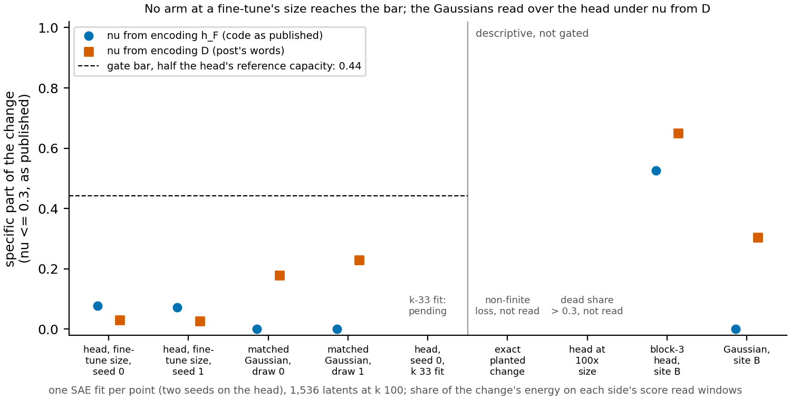

# Does the diff-SAE with latent scaling find a fine-tune-size change on the 67M model?

Cell P2.75, run 1 of 2, experiment E296, 2026-11-24. Method: Dumas, Minder and Nanda's diff-SAE, 2025, with Minder et
al.'s latent scaling, run through the diffing toolkit's pinned code. Spec: `reports/plans/2026-11-23_plan_p2-75-diff-sae-spec.md`.

We trained a sparse autoencoder on the difference between a changed model's activations and the original's, as Dumas
and Minder published it. We asked whether the latents it calls fine-tune-specific carry a known change of fine-tune
size better than a random change of the same size. They do not: under the code's form the known change reads far under
the pass bar, and under the post's wording the random changes read higher than the known one. So this baseline gives no
usable reading of a fine-tune-size change on this model, and the second run that would have scored the built pairs does not open.

## Result

The gate reads site A, block 2's input. It asks whether the share of a known change carried by the latents called
fine-tune-specific clears half of what latents could carry, while two size-matched Gaussian changes do not. The
known change is a grafted attention head scaled to a fine-tune's size. "Specific" means the latent's scaling ratio
$\nu = \beta_M / \beta_F$ is at most 0.3, the post's caption threshold, where 0 means the base model never writes the
latent's direction and 1 means it already does. The bar is $0.5 \cdot \min(K_1, 1) = 0.4422$, where $K_1 = 0.88438$ is the
share of the head's change left once the normaliser's mean is taken out, fixed before any fit.

Under $\nu$ computed as the toolkit's code runs it, encoding the changed model's activation, the head's specific part read
0.0775 and 0.0731 at two SAE seeds. Both Gaussians read 0, because no latent of theirs passed. That is the gate's fourth
outcome, **below the method's reach at a fine-tune's size**: the null stays at zero, but the known change also sits at a
sixth of the bar. Under $\nu$ computed as the post's words read, encoding the difference itself, the head read 0.0299
and 0.0275. The Gaussians read 0.1785 and 0.2297, higher than the known change. That is the second outcome, **does not
separate**. Neither form passes, so run 2 does not open.

What the fourth outcome cannot rule out: no change was read at site A at a larger size. The exact planted change
stopped and the head at a hundred times a fine-tune's size was not read. So this run does not show the method reaching
anything at site A, and "below the method's reach at a fine-tune's size" cannot be told apart from "the method selects
nothing at site A on this pipeline". The only change it selected is the block-3 head at site B. The fourth outcome stays
the filed label.

The dictionary itself fit the head's change well: its latents together carried 0.885 of the change at seed 0. Selection
is what fails, not reconstruction. Only 8 latents passed the code's form at seed 0, and the 167 that passed the post's
form carried under a twentieth of the change.

The descriptive arms do not gate. E235's block-3 head at site B, whose change carries about five hundred times the
fine-tune-size head's energy per token, read 0.5264 under the code's form and 0.6505 under the post's. Its single
Gaussian read 0 and 0.3045. These are read against that Gaussian only: the bar of 0.4422 was filed for site A. So at
one seed, against one Gaussian, the method puts more of a written change than of noise on its specific latents when the
change is far larger than a fine-tune's on this model. Two arms gave no reading, and they are set out below.

**The k-33 fit: also under the bar, descriptive.** whip-lead approved one more fit on the head at seed 0, with a third of the published
k. It asks whether the head's change is spread thinly over many latents, which a sparser code would gather, or lies
below the method's reach. It ran clean, with no dead latents, and its latents together carried 0.855 of the change.
The specific part read 0.0040 under the code's form and 0.0818 under the post's, against the same bar of 0.4422. So the
sparser code does not make the head readable: the head stays under the bar at k 33. No Gaussian was fit at k 33, so
with no matched null this is not a gate outcome, and run 1's outcome is unchanged.

**Reading it.** No arm at a fine-tune's size reaches the dashed bar. The blue circles are $\nu$ as the code computes it:
the head sits low and the Gaussians at zero. The orange squares are $\nu$ as the post describes it, and there both
Gaussians sit above both head seeds, so the reading prefers noise to the known change. The bar is drawn for site A only. To the right of
the grey line the block-3 head at site B reads above its one Gaussian under both forms, at a size far beyond a
fine-tune's; it is descriptive only.

### The two arms that gave no reading

**The exact planted change stopped.** This arm replays E212's planted direction, written at one position of the AG News
texts, and was to be the positive control. The fit stopped at step 5700 when AuxK's loss became non-finite, with 341
latents counted dead. The likely cause, untested by a rerun, is the plant's sparsity. In redteam-lead's diagnosis: "the published trainer's AuxK divides by a batch's residual variance
with no floor, and diverges when about a third of batches hold no planted token (the plant is on ~5e-4 of tokens)." No
rerun has moved it. Spreading the plant over batches or flooring the divisor were both rejected,
because each changes a published recipe on the control alone. The early AuxK onset is the published code's own: its
validation and logging calls advance the dead-latent counters, as confirmed in the pinned package.

What is lost: **no positive control shows the diff-SAE reconstructing or selecting a known planted change at site A.**
The block-3 head at site B, about five hundred times a fine-tune's energy per token, at one seed against one Gaussian,
is the only known change it selected, and it is descriptive. The oracle
checks only the read path. The comparison with our crosscoder's reading of the same plant cannot be made.

**The head at a hundred times a fine-tune's size is not read.** It missed the filed dead-share check at the end of
training, 0.7474 of latents dead against a bar of 0.3. It is "not read"; the cause is not named.

### Every arm

Specific part under the rule $\nu \le 0.3$; "all latents" is the share of the change all latents carry together; FVE
is the SAE's fraction of the difference's variance explained on the 5M validation tokens at the end of training.

| arm | site | specific, code's form | specific, post's form | all latents | FVE |
|---|---|---|---|---|---|
| head, fine-tune size, seed 0 | A | 0.0775 | 0.0299 | 0.885 | 0.925 |
| head, fine-tune size, seed 1 | A | 0.0731 | 0.0275 | 0.879 | 0.925 |
| head, seed 0, k 33 | A | 0.0040 | 0.0818 | 0.855 | 0.881 |
| matched Gaussian, draw 0 | A | 0 | 0.1785 | 0.806 | 0.750 |
| matched Gaussian, draw 1 | A | 0 | 0.2297 | 0.777 | 0.718 |
| exact planted change | A | stopped at step 5700, non-finite loss | | | |
| head at 100x size | A | not read, dead share 0.7474 | | | |
| block-3 head | B | 0.5264 | 0.6505 | 0.834 | 0.944 |
| Gaussian at site B | B | 0 | 0.3045 | 0.665 | 0.762 |

Checks that held: the pooled FVE at step 20,000 was 0.9147 on both head seeds, over their filed stops of 0.8826 and
0.8821. No dead latents remained on any read arm at the end. Every KL path check, numerator identity and row-disjointness
check passed. The gate as scored by `experiments/diff_sae/score.py` is in `experiments/diff_sae/results/run1/gate.json`.

With Minder et al.'s App. E.2 exclusion, reported beside and not scored, the head read 0 and 0.0255 under the code's
form and the Gaussians 0. Under the post's form the head read 0.0041 and 0.0077, the Gaussians 0.0450 and 0.0583.
Both forms read "does not separate" there. Under the code's form that label comes from a tie at 0, with the
Gaussians and the lower head seed both at 0, not from noise reading above the head.

### Surprises

The oracle, computed before any fit, leaned "below the method's reach" under both forms and put under a tenth of each
Gaussian's change on directions passing the post's form. The trained SAEs read the Gaussians at about a fifth instead. The
oracle diagnoses and does not change the outcome; the cause of the gap is not named.

## Departures from the literature

"Theirs": taken from the post, the paper or the toolkit at commit 617d926. "Ours": our choice where they are silent or
cannot apply.

- **Code.** Theirs: the toolkit pipeline. Ours for the adapter and ports: the dictionary-learning SAE, trainer and
  `trainSAE` called as they run, `closed_form_scalars` run from the pinned source, the normaliser and sampling rules
  ported. The toolkit cannot be installed or imported here. Theirs at the core, ours at the glue.
- **Model pair.** Ours: the 67M original and a changed model, in place of Gemma 2 2B base and chat. Forced.
- **Site.** Theirs: the middle layer, block 2's input; block 3's output for the block-3 head.
- **Text.** Ours: Pile plus each side's task text, 50M tokens each, in place of chat, pretraining and the training set.
  There is no chat model.
- **Context.** Ours: 512 tokens, not 1024, the 67M's rows.
- **Tokens.** Theirs per dataset: 100M over two datasets, two epochs, with the chat dataset dropped.
- **Training order.** Ours: E235's interleaved stream, not per-dataset prefixes shuffled in 1M-token shards.
- **Storage.** Ours: fp32 forwards and the difference in fp32, not bf16, whose rounding is a fine-tune's size here.
- **Normaliser.** Theirs in rule, ours in port: 500k tokens from each of two datasets, one stream pass.
- **SAE.** Theirs: BatchTopK at expansion 2, 1,536 latents at k 100. Ours: one k-33 fit on the head, run because the head failed under both forms.
- **Recipe and loop.** Theirs: `lr 1e-4`, warm-up 1,000 steps, batch 2,048, AuxK, threshold EMA, TF32, logging every 50
  steps and validation every 20,000 on 5M tokens.
- **Validation text.** Ours: 5M Pile tokens from train rows 196,608 to 206,392, since each side's task text is all
  used in training or scoring.
- **Latent scaling.** Theirs: 50M proportional prefixes, no shuffle, float32, the difference's normaliser, by their
  function.
- **Which input the latents are read from in latent scaling.** Both scored. Theirs, as the code runs: encoding the
  changed model's activation, the toolkit's `closed_form.py` line 354. Ours, as the post's words read: encoding the
  difference. That line 354 is an oversight is our inference.
- **Specific rule.** Theirs, scored: `nu <= 0.3`. Ours after Minder, reported beside: the App. E.2 exclusion
  `beta_M >= 0`, which fails a clean plant by construction.
- **Pass bar.** Ours: the specific part must reach half the reference capacity, fixed before the fit from the
  normaliser's mean; a side under half capacity reads "not read". The post has no bar.
- **Resume.** Theirs: none; a dead fit restarts at step 0.
- **KL "error" arm.** Theirs: the post's footnote patch, written as the changed activation minus the reconstruction.
- **KL subsets.** Theirs in form, ours in masks: the paper's eq. 5 with the diff-SAE's latents. The paper has no diff-SAE.
- **KL-gap floor.** Ours: a gap under the measured floor reads "not read". The floor was exactly 0 here, so it never bit.
- **KL data.** Ours: read windows and Pile rows, not chat responses. Forced.
- **Early-stop FVE.** Ours: the same formula pooled over the validation set, not averaged per batch, because a plant's
  batches with no plant token have zero variance.
- **AuxK on the planted change.** Theirs, unchanged: AuxK's loss divided by the batch's residual variance with no floor,
  dictionary-learning `batch_top_k.py` lines 129-134, after OpenAI. A fit whose parameters go non-finite stops and
  reads "not read", which is what the planted change did.
- **Dead-set fixture.** Ours, and untested. The rehearsal marked 100 latents dead to check that AuxK turns on for a
  known dead set; on all three rehearsal items every marked latent fired in the next batch, so the check tested nothing.
  AuxK did turn on in run 1, on the planted change, before it diverged.
- **Infinite ratio.** Ours: a ratio of plus or minus infinity is set to nan and fails; a minus infinity would pass.
- **Alive.** Ours: at least 10 firings on the read set, the crosscoder's rule.
- **Reading.** Ours, after Dumas: the specific part of the change, with the bias and error parts. The post counts
  latents under thresholds and reads KL recovery.
- **Steering and top-activating text.** Not run: no chat text to judge on the 67M.
- **Controls.** Ours: the planted change, the head at two sizes, two Gaussians matched to the head, and a second SAE seed.

## Not run

- Run 2, the 48-fit reading of the nine built pairs and E62 with matched random changes: the gate did not open it.
- A finite fit of the exact planted change: no rerun with a floored divisor or spread batches, both rejected as changes
  to the published recipe.
- A reading of the head at a hundred times a fine-tune's size: it stopped at the dead-share check, and no rerun is filed.
- A second seed for the Gaussians and for the site-B arms.
- The App. E.2 exclusion as the scored rule.
- Steering with the lowest-ratio latents and reading their top-activating text.
- The chat-SAE and base-SAE variants the post also compares.
- Rungs 2 to 4 of the head's size ladder, and Qwen.

Provenance: item files and logs in `experiments/diff_sae/results/run1/`, the gate in `results/run1/gate.json`, the
oracle in `results/oracle.json`, filed predictions and thresholds in `results/predictions.json`. Each fit ran on an
H100 80GB.
