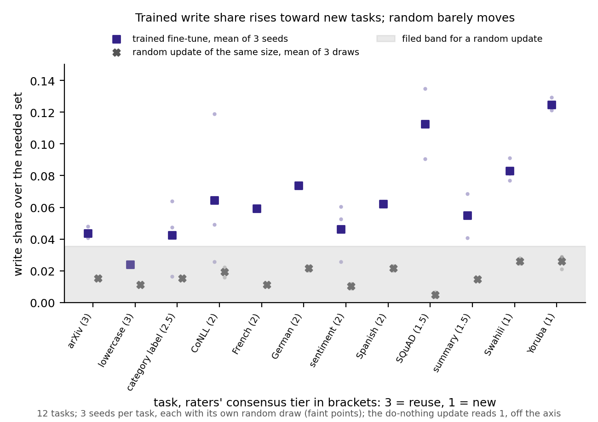

# Does the trained write share's reversal still beat random updates once both sides average three seeds?

We read the write share over the needed set on random updates matched to every fine-tune seed, so both sides now
average three seeds. The random updates' agreement with the raters moved slightly away from the trained one, so the
trained reversal still stands well beyond random. For the goals this keeps the earlier reading that the reversal comes
mostly from training, not from the text alone, though on single seeds the margin is narrower.

## The answer

Yes. Averaged over three seeds, the trained write share ranks the twelve tasks against the raters at a tau of -0.69.
Random updates of the same size, now also averaged over three draws, rank them at -0.22, and that is indistinguishable
from no relation. The gap of 0.47 clears the filed bar, so the paper's comparison survives. The paper should quote
-0.22 on three draws instead of -0.29 on one. Every random update read lower than every trained fine-tune of its own task.

## What we were trying to test

The paper's results section compares two rank agreements with the raters. The raters sorted twelve ordinary
fine-tuning tasks into reuse, middle and new tiers. The tiers are coded from 3 for reuse down to 1 for new, with half
steps where the raters split. For each task we read the write share over the needed set, $E_b$. It is the share of the
needed variables' write change that a rescaling of the base model's own writes explains. It reads 1 when nothing
changed and 0 when no change is a rescaled base write. The rank agreement is Kendall's tau-b between the tier and
the task's $E_b$. A tau of 1 means the same order as the raters, -1 the reversed order, and 0 no relation.

The trained side used the mean of three fine-tune seeds per task. The random side, the null, used a Gaussian update
with the same per-matrix size as the fine-tune it stands for. Until now only seed 0's fine-tune had such a random
update. So the paper set a three-seed trained tau against a one-draw random tau, as the consistency review pointed
out. This run read 24 new random updates, one for each task's seed 1 and seed 2, each an independent draw at its own
fine-tune's sizes. Everything else was held fixed: the same twelve tasks, the same read windows, the same code as the
first read, and the same H100 card. The question is whether the random tau on three-draw means moves toward the
trained one. If it did, the reversal would be something any update of that size produces on these tasks' windows.

## What we expected, and why

Two outcomes were filed before the run. If seed 0's random draw was typical, the three-draw random tau stays near
-0.29, and the gap to the trained tau stays at least 0.24. If seed 0's draw understated how random updates lean, the
random tau moves toward -0.69 and the gap falls under 0.24. The bar of 0.2403 is half the width of the trained tau's
90% task-bootstrap interval, which runs from -0.885 to -0.405. A gap that size is one the trained tau's own task
sampling could not close.

## What we observed

### Does the random tau move toward the trained one on three-draw means?

**Reading it.** No: it moved slightly away. The dark squares, the trained three-seed means, climb from about 0.024 on
lowercase to 0.125 on Yoruba as the tiers go from reuse to new. The grey crosses, the random three-draw means, stay
between 0.005 and 0.026 across all twelve tasks. They lean only weakly with the tiers, with Swahili and Yoruba a
little higher than lowercase and French. Each task's three random draws sit close together, with at most 0.008
between the highest and lowest on any task. The trained seeds spread far more, up to 0.093 on CoNLL. On every task
the lowest trained seed sits above the highest random draw, though on the category label by only 0.0007.

| task | consensus tier | trained, seeds 0 / 1 / 2 | random, draws 0 / 1 / 2 | trained mean | random mean |
|---|---|---|---|---|---|
| arXiv | 3 | 0.048 / 0.041 / 0.042 | 0.015 / 0.016 / 0.015 | 0.044 | 0.015 |
| lowercase | 3 | 0.023 / 0.025 / 0.024 | 0.012 / 0.011 / 0.011 | 0.024 | 0.012 |
| category label | 2.5 | 0.064 / 0.016 / 0.048 | 0.016 / 0.015 / 0.015 | 0.043 | 0.015 |
| CoNLL | 2 | 0.026 / 0.119 / 0.049 | 0.020 / 0.022 / 0.016 | 0.065 | 0.019 |
| French | 2 | 0.060 / 0.059 / 0.058 | 0.012 / 0.011 / 0.011 | 0.059 | 0.011 |
| German | 2 | 0.075 / 0.072 / 0.074 | 0.023 / 0.022 / 0.020 | 0.074 | 0.022 |
| sentiment | 2 | 0.026 / 0.053 / 0.060 | 0.009 / 0.012 / 0.010 | 0.046 | 0.011 |
| Spanish | 2 | 0.064 / 0.061 / 0.062 | 0.023 / 0.022 / 0.020 | 0.062 | 0.022 |
| SQuAD | 1.5 | 0.112 / 0.091 / 0.135 | 0.004 / 0.007 / 0.004 | 0.112 | 0.005 |
| summary | 1.5 | 0.056 / 0.041 / 0.069 | 0.015 / 0.014 / 0.015 | 0.055 | 0.015 |
| Swahili | 1 | 0.077 / 0.081 / 0.091 | 0.025 / 0.028 / 0.025 | 0.083 | 0.026 |
| Yoruba | 1 | 0.121 / 0.129 / 0.123 | 0.029 / 0.029 / 0.021 | 0.125 | 0.026 |

The rank agreements with the consensus tier, all over the same twelve tasks:

| side | tau-b | two-sided p |
|---|---|---|
| trained, mean of 3 seeds | -0.693 | 0.003 |
| random, mean of 3 draws | -0.220 | 0.349 |
| random, seed 0's draw only, as the paper had it | -0.287 | 0.221 |

The gap between the random and the trained tau is 0.473 on three-draw means, against 0.406 with seed 0's draw alone.
Holding the three-draw random reading fixed, the trained tau's partial is -0.677, so subtracting the random's ordering
leaves the reversal almost whole.

### Was seed 0's random draw typical?

Yes. Taken one seed at a time, the random tau barely moves between draws, so the paper's one-draw figure was not a
lucky draw. The trained tau varies more between seeds:

| seed | trained tau | random tau, its own draw | random minus trained |
|---|---|---|---|
| 0 | -0.524 | -0.287 | 0.237 |
| 1 | -0.558 | -0.287 | 0.271 |
| 2 | -0.795 | -0.254 | 0.541 |

That spread matters for one comparison the filed rule does not make: each trained seed against its own random draw.
Seed 0's pair alone falls just under the filed bar of 0.2403. The reversal holds on every single seed, but its margin
over random is narrower on one seed than on the means. Means over three seeds on both sides is the comparison the paper
makes and the rule scores.

## The filed rule and its result

The rule was filed in `experiments/convergence_panel/results/wide/predictions_p278.json` before the run. The gap is the
random three-draw tau minus the trained three-seed tau, on the tasks where all six readings are finite. It survives at
or above 0.2403. Fewer than five tasks, or an undefined tau, gives no call. All twelve tasks
qualified: no needed set fell under the floor of 100 variables. The measured gap is 0.473, so the call is "survives".
The cell is descriptive: a consistency fix asked for by the user, reported as a description, not a verdict on reuse.

## The control

The do-nothing update ran first and alone on each of the four pods. On all four it read a write share of exactly 1,
with no changed variable and a largest write change of exactly 0, as filed. A repeat of an earlier saved state
matched its saved value of 0.761 to eight places on each pod. Each new random update was also logged against a band
filed from seed 0's draws, 0 to 0.0357. All 24 fell inside it. The lowest was 0.0037 on SQuAD's third seed, the highest
0.029 on Yoruba's second. That band was logged, never a stop.

## How compelling is the evidence

Twelve tasks, three seeds per task on each side, one card and one set of read windows per task. The random side is
now matched to the trained side point for point, so the comparison is fair in the way the review asked.

**What tau is blind to.** Tau-b reads only the order of the tasks, never how far apart their values are. It cannot see
that every random write share sits below every trained one of its task, which the figure shows directly. It treats
tasks in the same tier as tied and ignores how they order among themselves. With twelve tasks
the random tau's p of 0.349 cannot tell a weak lean from none. Its positive control is the trained tau itself on the
same tasks and windows. Its null is the do-nothing update, which reads 1 everywhere, leaving tau undefined.

## Surprises

None that reverses a filed prediction. The one-seed pairing above was not filed. Seed 0's pair sits just under the
bar, which is a narrower margin, not a reversal.

## What next

- The paper's results paragraph should quote -0.22 on three draws in place of -0.29 on one draw, with the gap of 0.47.
  Nothing here changes Figure 2 beyond that number.
- If a reader asks for a same-seed comparison, the three paired gaps above are the answer. A larger task panel would
  be needed to say whether the seed-0 margin is noise.

## Scorecard

| id | claim in words | rule | read | verdict |
|---|---|---|---|---|
| rule | random tau on three-draw means stays at least 0.2403 above the trained tau | gap at or above 0.2403 on tasks with all six readings | gap 0.473 on 12 tasks | survives |
| stage 0 | do-nothing reads exactly 1, nothing changed | exact; the job stops on a miss | exactly 1, 0 changed, on 4 pods | passed |
| random band | each new random write share in the filed band | logged, never a stop | 24 of 24 in band | inside |

## Departures from the literature

None. Kendall's tau-b is the standard statistic; the random update is this project's own size-matched Gaussian.

## Not run

- More than one random draw per fine-tune seed. Draw-to-draw noise within a seed is seen only across the three seeds.
- Random updates for the other panel sets, the nine-task, low-KL and size-matched sets: only the wide high-KL set
  was read.
- A significance test of the gap itself, such as a task bootstrap of the difference: the filed rule uses a fixed bar.
- Any change to the reading, its windows or the needed set.

## Provenance

- Result: `experiments/convergence_panel/results/wide/random_3seed.json`, written by
  `experiments/convergence_panel/random_3seed.py`; per-seed taus in
  `experiments/convergence_panel/results/wide/random_3seed_by_seed.json` and the figure, both written by
  `experiments/convergence_panel/plot_p278.py`.
- Readings: `experiments/convergence_panel/results/wide/eb/*.json`; controls
  `experiments/convergence_panel/results/wide/eb/stage0/e302_{a,b,c,d}_stage0.json`; logs
  `experiments/convergence_panel/results/run_e302_*.log`. Run commit b4d0fdac.
- Filed rule: `experiments/convergence_panel/results/wide/predictions_p278.json`; card
  `experiments/convergence_panel/card_p278.md`. Asked for by item M8 of
  `reports/reviews/2026-11-24_review_consistency.md`.
- Compute: four H100 SXM pods, $42.89 in all.
