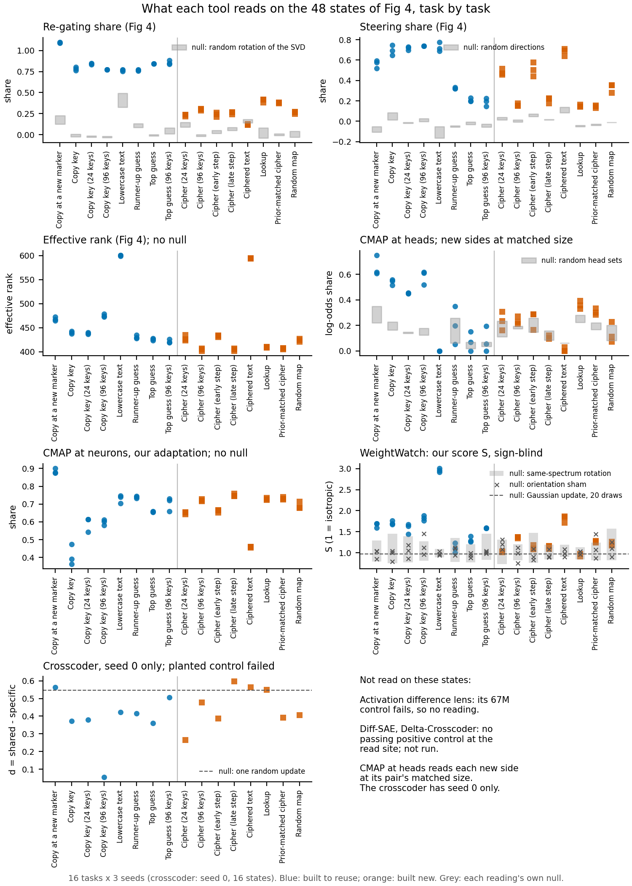

# What do the existing model-diffing tools read on the states of Fig 4?

*2026-11-24, baseline-lead, cell P2.80. Runs: E305, CMAP at heads on the five seed-2 states Fig 4 needed (commit
70026586); E306, WeightWatch on all 48 states (commit 190bae7e). Both descriptive: no bar was filed and no verdict is
given. Plan `reports/plans/2026-11-24_plan_tools-same-states.md`.*

We read each existing model-diffing tool on the same 48 fine-tuned states that the paper's Fig 4 plots: sixteen tasks,
eight built to reuse the base model's machinery and eight built new, three seeds each. Every tool with a passing
control gives values on the tasks built to reuse that overlap its values on the tasks built new, and the one tool
whose values do not overlap, the crosscoder, failed its planted control. For `GOALS.md` this puts the tools table on
the same footing as Fig 4: what the table says about each tool now holds on the exact states the cheap readings are
judged on.

## The answer

On the 48 states Fig 4 plots, head-level patching reads 0.00 to 0.66 on the tasks built to reuse and 0.01 to 0.36 on
those built new. Its lowest reuse values come from tasks whose circuit holds one or two heads, or none. WeightWatch's
score reads 1.11 to 2.96 on the reuse side and 0.95 to 1.81 on the new side, and it cannot tell a strengthened circuit
from a deleted one. Patching neurons reads 0.41 to 0.88 against 0.46 to 0.75. The crosscoder, read on one seed only,
places a random update above most fine-tunes on both sides.

## What we were trying to test

The paper's tools table reported each tool on whichever fine-tunes that tool happened to be run on. A reader comparing
a tool's row with Fig 4 could not tell a difference in the tool from a difference in the states. This cell re-reads the
tools on Fig 4's own states, so that each tool's panel above has the same sixteen tasks, the same three seeds and the
same task names as Fig 4.

The states are the fine-tunes of nine built pairs, listed in `experiments/known_3seeds/results/known3.json`. Two pairs
share a side, so there are sixteen distinct tasks. Each task is one column in every panel, the eight built to reuse on
the left of the grey line, the eight built new on the right. Each dot is one seed.

What each panel reads, with what its value means:

- **Re-gating share, steering share, effective rank.** Fig 4's three cheap readings, copied from `known3.json`, for
  reference.
- **CMAP at heads** (Prakash et al. 2024, the authors' code). Find the fine-tune's head circuit by path patching, give
  the unchanged model those heads' fine-tuned outputs, and report the share of the fine-tune's log-odds gain that comes
  back. 1 means the circuit's heads carry the whole gain, 0 means none of it.
- **CMAP at neurons**, our adaptation. The same patch at every MLP neuron's output: the share of the gain recovered when
  the base model's output weights read the fine-tuned model's neuron firing.
- **WeightWatch** (Zhong et al. 2026). As published it is a detector: it flags inputs whose activations along the
  update's top singular directions leave the base model's range. It gives no reuse score. We plot our score after
  Zhong, $S$: how much of the base model's output variance the update's top directions carry, against a random
  direction. $S = 1$ means the directions are no more aligned with the model's own output than a random one.
- **Crosscoder** (Minder et al. 2025, the authors' code). A crosscoder trained between the base and each fine-tune;
  $d$ is the shared part of the change minus the part on fine-tune-specific latents. 1 means the whole change is
  carried by latents both models share.

## Each tool's null, and how it differs from Fig 4's

Fig 4 itself draws no random reference. Its source files hold one per state for two of its three readings, and the
figure here draws those in grey.

| reading | null drawn | how it was made | states with one |
|---|---|---|---|
| re-gating share | random rotation | the share computed on each matrix's singular vectors under a random rotation | 48 |
| steering share | random directions | mean steering share over eight random directions | 48 |
| effective rank | none | | 0 |
| CMAP at heads | random head sets | mean share over ten random head sets of the circuit's size | 41 |
| CMAP at neurons | none | the empty update reads 0 by construction | 0 |
| WeightWatch $S$ | same-spectrum rotation, orientation sham, Gaussian update | the update's top vectors rotated at random over 20 draws; the whole update rotated at random; a Gaussian update | 48 |
| crosscoder | one random update | one Gaussian update with the runner-up guess update's per-matrix norms | one value |

The nulls differ in kind. The two cheap nulls change the decomposition or the direction while keeping the trained
update. CMAP's keeps the update and the circuit's size but picks other heads. WeightWatch's nulls keep the update's
singular values and throw away where it points. The crosscoder's null is a separate update with no task at all. The
seven CMAP states with no random head sets are those whose circuit search kept no head.

CMAP's do-nothing control has no gain to share, so its reading is undefined, and its planted head reads 1.0 in E305's stage 0, as in
E288's. WeightWatch's Gaussian update reads 0.98 over 20 draws, near the 1 its nulls expect.

## What we expected

Nothing was filed as a bar. Both runs were opened as descriptions of published baselines on the user's request, so the
cards name two rival readings but neither is scored here. The question is only what each tool reads on these states.

## What we observed

### Do the tools with passing controls read the two sides apart?

**Reading it.** No: on CMAP at heads, CMAP at neurons and WeightWatch's $S$, the values on the tasks built to reuse and
on those built new overlap. CMAP at heads reads 0.00 to 0.66 on the reuse side and 0.01 to 0.36 on the new side. The
reuse tasks that read low are lowercase text, where the circuit search finds no head on any seed, and the two top-guess
tasks, at 0.07 and 0.08. Those two keep about one or two heads, against nine to eleven on the cipher tasks they are
paired with, so their value reflects the circuit's size. Four reuse tasks, the copy tasks, read 0.45 to 0.66, above
their random head sets.

CMAP at neurons reads 0.41 to 0.88 built to reuse and 0.46 to 0.75 built new. Copy key, a reuse task, reads lowest of
all sixteen at 0.41.

WeightWatch's $S$ reads 1.11 to 2.96 built to reuse and 0.95 to 1.81 built new. Lowercase text reads highest at 2.96.
Ciphered text, the task built new from the same text, reads highest on the new side, at 1.81. The runner-up-guess task and the two
cipher tasks paired with it sit at 1.11 to 1.13, inside their same-spectrum null. $S$ is blind to sign: in E294 an edit
that deleted a circuit read 287, against 490 for one that doubled it. A high $S$ means the update writes along
directions the model already uses, not that it reuses them.

### What does the crosscoder read, with its failed control?

**Reading it.** The crosscoder's $d$ on seed 0 reads 0.06 to 0.56 on the tasks built to reuse and 0.27 to 0.60 on
those built new. One random update reads 0.55, above every reuse task but one. Its planted control failed: the latent
that carried a planted direction had a base-side ratio of 0.244 against the authors' cut-off of 0.2, so it was not
counted fine-tune-specific. Two crosscoders trained with different seeds on one state read 0.42 and 0.46. The lowest
reuse value, 0.06 on copy key with 96 keys, is the one state where fine-tune-specific latents carry a visible part of
the change.

### How do these sit beside Fig 4's cheap readings?

The re-gating share reads 0.76 to 1.09 on the reuse side and 0.12 to 0.40 on the new side, the only reading here whose
two sides do not overlap. Its random-rotation null spans -0.04 to 0.49 over the 48 states, and on lowercase text the
null reaches 0.49. The steering share reads 0.19 to 0.74 on the reuse side against 0.14 to 0.68 on the new side.
Effective rank reads 422 to 600 against 405 to 594.

### Per-task values

Means over the three seeds; the crosscoder is seed 0 alone. "Heads" is the CMAP circuit's size, averaged over seeds.

| task | built | re-gating | steering | eff. rank | CMAP heads | heads | CMAP neurons | WeightWatch $S$ | crosscoder $d$ |
|---|---|---|---|---|---|---|---|---|---|
| Copy at a new marker | reuse | 1.09 | 0.56 | 468 | 0.66 | 7.3 | 0.88 | 1.66 | 0.56 |
| Copy key | reuse | 0.78 | 0.70 | 440 | 0.54 | 4.3 | 0.41 | 1.71 | 0.37 |
| Copy key (24 keys) | reuse | 0.84 | 0.72 | 438 | 0.45 | 4.0 | 0.59 | 1.59 | 0.38 |
| Copy key (96 keys) | reuse | 0.77 | 0.74 | 475 | 0.58 | 3.7 | 0.60 | 1.82 | 0.06 |
| Lowercase text | reuse | 0.76 | 0.73 | 600 | 0.00 | 0.0 | 0.73 | 2.96 | 0.42 |
| Runner-up guess | reuse | 0.77 | 0.32 | 431 | 0.20 | 5.0 | 0.74 | 1.11 | 0.42 |
| Top guess | reuse | 0.84 | 0.21 | 426 | 0.07 | 1.3 | 0.66 | 1.31 | 0.36 |
| Top guess (96 keys) | reuse | 0.86 | 0.19 | 422 | 0.08 | 2.0 | 0.70 | 1.59 | 0.51 |
| Cipher (24 keys) | new | 0.23 | 0.48 | 428 | 0.23 | 9.0 | 0.65 | 1.03 | 0.27 |
| Cipher (96 keys) | new | 0.30 | 0.16 | 405 | 0.24 | 11.0 | 0.72 | 1.36 | 0.48 |
| Cipher (early step) | new | 0.24 | 0.51 | 433 | 0.25 | 10.3 | 0.66 | 1.12 | 0.39 |
| Cipher (late step) | new | 0.26 | 0.21 | 405 | 0.11 | 8.3 | 0.75 | 1.13 | 0.60 |
| Ciphered text | new | 0.12 | 0.68 | 594 | 0.01 | 1.7 | 0.46 | 1.81 | 0.56 |
| Lookup | new | 0.40 | 0.15 | 410 | 0.36 | 16.3 | 0.73 | 0.95 | 0.55 |
| Prior-matched cipher | new | 0.38 | 0.14 | 407 | 0.31 | 10.0 | 0.73 | 1.26 | 0.39 |
| Random map | new | 0.26 | 0.33 | 424 | 0.14 | 6.3 | 0.69 | 1.21 | 0.41 |

Per-state values and nulls: `experiments/weightwatch/figures/tools_fig4.csv`; summaries
`experiments/weightwatch/results/p2-80/tools_fig4.json`.

## What we learned

The tools table can now cite one set of states. On it, no existing tool with a passing control gives values that put
the tasks built to reuse on one side and the tasks built new on the other. CMAP at heads comes closest on the copy
tasks, but its value follows the circuit's size where the circuit is small. WeightWatch's score tracks whether an update
writes along the model's own output directions, which both sides do in places. Whether any of this counts as reuse is
the definition's call, and this page makes none.

## How compelling the evidence is

Every tool here sees the same sixteen tasks and three seeds as Fig 4, except the crosscoder, which has seed 0 only. One
convention differs: CMAP at heads reads each task built new at its pair's matched size, a scale of 0.52 to 0.98 of
the update, as E288 did. Cipher (24 keys) is the exception, read at its built size. Every other panel reads each update
at the size it was trained to, as Fig 4 does. CMAP at neurons and effective rank have no null on these states. Each
CMAP null is a mean of ten random head sets, so the grey band shows its spread over seeds, not over draws.

## Surprises

- The re-gating share's random-rotation null reads up to 0.49 on lowercase text, about two thirds of the trained
  share on that task. Fig 4 draws no null, so this was not visible there.
- The crosscoder finds fine-tune-specific latents on a task built to reuse, copy key with 96 keys, which pulls its $d$
  to 0.06, the lowest value on either side.

## What next

- Nothing is planned in this cell. A crosscoder row on seeds 1 and 2 is a gated run of about $114. It would still rest
  on a failed control, so it changes nothing unless the control is fixed first.

## Scorecard

None: both runs were descriptive and filed no rule.

## Departures from the literature

- CMAP at heads: the authors patch a fine-tune at its own size. We read the tasks built new at their
  pair's matched size, as E288 filed, so both sides of a pair move the output by the same KL.
- CMAP at neurons is ours: the authors patch heads only.
- WeightWatch: the published method is the detector; $S$ is our score after it, not theirs.
- Crosscoder: run as published, including the authors' rule that drops latents with a negative base coefficient.

## Not run

- **Activation difference lens**, as published: no reads on these states. The port check showed one entry checked to
  bf16 rounding and the rest bounded only by 0.118 absolute, not exact parity. The 67M positive control fails: the
  lens-like rise reads 0.0026 against a random-difference maximum of 0.039. Source:
  `reports/analyses/2026-11-24_analysis_p2-80-adl-port.md`.
- **Crosscoder on seeds 1 and 2**: not re-run, since its planted control failed. Its row stays seed 0, 16 states.
- **Diff-SAE**: not run on these states; no passing positive control at the read site.
- **Delta-Crosscoder**: not run on these states; no passing positive control at the read site.
- WeightWatch's detector flag rates are in the items but not plotted; the detector gives no reuse score.
- Matched random updates for the cheap readings, CMAP and WeightWatch: none of these runs read one on these states.

## Provenance

- Fig 4 states, cheap readings, CMAP at neurons: `experiments/known_3seeds/results/known3.json` (E303).
- Cheap nulls: `experiments/share_untrained/results/stage1.json`, `experiments/known_3seeds/results/stage2.json`,
  `experiments/refit_96key/results/stage1.json` (`rotated`); `experiments/holes_fill/results/stage1.json` and the same
  two files, `experiments/steering_copy_lookup/results/stage1.json` (`random_mean`, `random.mean_lo`).
- CMAP at heads: `experiments/cmap/results/items/` (E288) and `experiments/cmap/results/p2-80/items/` (E305, commit
  70026586), key `.compared.whole_logodds_share`; controls `experiments/cmap/results/p2-80/stage0_plant_v.json`,
  `stage0_do_nothing.json`.
- WeightWatch: `experiments/weightwatch/results/p2-80/summary.json` (E306, commit 190bae7e), `.rows.<state>`,
  Gaussian control `stage0.json .gaussian`.
- Crosscoder: `experiments/crosscoder/results/run2/sides/*_s0.json` `.d` (E203); random update `stage1_random.json`;
  reseed `stage1.json`; planted control `stage0b.json`.
- Figure and summary: `experiments/weightwatch/tools_fig4.py`, which reads only the files above. No GPU, $0.
