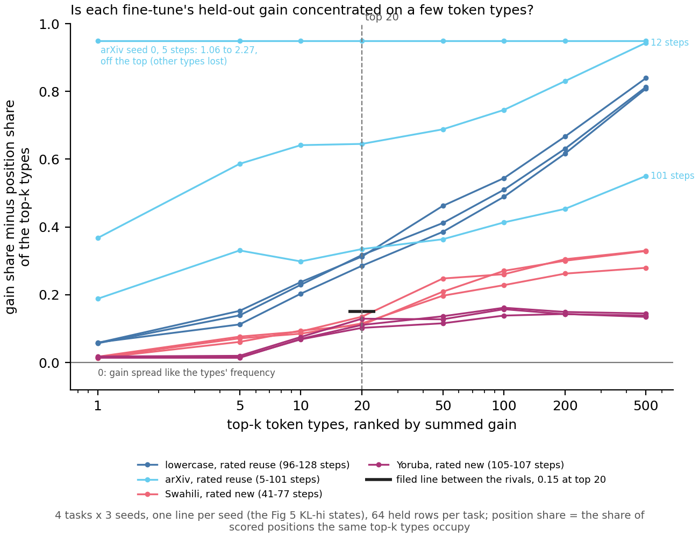

# Do the Swahili and Yoruba fine-tunes gain on a handful of tokens, or on the language?

We compared the base and fine-tuned models on the actual next token of held-out text, for four of the fine-tunes
behind the paper's Fig 5, three seeds each. On Swahili and Yoruba the gain is large and spread roughly like the text
itself, while lowercase and arXiv gain on a few format tokens. This reads output probabilities only, so it gives no
verdict on reuse, but it does not support the idea that the language fine-tunes boosted only a handful of bigrams.

## The answer

No handful. On Swahili and Yoruba the twenty tokens that gain most carry only a little more of the gain than their
share of the text, and most positions in the text gain. The Yoruba gain does sit heavily on the pieces of its dotted
and tone-marked letters, but those letters are a large part of written Yoruba, and they gain in proportion to how
often they occur. The two tasks rated reuse are the concentrated ones: lowercase on a few lower-cased sentence starts,
arXiv on line breaks, the end of the abstract and "We". Step counts do not explain the pattern.

## What we were trying to test

The paper's Fig 5 reads the write share over the needed set on twelve realistic fine-tunes. That share is the part of
the change in the needed variables' writes that a rescaling of the base model's own writes explains. Blind raters had
sorted the twelve tasks by whether learning them would reuse what the model has or need something new. The share ran
opposite to the raters: Yoruba at 0.125 and Swahili at 0.083, both rated new, were highest. Lowercase at 0.024 and
arXiv at 0.044, both rated reuse, were lowest.

The user's hypothesis for this: a 67M model cannot learn Swahili in a few hundred steps at a matched KL of about 0.18
nats. It can only repurpose a few bigrams or diacritics it already predicts, and that reads as "kept", while the raters
rated what learning the language would take. The user also asked how many steps each fine-tune ran.

So for those four tasks we took the exact fine-tuned states Fig 5 reads, three seeds each, and the 64 held-out rows of
each task. At every position the fine-tune trains on, we read the log-probability of the actual next token under the
base model and under the fine-tuned model. The **gain** at a position is the fine-tuned log-probability minus the base
one, in nats; 0 means no change. Summing the gain by the token that comes next gives the **risers**, the token types
whose predictions improved most. Summing it by the pair of previous and next token gives the rising **bigrams**.

To ask whether the gain sits on a handful of types, we rank types by summed gain and take the top k. Their **gain
share** is their summed gain over the total gain of all types. Their **position share** is the fraction of scored
positions those same types occupy. If every position gained alike, the two shares would be equal. The figure plots
**gain share minus position share**, the excess concentration: 0 means gain spread like the types' frequency, and a
large positive value means a few types carry far more than their share. A gain share can pass 1 when other types
lose, because it is a share of the net gain.

The positive control is lowercase: its fine-tune must move probability off upper-case tokens. We read the mean
probability the model puts on all tokens that hold an upper-case letter, at every scored position. The do-nothing
reference, a zero update, must give a gain of exactly 0 everywhere.

## What we expected, and why

Two rivals were filed before the run. If the user is right, the top twenty types on Swahili and Yoruba should carry a
gain share at least 0.15 above their position share, averaged over seeds, as was expected for lowercase. If the
fine-tunes improve the language broadly, the excess should stay under 0.15, as was expected for arXiv. The line of
0.15 is the filed separation between the two, not a measured noise floor. The run is descriptive: no verdict on reuse
rides on it. We also expected the lowercase fine-tune to cut the upper-case mass at least in half, and the other three
to move it by less than a third.

## What we observed

### Is the gain concentrated on a few token types?

**Reading it.** No for Swahili and Yoruba, yes for the two tasks rated reuse. At the top twenty types, the purple
Yoruba lines read 0.10 to 0.13 and the pink Swahili lines 0.11 to 0.14, all under the filed line. For Yoruba, the top
twenty types carry 0.43 to 0.44 of the gain but already fill 0.31 to 0.33 of the text. Swahili's top twenty carry 0.33
to 0.36 of the gain on 0.21 to 0.23 of the text. Lowercase reads 0.29 to 0.32 at the same point. Its top twenty carry
0.39 to 0.44 of the gain on only 0.10 to 0.13 of the text. arXiv reads 0.33 on its 101-step seed and far higher on its
5-step and 12-step seeds. Further out the curves separate more: at the top 500 types Yoruba stays near 0.14 while
lowercase climbs past 0.8.

A second view gives the same picture. On Yoruba about 0.80 of all scored positions gain under the fine-tune, and on
Swahili 0.65 to 0.68. On lowercase about half the positions gain, and on arXiv 0.49 to 0.59. The gains are also of a
different size. Swahili gains 0.92 to 1.12 nats per token and Yoruba 1.46 to 1.47. Lowercase gains 0.12 to 0.13 and
arXiv 0.06 to 0.21. All twelve states sit at a KL from the base model of 0.17 to 0.19 nats on general text.

The seeds agree closely. On Yoruba the top five types are the same on every seed and in the same order, and on Swahili
the top three are. Lowercase and arXiv keep their top three types across seeds too.

### What are the risers?

Each table is seed 1 of its task. Count is the number of scored positions with that next token or bigram. Base and
fine-tuned probability are the mean probability of the actual token at those positions; summed gain is in nats. A
summed gain can be positive while the mean probability falls, as for Swahili's word-start "wa", because the gain is a
sum of log ratios. A space at a token's start is shown as ␣; non-ASCII byte pieces are shown as hex bytes.

**Yoruba** is dominated by the pieces of its letters with a dot below and its tone marks. In this tokenizer ọ is the
three bytes E1 BB 8D and ẹ is E1 BA B9, and a tone is often a separate combining mark, CC 80 for grave or CC 81 for
acute. The fine-tune makes the model far more confident in completing these letters and in following them with a
tone. Below them come common Yoruba words: ni, àti 'and', fún 'for', àwọn, and the gb digraph.

| token | what it is | count | base prob. | fine-tuned prob. | summed gain |
|---|---|---|---|---|---|
| `[E1 BB]` | first two bytes of ọ | 1333 | 0.292 | 0.583 | 2644 |
| `[E1 BA]` | first two bytes of ẹ | 988 | 0.189 | 0.401 | 2065 |
| `[CC]` | first byte of a combining tone mark | 1154 | 0.495 | 0.793 | 1542 |
| `í` | i with acute tone | 850 | 0.238 | 0.556 | 1399 |
| `[8D]` | last byte of ọ | 1294 | 0.556 | 0.975 | 1305 |
| `gb` | Yoruba digraph | 214 | 0.126 | 0.199 | 1027 |
| `à` | a with grave tone | 607 | 0.186 | 0.459 | 1017 |
| `␣ì` | word-initial ì | 250 | 0.0062 | 0.081 | 983 |
| `␣à` | word-initial à, as in àti, àwọn | 276 | 0.011 | 0.053 | 980 |
| `␣ni` | the word ni | 316 | 0.021 | 0.07 | 971 |
| `ì` | i with grave tone | 425 | 0.218 | 0.465 | 793 |
| `n` | n | 607 | 0.37 | 0.642 | 751 |

| bigram | count | base prob. | fine-tuned prob. | summed gain |
|---|---|---|---|---|
| `[E1 BB] → [8D]`, completing ọ | 1294 | 0.556 | 0.975 | 1305 |
| `[8D] → [CC]`, ọ then a tone | 500 | 0.385 | 0.79 | 930 |
| `[B9] → [CC]`, ẹ then a tone | 618 | 0.601 | 0.815 | 560 |
| `␣à → ti`, the word àti | 75 | 0.0065 | 0.604 | 537 |
| `[E1 BA] → [B9]`, completing ẹ | 969 | 0.721 | 0.961 | 491 |
| `␣j → [E1 BA]`, jẹ | 98 | 0.098 | 0.705 | 475 |
| `[CC] → [80]`, a grave tone | 565 | 0.542 | 0.778 | 464 |
| `w → [E1 BB]`, wọ | 191 | 0.411 | 0.84 | 384 |

**Swahili** rises on frequent word pieces and short function words: ya and wa, both 'of', and na 'and'. The bigrams
spell whole words that recur in the held text: Marekani 'America', Tuzo ya Nobel 'Nobel Prize', Agosti 'August',
mshindi 'winner', mwandishi 'writer' and waliofariki 'those who died'. These look like the lists of encyclopedia date
pages. They are repeated words of this corpus, not single diacritics or loanword fragments.

| token | count | base prob. | fine-tuned prob. | summed gain |
|---|---|---|---|---|
| `␣ya` | 1003 | 0.54 | 0.652 | 1654 |
| `wa` | 301 | 0.112 | 0.429 | 997 |
| `io` | 138 | 0.122 | 0.623 | 856 |
| `u` | 427 | 0.324 | 0.697 | 729 |
| `and` | 127 | 0.038 | 0.161 | 596 |
| `w` | 606 | 0.438 | 0.488 | 590 |
| `i` | 539 | 0.402 | 0.676 | 569 |
| `iki` | 121 | 0.229 | 0.757 | 567 |
| `o` | 498 | 0.618 | 0.858 | 563 |
| `sh` | 327 | 0.232 | 0.403 | 541 |
| `␣wa` | 997 | 0.627 | 0.538 | 505 |
| `a` | 336 | 0.398 | 0.75 | 466 |

| bigram | count | base prob. | fine-tuned prob. | summed gain |
|---|---|---|---|---|
| `Wal → io`, waliofariki | 83 | 0.157 | 0.949 | 632 |
| `w → and`, mwandishi | 100 | 0.031 | 0.178 | 556 |
| `␣m → sh`, mshindi | 325 | 0.233 | 0.406 | 536 |
| `␣m → w` | 507 | 0.429 | 0.465 | 472 |
| `sh → indi`, mshindi | 296 | 0.676 | 0.915 | 459 |
| `ut → oka` | 224 | 0.595 | 0.756 | 443 |
| `and → ishi`, mwandishi | 99 | 0.478 | 0.9 | 354 |
| `␣ya → ␣Nobel`, Tuzo ya Nobel | 305 | 0.615 | 0.843 | 351 |

On both languages most top risers already had a base probability of a tenth or more: the fine-tune sharpens
predictions the base model half makes. A few start near zero, such as Yoruba's word-initial ì and àti, and Swahili's
"far" of waliofariki. The gain is large because there is much to gain: these are the two tasks where the base model
predicts the text worst.

**Lowercase** rises on sentence starts written in lower case. After a full stop or a line break the base model expects
a capital, so "the", "let", "in" and "expand" at those places gain most. The end-of-text token and the comma also rise.

| token | count | base prob. | fine-tuned prob. | summed gain |
|---|---|---|---|---|
| end-of-text | 80 | 0.112 | 0.123 | 248 |
| `␣the` | 899 | 0.334 | 0.348 | 193 |
| `,` | 788 | 0.305 | 0.368 | 167 |
| `s` | 118 | 0.524 | 0.611 | 111 |
| `the` | 44 | 0.087 | 0.165 | 109 |
| `␣let` | 30 | 0.047 | 0.426 | 104 |
| `let` | 16 | 0.056 | 0.365 | 92 |
| `␣in` | 298 | 0.203 | 0.219 | 85 |
| `expand` | 11 | 0.02 | 0.689 | 80 |
| `␣this` | 80 | 0.07 | 0.081 | 71 |

| bigram | count | base prob. | fine-tuned prob. | summed gain |
|---|---|---|---|---|
| `. → ␣the` | 45 | 0.057 | 0.164 | 120 |
| `\n → let` | 12 | 0.0007 | 0.412 | 91 |
| `\n → s` | 19 | 0.233 | 0.697 | 90 |
| `\n → expand` | 11 | 0.02 | 0.689 | 80 |
| `\n → the` | 25 | 0.036 | 0.134 | 78 |
| `. → ␣let` | 17 | 0.036 | 0.605 | 72 |
| `. → ␣in` | 16 | 0.0048 | 0.042 | 62 |
| `. → ␣this` | 23 | 0.031 | 0.052 | 58 |

**arXiv** rises on the format of the held abstracts. They are hard-wrapped, so a line break follows ordinary words
such as "the" and "of"; each abstract ends with end-of-text after a full stop and often begins with "We". The newline
token alone carries 1667 nats of a total of 6848 on this seed. On the 5-step seed it carries 2226 nats, more than the
net total of 1990, because common words such as "the" lost probability.

| token | count | base prob. | fine-tuned prob. | summed gain |
|---|---|---|---|---|
| `\n` | 1809 | 0.451 | 0.591 | 1667 |
| end-of-text | 186 | 0.041 | 0.419 | 538 |
| `We` | 90 | 0.017 | 0.355 | 379 |
| `-` | 637 | 0.429 | 0.502 | 162 |
| `␣study` | 44 | 0.036 | 0.119 | 98 |
| `␣a` | 495 | 0.185 | 0.217 | 87 |
| `␣We` | 166 | 0.131 | 0.181 | 87 |
| `␣of` | 1006 | 0.551 | 0.579 | 72 |
| `.` | 1001 | 0.445 | 0.472 | 55 |
| `_` | 64 | 0.437 | 0.517 | 50 |

| bigram | count | base prob. | fine-tuned prob. | summed gain |
|---|---|---|---|---|
| `. →` end-of-text | 171 | 0.044 | 0.44 | 493 |
| end-of-text `→ We` | 79 | 0.0034 | 0.38 | 373 |
| `␣the → \n` | 186 | 0.518 | 0.765 | 241 |
| `␣of → \n` | 82 | 0.437 | 0.572 | 103 |
| `. → ␣We` | 156 | 0.134 | 0.182 | 78 |
| `We → ␣study` | 12 | 0.0004 | 0.157 | 71 |
| `\n → ␣␣` | 10 | 0.069 | 0.804 | 49 |
| `␣and → \n` | 43 | 0.44 | 0.649 | 46 |

### Do diacritics carry more than their share?

We also split every scored position by the class of its next token: punctuation, space or digit; any token holding a
non-ASCII byte; an ASCII word start; an ASCII word continuation. On Yoruba the non-ASCII tokens, the diacritic pieces
above, carry 0.46 of the gain and fill 0.41 of the positions. So they carry nearly their share and no more. On Swahili
the word continuations carry 0.74 to 0.76 of the gain on 0.47 of the positions. There the gain sits inside words, after
the first piece, and punctuation gains almost nothing.

| task | class | gain share, seeds 0 / 1 / 2 | position share |
|---|---|---|---|
| Yoruba | non-ASCII | 0.458 / 0.455 / 0.464 | 0.408 |
| Yoruba | ASCII word continuation | 0.313 / 0.313 / 0.306 | 0.271 |
| Yoruba | ASCII word start | 0.177 / 0.178 / 0.176 | 0.22 |
| Yoruba | punctuation, space, digit | 0.052 / 0.054 / 0.055 | 0.101 |
| Swahili | ASCII word continuation | 0.757 / 0.737 / 0.752 | 0.469 |
| Swahili | ASCII word start | 0.217 / 0.22 / 0.212 | 0.341 |
| Swahili | punctuation, space, digit | 0.026 / 0.043 / 0.036 | 0.188 |
| lowercase | ASCII word continuation | 0.413 / 0.467 / 0.444 | 0.201 |
| arXiv | punctuation, space, digit | 1.255 / 0.425 / 0.605 | 0.219 |

### Do the step counts explain anything?

Each fine-tune ran until its KL from the base model reached about 0.18 nats, so the step count is how fast each task
moves the model, not a setting. All twelve stopped well under 300 steps.

| task | steps, seeds 0 / 1 / 2 | gain per token, nats | top-20 excess |
|---|---|---|---|
| lowercase | 128 / 101 / 96 | 0.128 / 0.128 / 0.122 | 0.286 / 0.317 / 0.313 |
| arXiv | 5 / 101 / 12 | 0.061 / 0.209 / 0.128 | 1.568 / 0.335 / 0.645 |
| Swahili | 77 / 77 / 41 | 1.107 / 1.115 / 0.921 | 0.111 / 0.115 / 0.135 |
| Yoruba | 105 / 107 / 107 | 1.46 / 1.464 / 1.469 | 0.129 / 0.102 / 0.111 |

Within arXiv, fewer steps meant more concentration. The 5-step seed is almost all newline and end-of-text, the
12-step seed less so, and the 101-step seed least. Within Swahili the 41-step seed gained less per token than the
77-step seeds and was slightly more concentrated. Across tasks the steps do not explain the split. Yoruba ran as many
steps as lowercase yet its gain is the most evenly spread of the four, and Swahili ran the fewest steps of the two
languages. The Fig 5 order, Yoruba above Swahili above arXiv above lowercase, does not follow the step counts either.

### The controls

The do-nothing update gave a gain of exactly 0 at every position, so the apparatus adds nothing on its own. Each
state's mean gain over the panel's own read positions reproduced the held-out gain saved with it to six decimal
places. On lowercase the upper-case mass fell from 0.036 to between 0.0047 and 0.0057, a drop of 84 to 87 percent,
as the filed control required. On arXiv it moved from 0.080 to between 0.080 and 0.084. On Swahili it moved from 0.186
to between 0.180 and 0.190. On Yoruba it fell about a tenth, from 0.072 to between 0.064 and 0.065. All three stay well inside the
filed third.

## What we learned

For the reuse question this removes one easy explanation of Fig 5's reversal. The Swahili and Yoruba fine-tunes did
not get their gain from a few tokens; they raised the probability of the text broadly, by more than a nat per token,
and their gain is spread over token types like the text itself. The tasks rated reuse are the ones whose gain sits on a
few format tokens. Whether the broad language gain is kept or new inside the model is not something these output
probabilities can tell. The user's hypothesis could still hold in a different form: the fine-tune may sharpen
predictions the base model already half makes, across the whole language, rather than learn the language.

## How compelling is the evidence

- **Blind to mechanism.** This reads only the output probability of the actual next token. A gain spread over many
  types can still come from one shared internal change, such as a script or language prior, and a concentrated gain
  can sit on types that matter.
- **Net shares.** Gain shares are shares of the net gain. Where many types lose, as on arXiv's 5-step seed, they pass
  1 and the excess is not comparable with the other tasks.
- **Spread.** No noise floor was measured before the run. The three seeds give the spread: at most 0.03 at the top
  twenty on Swahili, Yoruba and lowercase, and over 1.2 on arXiv, whose seeds stopped at very different steps.
- **Coverage.** Four Fig 5 tasks only: the two rated new with the highest share and the two rated reuse with the
  lowest, on 64 held rows each.

## Surprises

arXiv was expected to be diffuse, with an excess under 0.15, and it was the most concentrated task: 0.33 on its
101-step seed and far more on the others. Rival b had been phrased as "spread like arXiv". In the event Swahili and
Yoruba sit under the filed line while both tasks rated reuse sit well above it.

## What next

- Ask whether the broad Swahili and Yoruba gain is a sharpening of what the base already predicts: bin positions by
  base probability and read the gain per bin. A gain mostly on positions the base already gives a tenth or more would favour
  the user's reading in its "sharpen" form.
- Repeat on the eight other Fig 5 tasks, so the concentration can be set against the write share across all twelve.

## Scorecard

Descriptive run: nothing here is scored at a bar, and nothing is a verdict on reuse.

| id | claim in words | rule | read | outcome |
|---|---|---|---|---|
| do-nothing | a zero update changes nothing | max gain exactly 0 | 0 | as expected |
| reproduction | mean gain on the read positions matches the saved held-out gain | rounding | equal to six places | as expected |
| lowercase control | upper-case mass at most half its base on lowercase, moves under a third elsewhere | ratio | lowercase drops 84 to 87 percent; others within 12 percent | as expected |
| rival a | Swahili, Yoruba concentrated like lowercase | seed-mean top-20 excess at least 0.15 | Swahili 0.12, Yoruba 0.11 | not seen |
| rival b | Swahili, Yoruba spread like arXiv | seed-mean top-20 excess under 0.15 | Swahili 0.12, Yoruba 0.11 | seen, but arXiv itself was not spread |
| arXiv | diffuse | top-20 excess under 0.15 | 0.33 to 1.57 | missed |

## Departures from the literature

None: the measurement is a plain per-token log-probability difference, not a published method.

## Not run

- Gain binned by base probability, to separate sharpening from new predictions.
- The other eight Fig 5 tasks.
- Any internal reading of where the gain is carried; this page reads outputs only.
- More held rows or a second held split; all reads use the 64 held rows Fig 5 used.
- The token tables for seeds 0 and 2; they are in the results file.

## Provenance

Results `experiments/token_risers/results/risers.json`, log `experiments/token_risers/results/run_e308.log`, code
`experiments/token_risers/run.py`, figure `experiments/token_risers/plot.py`. States: the Fig 5 high-KL picks in
`experiments/convergence_panel/results/wide/selection.json`. Fig 5's shares: `experiments/convergence_panel/results/wide/random_3seed.json`.
Experiment E308, cell P2.81.
