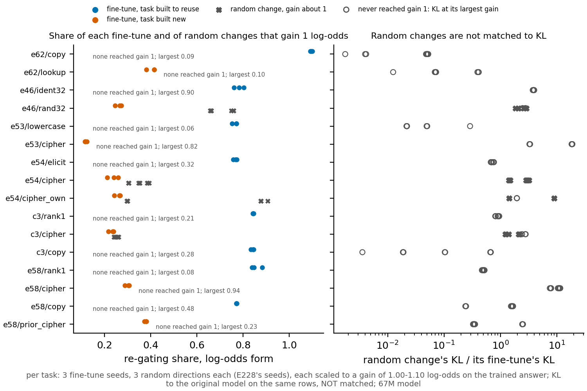
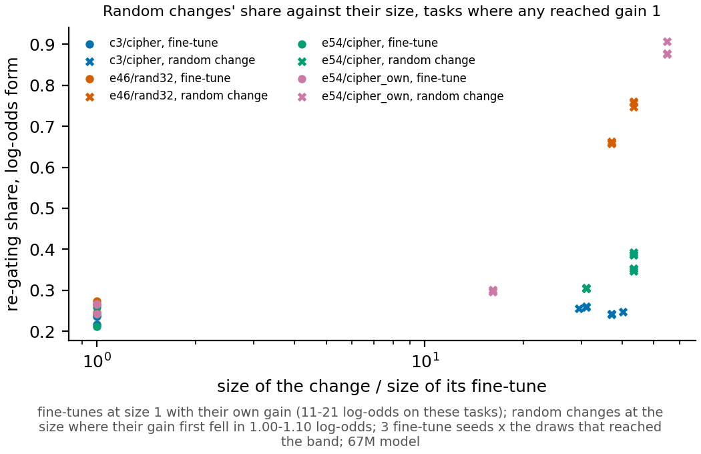

# What does the log-odds re-gating share read for random weight changes?

We scaled random weight changes until each raised the trained answer by one log-odds, and read the re-gating share on
them beside each fine-tune's own. Random changes got there only on four tasks built new, where they read the
fine-tunes' share or more; on every reuse task none did, even at a hundred times the fine-tune's size. So the share
has no random reference on the reuse side, and on the new side a low share does not set a trained update apart from
noise.

The random changes are not matched to the fine-tunes in gain, size or KL. A fine-tune raises the trained answer by
1.6 to 20.8 log-odds. The random changes were read at a gain of 1.00 to 1.10. So each comparison below sets a
fine-tune's share at its own large gain beside a random change's share at a gain of about one.

## What we were trying to test

**The share.** The paper's figure of known answers reports, for each fine-tune, the log-odds re-gating share
$r = (L_{01} - L_{00}) / (T_1 - T_0)$. Here $T_0$ and $T_1$ are the log-odds of the trained answer under the original
model and the changed one; their difference is the **gain**. $L_{00}$ is the log-odds with the original subcomponents
and the gates Γ gives them on the original activations, and $L_{01}$ the same subcomponents with the gates Γ gives on
the changed model's activations, the update itself left out. So $r$ is the part of the gain that appears when only
which subcomponents Γ switches on changes. It reads 0 when the gates do not move and 1 when the gates alone carry the
whole gain. It is defined only from a gain of 1 log-odds. Tasks built to reuse an existing skill read 0.75 to 1.10;
tasks built to need something new read 0.12 to 0.42.

**Why a random reference.** A review of the draft asked what $r$ reads for a change with no structure. If any change
of the weights that moves the answer reads a share like a fine-tune's, a low share says little about what was learned.
An earlier run scaled random changes to each fine-tune's KL and found none moved the answer by one log-odds, so the
log-odds form had no random reading at all. The user chose to scale up instead: "run option 1".

**What was run.** The 48 fine-tunes behind the figure: sixteen tasks, three fine-tune seeds each, on the 67M model and
its released decomposition. For each fine-tune, three random Gaussian directions with the fine-tune's per-matrix norms,
the same seeds as the earlier KL-matched run. Each direction was scaled up, on a log grid up to 100 times the
fine-tune's size and then by bisection, until its gain fell in 1.00 to 1.10 log-odds. The sign came from which of the
direction and its negative raised the answer more at the fine-tune's own size; if that sign never reached the band,
the other was tried. A direction that reached neither is reported with its largest gain and no share. For each
direction we also report its size relative to the fine-tune and its KL to the original model on the same rows. KL was
**not** matched.

**Control.** A zero change read gain, numerator and KL of exactly 0 on every task, and each of the 48 fine-tunes' own
shares came out equal to the figure's value bit for bit, on the same card type.

## What we expected, and why

Two readings were filed. If the share mostly measures how much of any output change flows through Γ's gates, random
changes at gain one should read near the new-side values or above, on most tasks, with a task's draws agreeing in sign.
If the share picks out structure that trained updates have and random ones lack, random changes should read near 0 or
flip sign from draw to draw. On KL, the earlier run suggested that draws reaching gain one would sit at a larger size
than the KL-matched ones and at a KL above their fine-tune's. No expectation was filed on how many draws would reach
the band.

## What we observed

### Do random changes reach a gain of one log-odds?

**Reading it.** Mostly not. In the left panel, grey crosses appear only on e46/rand32, e54/cipher, e54/cipher_own and
c3/cipher, all tasks built new. Every other row carries the largest gain any of its random changes reached, from 0.06
on e53/lowercase to 0.94 on e58/cipher. On the reuse tasks the trained answer barely moves under random changes of up
to a hundred times the fine-tune's size: the largest gains there run from 0.06 to 0.90. The gain does not grow with
size without end. Past some size the random change starts to wreck the model, the gain falls again, and the largest
gain sits at an intermediate size. So the share has no random reading on the twelve other tasks, and the in-band draws
below are a selected set: they are the directions and tasks on which noise happens to raise the trained answer.

The draws that reached the band, per task and fine-tune seed:

- e46/rand32: 2, 2, 2; c3/cipher: 2, 2, 2; e54/cipher_own: 2, 2, 2; e54/cipher: 3, 3, 3.
- Every other task: 0, 0, 0.
- Second sign needed: on e54/cipher_own, direction 228002 on every fine-tune seed; on e54/cipher, direction 228001 on
  fine-tune seeds 1 and 2. The probe at the fine-tune's size picked the other sign there.

### Where random changes are read, how do their shares compare with the fine-tunes'?

**Reading it.** At the fine-tunes' level or above, never near 0. On c3/cipher the random changes read 0.24 to 0.26
against the fine-tunes' 0.22 to 0.24. On e54/cipher they read 0.30 to 0.39 against 0.21 to 0.26. On e46/rand32 they
read 0.66 to 0.76 against 0.25 to 0.27. On e54/cipher_own one direction reads 0.30 and the other 0.88 to 0.91,
against 0.24 to 0.27. All shares are positive. On these four tasks a new-side fine-tune's low share is matched or
exceeded by a random change at gain one, so the share alone does not tell a trained new-side update from noise. The
caveat is the gain: the fine-tunes' shares are read at gains of 10.9 to 20.8 and the random ones at about one.

### Does the random share track the change's size rather than the task?

**Reading it.** Partly. Within a task, the larger in-band direction reads the larger share on e54/cipher_own, from
0.30 at 16 times the fine-tune's size to 0.91 at 55 times, and on e46/rand32 and e54/cipher less steeply. On c3/cipher
it does not: 0.26 at about 30 times and 0.24 at about 40. Across tasks, at the same 43 times, e54/cipher reads 0.35 to
0.39 and e46/rand32 0.75 to 0.76. So the random share depends on both the task and the size, and with three directions
a task the two cannot be separated. Neither filed reading said anything about size.

### Full tables

Per task, over the three fine-tune seeds. Gain is in log-odds. KL is to the original model on the read rows, and the
random changes' KL is **not matched** to the fine-tune's.

| task | built | fine-tune share | fine-tune gain | fine-tune KL | draws in band, per seed | random share, in-band draws only | random KL, not KL-matched | largest gain, draws not in band |
|---|---|---|---|---|---|---|---|---|
| e62/copy | reuse | 1.09 to 1.10 | 12.5 to 12.7 | 0.44 to 0.45 | 0, 0, 0 | none | none | 0.09 |
| e62/lookup | new | 0.38 to 0.42 | 15.0 to 15.4 | 0.47 to 0.49 | 0, 0, 0 | none | none | 0.10 |
| e46/ident32 | reuse | 0.76 to 0.80 | 14.0 to 14.3 | 0.59 to 0.61 | 0, 0, 0 | none | none | 0.90 |
| e46/rand32 | new | 0.25 to 0.27 | 13.2 to 13.7 | 1.03 to 1.14 | 2, 2, 2 | 0.66 to 0.76 | 2.10 to 3.02 | 0.39 |
| e53/lowercase | reuse | 0.75 to 0.77 | 1.6 to 1.7 | 0.42 to 0.43 | 0, 0, 0 | none | none | 0.06 |
| e53/cipher | new | 0.12 | 3.8 to 3.9 | 0.27 | 0, 0, 0 | none | none | 0.82 |
| e54/elicit | reuse | 0.76 to 0.77 | 10.8 | 0.46 to 0.50 | 0, 0, 0 | none | none | 0.32 |
| e54/cipher | new | 0.21 to 0.26 | 10.9 to 11.1 | 0.77 to 0.83 | 3, 3, 3 | 0.30 to 0.39 | 1.15 to 2.54 | none |
| e54/cipher_own | new | 0.24 to 0.27 | 20.2 to 20.8 | 0.74 to 0.75 | 2, 2, 2 | 0.30 to 0.91 | 1.06 to 6.70 | 0.80 |
| c3/rank1 | reuse | 0.84 | 10.9 | 0.36 to 0.40 | 0, 0, 0 | none | none | 0.21 |
| c3/cipher | new | 0.22 to 0.24 | 12.5 to 12.9 | 0.86 to 0.90 | 2, 2, 2 | 0.24 to 0.26 | 1.10 to 1.99 | 0.93 |
| c3/copy | reuse | 0.83 to 0.85 | 12.9 to 13.3 | 0.50 to 0.51 | 0, 0, 0 | none | none | 0.28 |
| e58/rank1 | reuse | 0.84 to 0.88 | 9.6 to 9.9 | 0.29 to 0.31 | 0, 0, 0 | none | none | 0.08 |
| e58/cipher | new | 0.29 to 0.31 | 14.9 to 16.0 | 0.77 to 0.82 | 0, 0, 0 | none | none | 0.94 |
| e58/copy | reuse | 0.77 | 16.3 to 16.5 | 0.51 to 0.52 | 0, 0, 0 | none | none | 0.48 |
| e58/prior_cipher | new | 0.37 to 0.38 | 14.4 to 14.9 | 0.59 to 0.61 | 0, 0, 0 | none | none | 0.23 |

Per direction, on the four tasks with in-band draws. Size is the random change's norm over the fine-tune's. "KL-matched
size in the earlier run" is the size at which the same direction matched the fine-tune's KL; seed 2 of e46/rand32 and
e54/cipher_own was not in that run, so its range covers seeds 0 and 1.

| task | direction | fine-tune seeds 0, 1, 2 | size / fine-tune size | KL-matched size in the earlier run | share | KL, not KL-matched |
|---|---|---|---|---|---|---|
| e46/rand32 | 228001 | not in band; not in band; not in band | 43 | 28 | none; largest gain 0.37 to 0.39 | 2.82 to 2.90 |
| e46/rand32 | 228002 | in band, first sign; in band, first sign; in band, first sign | 43 | 28 to 29 | 0.75 to 0.76 | 2.93 to 3.02 |
| e46/rand32 | 228003 | in band, first sign; in band, first sign; in band, first sign | 37 | 28 | 0.66 | 2.10 to 2.17 |
| e54/cipher | 228001 | in band, first sign; in band, second sign; in band, second sign | 43 | 26 to 28 | 0.39 | 2.31 to 2.37 |
| e54/cipher | 228002 | in band, first sign; in band, first sign; in band, first sign | 43 | 26 to 28 | 0.35 | 2.47 to 2.54 |
| e54/cipher | 228003 | in band, first sign; in band, first sign; in band, first sign | 31 | 26 to 28 | 0.30 to 0.31 | 1.15 to 1.18 |
| e54/cipher_own | 228001 | not in band; not in band; not in band | 19 | 13 | none; largest gain 0.79 to 0.80 | 1.46 to 1.47 |
| e54/cipher_own | 228002 | in band, second sign; in band, second sign; in band, second sign | 55 | 14 | 0.88 to 0.91 | 6.67 to 6.70 |
| e54/cipher_own | 228003 | in band, first sign; in band, first sign; in band, first sign | 16 | 14 | 0.30 | 1.06 to 1.07 |
| c3/cipher | 228001 | not in band; not in band; not in band | 43 | 26 to 28 | none; largest gain 0.92 to 0.93 | 2.20 to 2.49 |
| c3/cipher | 228002 | in band, first sign; in band, first sign; in band, first sign | 37 to 40 | 28 to 29 | 0.24 to 0.25 | 1.80 to 1.99 |
| c3/cipher | 228003 | in band, first sign; in band, first sign; in band, first sign | 29 to 31 | 28 | 0.26 | 1.10 to 1.20 |

For a direction that never reached the band, size and KL are at its largest gain.

## What we learned

The log-odds form of the share cannot be given a random reference on the reuse tasks, which are the ones that carry
the high shares: random changes up to a hundred times a fine-tune's size do not raise their trained answer by one
log-odds. On the four new tasks where random changes do reach that gain, they read the same share as the fine-tunes or
higher. So a low share on a new task is not evidence that the update has structure noise lacks. This run says
nothing about the gap between reuse and new tasks, because it gives no random reading on the reuse side.
For the paper this is a reference for the new side only, stated with its unmatched gain, size and KL.

## How compelling is the evidence

- The four tasks with in-band draws are selected: they are where noise raises the trained answer, and all four are
  new-side tasks with cipher-like or random targets.
- The three fine-tune seeds do not give independent random draws. A direction is built from its seed and the
  fine-tune's per-matrix norms, which barely differ between fine-tune seeds, so the same direction lands at the same
  grid size and reads nearly the same share on each. Each task has in effect three random directions, not nine.
- Gain, size and KL are all unmatched. The in-band random changes sit at 16 to 55 times the fine-tune's size. Their
  gain is about one, against the fine-tunes' 10.9 to 20.8. Their KL runs from 1.06 to 6.70, against the fine-tunes'
  0.74 to 1.14.
- The noise floor between batches of one fine-tune's share was about 0.03 in an earlier run; the spread between
  directions here is far wider, up to 0.30 against 0.91 on one task.
- One model, one decomposition, one band of gain.

## Surprises

- Random changes reached gain one on so few tasks, and on none built to reuse, that the reference exists only where
  shares are low.
- Some random changes read shares far above any new-side fine-tune: 0.88 to 0.91 on e54/cipher_own and 0.66 to 0.76 on
  e46/rand32, near the reuse side's values.
- The gain of a random change rises and then falls with its size, so for many directions the largest gain sits well
  below the cap.

## What next

- A random reference matched in gain would need random changes that raise the answer by 10 log-odds or more. The
  largest gains here suggest none exists. The paper can state that as the reason the form has no random baseline on
  the reuse side.
- Reading the share at the fine-tune's own gain on a lower-gain checkpoint of each fine-tune would put fine-tune and
  random change at the same gain on the new side; this needs a new cell.

## Scorecard

| id | claim in words | rule | what was read | verdict |
|---|---|---|---|---|
| control_zero | a zero change reads nothing | gain, numerator, KL exactly 0; share nan | exactly 0 on every task, share nan | held |
| control_fine_tunes | the fine-tunes' shares reproduce the figure | float equality with the figure's file | every fine-tune equal, difference 0 | held |
| random_rival_a | the share measures any output change through the gates | random shares near 0.12 to 0.42 or above on most tasks, signs agreeing | on the four tasks read, 0.24 to 0.91, all positive; on the twelve others no draw reached the band | holds where it can be read; its "most tasks" clause cannot be read |
| random_rival_b | the share separates trained structure from noise | random shares near 0 or erratic in sign | no task read near 0 or with mixed signs | not seen |
| random_kl | in-band draws sit above the KL-matched size and KL | size above the earlier run's KL-matched size; KL above the fine-tune's | every in-band draw above both | held |
| random_status | how many draws reach gain one | none filed | per task in the list above | no expectation filed |

## Departures from the literature

None: the share and its random draws are this project's own construction.

## Not run

- Random changes matched to a fine-tune's gain, which the largest gains here suggest do not exist.
- A twin or realistic fine-tune: not in the figure of known answers.
- KL-matched draws: the earlier run.
- A second decomposition, or the Qwen model.
- More than three random directions per task.
- Any verdict on reuse against new.

## Provenance

- Results: `experiments/random_logodds_share/results/control.json`, `results/states/*.json`; filed predictions in
  `results/predictions.json`; plan `reports/plans/2026-11-25_plan_p2-82-random-logodds-share.md`.
- Figures: `experiments/random_logodds_share/figures/shares.png`, `figures/share_vs_size.png`, drawn by `plot.py`.
- Run: E310, cluster debug QoS on an NVIDIA L40, six shards and a control job, $0; about three hours of reads in all.
- Earlier run cited: the KL-matched random draws, `experiments/random_kl_share/results/states/`.
