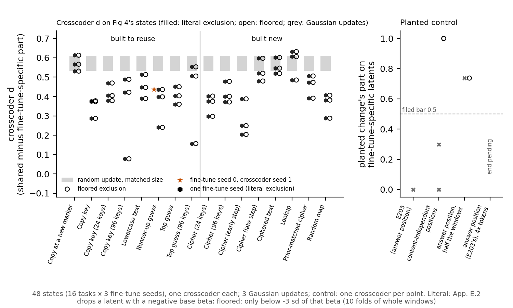

# What does Minder et al.'s crosscoder read on Fig 4's states, once its planted control works?

*2026-11-25, baseline-lead. Cell P2.83, experiment E311, runs 1 and 2 of 3. Descriptive: the states are named as built
and no state is called reused or new. Plan `reports/plans/2026-11-25_plan_p2-83-crosscoder-fix.md` with its appendix
and card; filed expectations `experiments/crosscoder_fig4/results/predictions.json`; code
`experiments/crosscoder_fig4/run.py` and `src/commute/crosscoder_sides.py`; figure
`experiments/crosscoder_fig4/figures/crosscoder_fig4.png`.*

We trained the crosscoder of Minder et al. 2025, with their code and settings, between the original 67M model and each
of the 48 fine-tuned states that Fig 4 plots, and also on three random weight changes and on a planted change whose
answer we know. The planted change is found once the authors' filter on negative coefficients is told to ignore noise,
it is lost under the filter as written, and on the real states the two filters agree exactly. For `GOALS.md` the
crosscoder now has a working control on this model, but it reads a random update as more shared than most real
fine-tunes, and the spread between fine-tune seeds of one task is larger than any difference between tasks, so it
offers no reading of reuse against new that the paper could use.

## The answer

With a planted change placed where no existing feature fires, the crosscoder gives it a latent of its own, and that
latent carries nearly all of the change. The authors' filter as written still drops that latent, because its base
coefficient comes out a hair below zero; with the filter floored at noise, the control passes. On every real state
both filters give the same reading. A random update reads more shared than most fine-tunes, and the three seeds of one
task spread wider than tasks differ.

## What we were trying to test

A crosscoder is one sparse dictionary trained on the activations of two models at once: each latent has one decoder
vector for the original model and one for the fine-tuned model. Minder et al. call a latent fine-tune-specific when its
original-model decoder is small next to its fine-tuned one, and when a check they call latent scaling confirms that the
original model cannot explain what the latent does. Latent scaling fits, for each latent, a coefficient that says how
much of the latent's direction each model's activations hold. The ratio of the original model's coefficient to the
fine-tuned model's is near 0 for a latent that exists only after fine-tuning and near 1 for a shared one.

We read each crosscoder with the number $d = S - F$, where $S$ is the share of the fine-tune's change in activations
carried by shared latents and $F$ the share carried by fine-tune-specific latents. Both shares run from 0 to 1, so $d$
runs from −1 to 1. A higher $d$ means more of the change sits on latents that both models use; under the authors'
reading, a fine-tune that taught something new puts its change on fine-tune-specific latents and reads lower. The
definition is `src/commute/crosscoder.py:374-378`, where `d_authors` is the shared part minus the fine-tune-specific
part. The rest of the change goes to biases, to latents that fail latent scaling, to other latents and to the
reconstruction error, so $S + F$ is well under 1.

The crosscoder was trained at the input of block 2, the middle of the model's four blocks, which is where the authors
train theirs on a 26-layer model. One crosscoder was trained for each of 52 sides:

- **48 states**: the sixteen tasks of Fig 4, eight built to reuse the original model's machinery and eight built new,
  each fine-tuned from three seeds.
- **Three random updates**: a Gaussian weight change at the per-matrix sizes of each seed of the runner-up-guess task.
  A random update teaches nothing, so it shows what the tool reads when no task was learnt.
- **One second crosscoder seed** on the seed-0 runner-up-guess state, to show how much of the spread comes from the
  crosscoder itself rather than from the fine-tunes.

Two controls ran first, alone. The **self control** trains a crosscoder of the original model against itself; it should
find every latent shared and none specific. The **planted control** adds one fixed random direction to the fine-tuned
side's activations only, so the right answer is known: one latent should hold that direction, be called
fine-tune-specific, and carry at least half the planted change.

The planted control of an earlier run of this crosscoder missed. That run put the direction at the answer position of
every task window, where existing features of the original model always fire. The saved crosscoder showed it had not
given the plant its own latent; it had written the plant into the fine-tuned decoder of the latent that already fires
there. By the authors' own test such a latent is shared, so that miss came from where the plant was put. This run moves
the plant: one variant adds it at positions chosen without regard to content, one in every 80, with two crosscoder
seeds; another keeps the answer position but plants only half the windows. A diagnostic arm reruns the old placement on
four times the tokens.

A second problem shapes every reading here. Minder et al. drop any latent whose original-model coefficient is negative.
For a latent that exists only in the fine-tune, that coefficient is zero plus sampling noise, so the filter drops it on
a coin toss. Every crosscoder is therefore scored twice: under the **literal filter**, as published, and under a
**floored filter** that drops a latent only when its coefficient sits more than three standard errors below zero. The
standard error comes from ten folds of whole windows in the same job.

## What we expected, and why

- The self control: no specific latent, every decoder-norm ratio within 0.001 of one half, fraction of variance
  explained near 0.932.
- The plant at content-independent positions: a pass under the floored filter, since an earlier run's spread plant had
  been isolated cleanly; a likely miss under the literal filter, for the coin-toss reason above.
- The half-window plant: a likely pass, because folding the plant into an existing latent now costs reconstruction on
  the unplanted half.
- The 48 states: seed-0 states within 0.05 of the earlier run's readings, and the two crosscoder seeds about 0.05 apart.
  No bar was filed on the states; the reading is descriptive.

## Does the planted control pass?

| control | filter | lead latent's ratio of coefficients | part on specific latents | pass |
|---|---|---|---|---|
| self, original against itself | both | none specific | none | yes |
| content-independent, crosscoder seed 0 | literal | dropped, base coefficient −3.1e-4 | 0 | no |
| content-independent, crosscoder seed 0 | floored | kept | 1.00 | yes |
| content-independent, crosscoder seed 1 | literal | dropped, base coefficient −2.1e-4 | 0.298 | no |
| content-independent, crosscoder seed 1 | floored | kept | 0.999 | yes |
| answer position, half the windows | both | 0.112 and 0.063 | 0.737 | yes |
| answer position, every window, earlier run | literal | 0.244, over the bar of 0.2 | 0 | no |

**Reading it.** Under the authors' literal filter the content-independent control misses at both crosscoder seeds;
under the floored filter it passes at both. The right panel shows this: the grey crosses sit at 0 and 0.298, under the
dashed bar of one half, and the open circles sit at the top. In both crosscoders a single latent took the plant, with a
decoder-norm ratio of 0.85 and 0.93 toward the fine-tuned side and an error-term ratio of 0.088 and 0.023, well under
the authors' cut-off of 0.2. The literal filter drops it only because one of its original-model coefficients came out
negative, at −1.3e-4 and −1.6e-4 as a ratio. The floored filter's bar for that coefficient was −0.0070 and −0.0042, so
those values are noise around zero. This is the cell's second planned outcome: missed under the published rule because
its sign filter acts on noise, passed with the filter floored. It is not a pass under the published rule.

The half-window plant passes under both filters, at 0.737, because its lead latent's original-model coefficients came
out positive. The self control passed every check: no specific latent, every ratio exactly one half, and a fraction of
variance explained of 0.932.

## Does the choice of filter change any reading on the real states?

No. On all 52 sides, the 48 states, the three random updates and the second crosscoder seed, the two filters give the
same $d$ to every digit stored. The reason is in the parts: on the real states the fine-tune-specific part is almost
nothing under either filter. Its largest value is 0.101 on the seed-0 state of the 96-key copy task, and on every other
state it is at most 0.005. With no specific latents to drop, the filter has nothing to act on, and $d$ is in effect the
shared part alone.

## What does the crosscoder read on the 48 states?

The random band is the three Gaussian updates, 0.532, 0.550 and 0.611. The second crosscoder seed on the seed-0
runner-up-guess state read 0.437 against the first seed's 0.398, a gap of 0.038.

| task | built | seed 0 | seed 1 | seed 2 | against the random band |
|---|---|---|---|---|---|
| Copy at a new marker | reuse | 0.567 | 0.531 | 0.613 | in it, one seed at each edge |
| Copy key | reuse | 0.373 | 0.287 | 0.378 | below |
| Copy key, 24 keys | reuse | 0.379 | 0.405 | 0.470 | below |
| Copy key, 96 keys | reuse | 0.078 | 0.422 | 0.489 | below |
| Lowercase text | reuse | 0.389 | 0.447 | 0.513 | below |
| Runner-up guess | reuse | 0.398 | 0.436 | 0.240 | below |
| Top guess | reuse | 0.360 | 0.404 | 0.451 | below |
| Top guess, 96 keys | reuse | 0.506 | 0.553 | 0.157 | seed 1 in it, the others below |
| Cipher, 24 keys | new | 0.298 | 0.375 | 0.402 | below |
| Cipher, 96 keys | new | 0.478 | 0.401 | 0.372 | below |
| Cipher, early step | new | 0.388 | 0.249 | 0.204 | below |
| Cipher, late step | new | 0.597 | 0.480 | 0.520 | seed 0 in it, the others below |
| Ciphered text | new | 0.519 | 0.602 | 0.547 | seeds 1 and 2 in it, seed 0 below |
| Lookup | new | 0.485 | 0.632 | 0.606 | seed 1 above, seed 2 in it, seed 0 below |
| Prior-matched cipher | new | 0.391 | 0.473 | 0.506 | below |
| Random map | new | 0.407 | 0.288 | 0.381 | below |

**Reading it.** Most states read below the random updates, not above them. The 48 states average 0.426, and the
random band runs from 0.532 to 0.611. Only the copy-at-a-new-marker, ciphered-text and lookup tasks, and single seeds
of the late-step cipher and the 96-key top guess, reach the band. A random update that taught nothing thus reads more
shared than most real fine-tunes. A high $d$ is therefore no evidence of reuse, and the band is the tool's value for
"no task learnt", not a floor and not a reference for new. Why a random change reads this way was not tested.

The tasks built to reuse average 0.410 and the tasks built new 0.442, and their values overlap across the whole range.
Within one task the three fine-tune seeds spread far wider than the crosscoder seeds do: the 96-key copy task runs
from 0.078 to 0.489, the 96-key top guess from 0.157 to 0.553, and the runner-up guess from 0.240 to 0.436. The second
crosscoder seed moved the reading by only 0.038. So the spread comes from the fine-tunes, and a mean of three seeds per
task cannot order the tasks. The lowest value of all 52 sides, 0.078 on the seed-0 96-key copy state, is the value the
earlier run read on the same state: a reproduced outlier, not a new one.

## E203's placement at four times the tokens: end pending

The diagnostic arm reruns the earlier placement, the plant at every answer position, for 800M tokens instead of 200M.
Its end file has not arrived. The runner's messages give the lead latent's error-term ratio at its snapshots: 0.320 at
25M tokens, 0.323 at 50M, 0.293 at 100M and 0.244 at 200M, all with no part on specific latents under either filter.
These equal the earlier run's snapshots to three decimals. The question it answers is whether the merged latent splits
off with more training; a miss at 800M under either filter would be a caveat in the caption, not a change to the
readings above.

## Against the earlier run of the same recipe

Most seed-0 states on the key-value tasks read the same as the earlier run to three decimals. Two moved, both by less
than 0.05. The 24-key cipher read 0.298 against 0.266 then. The runner-up guess read 0.398 against 0.416. The earlier
run's second crosscoder seed had read 0.463, a gap of 0.047 against this run's 0.038. The text-task states moved more,
as expected: their crosscoders now train on the full token budget, where the earlier ones ran out at about half. The
seed-0 lookup state read 0.485 against 0.549 then. The seed-0 ciphered-text state read 0.519 against 0.563.
The seed-0 random update read 0.550 against 0.547.

## What we learned

The crosscoder can isolate a fine-tune-only direction at block 2 of the 67M, so the earlier misses came from where the
plant was put and from the sign filter, not from the method failing to train. On real fine-tunes, though, it finds
almost no fine-tune-specific latents at all, and its reading reduces to the shared part of the change. That shared
part is higher for a random update than for most trained ones, and it varies more between fine-tune seeds than between
tasks. For `GOALS.md` the crosscoder joins the other model-diffing tools as a baseline whose values on Fig 4's states
overlap between the two built sides; it gives no reading of reuse against new on this model.

## How compelling is the evidence

- The control is strong for what it tests: one fixed direction added only to the fine-tuned side, found at two
  crosscoder seeds with nearly all of its change on one latent. It does not test a change spread across many
  directions, which is what a fine-tune makes.
- The reading is blind to whatever the crosscoder puts in the bias, in latents that fail latent scaling, and in the
  error; on the states the bias alone averages about a fifth of the change.
- Every state has three fine-tune seeds and one crosscoder. Only one state has a second crosscoder seed, so the
  crosscoder's own noise is one gap of 0.038, against fine-tune seed spreads up to 0.411 within a task.
- All 52 sides passed their end checks: the fraction of variance explained was at least 0.927 on every side against the
  bar of 0.882, and no side had dead latents against the bar of 0.3.

## Surprises

- The literal filter drops the planted latent at both crosscoder seeds on a coefficient within noise of zero. This was
  the filed lean, so it is not a reversal, but it means the authors' rule as published cannot pass this control here.
- The fine-tune-specific part on real states is almost zero, so $d$ is the shared part alone. That was not filed.
- The diagnostic arm's snapshot values equal the earlier run's to three decimals. Seed-0 crosscoders reproduce the
  earlier run exactly on most states, so this is plausible, but it should be checked against the end file.

## What next

- Pod e's end file: if the old placement splits off by 800M tokens, the caption can say the earlier miss was partly
  training length; if not, the placement alone explains it.
- Nothing else is proposed. The cell's runs are spent apart from the reserve for a lost pod, and the reading would not
  change with more crosscoder seeds, since the crosscoder's own gap is a tenth of the fine-tune seed spread.

## Scorecard

| id | claim | rule | read | verdict |
|---|---|---|---|---|
| 0a | self control | no specific latent; ratios within 0.001 of one half | none; exact | as expected |
| 0b random s0, s1 | plant at content-independent positions | lead specific and part at least 0.5; gate on the floored filter | floored 1.00 and 0.999; literal 0 and 0.298 | floored pass; literal miss, as leaned |
| 0b answer_half | plant on half the windows | as above | 0.737 under both | pass |
| 0b answer long | earlier placement, 800M tokens | diagnostic | snapshots to 200M only | end pending |
| 2 states | seed-0 key-value states within 0.05 of the earlier run | absolute gap | largest gap 0.031 on the 24-key cipher | as expected |
| 2 reseed | crosscoder seeds about 0.05 apart | absolute gap | 0.038 | as expected |
| 2 filters | floored $d$ at most the literal $d$ | per side | equal on every side | as expected |

## Departures from the literature

Source: Minder, Dumas, Juang, Chughtai, Nanda 2025, arXiv 2504.02922, with their pinned trainer and settings.

- **The negative-coefficient filter.** App. E.2, p. 26, drops every latent with a negative original-model coefficient,
  and reports that none were dropped for BatchTopK crosscoders on Gemma. We report that literal filter and, beside it,
  a floored filter that drops a latent only below three standard errors from ten folds of whole windows. Why: a latent
  that exists only in the fine-tune has a coefficient of zero plus noise, and on this model the literal filter drops
  such latents at random. The cell's gate reads the floored filter, and a pass there is reported as a pass with the
  filter floored, not under the published rule.
- **The planted control is ours**, as is its placement. The source has no planted control. The earlier run planted at
  the answer position; this run plants at content-independent positions and on half the windows, and keeps the old
  placement as a diagnostic. Why: App. D, p. 25, predicts that a direction always firing with an existing feature is
  merged into it, which the earlier run's saved decoder showed.
- **The reading $d$ is ours.** The source reports counts and lists of chat-specific latents, not a share of the change.
- **Scale and data.** A 67M model with a dictionary of 24,576 latents at expansion 32, at block 2 of four, instead of
  Gemma-2-2B with 73,728 latents at layer 13 of 26. The training text is the Pile plus the task's own text instead of
  FineWeb and chat data, 100M tokens an epoch for two epochs as in the source. The fine-tune-specific candidates are
  the top 1,667 latents by decoder-norm ratio, the toolkit's 5,000 scaled to the dictionary.

**Departure from the filed plan.** Two early checks never ran on the 52 sides: the fraction of variance explained and
the dead share at a side's first snapshot. They ran on the controls. `experiments/crosscoder_fig4/run.py:237`
calls `run_side` with snapshots off, and `src/commute/crosscoder_sides.py:290` then sets no snapshot marks, so the hook
that runs those checks never fires. Only the early stop was lost: the end checks at `run.py:242-243` are stricter, and
every side passed them. No rerun is needed.

## Draft caption for the crosscoder panel of Fig 6

Crosscoder of Minder et al. 2025, their code and recipe, at block 2: $d$, the shared minus the fine-tune-specific part
of the change, one point per fine-tune seed. Grey: three random updates, 0.532 to 0.611, above most states; star: a
second crosscoder seed, 0.038 from the first. The planted control passes with the negative-coefficient filter floored
at noise and misses under the literal filter, which gives identical $d$ on every state.

## Not run

- The old placement's end at 800M tokens: running, end pending.
- More than one crosscoder seed per state; a second seed on any state other than the runner-up guess.
- TF32, which would have halved training time but departs from the authors' fp32.
- A sweep of dictionary size or sparsity.
- The size-matched sides of the earlier run, which Fig 4 does not have.
- Any test of why a random update reads as more shared than a trained one.

## Provenance

Self control `experiments/crosscoder_fig4/results/stage0a.json`; planted controls `stage0b_random_s0.json`,
`stage0b_random_s1.json`, `stage0b_answer_half_s0.json` in the same folder; sides `results/sides/*.json`, one file per
side; shard checks `results/stage2_*_26.json`. Earlier readings `experiments/crosscoder/results/negbeta_rescore.json`
and `experiments/crosscoder/results/run2/stage0b.json`. Every side ran on an H100 in fp32, taking 47.4 to 49.2 minutes;
run 2 used 26 pods. Plotted values `experiments/crosscoder_fig4/figures/crosscoder_fig4.csv`. Ledger beside this file.
