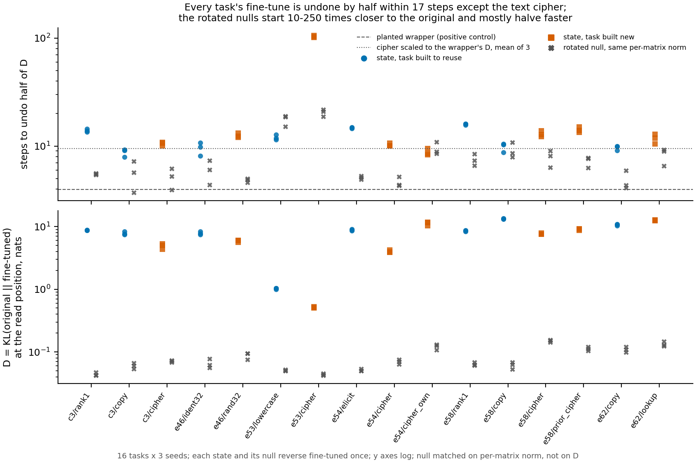
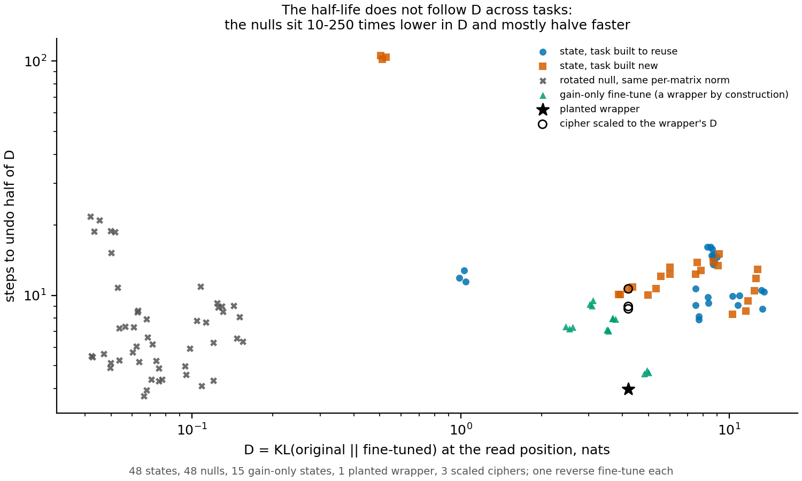

# Does reverse fine-tuning tell tasks built to reuse from tasks built new?

We took the 48 fine-tunes behind the paper's figure of known answers and trained each one back toward the original
model, counting the steps needed to undo half of the change, as Jain and colleagues do to detect a thin wrapper. Every
fine-tune came half way back within 17 steps except the text cipher, which took about 100, and the order of the two
sides flips from pair to pair. That is consistent with the earlier test's untested explanation, that the half-life
reads how easily the original behaviour returns, and by its construction the measure cannot see whether the new
behaviour runs on the original model's mechanisms, so it cannot stand in for the definition of reuse.

## The answer

Reverse fine-tuning does not separate the tasks built to reuse from the tasks built new on these 48 states. The
controls passed: a planted wrapper came back in 4 steps against about 9.5 for a cipher of the same size. But on the
real fine-tunes, copying tasks built to reuse halve faster than their partners, while rank-1 and elicitation tasks
built to reuse halve slower. The rank-1 map again came back slower than the cipher, as in the earlier test. One task,
the cipher on text, is a slow outlier.

## What we were trying to test

**The method.** Jain, Kirk, Lubana and colleagues, in a 2023 preprint published at ICLR 2024, fine-tune a model and
then fine-tune it again "in the reverse direction" toward the original task. If the old ability comes back in a few
steps, they read the fine-tune as a thin wrapper around a capability it kept. If it comes back slowly, the
capability was changed. They compare against a model that never had the ability. They read curves by eye and set no
cut-off.

**Our version on the 67M model.** The original model M is the 4-layer 67M Pile model. Each fine-tuned state F is M
plus one saved weight change. There are 16 tasks with three fine-tune seeds each, the 48 states of the paper's figure
of known answers. The tasks come in nine built pairs: one side built to reuse something M already does, the other built
to need something new. For each state we measure how far F sits from M as

$D = \mathrm{mean}\ \mathrm{KL}(p_M \,\|\, p_F)$ at the task's read position, over the held-out windows,

in nats. D is 0 for M itself. We then train F back toward M, with the same KL as the loss at every position of the
task's own training windows. The optimiser is Adam at a tenth of the forward learning rate and the forward batch. Only
the 24 decomposed weight matrices train, for at most 1000 steps. After every step we read D again. The **half-life** is the step at which D
first falls to half its start, interpolated between the two straddling steps. A short half-life is Jain's sign of a
wrapper. A half-life that never arrives within 1000 steps is called censored.

**The null.** Beside each state we run its own random update. Each matrix's change is turned by a random rotation on
its output side, which keeps that matrix's singular values and so its norm, but points it in a random direction. The
code is `experiments/reverse_ft_fig4/run.py:138-143`. The null is matched on each matrix's norm, **not on D**: a
random direction mostly misses the read position, so the null starts much closer to M.

**The positive control.** An earlier test of this same code planted a wrapper by hand. It takes 13 MLP neurons of M that already fire
mostly at the answer position and gives each one an extra write in a single fixed direction. Every other weight is
untouched, so M's mechanisms stay as they were. Here we rebuilt it
from its saved recipe. Its partner is the cipher, a task built new, with each seed's whole change multiplied by one
factor until its D equals the wrapper's. The factor is found by bisection, at `run.py:277-278`. If the method reads
wrappers at all, the wrapper must halve clearly faster than the cipher at the same D.

**The earlier result this repeats.** That earlier test ran this code on nine of the 48 states: the rank-1 map, the
cipher and the copy map on the 32-key task. It found the rank-1 map, built to reuse M's machinery, came back *slower*
than the cipher, built new. Jain's reading predicts the reverse, so we call that ordering wrong-way. Its untested
explanation was that the half-life reads how much of M's behaviour each fine-tune leaves recoverable, which every map
keeps, and not reuse. This run puts that explanation to all 16 tasks. It is descriptive: no rule on the 48 states was
filed.

**Also shown, without a rule.** Fifteen gain-only fine-tunes multiply each MLP neuron's output by a learned gain and
change nothing else. Every weight direction of M is kept, so they are wrappers by construction.

## What we expected, and why

We expected the controls to pass, because the planted wrapper had come back in about 4 steps before and the cipher in
about 10. We expected every state to halve within 4 to 20 steps, as the earlier test's 32 states had, and none to be
censored. We expected the nulls to start far closer to M than their states, with an unknown half-life. If Jain's reading
holds here, the side built to reuse should halve faster than the side built new in each pair. If the earlier
explanation holds, the two sides should sit close together or in the wrong order, following the update's size.

## The controls passed

| check | what it reads | expected | got | source key in `results/stage0.json` |
|---|---|---|---|---|
| zero update | D of M against itself; half-life | 0; none | 0; none | `.zero.D`, `.zero.t_half` |
| reproduce the rank-1 map, seed 0 | half-life, steps | within 1 of 13.91 | 13.91 | `.reproduce."c3/rank1_s0".t_half` |
| reproduce the cipher, seed 0 | half-life, steps | within 1 of 10.69 | 10.69 | `.reproduce."c3/cipher_s0".t_half` |
| planted wrapper | half-life, steps | within 1 of 3.97 | 3.97 | `.planted.wrapper.t_half` |
| ciphers scaled to the wrapper's D | half-life per seed, steps | 10 to 14 | 8.75, 10.66, 8.96 | `.planted.partners[].t_half` |
| wrapper against scaled ciphers | gap in steps against 3 × noise | pass | gap 5.49, noise 1.04 | `.planted.gate` |
| D measured two ways | batched against one window at a time, nats | under 1e-9 | 9.5e-12 | `.kappa_floor.batched_vs_single` |
| gain folded into the weights against the original hooks | relative logit difference | under the bar 3.1e-5 | 1.7e-6 | `.fold.rel_diff`, `.fold.bar` |

The reproductions matched the earlier test's half-lives to every printed digit. The weights were back at M after
every reverse fine-tune. The planted wrapper halved in 3.97 steps and the three scaled ciphers in 8.75 to 10.66, all
at a D of 4.21 nats. The gap of 5.49 steps clears three times the noise of 1.04 steps, so the method can tell a
planted wrapper from a new map of the same D. The scaled ciphers were faster than the 10 to 14 we expected, so the
gap was smaller than expected. Any item with D under 9.5e-11 nats, ten times the measured floor, would have been void.

All 111 items ran: 48 states, 48 nulls and 15 gain-only states. None was void and no half-life was censored.

## Does the half-life separate the side built to reuse from the side built new?

**Reading it.** No: the order of the two sides changes from pair to pair. The top panel shows each seed's half-life,
blue for tasks built to reuse and orange for tasks built new, with each state's rotated null in grey beside it. The
dashed line is the planted wrapper and the dotted line the D-matched ciphers. Apart from the text cipher, every state
halves in 7.9 to 16.1 steps. That is well above the wrapper's line, and around or above the ciphers' line. The
copying tasks built to reuse halve faster than their new partners. The rank-1 and elicitation tasks built to reuse
halve slower than theirs. The rank-1 map on the 32-key task took 13.95 steps against the cipher's 10.53. That is the
same wrong-way order as before. Within each pair the two sides' seed ranges do not overlap, so each pair's order is
not seed noise. The closest pair is the induction copy, at 9.07 to 9.96 steps, against the lookup at 10.45 to 12.90.

The bottom panel shows why the grey nulls are no size-matched reference. Their D sits between 11 and 250 times below
their state's, and yet most of them halve faster. They are not the reference for reading reuse. The only comparison at
matched D is the planted wrapper against the scaled ciphers, the two reference lines.

Mean half-life over three seeds for each task, in steps, and mean D in nats. Pairs as in the figure of known answers.

| pair | built to reuse | half-life | D | built new | half-life | D |
|---|---|---|---|---|---|---|
| 32-key rank-1 / cipher | c3/rank1 | 13.95 | 8.72 | c3/cipher | 10.53 | 4.89 |
| 32-key copy / cipher | c3/copy | 8.76 | 7.84 | c3/cipher | 10.53 | 4.89 |
| copy / random map | e46/ident32 | 9.56 | 7.84 | e46/rand32 | 12.53 | 5.86 |
| text lowercase / cipher | e53/lowercase | 12.04 | 1.02 | e53/cipher | 103.70 | 0.51 |
| elicit / matched cipher | e54/elicit | 14.76 | 8.78 | e54/cipher | 10.27 | 4.00 |
| elicit / own cipher | e54/elicit | 14.76 | 8.78 | e54/cipher_own | 8.78 | 11.18 |
| 96-key rank-1 / cipher | e58/rank1 | 15.97 | 8.48 | e58/cipher | 12.97 | 7.65 |
| 96-key copy / prior cipher | e58/copy | 9.86 | 13.30 | e58/prior_cipher | 14.12 | 8.98 |
| induction copy / lookup | e62/copy | 9.65 | 10.66 | e62/lookup | 11.73 | 12.58 |

The nulls, mean half-life in steps and mean D in nats, per task:

| task | null half-life | null D | task | null half-life | null D |
|---|---|---|---|---|---|
| c3/rank1 | 5.52 | 0.044 | e54/elicit | 5.11 | 0.051 |
| c3/copy | 5.55 | 0.060 | e54/cipher | 4.62 | 0.070 |
| c3/cipher | 5.12 | 0.071 | e54/cipher_own | 9.43 | 0.121 |
| e46/ident32 | 5.93 | 0.065 | e58/rank1 | 7.48 | 0.064 |
| e46/rand32 | 4.82 | 0.088 | e58/copy | 9.11 | 0.061 |
| e53/lowercase | 17.57 | 0.051 | e58/cipher | 7.82 | 0.149 |
| e53/cipher | 20.47 | 0.043 | e58/prior_cipher | 7.25 | 0.112 |
| e62/copy | 4.79 | 0.109 | e62/lookup | 8.27 | 0.134 |

### Why the text cipher is slow

The cipher on Pile text swaps 50 word types for other words. Its three seeds took 101.7 to 105.7 steps to halve,
against 7.9 to 16.1 for every other state. Two things set it apart, and the item files show both. First, the whole
text family is slow: its nulls halve in 17.6 and 20.5 steps on average, against at most 10.9 for any null elsewhere.
The text tasks train with a batch of 8 rather than 32, on ordinary text windows. Second, the cipher is slow even next
to lowercasing on the same windows and batch. Its seed-1 curve fell from 0.53 to 0.47 nats in ten steps, while
lowercasing fell from 1.03 to 0.62. Both changes have about the same weight norm, 2.60 and 2.52, but the cipher's D is
half of lowercasing's. A candidate, not tested here: the reverse loss runs at every position, and in cipher text only
the few swapped words differ from M, while lowercasing changes every capital. The cipher's change would then get little
gradient per window. Its slow return is the one place where a state built new reads far slower than its partner, and
it is also the state with the smallest D.

The start D of 0.51 nats is read at one position per window, the input to the swapped word, not at every position as
the spec said. This is the same position E53 itself read: index 63 of each window, whose next token is the scored
form at index 64, in `experiments/performed_anchor/run.py:9-10` and `src/commute/performed.py:214-216`. E53 read the
log-odds of that next token there, and this run reads the whole distribution at the same place. So this departure from
the spec keeps the experiment's own read position. The dilution candidate depends on which positions carry the change, and this
read sees only one of them.

## Is the half-life just the update's size?

**Reading it.** Not across different updates, and that cuts both ways for the null. On the earlier test's ladder, one
update was scaled up and down, and its half-life rose as the update shrank. That is why the review and the first caption
warned that a null's longer half-life could be a size effect. Here the nulls sit 11 to 250 times lower in D, and most of them halve
*faster* than their state, not slower. Outside the text family, the tasks' mean D runs from 4.0 to 13.3 nats with no
trend in the half-life. The text cipher is both the smallest D among the states and the slowest. So D does not set the
half-life. Nor can the null be read as what a change of this size gives. It is matched on norm, and at matched norm it
is a far smaller change in behaviour. The gain-only wrappers halved in 4.6 to 9.5 steps, with D of 2.5 to 5.0 nats. On
the four tasks where the figure also has the full fine-tune, the gain-only seeds halve faster than every full one.

## What we learned

The method separates one hand-planted wrapper, at 3.97 steps, from new maps of the same D. That does not give a
usable cut-off. The gain-only fine-tunes, wrappers by construction, take 4.6 to 9.5 steps. That range overlaps the
D-matched ciphers at 8.75 to 10.66 and the fastest real states from 7.9. Gain-only seeds beat the full fine-tune
only within the same task. On real fine-tunes the copying tasks come back faster than their partners and the rank-1
and elicitation tasks slower, at similar D. So the order follows the task family and not the built side. That is
consistent with the earlier test's untested explanation, that the half-life reads how easily M's behaviour returns.
D counts any change at the read position, so a change that taught almost nothing still gets a half-life. The
gain-only cipher sits at a D of about 2.5, so D is not how much was learned. The definition of reuse asks whether the
variables F needs still have M's mechanisms. That is outside what this measure can see by construction, a limit of
the metric and not a result of this run. It goes into the paper's baseline figure as a published method shown per
task, with the caption saying the rank-1 map comes back slower than the cipher.

## How compelling is the evidence

- Three fine-tune seeds per task. Within a task the seeds agree to about 2.6 steps or better, except the text cipher,
  whose seeds span 4.0 steps. The earlier test filed 1 step as the half-life's noise floor.
- One reverse learning rate, unswept, as in Jain's paper. A different rate could change the scale, and might change
  the order.
- The null is matched on per-matrix norm, not on D, so it is not a size-matched reference.
- The reading is blind to which of M's parts F's behaviour runs on, and to behaviour away from the read position.
- Jain's literal recipe, cross-entropy on Pile text, ran on three states only, as a secondary. The 32-key rank-1 map
  halved in 229.5 steps and text lowercasing in 14.8. The induction copy never halved within the cap. Pile text often
  does not reach the read position.

## Surprises

- The nulls mostly halve faster than their states, despite a D 11 to 250 times smaller. The review and the caption
  had warned of the opposite: a slower null from its smaller size.
- An earlier run found the gain-only cipher learned almost none of the task. It still moved D by about 2.5 nats and
  halved in about 7.3 steps, like the other gain-only fine-tunes. D measures any change at the read position, not
  progress on the task.
- The text cipher halved in about 100 steps, outside the 4 to 20 we expected. Its seeds did not reach a tenth of D
  within 1000 steps.
- The scaled ciphers in the control halved in 8.75 to 10.66 steps, below the expected 10 to 14. The gate still passed.

## What next

- None required for the cell. The panel is descriptive and its controls passed.
- If the paper wants a size-matched null, scale each rotated update until its D equals the state's, as the control's
  ciphers were. That would show whether a random change of equal D halves as fast. If it did, the half-life would read
  nothing specific to the fine-tune.
- The text cipher's slow return could be tested by reading D only at swapped-word positions in training. A fast return
  there would confirm the dilution candidate.

## Scorecard

Filed expectations from `results/predictions.json` `.expected`; only the gate was a stop rule.

| id | claim in words | rule | read | verdict |
|---|---|---|---|---|
| zero_update | M against itself reads 0 and no half-life | stop on a miss | 0, none | as expected |
| kappa_floor | two ways of reading D agree | under 1e-9 | 9.5e-12 | as expected |
| reproduce | the earlier test's half-lives come back | within 1 step, stop | 13.91, 10.69 | pass |
| planted_wrapper | the wrapper comes back as before | within 1 step of 3.97, stop | 3.97 | pass |
| planted_partners | D-matched ciphers | 10 to 14 steps | 8.75 to 10.66 | below the expected range |
| gate | wrapper faster than ciphers at equal D | gap ≥ 3 × noise, stop | 5.49 against 3.13 | pass |
| fold | gain folded into weights matches the hooks | under the bar | 1.7e-6 against 3.1e-5 | pass |
| states | half-life 4 to 20 steps, none censored | descriptive | 7.9 to 16.1, text cipher 101.7 to 105.7; none censored | text cipher outside the range |
| nulls | D well under the state's | descriptive | 11 to 250 times under; none void | as expected |
| gain | D under the full fine-tunes; gain cipher near 0 | descriptive | 2.5 to 5.0 against 7.5 to 13.4; gain cipher 2.5 | gain cipher not near 0 |
| pile_ce | unknown | reported only | 229.5, 14.8, never | reported |

## Departures from the literature

From the spec's Appendix A, `reports/plans/2026-11-25_spec_p2-84-reverse-ft.md`. Jain et al. line numbers refer to
`~/commute-data/lit_review_pdfs/Jain2024_finetuning_wrappers_2311.12786.txt`.

- **Model and tasks.** Jain: minGPT on PCFG counting, compiled Tracr models, TinyStories. Here: the 67M Pile model and
  the 16 tasks of the figure of known answers, the paper's testbed.
- **The capability.** Jain: a labelled pretraining task read by accuracy. Here: M's whole next-token distribution at
  the read position, read as KL. These tasks have no labels on M's side.
- **The question.** Jain asks whether a fine-tune deleted a capability. Here every fine-tune taught a task, and we ask
  how fast M's behaviour comes back.
- **Reverse data and loss.** Jain: data from the pretraining distribution, cross-entropy. Here: the task's own training
  windows, KL to M at every position. Jain's literal recipe on Pile text ran on three states as a secondary.
- **The reading.** Jain: steps to a target accuracy, curves read by eye. Here: the interpolated half-life of D, with the
  whole curve and the step to a tenth of D saved.
- **The baseline.** Jain: a model trained from scratch, then fine-tuned. Here: a per-state randomly rotated update,
  matched on per-matrix norm. A 67M model with no trace of M would never return, so it could pass nothing.
- **Optimiser.** Jain: AdamW, 20% warm-up, cosine, batch 96, 10 thousand iterations. Here: Adam at a constant 3e-6, no
  warm-up, the forward batch of 32 or 8, at most 1000 steps, as the earlier test's recipe.
- **Learning rate.** Jain forces the reverse rate below the forward one and does not sweep it. Here: a tenth of the
  forward rate, also unswept.
- **What trains.** Jain: every parameter. Here: the 24 decomposed matrices, the ones every fine-tune changed.
- **Positive control.** Jain has none built. Here: the planted wrapper against D-matched ciphers.
- **Code.** Jain's paper names no code release for its reverse fine-tuning runs. Here: our port, `commute.revival_kv.reverse_curve` on
  `commute.finetune.finetune_to_reference`, the code of the earlier test.
- **The text tasks' read.** The spec says D is read at every position of the held text for the text tasks. The code
  reads it at the one read position per window, like the other tasks: `run.py:114-116` cuts each window at that
  position and `src/commute/revival_kv.py:67-69` averages KL there only. That is the position E53 itself read.

## Not run

- A null scaled to the state's D, which the spec listed as an open question.
- More than one reverse learning rate, and the step count to near-full recovery as the reading.
- Jain's literal recipe, cross-entropy on Pile text, beyond the three probe states.
- Any test of the dilution candidate for the text cipher.
- Any reading of which subcomponents or neurons carry the returned behaviour.
- Any statistical test across tasks; the panel is descriptive.

## Provenance

Results `experiments/reverse_ft_fig4/results/{stage0.json, summary.json, items/}`, written by `run.py` from
`results/predictions.json`, with the void rule in `results/2026-11-25_note_dvoid.md`. Cluster jobs 67735, 67756 and
67764 on the MATS debug queue, at no cost. Figures `figures/page_per_task.png` and `figures/page_size.png` from
`plot_page.py`, which reads `summary.json` only; the full panel with controls is `figures/reverse_ft_fig4.png` from
`plot.py`. Spec `reports/plans/2026-11-25_spec_p2-84-reverse-ft.md`; reviews
`reports/reviews/2026-11-25_review_p2-84-spec.md` and `reports/reviews/2026-11-25_review_p2-84-predictions.md`.
