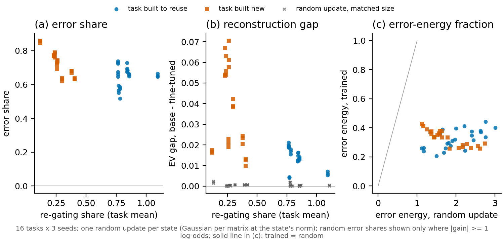
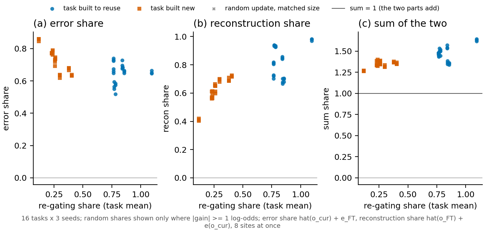

# Do cheap readings at base-model sparse autoencoders tell reused fine-tunes from new ones?

E314 and its control E317, cell P2.85 runs 1 and 2, sae-lead, 2026-11-26. Descriptive: no verdict on reuse and no bar
(user, 2026-11-26: "put in appendix G unless it works well"). Plan `reports/plans/2026-11-26_plan_e314-sae-proxies.md`;
method spec and departures for the reconstruction gap `reports/plans/2026-11-26_spec_kissane-sae-transfer.md`; code
`experiments/sae_proxies/run.py` and `complement.py`; numbers `results/results.json` and `results_complement.json`
under `experiments/sae_proxies/`.

We read the 48 fine-tunes behind the paper's known-answer figure through sparse autoencoders trained on the base model
alone, each beside a random update of the same weight size, and patched the dictionary's error and its reconstruction
into the base model separately. Either part alone restores more than half of the gain on the trained answer on nearly
every task, so the gain is carried by both at once and neither share says where it lies. Tasks built to reuse and
tasks built to be new overlap on every reading, so none can serve as the measure of reuse that `GOALS.md` asks for.

## The answer

No reading separates the tasks built to reuse from the tasks built to be new. Patching in only the fine-tune's error,
or only its reconstruction, each restores most of the gain, and the two shares add to well over one, so neither
locates the gain. The reconstruction share rises with the re-gating share more cleanly than the error share falls, but
the two sides still overlap. The reconstruction gap is small on every task, well above a random update of the same
weight size, which barely moves this model's activations, and again the sides overlap. Placement: both shares to
appendix G, and the reconstruction gap as the Kissane et al. row of the published-tools table; not the main text.

## What was run

Each fine-tune's update is read on its own task rows, at the read position and target token of the re-gating share,
the share of the gain that appears when VPD's original subcomponents are kept and only Γ switches them differently.
The dictionaries are E234's sparse autoencoders, one per site, trained on Pile activations of the base model only. Each
fine-tune also gets one random update: Gaussian noise in every matrix it changed, scaled to that matrix's norm in the
fine-tune's update. This weight-norm matching is the convention of the crosscoder random updates in the paper's
Figure 6.

- **Error share, ours, after the error node of Marks et al. 2024.** At each of the 8 attention and MLP outputs the
  error is what the base dictionary leaves out, $e = o - \mathrm{SAE}(o)$. The base model runs with every site's error
  replaced by the fine-tuned model's error on the same rows. The share is $(L - T_0)/(T_1 - T_0)$, with $T_0$ and $T_1$
  the target's log-odds under the base and fine-tuned models and $L$ under the patch.
- **Reconstruction share, the complement.** The same, but each site's reconstruction is set to the fine-tune's and the
  base run's own error is kept. If the two parts carried the gain additively, the two shares would sum to one.
- In both, all 8 sites are patched at once, so per-site shares need not add up to the total. Both are descriptive
  proxies, not counterparts of the re-gating share: the base reconstruction can itself change which latents are active.
- **Error-energy fraction.** The change in the error over the change in the output, $\sum|e_{FT} - e_0|^2 / \sum|o_{FT} -
  o_0|^2$ over sites and positions. It needs no gain, so it also reads on the random updates.
- **Reconstruction gap, after Kissane et al. 2024.** Their explained variance per site, base model minus fine-tuned
  model, averaged over E234's 13 sites. Zero means the fine-tune is reconstructed as well as the base.

**Controls, run first and alone, all held, in both jobs.** For the zero update, the change in the error, the numerators
of both shares and of the energy fraction, and both reconstruction gaps were exactly 0; the shares are 0/0 and came out
undefined, as the code checks. The fine-tuned model run twice gave identical logits, and patching its full outputs into
the base model reproduced them exactly, a share of 1. The second job read every error share again and matched the
first bit for bit. E234's base explained variance was reproduced within 4.4e-6 at all 13 sites. All 48 gains matched
E136's saved gains exactly. No token crossed Kissane's outlier threshold. Random updates move the target by at most
0.043 log-odds, under the 1 log-odds floor, so they have no shares.

## What we observed

**Reading it, the two shares.** Each part alone restores most of the gain, so neither share locates it. The error
share reads 0.52 to 0.74 on tasks built to reuse and 0.62 to 0.86 on tasks built to be new. The reconstruction share
reads 0.67 to 0.98 on reuse tasks and 0.40 to 0.73 on new ones; only `e53/cipher` is under one half. The sum is 1.26
to 1.64 on every task, nowhere near one, so the two parts are not additive, and either part alone brings back much of the
gain; redundancy and a non-linear interaction would both give such a sum. The reconstruction share rises with the re-gating share more cleanly than the error
share falls. Still, `e62/lookup`, a new task at 0.72 to 0.73, sits beside the reuse tasks `c3/rank1`, `e58/rank1` and
`e54/elicit` at 0.67 to 0.73.

**Reading it, error-energy fraction.** On trained states only 0.21 to 0.44 of the energy of the output change lies in
the error, so the base dictionary reconstructs most of how training moved the activations. Reuse and new tasks occupy
the same range. The random updates read 1.12 to 3.01, above the plan's expected 0.7 to 0.95. A fraction above one means
the reconstruction moves against or across the output change, as latents switch on and off. The random updates'
activation changes are small, so a few switching latents weigh heavily.

**Reading it, reconstruction gap.** Every trained state is reconstructed a little worse than the base model: reuse
tasks lose 0.0041 to 0.0212 explained variance, new tasks 0.0098 to 0.0705. The random updates lose 0.00009 to 0.00236,
between 7 and 725 times less than their own trained state. New tasks mostly read higher, but `e53/cipher` and
`e62/lookup` sit below `e54/elicit` and `e53/lowercase`. For scale, Kissane's base-to-chat transfer lost about 0.07
explained variance on Mistral-7B and 0.15 on Qwen1.5-0.5B; our largest task gap is about Mistral's. The random reference
is matched in weight norm, not in how far it moves activations, so "far below training" partly says that random weight
noise barely moves this model's activations.

## Per task

Sorted by re-gating share, task mean. The shares and the gap are seed ranges over three seeds; the random gap is over
the three seeds' random updates. The embedding site reads a gap of exactly 0 in every state and is inside the 13-site
mean.

| task | built | re-gating share | error share | reconstruction share | explained-variance gap | random update's gap |
|---|---|---|---|---|---|---|
| `e62/copy` | reuse | 1.09 | 0.65 to 0.66 | 0.97 to 0.98 | 0.0053 to 0.0072 | 0.00019 to 0.00041 |
| `e58/rank1` | reuse | 0.86 | 0.65 to 0.66 | 0.68 to 0.70 | 0.0128 to 0.0142 | 0.00035 to 0.00054 |
| `c3/rank1` | reuse | 0.84 | 0.68 to 0.69 | 0.67 to 0.70 | 0.0149 to 0.0163 | 0.00010 to 0.00020 |
| `c3/copy` | reuse | 0.84 | 0.68 to 0.73 | 0.84 to 0.86 | 0.0120 to 0.0127 | 0.00014 to 0.00023 |
| `e46/ident32` | reuse | 0.78 | 0.52 to 0.58 | 0.93 to 0.94 | 0.0155 to 0.0179 | 0.00010 to 0.00022 |
| `e58/copy` | reuse | 0.77 | 0.55 to 0.59 | 0.93 to 0.94 | 0.0041 to 0.0044 | 0.00027 to 0.00042 |
| `e54/elicit` | reuse | 0.77 | 0.72 to 0.74 | 0.70 to 0.73 | 0.0194 to 0.0212 | 0.00014 to 0.00018 |
| `e53/lowercase` | reuse | 0.76 | 0.65 to 0.67 | 0.81 to 0.82 | 0.0186 to 0.0194 | 0.00182 to 0.00203 |
| `e62/lookup` | new | 0.40 | 0.63 to 0.64 | 0.72 to 0.73 | 0.0098 to 0.0132 | 0.00058 to 0.00073 |
| `e58/prior_cipher` | new | 0.38 | 0.67 to 0.68 | 0.69 to 0.71 | 0.0205 to 0.0244 | 0.00051 to 0.00075 |
| `e58/cipher` | new | 0.30 | 0.62 to 0.64 | 0.68 to 0.70 | 0.0382 to 0.0423 | 0.00062 to 0.00072 |
| `e46/rand32` | new | 0.26 | 0.74 | 0.60 to 0.65 | 0.0577 to 0.0705 | 0.00012 to 0.00025 |
| `e54/cipher_own` | new | 0.26 | 0.69 to 0.73 | 0.65 to 0.66 | 0.0189 to 0.0230 | 0.00048 to 0.00055 |
| `e54/cipher` | new | 0.24 | 0.76 to 0.79 | 0.56 to 0.61 | 0.0541 to 0.0629 | 0.00010 to 0.00025 |
| `c3/cipher` | new | 0.23 | 0.77 | 0.56 to 0.61 | 0.0536 to 0.0670 | 0.00009 to 0.00017 |
| `e53/cipher` | new | 0.12 | 0.85 to 0.86 | 0.40 to 0.42 | 0.0162 to 0.0176 | 0.00142 to 0.00236 |

## Departures from the literature

The full table is in the spec, `reports/plans/2026-11-26_spec_kissane-sae-transfer.md`. The ones that matter for
reading this page:

- Kissane et al. compare a base model with its chat model; we compare it with small task fine-tunes, so their gaps set
  the scale only loosely.
- They read one middle-layer residual site; we average 13 sites, which dilutes a change confined to one block. Per-site
  gaps are saved.
- They train dictionaries on both models; we have base-model dictionaries only, so there is no own-dictionary
  reference to split a gap into drift and a harder distribution.
- The matched-size random update is ours; they have no size reference.
- The error and reconstruction shares are ours, after the error node of Marks et al. 2024, who use the error in circuit
  attribution, not as a share of a fine-tune's gain.

## Not run

- An own-dictionary reference: autoencoders trained on each fine-tuned model.
- Kissane's CE loss recovered; we read the target's log-odds instead.
- A random reference matched in activation change rather than weight norm, which could give the random updates shares.
- The same readings on Qwen3-1.7B.
- A per-site breakdown in this page; it is saved in `results.json`.

Provenance: E314 on cluster job 69300, one L40, 7.3 minutes; E317 on job 69357, 3.7 minutes; both $0. Controls are in
each results file under `stage0`.
