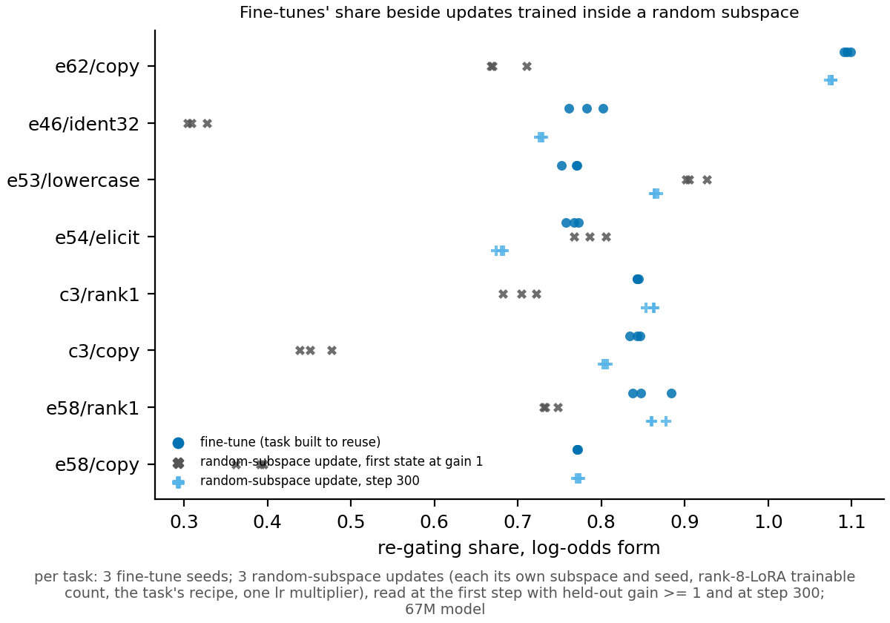

# What does the log-odds re-gating share read for an update trained only inside random directions?

E319, cell P2.87, regating-lead, 2026-11-26. Descriptive: values per task beside the fine-tunes, no verdict on reuse
or new. Card `experiments/subspace_share/card.md`, plan `reports/plans/2026-11-26_plan_p2-87-subspace-share.md`, code
`experiments/subspace_share/run.py`, figure script `experiments/subspace_share/plot.py`, filed rules
`experiments/subspace_share/results/predictions.json` and `experiments/subspace_share/rules.py`.

On the eight tasks built to reuse a skill, we trained updates that could move the weights only inside fixed random
directions, and read the re-gating share on them as on the fine-tunes. At the end of training each task's share sat
within 0.10 of its own fine-tune's. At their first small gain, the share sat 0.39 to 0.47 under its own fine-tune's on
all four copying tasks. It sat a little under on the two rank tasks, and level or above on the other two. For `GOALS.md` this
means a reuse-like share at the trained gain does not need an update free to choose its own directions.

## The answer

An update confined to random directions reaches a one log-odds gain within 23 steps on every reuse task. It trains as
many numbers as a rank-8 LoRA, but it is not low rank: its change to each matrix can reach rank 111 or 175. At the end
of the recipe its share is within 0.10 of the fine-tune's own on each task, at a weight change mostly three to six
times larger. At its first one log-odds gain, the share falls furthest below the task's own fine-tune on all four
copying tasks. The filed rule, read there, put the tasks with the reuse-like rival, but only because one task cleared
the bar by about one batch spread; without it the rule reads "between".

## What we were trying to test

**The share.** For each update, $r = (L_{01} - L_{00}) / (T_1 - T_0)$. $T_0$ and $T_1$ are the log-odds of the trained
answer under the original model and the updated one; their difference is the **gain**. $L_{00}$ is the log-odds with
the original subcomponents and the masks Γ gives them on the original activations. $L_{01}$ keeps the same
subcomponents but uses the masks Γ gives on the updated model's activations, with the update itself left out. So $r$
is the part of the gain that appears when only which subcomponents Γ switches on changes. It reads 0 when the masks
do not move and 1 when they alone carry the whole gain. It is defined only from a gain of 1 log-odds. In the paper's
figure of known answers, the 24 fine-tunes on tasks built to reuse read 0.75 to 1.10, and the tasks built to need
something new read 0.12 to 0.42.

**Why this run.** The share had no random reference on the reuse side. The previous run scaled random weight changes
up to a hundred times each fine-tune's size, and on no reuse task did any reach a gain of one log-odds, so none could
be read. The user asked for a reference that does reach the gain. Training is the only way to get there, so this run
trains, but only in directions nobody chose.

**The update.** On each of the 24 decomposed matrices $W$, of shape out by in, two fixed random orthonormal bases are
drawn: $U$ with $k$ columns in the output space and $V$ with $k$ columns in the input space. Only the $k \times k$ matrix
$Z$ is trained, starting at zero, and the update is $U Z V^\top$. The size $k$ is 111 on attention matrices and 175 on
MLP matrices, so the update has 442,136 trainable numbers against 442,368 for a rank-8 LoRA on the same matrices and
28,311,552 for the full fine-tune. The count matches the LoRA's, but the rank does not: $U Z V^\top$ can reach rank
$k$, 111 or 175 per matrix, against the LoRA's 8. Each seed draws its own bases and uses its fine-tune's own batch
order.

**What was held fixed.** Each task's own fine-tune recipe: data, loss, batch, clipping and 300 steps. The one change is
the learning rate, ten times each recipe's own. A three-point grid on one task chose it as the lowest multiplier
reaching the gain by step 100; at ten times, the first Adam step moves the weights about as far as the fine-tune's
first step does.

**The two states read.** Held-out gain was read after every step. Each update is scored at two states, exactly like
the fine-tunes, on the same rows and card type:

- **At one**: the first step whose held-out gain reaches 1 log-odds. This is where the filed rule reads.
- **End**: step 300, the recipe's last step.

**Control, run first and alone, held bit for bit.** A zero change read gain, numerator and KL of exactly 0 on every
task, with no share since it falls under the one log-odds floor. Each of the 24 reuse fine-tunes' shares came out
equal to the figure's values exactly, on an NVIDIA L40.

## What we expected, and why

The card filed two rivals. If the share reads the task's prior skill rather than how the update was built, the
subspace updates should read near the fine-tunes' reuse values on most tasks. If the share picks out structure that
a freely trained fine-tune finds and a random-subspace update cannot reach, they should read well under, near the
new-side values or near 0. The filed rule takes each task's mean at-one share over its seeds. It calls the first rival
when more than half the tasks have a mean at or above 0.65, the second when more than half sit at or below 0.42, and
"between" otherwise. The bar 0.65 sits 0.1 under the lowest reuse value; 0.42 is the top of the new-side range.
No expectation was filed for how fast the gain would be reached, for the update's size, or for the end state.

## What we observed

FIGURE PENDING: the CPU worker failed with srun socket timeouts while this page was written, so `plot.py` had not
drawn `experiments/subspace_share/figures/shares.png` or written `results/summary.json`. The tables below are read
directly from `experiments/subspace_share/results/updates/*.json` with jq. The figure, when drawn, plots per task the
three fine-tune seeds, the three at-one states and the three end states on one share axis.

### What states are being compared?

**Reading it.** The two states are very different updates, and neither matches the fine-tune on everything. At one is
reached after one to four steps on every task but e53/lowercase, which took 19 to 23 steps. Its gain is 1.00
to 1.95 log-odds, against the fine-tunes' 1.6 to 16.5. Its weight change is 0.20 to 0.65 times the fine-tune's, and
its KL to the original model is 0.012 to 0.29 times the fine-tune's. So at one is a small, early update, matched to
the fine-tune only on clearing the share's floor. The end state's gain is close to the fine-tune's on most tasks. Its
weight change is 1.5 to 5.7 times the fine-tune's and its KL 0.57 to 0.92 times. So at the end the gain is roughly
matched but the subspace update has had to move the weights much further to get it.

| task | at-one step | at-one gain | at-one size / fine-tune's | at-one KL / fine-tune's | fine-tune gain | end gain | end size / fine-tune's | end KL / fine-tune's |
|---|---|---|---|---|---|---|---|---|
| e62/copy | 1 | 1.49 to 1.56 | 0.20 | 0.031 to 0.036 | 12.5 to 12.7 | 12.3 to 12.4 | 3.1 to 3.2 | 0.85 to 0.86 |
| e46/ident32 | 2 | 1.71 to 1.83 | 0.48 to 0.50 | 0.035 to 0.044 | 14.0 to 14.3 | 16.9 to 17.1 | 4.2 to 4.4 | 0.79 to 0.82 |
| e53/lowercase | 19 to 23 | 1.00 to 1.01 | 0.45 to 0.48 | 0.259 to 0.289 | 1.6 to 1.7 | 1.4 | 1.5 to 1.6 | 0.57 to 0.59 |
| e54/elicit | 2 to 3 | 1.05 to 1.45 | 0.47 to 0.64 | 0.043 to 0.094 | 10.8 | 12.0 | 5.7 | 0.62 to 0.68 |
| c3/rank1 | 3 | 1.19 to 1.42 | 0.63 to 0.65 | 0.115 to 0.117 | 10.9 | 10.9 to 11.1 | 4.9 to 5.1 | 0.63 to 0.69 |
| c3/copy | 1 to 2 | 1.02 to 1.94 | 0.29 to 0.50 | 0.012 to 0.046 | 12.9 to 13.3 | 15.2 to 15.3 | 4.3 to 4.4 | 0.83 to 0.85 |
| e58/rank1 | 4 | 1.08 to 1.23 | 0.46 to 0.47 | 0.167 to 0.234 | 9.6 to 9.9 | 9.6 to 9.9 | 3.9 to 4.1 | 0.72 to 0.78 |
| e58/copy | 2 | 1.72 to 1.95 | 0.32 to 0.33 | 0.043 to 0.050 | 16.3 to 16.5 | 16.1 to 16.3 | 3.0 | 0.90 to 0.92 |

Ranges are over the three seeds; one value means the seeds agree at the precision shown. Gains are in log-odds. Size
is the Frobenius norm of the whole update over the fine-tune's; KL is to the original model on 64 rows.

### What share does the subspace update read, beside the fine-tune's?

**Reading it.** Against each task's own fine-tune, the at-one share falls furthest on the four copying tasks and the
end share comes back near the fine-tune's everywhere. At one, c3/copy, e46/ident32, e58/copy and e62/copy fall by
0.39 to 0.47. The two rank tasks, c3/rank1 and e58/rank1, fall by 0.12 to 0.14. On e54/elicit the at-one share rises
by 0.02, and on e53/lowercase by 0.15. Against the new-side range, a second reference, three copying tasks read 0.31
to 0.46 at one, inside or near it; e62/copy reads 0.68, above it, because its fine-tune starts highest, at 1.09. At
step 300 the end share runs from 0.68 on e54/elicit to 1.08 on e62/copy. The largest end gaps to the fine-tune are on
e53/lowercase, 0.10 above, and e54/elicit, 0.09 below, each about three batch spreads. The three seeds of each task
agree closely at both states, each seed with its own random bases.

| task | fine-tune share, mean | at-one share, mean | at-one, seed range | end share, mean | end, seed range |
|---|---|---|---|---|---|
| e62/copy | 1.09 | 0.68 | 0.67 to 0.71 | 1.08 | 1.07 to 1.08 |
| e46/ident32 | 0.78 | 0.31 | 0.30 to 0.33 | 0.73 | 0.73 |
| e53/lowercase | 0.76 | 0.91 | 0.90 to 0.93 | 0.87 | 0.86 to 0.87 |
| e54/elicit | 0.77 | 0.79 | 0.77 to 0.81 | 0.68 | 0.67 to 0.68 |
| c3/rank1 | 0.84 | 0.70 | 0.68 to 0.72 | 0.86 | 0.85 to 0.86 |
| c3/copy | 0.84 | 0.46 | 0.44 to 0.48 | 0.80 | 0.80 to 0.81 |
| e58/rank1 | 0.86 | 0.74 | 0.73 to 0.75 | 0.87 | 0.86 to 0.88 |
| e58/copy | 0.77 | 0.38 | 0.36 to 0.40 | 0.77 | 0.77 |

The do-nothing reference reads no share at all, since its gain is 0. The fine-tune column is the figure's own values,
reproduced exactly by the control.

The four tasks whose targets copy an earlier token, c3/copy, e46/ident32, e58/copy and e62/copy, are the four with
the largest fall at one, each by about the same amount against its own fine-tune. This run does not say why. It is an
observation, and a test is listed under "Not run".

### What did the filed rule read?

Applied to the at-one task means above, the rule's reading is "rival a": more than half of the tasks have a mean at or
above 0.65. That label rests on one task. Five tasks clear the bar, and one of them, e62/copy, reads 0.683, only 0.033
over it. That margin is about one batch spread of the share, 0.031. Were e62/copy under the bar, four of eight would clear it, not more than half,
and only two would sit at or below 0.42, so the rule would read "between". Applied to the end means, which the card
reports beside as descriptive only, it is also "rival a". Every
task had a mean at both states, so none was left out as "no comparable null". This is what was read under the card's
labels. It is not a verdict on whether any task is reuse or new, and the reading depends on which state is read, as
the copying tasks show.

## What we learned

On the tasks built to reuse, an update that could move only inside random directions reaches the fine-tune's gain. At
the end it reads a share within about three batch spreads of the fine-tune's. It has a rank-8 LoRA's number of
trainable values, but not its low rank. So a reuse-like share on these tasks does not need the update to have found its own
directions. One hypothesis, which this run cannot test without a new-side reference, is that the share's value is
closer to a property of the task, given enough training, than of how the update was parameterised. Early in training
the share sits much lower on all four copying tasks, so a reading taken at a small gain is not the same as one taken
at the trained gain. The new side has no subspace reference yet, so this page cannot say whether the share would separate a
subspace update from a fine-tune on tasks built to need something new.

## How compelling is the evidence

- **Blind to.** One subspace size, one learning-rate multiplier for every task, and one decomposition. The at-one
  comparison is at matched floor, not matched gain, size or KL. The end comparison is near matched gain but at three to
  six times the size on most tasks. The fine-tunes were kept by their own step rules, not at a first gain of one.
- **Blind to the step size at one.** At one is the very first step on all three seeds of e62/copy and two of c3/copy,
  and within four steps on every task but e53/lowercase. On the learning-rate grid every multiplier, ten, thirty and a
  hundred times, already reached a gain of 1 at step 1, so the grid does not bound the rate from below. The at-one
  share therefore depends on how large that first step is, which this run did not vary.
- **Noise.** The share's batch spread, measured on one fine-tune over five batches, is 0.0314. The seed ranges in the
  tables are of the same order, with each seed on its own bases.
- **Coverage.** All eight reuse tasks of the paper's figure, three seeds each; the reuse side only.
- **Controls.** The zero change and all 24 reuse fine-tunes were reproduced exactly on the same card type. The step-0
  gain read exactly 0 in every training, and the training's gain equalled the reader's on every scored state.

## Surprises

- On e53/lowercase the end gain, 1.4, stays under the fine-tune's 1.6 to 1.7, and the logged training loss did not
  fall over the first 50 steps on two of its seeds. Its at-one state took 19 to 23 steps. The loss there is
  next-token cross-entropy on Pile text, which barely moves for any update this small; no bar was filed on it.
- At one, the update's KL to the original model is very small against the fine-tune's on the copying tasks, as low as
  0.012 times. No expectation was filed on it.

No filed prediction was reversed; the rule had no expectation beyond its two rivals.

## What next

- A matching subspace reference on the tasks built to need something new. If those also read reuse-like shares at the
  end, the share does not separate reuse from new on its own and the paper's figure needs this reference beside it.
- The subspace updates read at a gain matched to the fine-tune's, instead of at step 300. If the copying tasks' shares
  stay near the fine-tune's there, the low at-one values are about small gain rather than about the random directions.

## Scorecard

| id | claim in words | rule | read | verdict |
|---|---|---|---|---|
| control_zero | a zero change reads 0 and no share | exact 0 | exact 0 on every task | held |
| control_fine_tunes | the 24 reuse fine-tunes' shares reproduce the figure | float equality | equal on all 24 | held |
| step0_gain | Z = 0 gives gain 0 | exact 0 | exact 0 in every training | held |
| at1_gain | each at-one state reads gain at least 1 | gain ≥ 1 | 1.00 to 1.95 | held |
| rules on at1 | rival a or rival b or between | task means vs 0.65 and 0.42, more than half | "rival a" | descriptive label |
| rules on end | as above, reported beside | as above | "rival a" | descriptive only |

## Departures from the literature

- **The parameterisation.** Hu et al. 2021's LoRA trains both low-rank factors; here both bases are fixed at random and
  only the small middle matrix trains. The LoRA is cited only to set the trainable count, at its common rank of 8. The
  nearest published method is the intrinsic-dimension training of Li et al. 2018, which maps one small trained vector
  into all weights through a single fixed random matrix; ours draws a separate two-sided orthonormal pair per matrix.
- **The learning rate.** Each recipe's own rate of 3e-5 is multiplied by ten, chosen on a three-point grid on one
  task's seed 0, because Adam's step on the small middle matrix moves the weights much less than on the full matrix.
- **The share** is the paper's, unchanged.

## Not run

- A random-subspace reference on the tasks built to need something new.
- A test of why the copying tasks read lower at one: reading the same updates at matched gain, or with larger or
  smaller subspaces, or tracking the share step by step through the first 30 steps on c3/copy, e46/ident32, e58/copy
  and e62/copy.
- Other subspace sizes and other learning-rate multipliers on every task; the grid ran on e62/copy seed 0 only.
- Matching at-one to the fine-tune on size or KL rather than on the floor.
- The rendered figure and `results/summary.json`, at the time of writing: the CPU worker was failing.

## Provenance

- Results: `experiments/subspace_share/results/control.json`, `lrgrid.json`, `updates/*.json`; run logs and tarballs
  in `experiments/subspace_share/results/e319_dl/`; saved updates in `results/large/`.
- Card: NVIDIA L40 on RunPod, the cluster node being down; cost $0.32 as reported by the runner.
- Commit of the results: 7b36c349.
