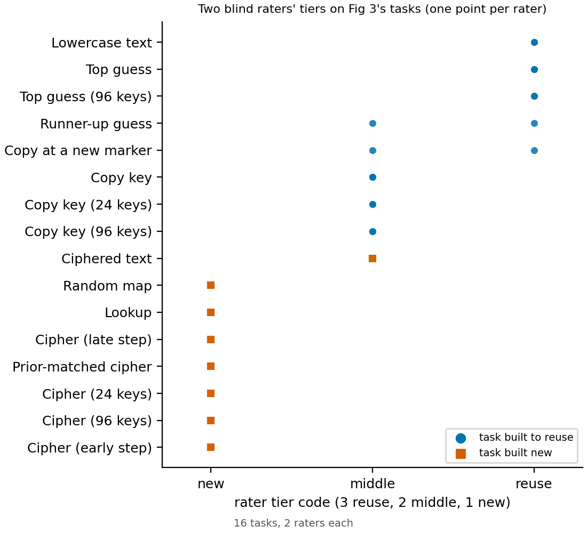

# Do the blind raters recover the answer on tasks whose answer we built?

We gave the two blind raters that sorted the realistic fine-tunes (a fresh Claude Opus and a fresh GPT model, same
prompt and tier scale) plain descriptions of the sixteen known-answer tasks of Figure 3, with no construction words.
Every task built new except one was rated new by both raters, and every task built to reuse was rated reuse or middle;
no task built to reuse was rated new by either rater. The raters' tiers can be trusted at the new end, but they are
cautious at the reuse end: three copy tasks built to reuse sit in the middle, and one cipher built new also sits there,
so the middle tier of the realistic panel mixes both kinds.

**Reading it.** Each row is one Figure 3 task; each point is one rater's tier. Blue tasks were built to reuse, orange
ones built new.
- **New end.** Seven of the eight tasks built new (the random map, the lookup and every key-to-random-word cipher) were
  rated new by both raters.
- **Reuse end.**
  - Lowercase text and both top-guess tasks were rated reuse by both raters.
  - The runner-up guess and the copy at a new marker were rated reuse by the Opus rater and middle by the GPT rater.
    Their consensus is reuse under E276's rule: the average of the two tier codes, reuse 3, middle 2, new 1, read as
    reuse from halfway between middle and reuse upwards.
  - The three copy-the-key tasks were rated middle by both. Both raters said they could not tell whether the base
    model's copying would carry over to a copy after a rare symbol.
- **One error.** Ciphered text was built new: fifty frequent words swapped among themselves throughout Pile text. Both
  raters rated it middle, reasoning that most of the language around the swapped words is unchanged.

Per task, with the consensus by the E276 rule, from `experiments/rater_calibration/results/tiers.json`:

| task (Figure 3) | built | Opus rater | GPT rater | consensus |
|---|---|---|---|---|
| Lowercase text | reuse | reuse | reuse | reuse |
| Top guess | reuse | reuse | reuse | reuse |
| Top guess (96 keys) | reuse | reuse | reuse | reuse |
| Runner-up guess | reuse | reuse | middle | reuse |
| Copy at a new marker | reuse | reuse | middle | reuse |
| Copy key | reuse | middle | middle | middle |
| Copy key (24 keys) | reuse | middle | middle | middle |
| Copy key (96 keys) | reuse | middle | middle | middle |
| Ciphered text | new | middle | middle | middle |
| Random map | new | new | new | new |
| Lookup | new | new | new | new |
| Cipher (late step) | new | new | new | new |
| Prior-matched cipher | new | new | new | new |
| Cipher (24 keys) | new | new | new | new |
| Cipher (96 keys) | new | new | new | new |
| Cipher (early step) | new | new | new | new |

**What it means for Figure 4.** Figure 4's negative result rests on the realistic panel's tiers. On tasks whose answer
is known, a task the raters call new was built new, and a task they call reuse was built to reuse. Their middle tier
holds tasks of both kinds. A proxy that fails to separate the realistic panel's reuse tier from its new tier is
therefore not excused by rater error at the two ends. A proxy that misorders tasks inside the middle tier may be partly
excused.

**How compelling.** This is a description, with no claim tested at a filed bar (card
`experiments/rater_calibration/card.md`).
- **Too easy, in two ways.** These tasks are easier to rate than realistic fine-tunes. Three of the descriptions say
  plainly that the target is the base model's own first or runner-up guess. And the tasks built new are arbitrary
  mappings, which any reader would call new.
- **Not identical to the realistic panel.**
  - The prompt's sentence on the training objective was changed. The realistic prompt said "plain next-token training
    on that text", which is false for 14 of these 16 tasks; it now says "on the data described".
  - The descriptions are longer than the realistic panel's one-liners.
- **What the descriptions leave out.** Some tasks differ only in key count or step count. The descriptions also leave
  out how the random targets were picked (from words the base model finds very unlikely), so two 96-key ciphers read
  almost the same.
- **Not independent of the panel's raters.** This is one answer from each of two fresh raters, the same model families
  as the realistic panel, not the same agents.

Files: `experiments/rater_calibration/results/raters/prompt.md` (what the raters saw, committed before they ran),
`facts.md` (construction per task, not shown to the raters), `rater_opus.md` and `rater_gpt.md` (verbatim, committed
before the reading), `score.py`, `results/tiers.json`.

## Not run
- No repeat draws of the raters, so how much one rater's tier varies between runs is unmeasured.
- No version of the descriptions with the base-model wording removed (for example "a fixed word per key" in place of
  "the base model's first guess").
- No re-reading of Figure 4 with only the end tiers. Figure 3's labels stay as built.
