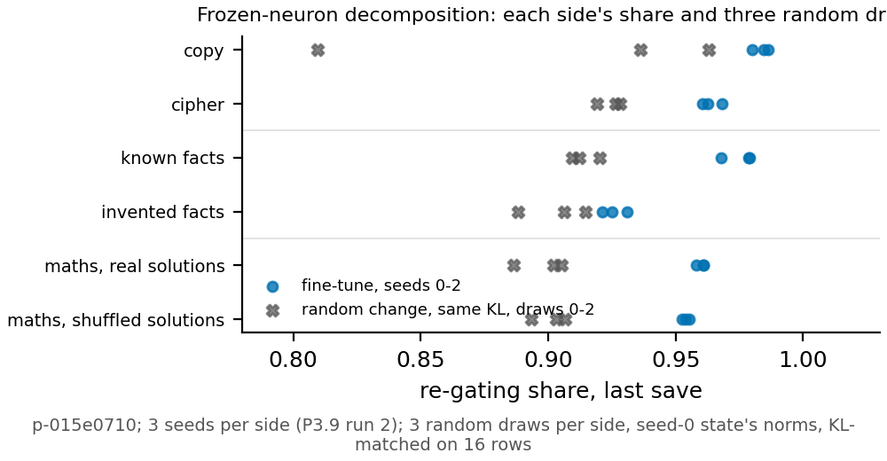
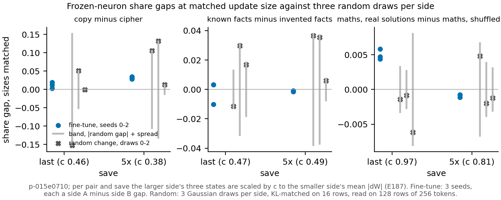

# Does the Qwen neuron-control comparison survive three random draws instead of one?

E320, cell P3.15, descriptive: no comparison is called reused or new, and nothing is claimed at a bar.

## The answer

We repeated the random reference behind the Qwen frozen-neuron comparison twice more, with new random seeds, for all
six comparisons. At the sizes the fine-tunes were saved at, every fine-tune still reads well above all three random
changes. Once the two sides of a pair are matched in update size, the verdict depends on the draw. Real against
shuffled maths stands apart on two of the three draws. On the third draw it does not, and both copy-against-cipher
comparisons stand apart instead. The appendix sentence "separates only one of six comparisons" holds for two draws
of three, and which comparison separates is not stable.

## What we were trying to test

The paper's Qwen appendix reads the re-gating share on the frozen-neuron decomposition of Qwen3-1.7B. The re-gating
share is the fraction of a fine-tune's behaviour change carried by changed causal importances rather than by weight
change inside the subcomponents; 1 means all of it. Each fine-tune is compared against a random change to the same
weights. The random change is Gaussian noise with the fine-tune's per-matrix norms, scaled until its KL divergence
from the base model matches the fine-tune's. The appendix sentence rests on one such random draw per side.

Three pairs were read: copy against cipher, known facts against invented facts, and maths with real solutions
against maths with shuffled solutions. Each pair is read at two saves: the last save and the save where the update
was five times its first size. That makes six comparisons. For each comparison, the seed gap is side A's share minus
side B's, for each of three fine-tune seeds. Before taking the gap, the larger side's update is scaled down to the
smaller side's mean size; this is the size matching. The random gap is the same difference for the random changes.

Draw 0 is the existing one. This run adds draws 1 and 2 with the same recipe and code path, at the seed-0 state of
each side. The rule for one draw is the one the paper used. The band is the absolute random gap plus the seed-noise
spread of 0.002. A comparison "separates" when all three seed gaps lie beyond the band with one sign.

## What we expected, and why

No verdict was filed; the run is descriptive. The filed lean was that each random share would fall between 0.81 and
1.06, the range earlier draws had read. Three controls had to hold first, and the run would stop on a miss. The
unchanged model had to read as no change. The do-nothing state had to read a share of exactly 1. Draw 0 had to
reproduce its saved share within 0.0002.

## What we observed

### Do the controls hold?

Yes, on all three pods. The do-nothing share read exactly 1, and the unchanged model read no change. Draw 0
reproduced its saved share to within 0.0001 on copy-cipher, within 0.00002 on facts and within 0.00014 on maths. The
tolerance was 0.0002. All 36 random reads were scored, and every random share fell between 0.81 and 0.99.

### At the saved sizes, does every side still read above its random change?

**Reading it.** Yes. The figure shows each side's share at its last save for three fine-tune seeds, beside three
random changes at the same KL. Every fine-tune seed reads above every random draw on all six sides. The closest side
is invented facts: its lowest seed reads 0.921 and its highest random draw 0.914. The random draws spread widely on
the copy side, from 0.81 to 0.96, so one draw alone said little about where the random reference sits.

### Once sizes are matched, how many comparisons separate?

**Reading it.** It depends on the draw. The figure shows, per comparison, the three seed gaps as dots beside each
draw's random gap as a cross with its band. On draws 0 and 1, only maths at the last save has all three seed gaps
beyond the band. On draw 2, maths at the last save falls inside its band, because that draw's random gap is −0.006
against seed gaps of 0.004 to 0.006. On the same draw, both copy-cipher comparisons separate, because its random gaps
are near zero, at −0.0003 and 0.013; copy-cipher at the last save clears that band by less than a thousandth. Facts
at either save never separates.

The copy-cipher random gap is the least stable: from −0.15 to 0.05 at the last save and from 0.01 to 0.13 at the
five-times save. The copy-cipher seed gaps, at 0.003 to 0.035, sit inside that spread. The maths random gap is
stable in sign at the last save, negative on all three draws, and all three seed gaps sit above all three random
gaps. It is the only comparison where that is true. Facts at the five-times save is the mirror case: all three seed
gaps sit below all three random gaps, at about −0.001 against 0.006 to 0.037.

| comparison | seed gaps | random gap, draws 0 / 1 / 2 | separates on draw |
|---|---|---|---|
| copy − cipher, last | 0.019, 0.012, 0.003 | −0.152 / 0.051 / −0.0003 | 2 |
| copy − cipher, 5x | 0.035, 0.032, 0.028 | 0.106 / 0.132 / 0.013 | 2 |
| known − invented facts, last | −0.010, 0.003, 0.003 | −0.011 / 0.030 / 0.017 | none |
| known − invented facts, 5x | −0.001, −0.001, −0.001 | 0.037 / 0.036 / 0.006 | none |
| maths real − shuffled, last | 0.006, 0.004, 0.005 | −0.001 / −0.001 / −0.006 | 0 and 1 |
| maths real − shuffled, 5x | −0.001, −0.001, −0.001 | 0.005 / −0.002 / −0.001 | none |

## What we learned

The unmatched picture in the appendix figure stands: every Qwen fine-tune reads above three random changes of the
same KL, not just one. The size-matched count of "one of six" is a single-draw number. Over three draws it is one,
one and two, and the separating comparison changes. The random reference's draw-to-draw spread is as large as the
fine-tune effects on two of three pairs. A one-draw band understates it, so the neuron control does not separate the
Qwen pairs at matched size in any stable way. The maths pair at the last save is the only comparison whose seed gaps
lie above all three random gaps, and the only one that clears the band on more than one draw (draws 0 and 1).

## How compelling is the evidence

Three random draws per side, each at the seed-0 state only; three fine-tune seeds per side. The band rule adds the
seed spread to one draw's gap. It does not use the spread across draws, which this run shows is larger. Three draws
are too few to estimate that spread well. The reading is blind to how the random change varies across states other
than seed 0. It is also blind to the norm-matched form of the random change and to the other decomposition,
p-9707d6ff.

## Surprises

The random reference moved far more between draws than the seed spread used in the band: on copy-cipher, a range of
0.20 in random gap against a seed spread of 0.002. Not a filed prediction; it is why the count changes.

## What next

- For the appendix sentence, writeup-lead may say that, at matched size, the neuron control separates at most one or
  two of six comparisons depending on the random draw, and that real against shuffled maths at the last save is the
  only comparison whose seed gaps lie above all three random gaps, and the only one that clears the band on more
  than one draw (draws 0 and 1). Changing the paper is writeup-lead's call.
- A band built from the draw-to-draw spread would need more draws, perhaps ten per side, at about five minutes per
  read. That would need a new cell.

## Scorecard

| id | claim | rule | read | verdict |
|---|---|---|---|---|
| W0 | unchanged model reads no change | K00 = K01 = K0 within id_tol | held on all three pods | held |
| do_nothing | share 1 | within id_tol | 1.0 on all three | held |
| reproduce_d0 | draw 0 reproduces its saved share | within 0.0002 | 0.00010, 0.00002, 0.00014 | held |
| scored | every random read scored | floor()'s check | 36 of 36 | held |
| random_share_lean | random shares in 0.81 to 1.06 | a lean | 0.81 to 0.99 | as expected |
| per-draw call | descriptive | band rule per draw | 1, 1, 2 comparisons separate | descriptive |

## Departures from the literature

None beyond those of the original neuron-control comparison; the recipe is unchanged and only the draw seed differs.

## Not run

- The norm-matched form of the random change.
- Random draws at seeds 1 and 2's states.
- The p-9707d6ff decomposition.
- A band from the draw-to-draw spread.

## Provenance

- Results: `experiments/qwen_neuron_draws/results/{copy_cipher,facts,gold}/`, `results/summary.json`,
  `results/size_matched_draws.csv`, `figures/size_matched_draws.{png,pdf,csv}`, `figures/unmatched_last_draws.{png,pdf,csv}`;
  commit df0efc84. Draw 0 from `experiments/qwen_library_share/results/p-015e0710/run1/` and
  `experiments/size_matched/results/qwen/`.
- Filed rules: `experiments/qwen_neuron_draws/results/predictions.json`, sha256 90b6eaf2…ec31. Card
  `~/commute-data/cards/P3.15-run1.md`; sketch `reports/predictions/2026-11-26_sketch_p315-neuron-draws.png`.
- RunPod H100 80GB, three pods, one per pair, 2026-11-26 21:47 to 2026-11-27 01:29. About 300 s per read, peak GPU
  38.6 GiB, peak host 95 GB. Cost $32.15 of an $80 cap, including four pods lost to the idle watchdog during the W&B
  fetch.
- Figures drawn by `plot.py` on the maths pod, since the cluster CPU worker was down. The unmatched figure's title is
  cut off at the right edge, a cosmetic fault.
