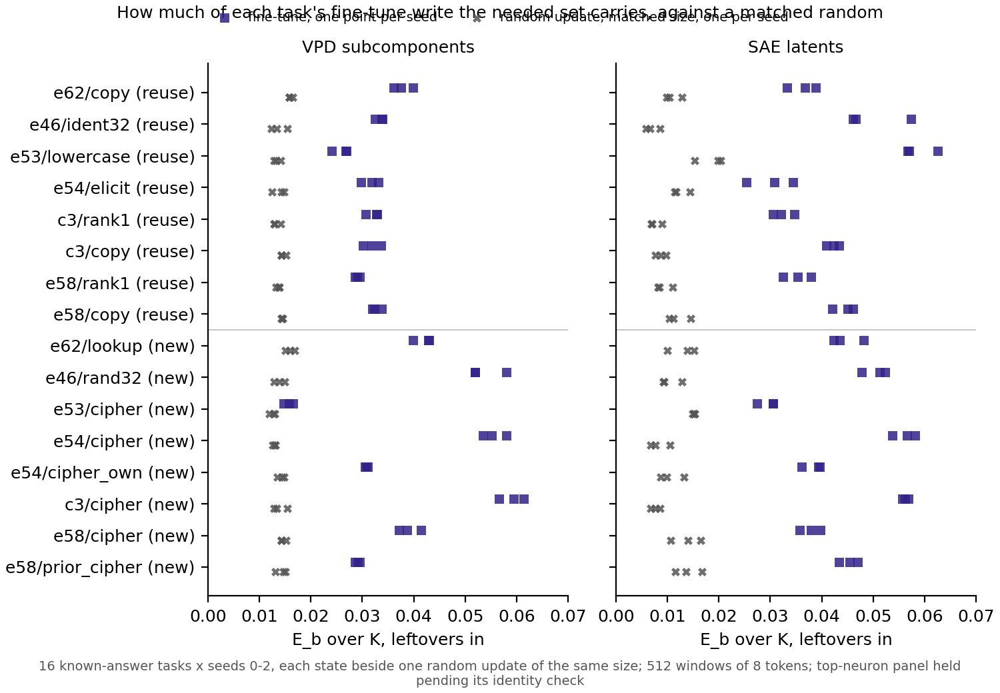

# How much of each fine-tune's write does the needed set carry, on all sixteen known-answer tasks?

We read Figure 2's retained share on all sixteen known-answer tasks at three featurizations, each fine-tune beside a random update of the same size. At VPD and SAE every fine-tune keeps a few hundredths of its write in the needed set, above its random on every seed, and tasks known to reuse read no higher than new ones. Figure 2 can now use the same tasks as Figures 3 and 7 at VPD and SAE, as a description; the neuron panel waits on its identity control.

## What was read

The retained share $E_b$ over $K$ is the share of an update's write change carried by the needed set $K$, the variables whose swap between two inputs changes the model's answer. It reads 0 when the needed set carries none of the change and 1 when it carries all of it. The leftover variables, the remainders a featurization does not split, are counted in both the swap test and the sums. Each value is read on 512 windows of 8 tokens per task, with the needed set found at the last position.

Each of the 48 trained states, sixteen tasks by three seeds, is read beside one matched random update. The random update draws a Gaussian direction over the parameters the fine-tune changed and scales it to the fine-tune's size. It is the reference for a change that carries no task structure: a share near the random's says the needed set carries what any update of that size would put there.

The three featurizations are VPD subcomponents, the top neurons of each layer and SAE latents. Twelve of the 48 states, the four e58 tasks, were read earlier for the five-task figure, and their rows are reused after a stage-0 reproduction of a saved item. The other 36 states, with their randoms, are new: 72 items per featurization.

The card says 11 added tasks and 66 items per featurization. The run read 12 and 72, because the figure's elicitation task is now the key-dependent elicit fine-tune of E54, which replaces the 96-key elicit of E58; `experiments/fig2_all_tasks/README.md` gives the reason. The run is descriptive: the card files no bar and no verdict.

## What we expected

The predictions file expected every trained value between 0 and 1, near the earlier figure's trained range, and each random at or under about two hundredths. It expected the stage-0 controls to read as they did for the five-task figure. The do-nothing update gives a share of 1 with no changed answer. The identity swap changes no answer and moves the logits as little as it did there.

## What we observed at VPD subcomponents and SAE latents

> **Figure pending.** `experiments/fig2_all_tasks/plot.py` is written but has not run: the CPU worker's node was down on 2026-11-27. It draws, for VPD and SAE, every seed's trained and random value per task, one row per task, the tasks known to reuse above those known to be new. The values below come from the same file it reads, `results/summary.json`.

**Reading it.** At VPD subcomponents the fine-tunes' seed means run from 0.016 on the e53 text cipher to 0.059 on the c3 cipher. Their randoms sit in a narrow band, from 0.013 to 0.016, and every task's three trained seeds lie above its three random seeds. The text cipher is the closest: its fine-tune reads 0.016 against its random's 0.013.

At SAE latents the fine-tunes run from 0.030 on the elicit and text-cipher tasks to 0.059 on e53 lowercasing. The randoms spread wider than at VPD, from 0.007 to 0.018, and again every task's trained seeds lie above its random seeds. Lowercasing has the highest random at SAE, 0.018, as well as the highest fine-tune.

Seeds agree closely at both featurizations. The widest trained spread at VPD is on the e46 random-key task, 0.052 to 0.058; at SAE it is on the e46 identity task, 0.046 to 0.057.

The tasks known to reuse old parts do not read above the tasks known to be new. At VPD the reuse tasks' mean is 0.032 and the new tasks' mean is 0.041. At SAE the two means are 0.041 and 0.045. The reuse tasks span 0.026 to 0.038 at VPD, inside the new tasks' wider span, so this reading does not order the two sides by their known answers.

## Top neurons: the panel is held

The top-neuron identity control read off on two of the four states it was checked on. Swapping every neuron with its own value should leave the logits unchanged up to rounding. It did so on the e58 and c3 copy states, at 5.1e-5 and 4.6e-5. On the e62 copy state the largest logit deviation was 0.02715, and on the e46 identity state 0.0692, against a filed order of 8e-5 (`results/run_ident_diag.log`). No answer changed on any state.

On the same e62 state the VPD identity read 5.9e-5 and the SAE identity 3.7e-5 (`results/stage0/vpd_identity_*.json`, `sae_identity_*.json`). So the deviation belongs to the neuron swap path, not to the state or its windows.

A candidate cause is fixed in commit `d2d81436`. The neuron hook took the input's own activation at the swapped layer from the rerun instead of the cached run. An entry whose two activations fall on opposite sides of a neuron's bound is then split differently. This is a hypothesis. The check that tests it, `experiments/fig2_all_tasks/ident_straddle.py`, has not run; it files a deviation under 1e-4 on all four states after the fix.

> **PLACEHOLDER: neuron identity check result.** To be filled from `results/ident_straddle.json`: old and fixed deviation per state, straddle counts, flips, and whether the neuron rows need a re-read.

Until then the neuron values are provisional. They appear only in the table below.

## Per-task values

Seed mean over seeds 0 to 2, with the lowest and highest seed in brackets, from `experiments/fig2_all_tasks/results/summary.json`. Neuron columns are provisional.

| task | known answer | VPD fine-tune | VPD random | SAE fine-tune | SAE random | neurons fine-tune, provisional | neurons random, provisional |
|---|---|---|---|---|---|---|---|
| e62/copy | reuse | 0.038 (0.036-0.040) | 0.016 (0.016-0.016) | 0.036 (0.033-0.039) | 0.011 (0.010-0.013) | 0.018 (0.016-0.020) | 0.006 (0.004-0.008) |
| e46/ident32 | reuse | 0.033 (0.033-0.034) | 0.014 (0.012-0.015) | 0.050 (0.046-0.057) | 0.007 (0.006-0.009) | 0.028 (0.024-0.033) | 0.003 (0.003-0.004) |
| e53/lowercase | reuse | 0.026 (0.024-0.027) | 0.013 (0.013-0.014) | 0.059 (0.057-0.063) | 0.018 (0.015-0.020) | 0.018 (0.017-0.020) | 0.009 (0.008-0.010) |
| e54/elicit | reuse | 0.032 (0.030-0.033) | 0.014 (0.012-0.015) | 0.030 (0.025-0.034) | 0.012 (0.011-0.014) | 0.011 (0.010-0.013) | 0.004 (0.003-0.004) |
| c3/rank1 | reuse | 0.032 (0.031-0.033) | 0.013 (0.013-0.014) | 0.032 (0.031-0.035) | 0.008 (0.007-0.009) | 0.019 (0.019-0.020) | 0.003 (0.003-0.004) |
| c3/copy | reuse | 0.032 (0.030-0.034) | 0.015 (0.014-0.015) | 0.042 (0.041-0.043) | 0.009 (0.008-0.010) | 0.025 (0.022-0.028) | 0.004 (0.003-0.005) |
| e58/rank1 | reuse | 0.029 (0.029-0.030) | 0.014 (0.013-0.014) | 0.035 (0.032-0.038) | 0.009 (0.008-0.011) | 0.017 (0.014-0.020) | 0.007 (0.004-0.011) |
| e58/copy | reuse | 0.033 (0.032-0.034) | 0.014 (0.014-0.014) | 0.044 (0.042-0.046) | 0.012 (0.010-0.015) | 0.012 (0.012-0.012) | 0.005 (0.004-0.006) |
| e62/lookup | new | 0.042 (0.040-0.043) | 0.016 (0.015-0.017) | 0.045 (0.042-0.048) | 0.013 (0.010-0.015) | 0.015 (0.014-0.016) | 0.006 (0.005-0.006) |
| e46/rand32 | new | 0.054 (0.052-0.058) | 0.014 (0.013-0.015) | 0.051 (0.048-0.052) | 0.010 (0.009-0.013) | 0.027 (0.022-0.031) | 0.005 (0.004-0.006) |
| e53/cipher | new | 0.016 (0.015-0.017) | 0.013 (0.012-0.013) | 0.030 (0.027-0.031) | 0.015 (0.015-0.015) | 0.015 (0.014-0.015) | 0.008 (0.007-0.009) |
| e54/cipher | new | 0.056 (0.054-0.058) | 0.013 (0.013-0.013) | 0.056 (0.054-0.058) | 0.008 (0.007-0.011) | 0.029 (0.024-0.037) | 0.004 (0.003-0.005) |
| e54/cipher_own | new | 0.031 (0.031-0.031) | 0.014 (0.013-0.015) | 0.038 (0.036-0.040) | 0.011 (0.009-0.013) | 0.017 (0.015-0.019) | 0.005 (0.005-0.005) |
| c3/cipher | new | 0.059 (0.057-0.061) | 0.014 (0.013-0.015) | 0.056 (0.056-0.057) | 0.008 (0.007-0.009) | 0.025 (0.022-0.031) | 0.004 (0.003-0.004) |
| e58/cipher | new | 0.039 (0.037-0.042) | 0.015 (0.014-0.015) | 0.038 (0.036-0.040) | 0.014 (0.011-0.016) | 0.023 (0.021-0.028) | 0.007 (0.007-0.008) |
| e58/prior_cipher | new | 0.029 (0.029-0.030) | 0.014 (0.013-0.015) | 0.045 (0.043-0.047) | 0.014 (0.011-0.017) | 0.021 (0.020-0.021) | 0.007 (0.006-0.008) |

## What we learned

The fine-tunes' retained share is small on every one of the sixteen tasks, not only on the five the old figure read. It sits a few hundredths above a random update of the same size at VPD and SAE, so the needed set carries more of a fine-tune's write than chance, but most of the write lies outside it. This reading does not separate the tasks known to reuse old parts from those known to build new ones. The reuse definition is under revision, so no verdict is given here under either wording.

## How compelling is the evidence

The stage-0 controls passed at VPD and SAE on every card: the do-nothing update read a share of 1 with no changed answer, the identity swap changed no answer, and a saved item from the five-task figure reproduced exactly. The redteam review found all 288 rows present and the 72 overlap rows identical to the paper's. Three seeds per task and one random per state is the whole sample; a random's spread across seeds is the only noise floor read here. The measurement is blind to whether the write it counts is the one the behaviour uses: it is a share of write change, not of behaviour.

## Surprises

The neuron identity deviation on the e62 and e46 states, above. Nothing else.

## What next

- Run `ident_straddle.py`. If the fixed hook reads under 1e-4 on all four states, re-read the neuron rows of the affected states and release the panel; if not, the cause is elsewhere and the panel stays held.
- Run `plot.py` once the worker is back, and check the figure against the paragraphs above.

## Scorecard

| id | claim in words | rule | read | verdict |
|---|---|---|---|---|
| rival_a, rival_b | added tasks read like, or unlike, the five | descriptive, no bar | values above | none: descriptive |
| stage 0, VPD and SAE | do-nothing 1, identity no flip, reproduction exact | filed in `predictions.json` | as filed | as expected |
| stage 0, neurons identity | deviation of the order of 8e-5 | filed in `predictions.json` | 0.02715 and 0.0692 on two states | not as expected; panel held |

## Departures from the literature

None beyond those `experiments/fig2_all_tasks/README.md` lists against the five-task protocol: the matched random's seed base, the stage-0 control state and the reproduction items.

## Not run

- The figure: `plot.py` is written but the CPU worker was down.
- The neuron identity check with the fix of commit `d2d81436`, and any re-read of the neuron rows after it.
- The identity control on the other new states: only four states were diagnosed.
- More than one random per state, and seeds beyond 0 to 2.
- The 96-key elicit of E58, which left the sixteen.
- The new caption and section text in the paper.

Provenance: `experiments/fig2_all_tasks/results/{definition_rows.csv, summary.json, items/, stage0/, run_ident_diag.log}`; review `reports/reviews/2026-11-27_review_e326-fig2-16-tasks.md`.
